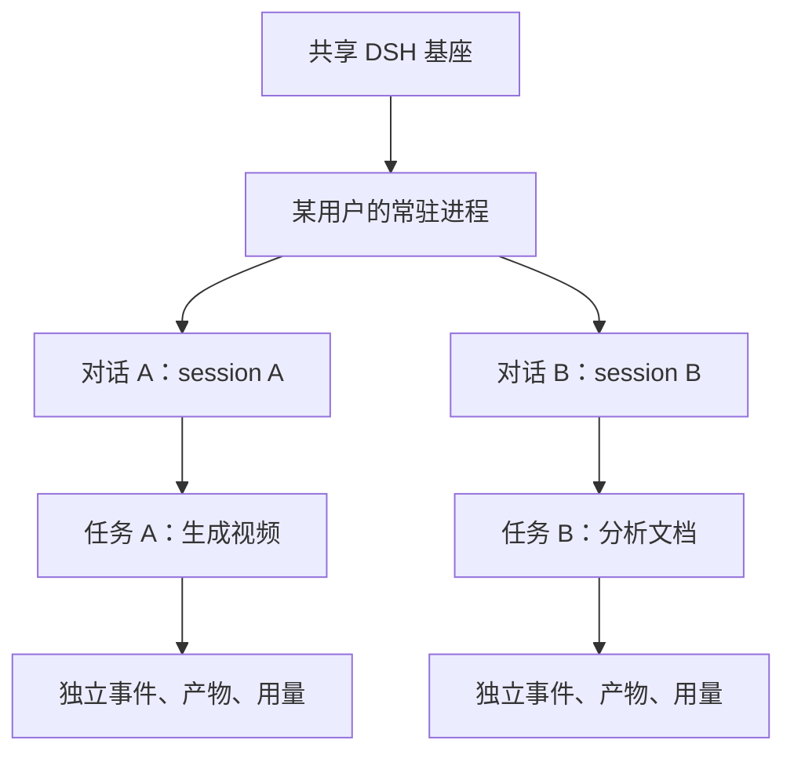

# DSH 多 Session 并发与 PT 模型目录自动维护

日期：2026-10-15。性质：讨论稿，记录方案与调研结论，不代表已经实现或通过真实模型验收。

**可以优先采用“一个 DSH 进程并发多个 session”；模型能力目录也可以每天自动同步、用规则打标签，不必调用大模型。** 两件事都有可行路径，但需要分别处理并发状态隔离，以及“模型存在、具备能力、项目已适配”之间的区别。

## 1. DSH 同进程并发多个 Session

**源码层面具备基础，值得采用这条路线。** 调研检查了项目锁定的 `0.1.1-rc.2` 官方包，而不只是最新文档。

| 源码证据 | 说明 |
|---|---|
| Agent Registry 保存多个 Agent 实例 | 一个运行进程可以管理多个 Agent |
| 每个 Agent 独立持有 session、inbox、运行阶段 | 对话历史与待执行消息不是全局共用 |
| 每个 Agent 有独立 `AbortController` | 取消机制按 Agent 管理 |
| `whenIdle()` 等待该 Agent 的执行状态 | 不要求整个进程空闲 |
| Agent 有独立作用域 | 工具、提示与监听器可以按 Agent 注册 |

依据：[锁定版本 Agent 包](https://registry.npmjs.org/@deepseek-ai/dsh-agent/-/dsh-agent-0.1.1-rc.2.tgz)、[Agent Loop 包](https://registry.npmjs.org/@deepseek-ai/dsh-agent-loop/-/dsh-agent-loop-0.1.1-rc.2.tgz)。**这证明 SDK 的结构支持这条路线，尚不等于北极星的完整并发链路已通过实测。**

### 推荐如何用于北极星

| 范围 | 判断 |
|---|---|
| **同一用户的多个对话，在其现有 DSH 进程内并发** | 推荐一期采用；用户 Key 与 workspace 相同，改造相对可控 |
| **所有用户的所有对话，共用唯一一个 OS 进程** | 技术上可继续研究，但还涉及跨用户凭据、文件权限与故障影响范围，改造明显更大 |

调研时的代码虽然共享同一套 DSH 基座，实际仍按租户启动常驻进程。**建议保留共享基座，在现有进程内实现多个对话并发；这已经能够解决“生成视频时，另一个对话不能工作”的问题。**

### 项目需要改哪些地方

| 改造 | 原因 |
|---|---|
| 用户锁改为对话锁＋用户并发额度 | 同一对话顺序执行，不同对话允许同时运行 |
| 全局命令队列改为按 session 排队 | 现在所有 task 都串在同一个 Promise 队列上 |
| 报告、媒体结果、模型信息改为任务局部状态 | 当前存在 `lastReport` 等共享变量，并发后可能串结果 |
| 事件统一携带 sessionId／runId | 流式文字、工具结果、错误与用量必须回到正确任务 |
| 完整保存 Agent 生命周期句柄 | 关闭对话时真正释放 Agent，而不只是从自己的 Map 删除 |
| 重做停止与超时收敛 | 不能一个 session 超时，就按现有兜底杀掉整个进程 |
| 限制并发和共享文件写入 | 防止资源耗尽、同一文件被两段对话同时覆盖 |

**第一，不能用 `process.chdir()` 随任务切目录。** 它影响整个进程，应通过 session 的 workspace 元数据和每次工具执行的目录参数传递。官方文件后端也明确：`cwd` 是路径解析默认值，不是文件访问限制，权限约束仍需单独实施。[锁定版本文件后端](https://registry.npmjs.org/@deepseek-ai/dsh-fs-local/-/dsh-fs-local-0.1.1-rc.2.tgz)

**第二，跨用户共用进程时不能轮流改环境变量注入 Key。** 当前 Key 在启动进程时注入环境；若多个用户共享该进程，必须改为按可信任务上下文解析凭据。否则存在串 Key、串费用风险。同一用户多个 session 并发则没有这项跨用户凭据改造。

**工作量：同用户、同进程多 session 并发，建议按 6–10 人日估算，包含技术验证、改造和定向验收；任务持久化与重连仍复用此前方案的任务包。** 共享进程崩溃会影响其中所有 session，这个故障范围无法靠 session 隔离消除，需要中断记录与恢复机制。

正式开发前应验证：两个任务实际重叠运行；停止 A 不影响 B；事件与产物不串；连续创建与关闭 session 不持续泄漏资源。

## 2. 每日自动维护 PT 模型能力目录

**每天同步并维护模型目录可行，而且适合作为 AUTO 的基础。** 建议将“已有的不变”调整为：**已有模型身份与本地配置保留，上游变化仍同步更新。** 否则模型改端点、能力或限制后，本地会一直使用旧信息。

### 同步规则

| 每日同步结果 | 本地处理 |
|---|---|
| 已有且仍存在 | 更新最后发现时间；元数据有变化才更新，保留本地策略 |
| 新发现 | 新增模型，解析能力标签，匹配已有接口适配器 |
| 完整列表中不再存在 | 标记“上游列表不可见”，暂停新 AUTO 路由，保留历史记录 |
| 后续重新出现 | 恢复目录状态；是否进入 AUTO 取决于适配与验证状态 |
| 请求超时、401、限流、返回异常或分页不完整 | 标记本次同步失败，保留上次有效目录，**不批量下架模型** |

**某个 Key 看不到模型，不一定代表 PT 全站下架了它。** 平台目录、该用户 Key 的访问权限和实时请求健康度，应分别记录。

### 资源开销

**每天拉一次目录的资源开销很小。** 一个全局同步任务每天运行，模型信息供所有用户共用；只有涉及个人 Key 权限时，才单独缓存用户可见范围。

主要开销是普通 HTTP 请求、JSON 解析和少量数据库更新。**不调用生成模型，就不会产生这一环节的推理 Token 消耗**；目录接口自身是否限流或收费，仍以 PT 规则为准。

需要避免：每位用户登录都重新拉完整目录；每天对全部模型实际生成一次图片、视频来测试；每次同步都重新读取全部文档和重写全部记录。

建议采用**每日列表同步＋新增／变更项增量解析＋失败重试退避**。付费验证仅在新增模型、重要变更或故障诊断时进行，不每天全量试跑。

### 不调用大模型打标签

**可以优先用确定性规则。** 数据来源按以下顺序使用：

1. PT 官方结构化能力字段。
2. 官方模型配置或模型详情接口。
3. 官方 OpenAPI 定义与模型说明。
4. 项目维护的少量规则和人工覆盖项。

PT 官方目录已有 Chat、图生图、图生视频等类型，官方文档也按模型提供接口定义，可作为解析来源。[模型目录](https://powertokens.ai/models)、[官方接口索引](https://docs.powertokens.ai/llms.txt)

**本轮调研没有拿到经鉴权的 `/v1/models` 完整响应，尚不能确认它是否包含足够的能力字段。** 如果只返回模型 ID，就无法仅靠这一接口自动补全所有能力，需要结合官方模型元数据。

### 多模态怎样分类

**接口类型与模型能力是两个维度。** `/chat/completions` 说明调用协议，不能证明模型只接受文字，也不能证明它支持图片。

建议不用一个笼统的“多模态”标签，而是拆开：

| 维度 | 示例 |
|---|---|
| 输入 | 文本、图片、音频、视频 |
| 输出 | 文本、图片、音频、视频 |
| 任务 | 对话、视觉理解、转录、文生图、图生图、文生视频等 |
| Agent 特性 | 工具调用、流式、结构化输出 |
| 限制 | 上下文、参考图数量、视频时长、分辨率、文件大小 |
| 接口适配 | 协议、端点、参数映射、异步查询／取消方式 |

| 模型类型 | 输入→输出 | 能做什么 |
|---|---|---|
| 纯文本对话 | 文本→文本 | 问答、分析 |
| 视觉理解 | 文本＋图片→文本 | 看图、OCR、解释图表 |
| 图片生成 | 文本→图片 | 生图 |
| 图片编辑 | 文本＋图片→图片 | 修改参考图 |
| 视频理解 | 文本＋视频→文本 | 理解视频内容 |
| 图生视频 | 文本＋图片→视频 | 让参考图生成动态片段 |

“支持图片输入”还不够：**它可能用图片生成文字，也可能生成另一张图片或视频。** 每个能力使用**支持／不支持／未知**三种状态，并保存来源和更新时间。官方信息没有说明时填“未知”，不能凭模型名称补成“支持”。

### 自动新增之后能否直接使用

| 状态 | 含义 |
|---|---|
| 已发现 | PT 列表里有这个模型 |
| 已适配 | 项目知道如何正确调用其接口 |
| AUTO 可用 | 所需能力有依据、适配完成且满足路由条件 |

**自动维护目录可以做到；任意新模型自动可用，取决于接口是否兼容。** 新 chat 模型若沿用已支持协议，通常容易接入；新视频模型若采用不同提交、查询和取消接口，仍需要新增适配器。自动打标签不会自动生成可靠的接口适配。

能力标签也不能直接产生“质量最好、速度最快”的排名；这些需要运行数据或代表任务评测。可以先用规则选满足需求的稳定模型，再逐步根据真实成功率、延迟和费用优化 AUTO。

## 3. 实施范围与完成条件

可以承担这些任务的方案、代码实现、架构收口、测试与验收证据整理，并按模块推进到可交付状态。讨论确定后，可以继续完成同进程多 session、模型目录与 AUTO、多媒体、文档问答、产物管理、用户系统和日志用量等工作。

| 真实依赖 | 影响 |
|---|---|
| 可用于验收的 PT Key、额度与权限 | 才能证明真实模型、并发、取消、用量链路可用 |
| PT 实际能力元数据及可调用端点 | 决定目录自动化程度，以及音视频理解的接入方式 |
| 明确的一期文件与媒体限制 | 才能形成可测的交付范围和稳定的工期 |

完成项目侧实现时，需要明确暴露供应商不支持或协议不兼容的地方；不能用 mock 通过替代真实验收。

**建议先确定两条：并发采用“现有用户进程内多 session”；模型目录采用“每日同步、规则打标签、按适配状态开放 AUTO”。** 当前仍为讨论与只读调研结论，未开始上述功能开发。
