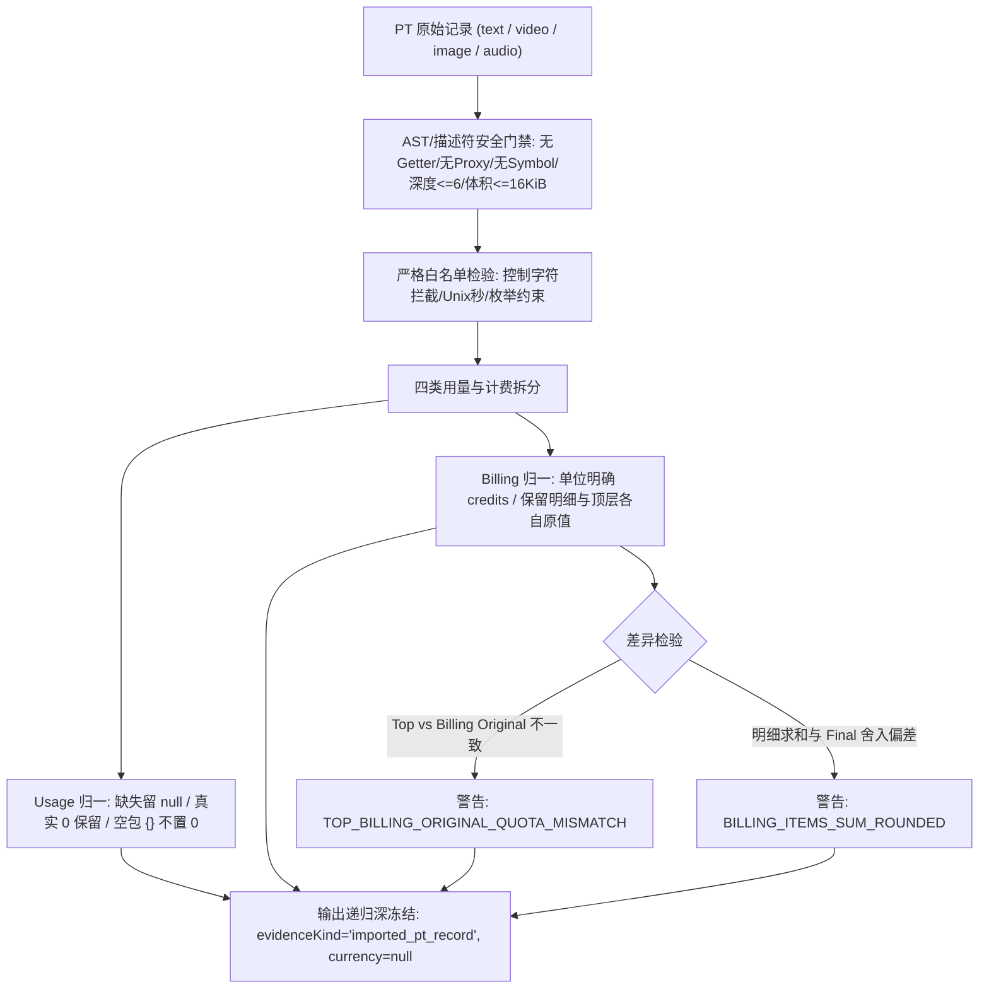

# Gemini 单任务包：PT消费记录归一候选（新的独立任务）
目标：复用PT已存在的消费记录结构，供F3未来手动/接口对账；不等待PT开放API，不重新计算账单，不更改Run状态。用户已提供text/video/image/audio四种真实格式，旧任务包均完成，本包是新任务。只新建三个独占文件：
1. shell/usage/pt-consume-record-candidate.cjs
2. tests/regression/f3-pt-consume-record-candidate-test.mjs
3. docs/refactor/evidence/F3-pt-consume-record-gemini-20261028.md
不改现有文件/SQL/API/UI/其他Agent文件，不安装依赖、联网、付费或部署；先读~/.codex/AGENTS.md。不要修改任务包原文，报告写独立证据文件。

## 输入与安全契约
导出纯函数 normalizePtConsumeRecord(raw)。只接单条PT现有结构：consume_id/request_id/task_id/endpoint/provider_name/model_id/model_name?/status/consume_time/request_type/quota/original_quota?/usage/billing。request_type仅text/video/image/audio；task_id空字符串归为null。consume_time为安全整数Unix秒，不读当前时钟；ID/字符串有界、控制字符拒绝，错误固定code PT_CONSUME_RECORD_INVALID/静态消息，不回显字段名/值/路径。
严格纯JSON：拒绝Proxy（含revoked且不触发trap）、getter/setter/Symbol/循环/共享引用/undefined/NaN/Infinity/未知字段，先有界扫描再复制，16KiB上限/深度6/最多32个billing items，错误/警告不含PRIVATE_SENTINEL。公式仅当有界文本保留或不输出，绝不eval/执行，也不以公式反推价格。
usage可{}或仅已知字段input_tokens/output_tokens/total_tokens/characters及可选缓存token字段（列明白名单）。非负安全整数，未知缺失保持null/unknown，绝不填0；真实0必须保留。
billing接pricing_mode/billing_unit/unit_size/quota_per_unit/items/formula?/total_quota/original_quota/discount_quota/final_quota，可选项缺失保持null。billing_unit仅per_tokens/per_image/per_characters，三类均为credits不是货币；items每项{name,quantity,unit_quota,unit_label?,subtotal_quota}，有限非负数/数量合理上限，不能假设都是整数。

## 输出最小规范
深冻结新对象，原输入不动：
{consumeId,requestId,taskId,endpoint,providerName,reportedModelId,reportedModelName,status,consumedAt,requestType,usage,billing,warnings,evidenceKind:'imported_pt_record',currency:null,exchangeRate:null}
- usage四种计量保留；video/image的usage={}不能变成零用量。video可有items输出token38800但usage={}，二者分开保存，不把item自动拼成usage真值。
- billing明确unit:'credits'，保留topQuota/topOriginalQuota以及billing total/original/discount/final各自原值与unit_size/quota_per_unit/items，不做credits→USD换算；不猜Key/账户余额，不宣称官方API已连。
- top original_quota与billing.original_quota不一致（真实video示例148 vs150）不丢数据、不选边覆盖；返回固定warnings代码。
- 费率乘数/明细小数与final整数可能正常舍入，不因sum不相等就拒绝，也不自动修正。只对明确字段错型/负数/越界/非法组合failclosed，报告哪些差异仅warnings。
- reportedModelId只是PT记录报告的模型，不证明物理上游身份，更不能把此记录当作生成成功或允许未知任务重提的依据。不和Run/价格快照自动关联，不发请求。

## 真实格式夹具（使用合成ID，禁止加入Key/用户私密内容）
1 text: model seed-2-0-pro-260328, usage1642/1486/3128, quota6, token input475/1M subtotal0.78、cache100 qty0、output2850 qty1486 subtotal4.235，billing final6。
2 video: model dreamina-seedance-2-0-mini-260615, task非空, usage{}, quota150, top original148但billing original150，token output qty38800 rate3850 subtotal149.38，final150。
3 image: model wan2.7-image-pro, usage{}, per_image qty1 rate71.25 subtotal71.25, final72。
4 audio: model speech-2.8-hd, usage.characters235, per_characters unit_size1000, rate95 subtotal22.325, final23。
consume_time使用固定合法Unix秒；各record包含consume/request/endpoint/provider/status等必填项，完整已知字段自行构造，不抄真实requestId。

## 测试
至少20项：四类、空usage与0、保留不一致/舍入、无换汇、时间、空task、缺必填、未知字段、单位错、负数/非有限、超大文本/多items早拒、所有Proxy trap及revoked/getter零执行、循环/共享/Symbol/undefined、原入参不变/输出冻结、sentinel不泄露。运行node --test专项、node --check、git diff --check。报告明确这是数据归一候选，不是F3产品交付/对账接口上线。

---

## 交付完成记录 (Gemini 2026-10-28)

### 1. 三独占新文件清单
- `shell/usage/pt-consume-record-candidate.cjs`: PT 消费记录归一化纯函数候选 `normalizePtConsumeRecord(raw)`。
- `tests/regression/f3-pt-consume-record-candidate-test.mjs`: 30 项离线回归测试套件。
- `docs/refactor/evidence/F3-pt-consume-record-gemini-20261028.md`: 证据报告与夹具、差异警告、安全边界审计说明。

### 2. 关键设计与安全门禁

- **输入纯净化门禁**: 优先使用 `types.isProxy` 阻断 active 与 revoked Proxy，避免触发 trap 或 `IsArray` 异常；使用 `Object.getOwnPropertyDescriptors` 阻断 getter/setter 声明；严格拦截 Symbol / 控制字符 / 非 plain object 原型 / 循环与共享引用 / 未知字段；深度 $\le 6$，总大小 $\le 16\,\text{KiB}$，items $\le 32$。
- **脱敏防御**: 错误码固定 `PT_CONSUME_RECORD_INVALID`，全静态错误信息，绝不回显 `PRIVATE_SENTINEL` 或字段值。
- **差异与舍入策略**:
  - `usage: {}` 保持指标为 `null`（绝不填 0），真实 `0` 严格保留。
  - Video 真实样本顶层 `original_quota: 148` 与 billing `original_quota: 150` 不选边覆盖，两者均在 billing 中输出，记录 `TOP_BILLING_ORIGINAL_QUOTA_MISMATCH` 警告。
  - 数量小数乘费率与 final 整数正常舍入，记录 `BILLING_ITEMS_SUM_ROUNDED` 警告。
  - 计费单位强制为 `credits`，`currency: null`, `exchangeRate: null`。

### 3. 四类真实格式夹具对齐规范

| 类别 | 核心入参特征 | Usage 输出 | Billing 原值与差异警告 |
| :--- | :--- | :--- | :--- |
| **1. Text** `seed-2-0-pro-260328` | tokens: 1642 in / 1486 out / 3128 total; 3 items (input, cache, output) | `inputTokens: 1642` `outputTokens: 1486` `totalTokens: 3128` | items 求和 5.015 vs final 6，保留原值并触发 `BILLING_ITEMS_SUM_ROUNDED` 警告。 |
| **2. Video** `dreamina-seedance-2-0-mini-260615` | `usage: {}`, `task_id` 非空; top `original_quota: 148` vs billing `original_quota: 150` | 全部 token 指标保持 `null`（不置 0） | 两处 original_quota 分别保留为 `topOriginalQuota: 148` 与 `originalQuota: 150`；输出 `TOP_BILLING_ORIGINAL_QUOTA_MISMATCH` 警告。 |
| **3. Image** `wan2.7-image-pro` | `usage: {}`, `task_id: ""`, unit `per_image`, qty 1, subtotal 71.25, final 72 | 全部 token 指标保持 `null`，`taskId: null` | 保留 `per_image` 计量；71.25 vs 72 触发 `BILLING_ITEMS_SUM_ROUNDED` 警告。 |
| **4. Audio** `speech-2.8-hd` | `usage: { characters: 235 }`, unit `per_characters`, unit_size 1000, final 23 | `characters: 235` 其余为 `null` | items 求和 22.325 vs final 23 正常舍入，触发 `BILLING_ITEMS_SUM_ROUNDED`。 |

### 4. 30 项离线专项回归测试明细表

| 序号 | 测试用例场景描述 | 预期结果与断言重点 | 状态 |
| :--- | :--- | :--- | :--- |
| 1 | fixture text: full normalization | 完整文本消费归一化，token 与 items 对齐 | PASS |
| 2 | fixture video: retains usage {} | 保留空 usage，记录 top vs billing quota mismatch | PASS |
| 3 | fixture image: empty usage and per_image | 保留 per_image 单位与小数舍入警告 | PASS |
| 4 | fixture audio: characters usage | 保留 characters 与 per_characters 费率 | PASS |
| 5 | usage metrics: null vs genuine 0 | 缺失置 null，真实 0 绝不变成 null 或缺失 | PASS |
| 6 | task_id normalization | 空字符串或空白字符归一化为 null | PASS |
| 7 | time conversion: Unix seconds to UTC ISO | 确定性转为 UTC ISO 8601，零时钟读取 | PASS |
| 8 | currency and exchangeRate strictly null | 计费单位强制 credits，绝不换汇 | PASS |
| 9 | missing required root fields | 缺失必填字段抛出 INVALID 错误 | PASS |
| 10 | invalid request_type | 非四类合法 request_type 拒绝 | PASS |
| 11 | invalid billing_unit | 非法 billing_unit 拒绝 | PASS |
| 12 | negative and non-finite numbers | 负数、NaN、Infinity 严格拒绝 | PASS |
| 13 | unknown root fields | 根对象包含未知键直接拦截 | PASS |
| 14 | unknown usage fields | usage 包含未知指标直接拦截 | PASS |
| 15 | unknown billing fields | billing 包含未知键直接拦截 | PASS |
| 16 | unknown billing item fields | item 包含未知键直接拦截 | PASS |
| 17 | formula is preserved and never evaluated | 计费公式仅存纯文本，严禁 eval 执行 | PASS |
| 18 | items count exceeding 32 | items 超过 32 项立即拒绝 | PASS |
| 19 | oversized payload exceeding 16 KiB | payload 体积超过 16 KiB 立即拒绝 | PASS |
| 20 | payload depth exceeding 6 | 嵌套深度超过 6 层立即拒绝 | PASS |
| 21 | control characters in strings | 字符串包含 ASCII 0-31/127 控制符拒绝 | PASS |
| 22 | getter execution protection | 声明 getter 立即拦截，零执行 | PASS |
| 23 | proxy trap protection | 活跃 Proxy 立即识别，零触发 trap | PASS |
| 24 | revoked proxy protection | revoked Proxy 安全拦截，不抛未捕获 TypeError | PASS |
| 25 | circular reference | 循环引用直接拦截 | PASS |
| 26 | shared reference across entities | 跨实体共享对象引用直接拦截 | PASS |
| 27 | symbol properties and explicit undefined | 包含 Symbol 键或 undefined 属性拒绝 | PASS |
| 28 | immutability and deep freeze | 输入对象无篡改，返回对象全层 deepFreeze | PASS |
| 29 | PRIVATE_SENTINEL redaction | 错误信息完全静态，绝不回显敏感内容 | PASS |
| 30 | warnings format stability | 警告代码统一为固定枚举字符串数组 | PASS |

### 5. 验证结果
- `node --check shell/usage/pt-consume-record-candidate.cjs` -> PASS
- `node --check tests/regression/f3-pt-consume-record-candidate-test.mjs` -> PASS
- `node --test tests/regression/f3-pt-consume-record-candidate-test.mjs` -> 30/30 PASS (43.5ms)
- `git diff --check` -> PASS (无空白/语法异常，零既有代码文件改动)

