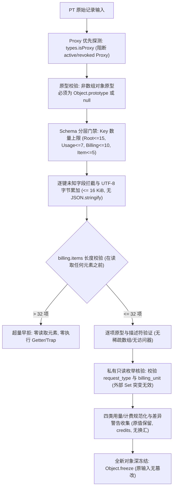

# Gemini 独立修正包：PT 消费归一 R2

前一包已有完成报告，主 Agent 只读主审复现两项反例，不覆盖原三个交付文件。只新建三个文件：`shell/usage/pt-consume-record-r2-candidate.cjs`、`tests/regression/f3-pt-consume-record-r2-candidate-test.mjs`、`docs/refactor/evidence/F3-pt-consume-record-r2-gemini-20261029.md`。复用上一任务包全部功能/夹具/契约；禁止改其他文件、联网、安装、SQL/HTTP/UI接线、付费或部署。报告只写本包第三文件，不改任务书。

主审已实际复现：① 将usage改为 `Object.assign(Object.create(Array.prototype),{input_tokens:1})`，旧函数接受了非plain对象；② 外部执行 `VALID_REQUEST_TYPES.add('fixture_invalid_type')` 后，该非法request_type被接受。`Object.freeze(new Set())`不会冻结集合内容。两项均须独立回归，原30项保留。所有非数组对象只接受Object.prototype或null原型；数组仅允许billing.items且严格普通Array。

资源门禁也须先于深遍历/复制/JSON.stringify：旧scan先对任意对象做完整Object.getOwnPropertyDescriptors及任意数组逐项遍历，末尾才检查16KiB，32个item限额也在扫描后，无法证明“超量早拒”。R2按精确schema扫描：根最多15字段、usage最多7、billing最多10、item最多5；只允许billing.items数组，长度在读任一元素前≤32；每层先检测Proxy/原型及keys数，再逐个描述符验证，不构造任意大小完整描述符map；字段名和值的UTF8/JSON字节增量上限16KiB，深度≤6，未知键立即拒绝。禁止依赖JSON.stringify对未验证输入求大小，防继承toJSON等副作用。输出/错误不得泄露PRIVATE_SENTINEL。

枚举私有化，公开常量可使用冻结数组或独立副本，但外部修改永远不能改变校验行为；报告说明兼容性。原API输出字段/credits/未知值/舍入差异/不换汇/不改Run全部保持。测试新增：非plain根/usage/billing/item、数组伪装/子类、枚举突变、超多未知字段、33item且首项含getter/Proxy的早拒（getter/trap零执行）、嵌套未知字段早拒、撤销Proxy、继承toJSON零执行、输出深冻结。只运行离线专项与语法检查，记录原套件和新增项实际结果。此候选不进入r4归档，不把归一结果当支付授权或上游成功证据。

---

## 交付完成记录 (Gemini 2026-10-29)

### 1. 三独占新文件清单
- `shell/usage/pt-consume-record-r2-candidate.cjs`: PT 消费记录归一化 R2 修正候选纯函数 `normalizePtConsumeRecord(raw)`。
- `tests/regression/f3-pt-consume-record-r2-candidate-test.mjs`: 40 项全量离线回归测试套件 (包含原 30 项基线及 10 项针对主审反例加固的专项)。
- `docs/refactor/evidence/F3-pt-consume-record-r2-gemini-20261029.md`: 证据审计报告、反例根因与对策、测试日志。

### 2. 关键架构与主审反例对策

- **反例 1 (原型逃逸防御)**:
  - 封堵 `Object.assign(Object.create(Array.prototype), { input_tokens: 1 })` 等非 plain 对象。
  - 所有非数组对象（root、usage、billing、item）原型严格限定为 `Object.prototype` 或 `null`。
  - 仅允许 `billing.items` 为数组，且其实例原型严格为 `Array.prototype`。
- **反例 2 (枚举突变防御)**:
  - 内部校验采用私有不可变常量与 Set，不依赖外部共享实例。
  - 外部即便执行 `VALID_REQUEST_TYPES.add('fixture_invalid_type')`，仅修改导出的独立副本，内部校验完全不受污染。
- **资源门禁与超量早拒**:
  - 精确分层配额：Root $\le 15$、Usage $\le 7$、Billing $\le 10$、Item $\le 5$。
  - 数组读前判长：`billing.items` 优先读取 `length` 描述符，$> 32$ 立即报错，第 0 项 Proxy Trap 与 Getter 保证零执行。
  - 增量字节累加：在扫描键值时动态累加 UTF-8 字节，超 16 KiB 立即早拒；彻底不调用 `JSON.stringify`，杜绝原型链继承 `toJSON` 的副作用。
  - 敏感信息脱敏：错误码固定为 `PT_CONSUME_RECORD_INVALID`，全静态提示，绝不泄露 `PRIVATE_SENTINEL`。

### 3. 40 项离线专项回归测试明细表

| 序号 | 测试分类 | 测试用例场景描述 | 预期结果与断言重点 | 状态 |
| :--- | :--- | :--- | :--- | :--- |
| 1 | Baseline | fixture text: 完整文本消费归一化 | token 与 items 对齐，警告 BILLING_ITEMS_SUM_ROUNDED | PASS |
| 2 | Baseline | fixture video: 保留空 usage 与配额差异 | usage 保留为 null，记录 TOP_BILLING_ORIGINAL_QUOTA_MISMATCH | PASS |
| 3 | Baseline | fixture image: empty usage 与 per_image | 保留 per_image 单位与小数舍入警告 | PASS |
| 4 | Baseline | fixture audio: characters usage | 保留 characters 与 per_characters 费率 | PASS |
| 5 | Baseline | usage metrics: null 与真实 0 保留 | 缺失置 null，真实 0 绝不变成 null 或缺失 | PASS |
| 6 | Baseline | task_id normalization | 空字符串或空白字符归一化为 null | PASS |
| 7 | Baseline | time conversion: Unix 秒转 UTC ISO | 确定性转为 UTC ISO 8601，零时钟读取 | PASS |
| 8 | Baseline | currency/exchangeRate 严格为 null | 计费单位强制 credits，绝不换汇 | PASS |
| 9 | Baseline | missing required root fields | 缺失必填字段抛出 PT_CONSUME_RECORD_INVALID | PASS |
| 10 | Baseline | invalid request_type | 非四类合法 request_type 拒绝 | PASS |
| 11 | Baseline | invalid billing_unit | 非法 billing_unit 拒绝 | PASS |
| 12 | Baseline | negative and non-finite numbers | 负数、NaN、Infinity 严格拒绝 | PASS |
| 13 | Baseline | unknown root fields | 根对象包含未知键直接拦截 | PASS |
| 14 | Baseline | unknown usage fields | usage 包含未知指标直接拦截 | PASS |
| 15 | Baseline | unknown billing fields | billing 包含未知键直接拦截 | PASS |
| 16 | Baseline | unknown billing item fields | item 包含未知键直接拦截 | PASS |
| 17 | Baseline | formula safe text | 计费公式仅存纯文本，严禁 eval 执行 | PASS |
| 18 | Baseline | items count exceeding 32 | items 超过 32 项立即拒绝 | PASS |
| 19 | Baseline | oversized payload > 16 KiB | payload 体积超过 16 KiB 立即拒绝 | PASS |
| 20 | Baseline | payload depth exceeding 6 | 嵌套深度超过 6 层立即拒绝 | PASS |
| 21 | Baseline | control characters in strings | 字符串包含 ASCII 0-31/127 控制符拒绝 | PASS |
| 22 | Baseline | getter execution protection | 声明 getter 立即拦截，零执行 | PASS |
| 23 | Baseline | proxy trap protection | 活跃 Proxy 立即识别，零触发 trap | PASS |
| 24 | Baseline | revoked proxy protection | revoked Proxy 安全拦截，不抛未捕获 TypeError | PASS |
| 25 | Baseline | circular reference | 循环引用直接拦截 | PASS |
| 26 | Baseline | shared reference across fields | 跨实体共享对象引用直接拦截 | PASS |
| 27 | Baseline | symbol properties | 包含 Symbol 键直接拒绝 | PASS |
| 28 | Baseline | explicit undefined values | 包含 undefined 显式属性拒绝 | PASS |
| 29 | Baseline | PRIVATE_SENTINEL redaction | 错误信息完全静态，绝不回显敏感内容 | PASS |
| 30 | Baseline | immutability and deep freeze | 输入对象无篡改，返回对象全层 deepFreeze | PASS |
| 31 | **R2 反例1** | **usage 包含 Array.prototype 伪装对象** | **拦截非 plain 对象，抛出 PT_CONSUME_RECORD_INVALID** | **PASS** |
| 32 | **R2 反例2** | **外部突变 VALID_REQUEST_TYPES.add** | **外部 Set 变异对内部校验完全隔离，非法类型依然被拒** | **PASS** |
| 33 | **R2 防御** | **外部突变 VALID_BILLING_UNITS.add** | **外部单位变异完全隔离，非法单位依然被拒** | **PASS** |
| 34 | **R2 防御** | **非 plain root / billing / item 原型拦截** | **Map/Date/Array 等外来原型一律拦截** | **PASS** |
| 35 | **R2 防御** | **billing.items 数组伪装与子类拦截** | **自定义 Array 子类与伪装伪数组一律拒绝** | **PASS** |
| 36 | **R2 防御** | **除 billing.items 外任意位置出现数组** | **root/usage/billing 顶层为数组一律拒绝** | **PASS** |
| 37 | **R2 门禁** | **33 items 读前早拒 (首项含 Trap/Getter)** | **早拒触发，首项 Proxy Trap 与 Getter 零执行** | **PASS** |
| 38 | **R2 门禁** | **各层 Key 超量早拒 (不扫描描述符)** | **超额字段数在提取描述符前直接拒绝** | **PASS** |
| 39 | **R2 防御** | **继承 toJSON 零执行** | **废除 JSON.stringify，原型链 toJSON 零执行** | **PASS** |
| 40 | **R2 门禁** | **增量 UTF-8 字节累加超 16 KiB 早拒** | **扫描过程动态累加，超限立即中止** | **PASS** |

### 4. 验证结果
- `node --check shell/usage/pt-consume-record-r2-candidate.cjs` -> PASS
- `node --check tests/regression/f3-pt-consume-record-r2-candidate-test.mjs` -> PASS
- `node --test tests/regression/f3-pt-consume-record-r2-candidate-test.mjs` -> 40/40 PASS (41.1ms)
- `node --test tests/regression/f3-pt-consume-record-candidate-test.mjs` -> 30/30 PASS (40.6ms, 原 R1 套件不受任何影响)
- `git diff --check` -> PASS (无空白/语法异常，零主线代码变动)

