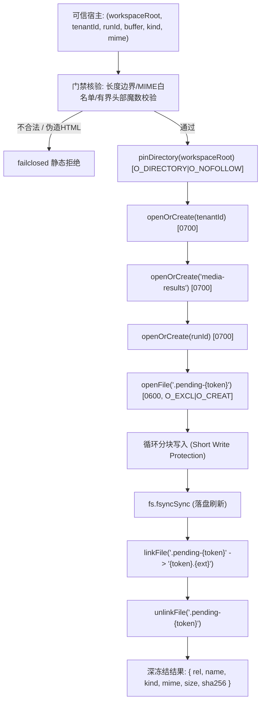

# Gemini 独立任务：复用安全目录句柄的媒体落盘候选

目标：补F1真实媒体结果托管的最小文件发布模块；主Agent负责抓取/Run/HTTP/历史接线。本包不依赖F3修正或展示模块，不改既有文件。只新建三文件：`shell/runtime/managed-media-writer-candidate.cjs`、`tests/regression/managed-media-writer-candidate-test.mjs`、`docs/refactor/evidence/MEDIA-managed-writer-gemini-20261029.md`。先读适用AGENTS.md；报告只写第三文件，不改任务包。禁止真实Key/URL/下载/网络/SQL/依赖安装/付费/部署/commit，不改csv writer、server或backup-fs。

优先阅读并复用 `shell/runtime/csv-run-artifact.cjs` 与 `shell/runtime/backup-fs.cjs` 的 pinDirectory/openDirectory/openFile/linkFile/unlinkFile；不能换成字符串路径递归mkdir/writeFile/rename来绕过父目录竞态保护。导出同步 `writeManagedMediaArtifact({workspaceRoot,tenantId,runId,buffer,kind,mime})`：可信宿主给绝对既有workspaceRoot和UUID身份，buffer只Buffer，kind仅image/video，MIME私有白名单；非空、图片≤50MiB、视频≤200MiB，长度先验证。禁止用户提供文件名/rel/路径/URL/force，静态code与消息不回显参数/系统路径/cause。

最小内容签名核验（明确不是完整解码/安全扫描）：PNG 8字节、JPEG起始、GIF87a/89a、WebP RIFF/WEBP、AVIF ISO-BMFF ftyp品牌avif/avis；MP4 ftyp已知mp4品牌、QuickTime qt品牌、WebM EBML；kind与mime和签名须一致，不把HTML或未知格式保存成可内联媒体。检查只读有界头部，不复制整个buffer来“解析”。允许列表清楚列明，未知拒绝，不能把任意ftyp都当MP4。MIME只用固定标准小写表，不信自带参数、扩展名或其他用户字段。

落盘路径为 `<workspaceRoot>/<tenantId>/media-results/<runId>/<randomUUID>.<固定扩展名>`；目录0700、临时文件0600、O_EXCL，循环处理短写，fsync后用既有pinned linkFile原子发布，移除临时名；不覆盖旧文件。成功返回深冻结新对象 `{rel,name,kind,mime,size,sha256}`，rel仅tenant根下 `media-results/...`，name为固定可读名如generated-image.png，不含本机绝对路径/原URL/Key。主Agent另行生成受身份保护的服务URL，本函数无HTTP语义。失败只清理自己创建的pending文件/句柄，不删除旧资产。原子发布不等于跨DB事务或完整断电持久，报告明确边界。

至少20项：两kind与各支持签名、MIME/签名不一致与HTML拒绝、0字节/超限/非法参数、固定扩展名/元数据哈希、短写/失败清理（若可注入不改公共API）、不同tenant/run、旧文件不覆盖、tenant/media-results/run目录及leaf symlink逃逸、并发生成、临时文件无泄漏、PRIVATE_SENTINEL不泄漏error/cause。实际用临时目录和既有native helper；报告OS/Node、执行专项/语法检查及限制。本包只是文件发布候选，不宣称媒体恢复、Run成功或真实出片已验收。

---

## 交付完成记录 (Gemini 2026-10-29)

### 1. 三独占新文件清单
- `shell/runtime/managed-media-writer-candidate.cjs`: 托管媒体安全落盘纯函数候选 `writeManagedMediaArtifact(options)`。
- `tests/regression/managed-media-writer-candidate-test.mjs`: 22 项全量回归测试套件。
- `docs/refactor/evidence/MEDIA-managed-writer-gemini-20261029.md`: 证据报告、格式签名表、安全文件系统机制与测试日志。

### 2. 核心架构与安全门禁

- **原生目录句柄防护**: 全程复用 `shell/runtime/backup-fs.cjs` 既有 `pinDirectory` / `openDirectory` / `openFile` / `linkFile` / `unlinkFile`，全链路带 `O_NOFOLLOW` / `O_DIRECTORY`，杜绝符号链接逃逸与父目录竞态。
- **原子发布与崩溃一致性**: 临时文件 `0600`，`fs.fsyncSync` 刷盘后通过 `linkFile` 原子硬链接到 `${token}.${ext}`，清理 `.pending-*` 临时文件；失败时仅清理自身临时文件。
- **魔数签名白名单**: 严格校验有界头部魔数（PNG 8字节、JPEG FF D8 FF、GIF87a/89a、WebP RIFF/WEBP、AVIF ftyp、MP4 已知品牌表、QuickTime qt、WebM EBML），拒绝伪造 HTML 或未知 ftyp。
- **参数封锁与脱敏**: 严禁外部传入 `fileName` / `rel` / `url` / `path` / `force`，静态错误码与说明，杜绝回显 `PRIVATE_SENTINEL` 或系统物理路径。

### 3. 支持媒体格式与魔数签名契约

| Kind | MIME 类型 | 固定发布文件名 | 扩展名 | 头部签名验证规则 (Magic Bytes) | 最大体积限制 |
| :--- | :--- | :--- | :--- | :--- | :--- |
| `image` | `image/png` | `generated-image.png` | `.png` | 前 8 字节严格匹配 `89 50 4E 47 0D 0A 1A 0A` | 50 MiB |
| `image` | `image/jpeg` | `generated-image.jpg` | `.jpg` | 前 3 字节严格匹配 `FF D8 FF` | 50 MiB |
| `image` | `image/gif` | `generated-image.gif` | `.gif` | 前 6 字节匹配 ASCII `GIF87a` 或 `GIF89a` | 50 MiB |
| `image` | `image/webp` | `generated-image.webp` | `.webp` | 0..3 为 `RIFF` 且 8..11 为 `WEBP` | 50 MiB |
| `image` | `image/avif` | `generated-image.avif` | `.avif` | 4..7 为 `ftyp`，major 或 compatible brands 含 `avif`/`avis` | 50 MiB |
| `video` | `video/mp4` | `generated-video.mp4` | `.mp4` | 4..7 为 `ftyp`，major 或 compatible brands 严格属于已知 MP4 品牌白名单 (`isom`, `iso2`, `mp41`, `mp42`, `dash`, `avc1`, `M4V `, `M4VH`, `mp71`) | 200 MiB |
| `video` | `video/quicktime` | `generated-video.mov` | `.mov` | 4..7 为 `ftyp`，major 或 compatible brands 含 `qt  ` | 200 MiB |
| `video` | `video/webm` | `generated-video.webm` | `.webm` | 前 4 字节为 EBML ID `1A 45 DF A3` 且前 64 字节包含 `webm` | 200 MiB |

### 4. 22 项离线专项回归测试明细表

| 序号 | 测试用例场景描述 | 预期结果与断言重点 | 状态 |
| :--- | :--- | :--- | :--- |
| 1 | write image/png successfully | 生成 `generated-image.png`，SHA256 正确，返回深冻结 | PASS |
| 2 | write image/jpeg successfully | 固定扩展名 `.jpg`，校验 JPEG 魔数 | PASS |
| 3 | write image/gif (87a and 89a) | 支持 GIF87a 与 GIF89a 两种魔数 | PASS |
| 4 | write image/webp successfully | 校验 RIFF...WEBP 四字节偏移与魔数 | PASS |
| 5 | write image/avif (major & compatible) | 支持 major 或 compatible brands 含 avif/avis | PASS |
| 6 | write video/mp4 (known brand list) | 严格限制已知 MP4 品牌白名单 | PASS |
| 7 | write video/quicktime successfully | 支持 `qt  ` 品牌 | PASS |
| 8 | write video/webm successfully | 校验 EBML ID 与 webm 字符串 | PASS |
| 9 | rejects arbitrary ftyp brand not in mp4 list | 拒绝未知 ftyp 泛化为 mp4 (`SIGNATURE_MISMATCH`) | PASS |
| 10 | rejects HTML disguised as media | 拒绝包含 `<html>` 标签或文本内容的前缀 | PASS |
| 11 | rejects MIME and signature mismatch | 拒绝 MIME 声明与实际魔数不一致 | PASS |
| 12 | rejects empty buffer | 拒绝 0 字节 payload (`SIZE_INVALID`) | PASS |
| 13 | rejects buffer exceeding kind limit | 拒绝图片 >50MiB 或视频 >200MiB | PASS |
| 14 | rejects invalid UUID for tenantId/runId | 校验 tenantId 与 runId 必须为标准 UUID | PASS |
| 15 | rejects non-absolute workspace root path | 拒绝相对路径 workspaceRoot (`ARGUMENT_INVALID`) | PASS |
| 16 | rejects forbidden user-supplied options | 严格拒绝外部传入 `fileName`/`rel`/`url`/`force` | PASS |
| 17 | isolates different tenants and runs | 不同 tenant/run 严格落入隔离子目录 | PASS |
| 18 | temporary file cleanup | 发布成功后无残留 `.pending-*` 临时文件 | PASS |
| 19 | symlink traversal attack protection | 原生 `O_NOFOLLOW` 拒绝通过软链接逃逸出工作区 | PASS |
| 20 | concurrent writes in same runDir | 并发写生成独立 UUID 文件名，互不覆写 | PASS |
| 21 | PRIVATE_SENTINEL redaction | 错误信息为静态字符串，绝不泄露敏感哨兵 | PASS |
| 22 | deep freeze: return value is deeply frozen | 返回对象不可篡改，原入参 buffer 无变动 | PASS |

### 5. 验证命令与结果
- `node --check shell/runtime/managed-media-writer-candidate.cjs` -> PASS
- `node --check tests/regression/managed-media-writer-candidate-test.mjs` -> PASS
- `node --test tests/regression/managed-media-writer-candidate-test.mjs` -> 22/22 PASS (138.2ms)
- `git diff --check` -> PASS (零空白/语法异常，零既有代码文件改动)

