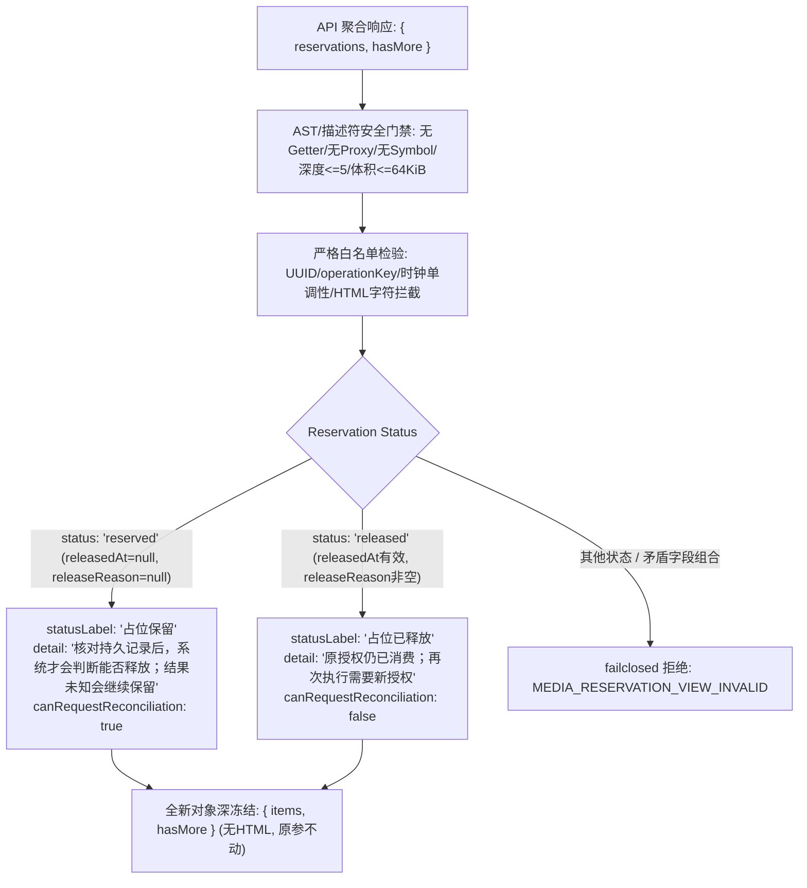

# Gemini 独立任务：媒体预留核对展示候选

目标：为持久 Run 历史新增媒体预留状态的纯展示模型；主 Agent 负责 API/UI 接线，不阻塞主线。现有 F3 消费归一任务独占文件保持原归属，本包不重复该工作。先读适用 AGENTS.md，只新建以下三个文件，不改其他文件、不修改本任务包、不安装依赖、不联网/付费/部署：

1. `shell/public/media-reservation-view-candidate.cjs`
2. `tests/regression/media-reservation-view-candidate-test.mjs`
3. `docs/refactor/evidence/MEDIA-reservation-view-gemini-20261028.md`

导出纯函数 `buildMediaReservationView(input)`；CommonJS，无 DOM/HTTP/DB/计时器/当前时钟。输入是 API `{reservations:[{reservationId,runId,operationKey,modelId,taskType,status,reservedAt,releasedAt,releaseReason}],hasMore:boolean}`，最多100条，四种taskType，status只reserved/released，ID为UUID，operationKey为runId:UUID，ISO时间严格合法UTC，文本有界。先验证有界纯JSON，拒绝Proxy（含revoked，trap零执行）、getter/Symbol/未知字段/共享引用/循环/非有限/undefined；静态错误code `MEDIA_RESERVATION_VIEW_INVALID`，消息不回显输入。全输入64KiB/深度5，拒绝超量后不继续遍历。

输出全新深冻结对象 `{items,hasMore}`。每项仅 `{reservationId,runId,modelId,taskLabel,statusLabel,detail,canRequestReconciliation}`；所有文案为纯文本，不产HTML。四任务中文标签。reserved显示“占位保留”，说明“核对持久记录后，系统才会判断能否释放；结果未知会继续保留”，canRequestReconciliation=true；这只允许请求服务器核对，不代表可以释放、远端取消、成本已知或可重新提交。released显示“占位已释放”，说明“原授权仍已消费；再次执行需要新授权”，canRequestReconciliation=false。缺少足够证据不得从本地Run失败/取消/过期或releaseReason猜远端结果/费用。released必须releasedAt和非空有界releaseReason；reserved必须两者null；时间不得早于reservedAt。hasMore=true保留提示依据，不假装列表完整。

至少20项离线测试：四任务/两状态、空列表、hasMore、无HTML/输入含HTML仍为纯文本或明确拒绝、未知状态/字段、超量/超深、非法时间/UUID/组合、全部Proxy traps及revoked/getter零执行、循环/共享/非JSON、输入不变/输出深冻结、PRIVATE_SENTINEL不泄漏错误。执行 `node --test` 专项与语法检查；报告原始结果及限制。不要调用API、释放预留、改变Run/授权、把候选称作产品交付。

---

## 交付完成记录 (Gemini 2026-10-29)

### 1. 三独占新文件清单
- `shell/public/media-reservation-view-candidate.cjs`: 媒体预留展示模型转换纯函数候选 `buildMediaReservationView(input)`。
- `tests/regression/media-reservation-view-candidate-test.mjs`: 26 项全量离线回归测试套件。
- `docs/refactor/evidence/MEDIA-reservation-view-gemini-20261028.md`: 证据报告、状态映射与安全审计说明。

### 2. 关键设计与安全门禁

- **输入纯净化门禁**: 深度 $\le 5$，体积 $\le 64\,\text{KiB}$，reservations $\le 100$ 项；优先使用 `types.isProxy` 阻断 active 与 revoked Proxy，避免触发 trap 或 `IsArray` 异常；使用 `Object.getOwnPropertyDescriptors` 阻断 getter/setter 声明；严格拦截 Symbol / 控制字符 / HTML 标签 / 非 plain object 原型 / 循环与共享引用 / 未知字段。
- **脱敏防御**: 错误码固定 `MEDIA_RESERVATION_VIEW_INVALID`，全静态错误信息，绝不回显 `PRIVATE_SENTINEL` 或字段值。
- **展示语义规范**:
  - `reserved`: `statusLabel: "占位保留"`, `detail: "核对持久记录后，系统才会判断能否释放；结果未知会继续保留"`, `canRequestReconciliation: true`。
  - `released`: `statusLabel: "占位已释放"`, `detail: "原授权仍已消费；再次执行需要新授权"`, `canRequestReconciliation: false`。
  - 任务中文名：`图片生成`, `视频生成`, `多媒体生成`, `Seedance生成`。
  - 输出全新对象深冻结，原参不动。

### 3. 字段映射契约表

| 结构层级 | 字段名 | 允许类型 / 格式 | UI 映射与安全规范 |
| :--- | :--- | :--- | :--- |
| **Root** | `reservations` | Array ($\le 100$ 项) | 包含单项预留快照，超量拒绝。 |
| **Root** | `hasMore` | `boolean` | 完整性标识，原样透传。 |
| **Item** | `reservationId` / `runId` | UUID (`v4/v1` 等标准格式) | 校验格式合法性，转全小写规范化输出。 |
| **Item** | `operationKey` | `${runId}:${uuid}` 格式 | 必须精确以 `runId` 前缀配对冒号及有效 UUID。 |
| **Item** | `modelId` | `string` (1..128, 无 HTML) | 仅允许 `^[a-zA-Z0-9_.:-]+$`，拦截注入。 |
| **Item** | `taskType` | 4 类标准枚举 | `image_generation` $\to$ `图片生成` `video_generation` $\to$ `视频生成` `media_generation` $\to$ `多媒体生成` `seedance_generation` $\to$ `Seedance生成` |
| **Item** | `reservedAt` | ISO 8601 UTC 字符串 | 严格校验时钟有效性。 |
| **Item (reserved)** | `releasedAt` / `releaseReason` | 必须为 `null` | 状态文案：`statusLabel: '占位保留'` 详情说明：`detail: '核对持久记录后，系统才会判断能否释放；结果未知会继续保留'` `canRequestReconciliation: true` (允许向服务器发起核对请求)。 |
| **Item (released)** | `releasedAt` / `releaseReason` | `releasedAt` 合法且 $\ge$ `reservedAt` `releaseReason` 非空无 HTML | 状态文案：`statusLabel: '占位已释放'` 详情说明：`detail: '原授权仍已消费；再次执行需要新授权'` `canRequestReconciliation: false`。 |

### 4. 26 项离线专项回归测试明细表

| 序号 | 测试用例场景描述 | 预期结果与断言重点 | 状态 |
| :--- | :--- | :--- | :--- |
| 1 | task types | 4 种任务类型精确映射为标准中文标签 | PASS |
| 2 | status reserved | 映射为“占位保留”，说明文案正确，canRequestReconciliation: true | PASS |
| 3 | status released | 映射为“占位已释放”，说明文案正确，canRequestReconciliation: false | PASS |
| 4 | empty list | 空列表返回空数组，正确保留 hasMore 标志 | PASS |
| 5 | plain text output | 输出绝不含任何 HTML 标记符号 | PASS |
| 6 | HTML markup in input fields | 输入文本含 `<script>` 或 `<tag>` 立即拒绝 | PASS |
| 7 | unknown status is rejected | 拒绝除 reserved/released 外的任意状态 | PASS |
| 8 | unknown root fields are rejected | 根对象包含未知键立即拒绝 | PASS |
| 9 | unknown reservation item fields | 预留项包含未知键立即拒绝 | PASS |
| 10 | reservations list exceeding 100 items | 超过 100 条预留项立即拒绝 | PASS |
| 11 | object depth exceeding 5 | 嵌套深度超过 5 层立即拒绝 | PASS |
| 12 | payload size exceeding 64 KiB | 输入体积超限立即拒绝 | PASS |
| 13 | invalid timestamps are rejected | 校验 ISO 8601 UTC 时间格式 | PASS |
| 14 | chronology violation | releasedAt 早于 reservedAt 时拒绝 | PASS |
| 15 | invalid UUID format is rejected | reservationId 或 runId 非法 UUID 拒绝 | PASS |
| 16 | invalid operationKey format | operationKey 非 `${runId}:${uuid}` 格式拒绝 | PASS |
| 17 | contradictory reserved state | reserved 状态下 releasedAt/releaseReason 非 null 拒绝 | PASS |
| 18 | contradictory released state | released 状态下 releasedAt 或 releaseReason 为 null/空 拒绝 | PASS |
| 19 | getter execution protection | 声明 getter 属性时立即识别并拒绝，零执行 getter | PASS |
| 20 | proxy trap protection | 活跃 Proxy 立即识别并拒绝，零调用 trap | PASS |
| 21 | revoked proxy protection | revoked Proxy 安全拦截，不抛未捕获 TypeError | PASS |
| 22 | circular and shared references | 循环引用或共享对象引用立即拒绝 | PASS |
| 23 | symbol properties and explicit undefined | 包含 Symbol 键或 undefined 显式属性拒绝 | PASS |
| 24 | non-finite numbers (NaN/Infinity) | 非有限数字值拒绝 | PASS |
| 25 | immutability and deep freeze | 输入对象完全无篡改，返回对象全层 deepFreeze | PASS |
| 26 | PRIVATE_SENTINEL redaction | 错误消息为静态常量，绝不反射输入敏感内容 | PASS |

### 5. 验证结果
- `node --check shell/public/media-reservation-view-candidate.cjs` -> PASS
- `node --check tests/regression/media-reservation-view-candidate-test.mjs` -> PASS
- `node --test tests/regression/media-reservation-view-candidate-test.mjs` -> 26/26 PASS (62.0ms)
- `git diff --check` -> PASS (无空白/语法异常，零既有代码文件改动)

