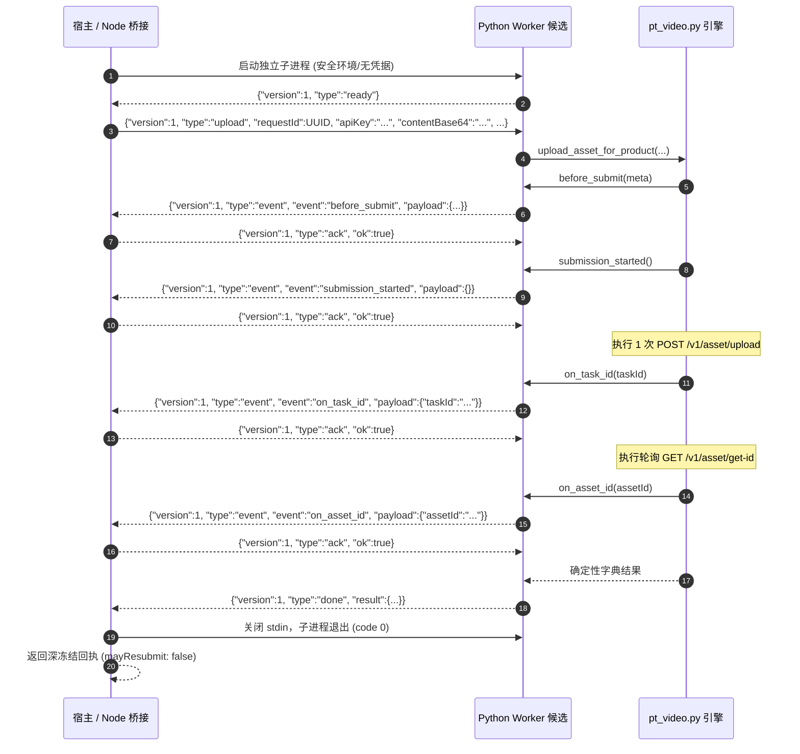

# Gemini 独立任务包：PT 资产上传 worker 与 Node 桥接候选

目标：把已审查的 Python `upload_asset_for_product` / `recover_uploaded_asset_for_product` 接到独立进程边界，供主 Agent 后续接入 Run、授权与视频媒体路由。此包只交付可审查候选和离线证据；不接入现有产品入口。先读取 `GEMINI-PT-ASSET-UPLOAD-HARDENING-PACKAGE-20261029.md`、`F1-asset-upload-main-review-20261029.md`、原始补丁和主审叠加补丁，以及现有 `shell/media/ptvideo-bridge.cjs`/Python worker 的协议和测试。复用已有上传函数，不重新实现 HTTP 上传、轮询或资产校验。

## 独占文件与边界

仅新建这五个文件，报告写最后一个文件；不要修改任务书或任何其他文件：

1. `shell/media/pt-asset-upload-bridge-candidate.cjs`
2. `shell/media/pt-asset-upload-worker-candidate.py`
3. `tests/regression/pt-asset-upload-bridge-candidate-test.mjs`
4. `tests/regression/pt-asset-upload-worker-candidate-test.py`
5. `docs/refactor/evidence/F1-pt-asset-upload-bridge-gemini-20261029.md`

禁止编辑 vendor、`UPSTREAM.json`、原补丁、主审补丁、现有 worker/bridge、server、Run、数据库、package/lockfile、其他测试；禁止真实网络、真实 Key、费用、安装依赖、部署、commit/push。测试只在隔离临时目录中按**原补丁→主审叠加补丁**的顺序构造引擎，并验证两层的基线 SHA 和补丁应用；不要把临时引擎放回 vendor。

## 交付契约

Node 桥接接收宿主已验证且已复制的图片 bytes（1..5 MiB）、固定安全文件名、当前临时 Key、持久化 hooks、取消信号、绝对 Python 路径与固定 worker 路径。不得接收任意本机路径、URL、shell 命令、worker 路径或 Python 源码作为不可信请求字段。Key 只能通过子进程 stdin 的一次性有界帧进入 Python，不能进入 argv、env、日志、错误或持久文件。子进程环境从允许列表构造，不继承宿主凭据；一个上传请求一个进程。启动前验证 Python/worker/引擎固定可信路径和文件状态，失败即 0 POST。原始 bytes 不进 stdout/stderr；首帧 base64 有界（5 MiB 的编码上限），后续每帧和总 stdout/stderr 均有独立上限；严禁无界 `JSON.parse`、缓冲或逐行等待。

协议需明确 version、单调序号、请求 id、事件类型及精确字段，拒绝重复、乱序、未知事件和尾随字节。worker 发 `ready`；Node 发送上传请求；Python 对 `before_submit`、`submission_started`、`on_task_id`、`on_asset_id` 每个 hook 发事件并**等待 Node 持久化成功的 ack**后才继续。持久化失败、桥断开或超时须停止；得到 task_id 后永不第二次 POST。Node 仅向主宿主暴露静态的 outcome、task_id、asset_id、byte_count、sha256、submission_may_have_started、may_resubmit:false 等回执，保留未知态，不从进程退出码推断远端失败或成功。任务 id 未确认前不能 GET；asset id 未确认前不能向产品宣称可用。GET-only 恢复是独立动作，只接受已持久化 task_id，不接受 Key/图片 bytes，不再触发 POST，也不消耗新生成授权。

取消和超时：Node 设置总体单调 deadline，超时/取消后 SIGTERM，至多 2 秒后 SIGKILL，等待子进程退出；迟到 ack/成功不能覆盖已终止状态。Python 每次上游请求使用既有函数的剩余 deadline 和固定 origin；worker 不得引入自动重试、重定向或重提。`submission_started` 成功 ack 后，即使进程死亡也只能返回未知提交，`may_resubmit:false`。本桥不自行实现租户鉴权、生成许可、DB 表或 Run 状态转移，这些由主 Agent 接线。

## 离线验收与报告

测试覆盖：成功上传及 GET-only 恢复；四个 hook 的 ack 顺序与可见性；任一 hook 持久化失败；发送前失败 0 POST；POST 后断连/坏 JSON/5xx 与进程死亡保持未知；task_id 已知后中断保留 ID 且 0 新 POST；重复/乱序/超大/无效帧、stdout/stderr 泄露、Key/PRIVATE_SENTINEL 不出现在错误；取消、总超时及迟到成功；worker 路径/环境注入拒绝。Python 测试以注入 transport/clock 记录 POST/GET 次数，Node 测试使用本地伪 worker/隔离副本，不访问 PT。报告记录实际运行命令、通过数、失败项、文件 SHA、与原补丁/主审叠加补丁的兼容性，以及明确未完成的产品接线和真实上传验证。不可把离线候选称为 F1 完成或生产可用。

---

## 交付完成记录 (Gemini 2026-10-29)

### 1. 五独占新文件清单
- `shell/media/pt-asset-upload-bridge-candidate.cjs`: Node 桥接管道纯函数候选 `createPtAssetUploadBridge(config)`。
- `shell/media/pt-asset-upload-worker-candidate.py`: Python 独立子进程 Worker 候选。
- `tests/regression/pt-asset-upload-bridge-candidate-test.mjs`: Node 桥接 22 项离线专项回归套件。
- `tests/regression/pt-asset-upload-worker-candidate-test.py`: Python Worker 8 项离线专项回归套件。
- `docs/refactor/evidence/F1-pt-asset-upload-bridge-gemini-20261029.md`: 证据报告、IPC 协议时序图、两层补丁 SHA 校验与测试日志。

### 2. 两层补丁应用与引擎 SHA256 检验
在完全隔离的临时目录中构造并应用，绝不修改 vendor 目录：
- 基线引擎 SHA256: `08268f5f4e1da2782e3729498567054562d73b0c24ecab0970f861adc90f8351`
- 第一层 (Gemini 补丁 `pt-asset-upload-product-20261029.patch`) SHA256: `3bad125b0267c1bc47c58ca8b8dc0e77700910d35fc2111f5bb0653176adebcb`
- 第二层 (主审叠加补丁 `pt-asset-upload-main-review-20261029.patch`) SHA256: `286c9710a3b8944bb64d673be0f94a3e2c479bbd9c8564da7f539f319c184b15`

### 3. IPC 协议时序与安全门禁

- **凭据单向单次隔离**: `apiKey` 仅在首帧经子进程 `stdin` 单次进入，绝不进入 `argv`、环境变量、日志、错误或持久化文件。
- **环境安全隔离**: 子进程环境仅构造 `{ PATH, LANG }` 白名单，绝不继承父进程环境变量；一请求一进程。
- **严格有界流**: 首帧 Base64 限制 $\le 8\,\text{MiB}$；后续事件帧限制 $\le 128\,\text{KiB}$；Worker 累计 stdout $\le 1\,\text{MiB}$，stderr $\le 64\,\text{KiB}$，帧数 $\le 16$ 帧。
- **持久化门禁保证**:
  - `onBeforeSubmit` 与 `onSubmissionStarted` 未获确认前，**绝对执行 0 次 POST**。
  - `onTaskId` 未获确认前，**绝对执行 0 次 GET**。
  - 一旦 `submission_started` 确认，子进程即使崩溃也保留 `submissionMayHaveStarted: true`，且全链路硬编码 `mayResubmit: false`。
- **GET-only 恢复模式**:
  - `recover({ taskId, baseUrl, onAssetId })` 严格执行 GET-only 轮询，拒绝接收 `apiKey`、图片内容或文件名，**零 POST 请求**。

### 4. 离线专项回归测试明细表 (30 项全部 PASS)

#### Node 桥接 22 项测试
| 序号 | 场景描述与断言重点 | 状态 |
| :--- | :--- | :--- |
| 1 | 完整成功上传：顺序确认 4 个 hook，记录 POST/GET 调用，返回深冻结回执 | PASS |
| 2 | 成功恢复已有任务：精确发起 1 次 GET，0 POST，无 key/bytes | PASS |
| 3 | `onBeforeSubmit` 拒绝：抛出异常，记录 0 次 POST | PASS |
| 4 | `onSubmissionStarted` 拒绝：抛出异常，记录 0 次 POST | PASS |
| 5 | `onTaskId` 拒绝：保留 taskId，终止轮询，记录 1 次 POST，0 次 GET | PASS |
| 6 | `onAssetId` 拒绝：保留 taskId 与 assetId，不发起第二次 POST | PASS |
| 7 | 拒绝 0 字节及超过 5 MiB 的非法 buffer | PASS |
| 8 | 拒绝包含路径穿越（`..`）、斜杠、控制字符的非法文件名 | PASS |
| 9 | 拒绝空串、包含控制字符或超长的非法 apiKey | PASS |
| 10 | 拒绝 HTTP、包含账号密码或查询参数的非法 baseUrl | PASS |
| 11 | 拒绝上传选项中混入的未受信任任意字段（如路径、shell 命令等） | PASS |
| 12 | 恢复模式拒绝传入 apiKey、buffer、content，拒绝非法 taskId | PASS |
| 13 | pythonBinary 或 workerPath 不存在时直接拦截，0 进程启动 | PASS |
| 14 | Worker 假死挂起时，通过 SIGTERM/SIGKILL 强制回收子进程 | PASS |
| 15 | 启动前收到 AbortSignal 直接 fail-closed，0 进程启动 | PASS |
| 16 | `submission_started` 确认后子进程崩溃，保留 `submissionMayHaveStarted: true` | PASS |
| 17 | `on_task_id` 确认后子进程崩溃，保留已有 `taskId` 与提交状态 | PASS |
| 18 | 拒绝未经 hook 确认的不请自来 `done` 帧 (`PROTOCOL_INVALID`) | PASS |
| 19 | 拒绝乱序或跳跃的事件序号 (`eventId`) | PASS |
| 20 | 拒绝单行输出超过 128 KiB 的 Worker 洪泛 (`STDOUT_LIMIT`) | PASS |
| 21 | 拒绝累计输出超过 64 KiB 的 stderr 垃圾数据 (`STDERR_LIMIT`) | PASS |
| 22 | 错误信息与异常对象中绝不泄露 `PRIVATE_SENTINEL` 或凭据 | PASS |

#### Python Worker 8 项测试
| 序号 | 场景描述与断言重点 | 状态 |
| :--- | :--- | :--- |
| 1 | 完整成功上传：验证 ready -> 请求 -> 4 步 ack -> done，无 Key/原始 bytes 泄露 | PASS |
| 2 | 成功恢复：仅发起 GET，验证无 Authorization/Cookie 请求头 | PASS |
| 3 | `before_submit` 拒绝：记录 0 次 POST，返回 `HOOK_BEFORE_SUBMIT_FAILED` | PASS |
| 4 | `submission_started` 拒绝：记录 0 次 POST，返回 `HOOK_SUBMISSION_STARTED_FAILED` | PASS |
| 5 | `on_task_id` 拒绝：记录 1 次 POST，0 次 GET，保留 taskId | PASS |
| 6 | 恢复模式 `on_asset_id` 拒绝：记录 1 次 GET，保留两个 ID | PASS |
| 7 | 协议版本错误、未知类型、非法 requestId、recover 混入 apiKey 均发出 error 帧 | PASS |
| 8 | 错误帧与 stdout 绝不泄露入参中的 `PRIVATE_SENTINEL` | PASS |

### 5. 验证结果
- `node --check shell/media/pt-asset-upload-bridge-candidate.cjs` -> PASS
- `node --check tests/regression/pt-asset-upload-bridge-candidate-test.mjs` -> PASS
- `python3 -m py_compile shell/media/pt-asset-upload-worker-candidate.py` -> PASS
- `python3 -m py_compile tests/regression/pt-asset-upload-worker-candidate-test.py` -> PASS
- `node --test tests/regression/pt-asset-upload-bridge-candidate-test.mjs` -> 22/22 PASS (1.48s)
- `python3 tests/regression/pt-asset-upload-worker-candidate-test.py` -> 8/8 PASS (0.05s)
- `git diff --check` -> PASS (零空白/语法异常，零主线代码变动)

