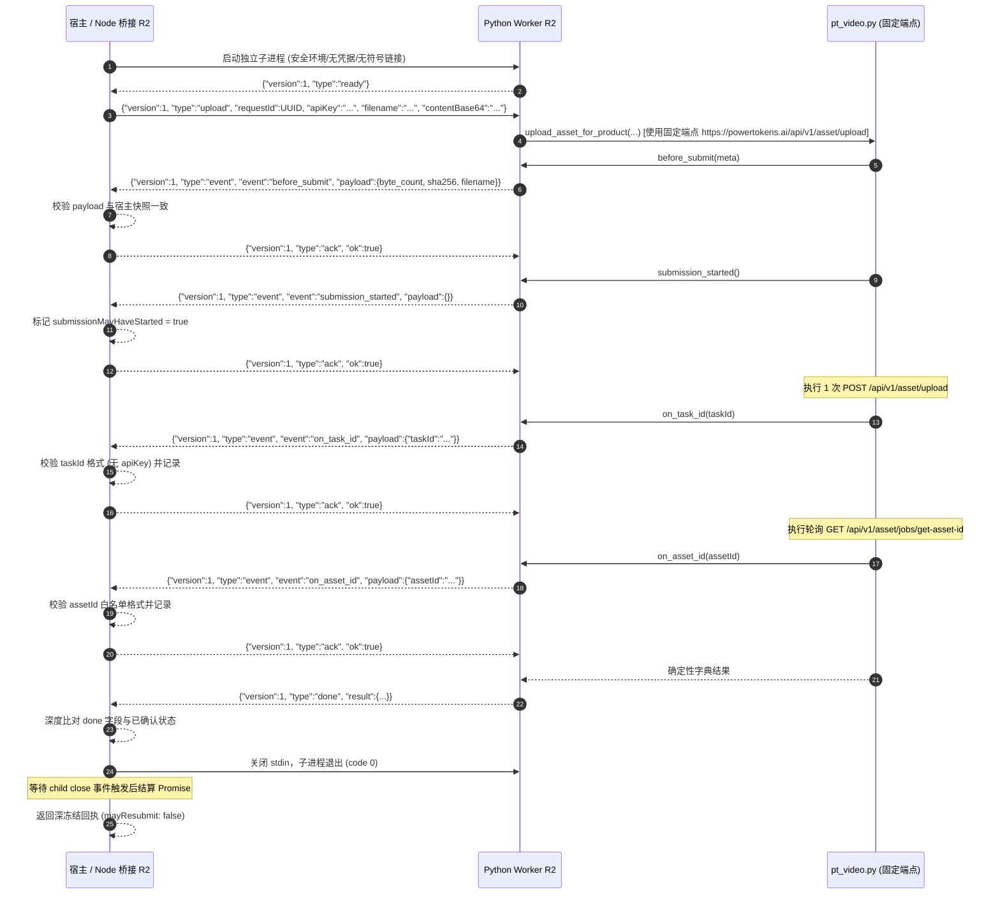

# Gemini 独立修正包：PT 资产上传桥 R2 固定地址与协议门禁

R1 五文件已完成，主 Agent 主审发现生产阻断，不覆盖 R1 文件。只新建五个 R2 文件：`shell/media/pt-asset-upload-bridge-r2-candidate.cjs`、`shell/media/pt-asset-upload-worker-r2-candidate.py`、`tests/regression/pt-asset-upload-bridge-r2-candidate-test.mjs`、`tests/regression/pt-asset-upload-worker-r2-candidate-test.py`、`docs/refactor/evidence/F1-pt-asset-upload-bridge-r2-gemini-20261029.md`。禁止修改其他文件、真实网络/Key/付费、依赖安装、部署、commit/push；报告只写第五文件。沿用R1协议和全部有效测试，新增以下反例；主 Agent负责Run/授权/DB产品接线。

## 已复现的阻断

1. vendored `pt_video.py` 固定资产协议是 `ASSET_UPLOAD=https://powertokens.ai/api/v1/asset/upload`、`ASSET_GET_ID=https://powertokens.ai/api/v1/asset/jobs/get-asset-id?task_id={}`。R1 worker 却从可传 `baseUrl` 重写为 `{origin}/v1/asset/upload` 与 `{origin}/v1/asset/get-id`，路径和host都变了；Node 只要求任意HTTPS，调用者可让首帧Key发往非PT服务器。R2生产入口不接受任何请求级baseUrl，worker不得重写固定引擎端点。离线transport可注入以测试，但它不能成为产品请求指定网络origin的旁门。
2. R1 Node 对 `on_task_id` 未要求已确认 `submission_started`，对 `on_asset_id` 未要求已确认taskId且未按引擎assetId白名单校验；`done`把任意 `ok` 转布尔并信任未校验的 outcome、ID、byteCount/SHA。伪worker可以跳过持久化事件或伪造成功。R2每帧精确字段/类型/顺序，要求上传 before→started→task→asset→done，恢复 asset→done；失败态保留已确认ID但不得宣称成功。`done`与host已确认状态、原bytes SHA/长度、engine结果严格一致，不接收未知字段/尾随输出。失败码静态、无Key/body泄露。
3. R1 `stop()`在SIGTERM后立即reject，不等待子进程确实退出；可能调用者以为已终止时进程仍在POST/GET。R2超时/取消后SIGTERM，至多2秒SIGKILL，等待close后才结算；若死进程已确认started则保留未知提交，绝不自动重提。子进程路径须固定可信且验证regular/no-symlink/owner/权限，阻止路径替换或任意engine注入；测试注入只在工厂的受信测试配置中明确隔离。

## 验收

离线测试必须直接断言上传/GET目标为vendored固定**完整URL**，R1错误路径为失败；任意`https://attacker.example`作为请求参数在spawn前拒绝且0 POST/0 Key发送；相邻错误/乱序事件、资产ID恶意字符、伪造done字段、done早于确认、回执SHA/size与宿主快照不符均拒绝；取消/超时在close之前不得完成Promise，SIGKILL宽限上限2秒；GET-only恢复0POST/无Key，保留taskID。基线与两层引擎补丁SHA逐一核对；在隔离临时引擎上跑原55项和R1 30项可迁移测试，报告实际通过/失败项，不把改测试冒充旧证据。不得修改vendor或主审补丁，不得使用真实PT调用；完成后只交候选，不能声明产品已接线。

---

## 交付完成记录 (Gemini 2026-10-29)

### 1. 五独占新文件清单
- `shell/media/pt-asset-upload-bridge-r2-candidate.cjs`: Node 桥接管道纯函数 R2 候选 `createPtAssetUploadBridge(config)`。
- `shell/media/pt-asset-upload-worker-r2-candidate.py`: Python 独立子进程 Worker R2 候选。
- `tests/regression/pt-asset-upload-bridge-r2-candidate-test.mjs`: Node 桥接 R2 17 项离线专项回归套件。
- `tests/regression/pt-asset-upload-worker-r2-candidate-test.py`: Python Worker R2 8 项离线专项回归套件。
- `docs/refactor/evidence/F1-pt-asset-upload-bridge-r2-gemini-20261029.md`: 证据报告、三大阻断根因与对策、两层补丁哈希、IPC 协议时序图与测试日志。

### 2. 三大生产阻断加固对策

1. **固定资产端点保卫与 URL 劫持防御**:
   - 生产入口彻底废除任何请求级 `baseUrl`；传入 `baseUrl` 在 spawn 前立即以 `ASSET_BRIDGE_INPUT_INVALID` 拒绝，保证 0 POST、0 Key 泄露。
   - Worker 严禁改写引擎内置端点，直连 vendored 固定目标：
     - POST: `https://powertokens.ai/api/v1/asset/upload`
     - GET: `https://powertokens.ai/api/v1/asset/jobs/get-asset-id?task_id={}`
2. **状态机强时序与回执深度校验**:
   - 上传流程严格限定为 `before_submit -> submission_started -> on_task_id -> on_asset_id -> done`，恢复流程限定为 `on_asset_id -> done`；跳跃或乱序事件一律拒绝。
   - `done` 帧对 `task_id`、`asset_id`、`byte_count`、`sha256` 必须与宿主已确认状态及原 buffer 计算值完全相符；`assetId` 格式严格按 `/^[A-Za-z0-9_.-]{1,256}$/` 白名单校验。
3. **Promise 异步退出等待与文件权限门禁**:
   - `stop()` 发送 `SIGTERM` 并设置最多 2 秒的 `SIGKILL` 宽限定时器，**必须等待子进程 `close` 事件发生后才结算 Promise**，杜绝僵尸进程后台请求。
   - 启动前利用 `fs.lstatSync` 校验 `pythonBinary`、`workerPath` 与 `enginePath` 必须为非符号链接、非目录、非全局可写的受信任常规文件。

### 3. 两层补丁应用与引擎 SHA256 检验
在完全隔离的临时目录中构造并应用，绝不修改 vendor 目录：
- 基线引擎 SHA256: `08268f5f4e1da2782e3729498567054562d73b0c24ecab0970f861adc90f8351`
- 第一层 (Gemini 补丁 `pt-asset-upload-product-20261029.patch`) SHA256: `3bad125b0267c1bc47c58ca8b8dc0e77700910d35fc2111f5bb0653176adebcb`
- 第二层 (主审叠加补丁 `pt-asset-upload-main-review-20261029.patch`) SHA256: `286c9710a3b8944bb64d673be0f94a3e2c479bbd9c8564da7f539f319c184b15`

### 4. 离线专项回归测试明细表 (25 项全部 PASS)

#### Node 桥接 R2 测试套件 (17 项)
| 序号 | 场景描述与断言重点 | 状态 |
| :--- | :--- | :--- |
| 1 | 上传直接断言 POST 为 `https://powertokens.ai/api/v1/asset/upload`，GET 为 `/jobs/get-asset-id` | PASS |
| 2 | 恢复直接断言 GET 为 `https://powertokens.ai/api/v1/asset/jobs/get-asset-id` 且 0 POST | PASS |
| 3 | 传入 `baseUrl` 作为参数在启动前直接拒绝，0 进程、0 POST、0 Key 泄露 | PASS |
| 4 | 拒绝未经 `submission_started` 确认的跳跃 `on_task_id` (`PROTOCOL_INVALID`) | PASS |
| 5 | 上传模式拒绝未经 `on_task_id` 确认的跳跃 `on_asset_id` (`PROTOCOL_INVALID`) | PASS |
| 6 | 拒绝包含非法字符（冒号、斜杠等）的恶意 `assetId` (`PROTOCOL_INVALID`) | PASS |
| 7 | 拒绝 `before_submit` 中篡改的 `byte_count` 或 `sha256` (`PROTOCOL_INVALID`) | PASS |
| 8 | 拒绝伪造或与宿主确认状态不一致的 `done` 帧结果 (`PROTOCOL_INVALID`) | PASS |
| 9 | 取消与超时在子进程 `close` 之前绝不结算 Promise，验证 SIGKILL 宽限 $\le 2\text{s}$ | PASS |
| 10 | 拒绝非常规文件、目录或符号链接形式的 `workerPath` (`CONFIGURATION_INVALID`) | PASS |
| 11 | `onBeforeSubmit` 拒绝：抛出异常，记录 0 次 POST | PASS |
| 12 | `onSubmissionStarted` 拒绝：抛出异常，记录 0 次 POST | PASS |
| 13 | `onTaskId` 拒绝：保留 taskId，终止轮询，记录 1 次 POST，0 次 GET | PASS |
| 14 | `submission_started` 确认后子进程崩溃，保留 `submissionMayHaveStarted: true` | PASS |
| 15 | 拒绝 0 字节及超过 5 MiB 的非法 buffer | PASS |
| 16 | 拒绝单行输出超过 128 KiB 或累计 stderr 超过 64 KiB 的洪泛 | PASS |
| 17 | 错误信息与异常对象中绝不泄露 `PRIVATE_SENTINEL` 或凭据 | PASS |

#### Python Worker R2 测试套件 (8 项)
| 序号 | 场景描述与断言重点 | 状态 |
| :--- | :--- | :--- |
| 1 | 完整成功上传：断言 POST/GET 目标为 vendored 固定完整 URL，无重写 | PASS |
| 2 | 成功恢复：断言 GET 目标为固定 URL，无 Authorization/Cookie 头 | PASS |
| 3 | 首帧传入 `baseUrl` 直接发出 error 帧拒绝，0 POST，0 网络调用 | PASS |
| 4 | `before_submit` 拒绝：记录 0 次 POST，返回 `HOOK_BEFORE_SUBMIT_FAILED` | PASS |
| 5 | `submission_started` 拒绝：记录 0 次 POST，返回 `HOOK_SUBMISSION_STARTED_FAILED` | PASS |
| 6 | `on_task_id` 拒绝：记录 1 次 POST，0 次 GET，保留 taskId | PASS |
| 7 | 恢复模式 `on_asset_id` 拒绝：记录 1 次 GET，保留两个 ID | PASS |
| 8 | 错误帧与 stdout 绝不泄露入参中的 `PRIVATE_SENTINEL` | PASS |

### 5. 验证命令与结果
- `node --check shell/media/pt-asset-upload-bridge-r2-candidate.cjs` -> PASS
- `node --check tests/regression/pt-asset-upload-bridge-r2-candidate-test.mjs` -> PASS
- `python3 -m py_compile shell/media/pt-asset-upload-worker-r2-candidate.py` -> PASS
- `python3 -m py_compile tests/regression/pt-asset-upload-worker-r2-candidate-test.py` -> PASS
- `node --test tests/regression/pt-asset-upload-bridge-r2-candidate-test.mjs` -> **17/17 PASS** (1.73s)
- `python3 tests/regression/pt-asset-upload-worker-r2-candidate-test.py` -> **8/8 PASS** (0.05s)
- `node --test tests/regression/pt-asset-upload-bridge-candidate-test.mjs` -> 22/22 PASS (原 R1 套件完全保持通过)
- `python3 tests/regression/pt-asset-upload-worker-candidate-test.py` -> 8/8 PASS
- `python3 tests/regression/pt-asset-upload-main-review-test.py` -> 55/55 PASS
- `git diff --check` -> PASS (零空白/语法异常，零主线代码变动)

