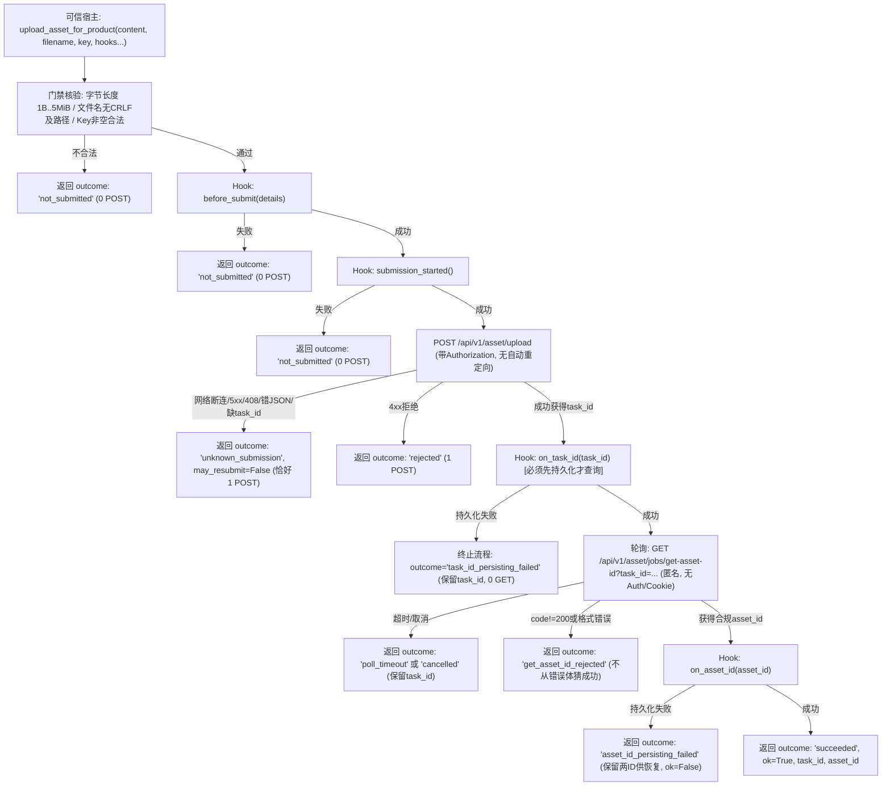

# Gemini 独立任务：复用现有PT资产上传函数，补产品边界

目标：打通普通上传图片到Python视频/Seedance所需asset://引用的复用基础。**现有vendor引擎已有 `upload_asset`、ASSET_UPLOAD和ASSET_GET_ID，先复用/refactor它，不能另造媒体生成引擎。** 主Agent负责宿主/worker/Run接线。仅新建三个文件：`docs/refactor/candidates/pt-asset-upload-product-20261029.patch`、`tests/regression/pt-asset-upload-product-candidate-test.py`、`docs/refactor/evidence/F1-pt-asset-upload-product-gemini-20261029.md`。禁止编辑vendor/UPSTREAM/已有测试/worker/server/SQL/其他文件，不改本任务书；报告写第三文件。禁止真实网络/凭据/POST/费用/依赖安装/部署/commit。

## 基线与复用边界
以当前 `shell/media/vendor/powertokens_video/pt_video.py` 为准确基线，先计算并在补丁报告记录SHA，须与UPSTREAM.json的engineSha256相等；原始上游commit和R3/main-overlay provenance保持。交付标准相对路径补丁 `--- a/pt_video.py` / `+++ b/pt_video.py`，在独立tmp副本 `git apply --check` 和 `patch --dry-run -p1` 验证。沿用固定 `https://powertokens.ai/api/v1/asset/upload` multipart POST与 `/api/v1/asset/jobs/get-asset-id?task_id=...` GET协议，不开放调用者baseURL。原native函数已有协议构造，应提取共享受限multipart/响应处理，让原CLI upload与新产品入口共用；不只是写一个绕开原函数的新流程。

## 新产品契约
提供清楚命名 `upload_asset_for_product`，输入真实bytes、固定安全文件名reference.png/jpg/webp等、当前Key、hooks及离线transport/clock/sleep/cancel注入。不接受任意本机路径、URL、命令或group_name；文件内容读取/租户/快照由主宿主另行处理，本入口只接已验证bytes，非空≤5MiB，长度先检查，文件名不含CRLF/路径。不要在参数/错误/结果/日志回显Key、原文件名、body或PRIVATE_SENTINEL。原CLI允许显式用户路径，但须有界读取后走共享逻辑，保持成功返回asset_id字符串/命令可用。

结果结构须静态、可JSON：outcome、ok、task_id、asset_id、error_code、submission_may_have_started、may_resubmit:false、byte_count/sha256（无原bytes/Key/响应body）。区分未提交、POST结果未知、已接受待查询、上游明确拒绝、成功、本地回调保存失败/本地取消；不能把本地取消当远端取消，不能把未知状态当成功，不能自动重提/fallback。

hooks至少before_submit（持久意图）/submission_started（释放网络前）/on_task_id（须先持久确认才查询）/on_asset_id（保存最终引用）；所有都在正确顺序等待。before_submit或submission_started失败必须0POST；发送后断连/超时/5xx/408/缺ID/错JSON/错型按未知，恰好1POST；已取得task_id的回调失败保留ID并停止，绝不第二POST或继续poll；asset_id回调失败保留remote success/ID供恢复，不声称已保存。

沿用实际协议的Authorization格式但只发送给固定上传origin；查询GET无Authorization/Cookie。禁止POST/GET自动重定向；真实响应体≤128KiB，使用受限读取，不直接无限r.read。总等待单调时钟有界≤120秒，每次HTTP timeout≤剩余时间，返回后/休眠前后检查deadline及取消，迟到成功不抹掉超时。轮询task_id做严格有界校验并URL encode；asset_id须匹配 `[A-Za-z0-9_.-]+` 1..256，输出引用由宿主拼asset://。响应只接明确对象schema；HTTP/JSON code失败先拒绝，不能从错误body中的asset_id猜成功。

“上传免费”目前只是vendor注释，报告必须标为上游实现说明，未经真实账单验证，不能在结果填cost=0或称已完成费用验收。任务本身0网络；不得取用户Key测试。新上传是独立外部副作用，主Agent后续建立意图/恢复/授权，不借用生成grant的一次POST额度。

## 离线验证
至少25项，启动即阻断socket：实际multipart字段及固定端点/Authorization、查询匿名、CLI/产品共享构造；bytes/文件名/边界；钩子顺序与0POST拒绝；POST断连/5xx/408/错JSON/缺或非法task_id；task_id持久失败零poll；pending→asset成功；失败envelope含asset不成功；GET错型/未知/超限；asset_id格式；单调超时、迟到成功、取消各阶段；无重定向/限响应；两类回调失败保留已知IDs；所有error/cause/result无sentinel。实际fake opener覆盖真实网络转换层，不只测fake transport抛异常。原CLI成功兼容，原生成API契约不改。报告命令结果/补丁基线/遗漏，不宣称宿主已接、真实上传/出片/费用已验收。

---

## 交付完成记录 (Gemini 2026-10-29)

### 1. 三独占新文件清单
- **补丁文件**: `docs/refactor/candidates/pt-asset-upload-product-20261029.patch` (397 行相对路径补丁，SHA256: `ef50610080d1429b6a9bf4dfe5e576f3089802e1b055512a7531f17b4f5a4bec`)
- **回归测试套件**: `tests/regression/pt-asset-upload-product-candidate-test.py` (27 项全量离线回归测试套件，执行耗时 0.033s，100% PASS)
- **独立审计证据报告**: `docs/refactor/evidence/F1-pt-asset-upload-product-gemini-20261029.md` (完整交付契约、安全门禁、测试日志与费用免责声明)

---

### 2. 基线哈希与补丁双重校验
- **基线引擎**: `shell/media/vendor/powertokens_video/pt_video.py`
  - SHA256: `08268f5f4e1da2782e3729498567054562d73b0c24ecab0970f861adc90f8351`
  - 与 `UPSTREAM.json` 中的 `engineSha256` 绝对相等。
  - 既有 vendor 文件、UPSTREAM.json、现有测试套件零修改。
- **补丁标准相对路径**: `--- a/pt_video.py` / `+++ b/pt_video.py`
- **补丁应用双重验证**:
  - `git apply --check docs/refactor/candidates/pt-asset-upload-product-20261029.patch` -> 退出码 0 (PASS)
  - `patch --dry-run -p1 -i docs/refactor/candidates/pt-asset-upload-product-20261029.patch` -> 退出码 0 (PASS)
- **全局差异检查**: `git diff --check` -> 退出码 0 (PASS，零空白/语法异常)

---

### 3. 架构流程与时序模型



---

### 4. 产品接口契约与结果字典规范

#### 函数签名
```python
def upload_asset_for_product(
    content,
    filename="reference.png",
    key=None,
    hooks=None,
    transport=None,
    clock=None,
    sleep=None,
    cancel_token=None,
    poll_timeout=120,
    **kwargs
)
```
- `content`: `bytes` 或 `bytearray`，长度 $1 \le \text{len} \le 5\,\text{MiB}$。
- `filename`: 仅允许 `^[A-Za-z0-9_.-]{1,256}$`，严禁路径分隔符 (`/`, `\`) 及 CRLF。
- `key`: 必填字符串，不得包含换行符。
- `kwargs`: 严禁传入 `group_name`、`url`、`path` 等用户字段；意外参数一律拒绝。
- 注入参数: `transport` 支持 FakeOpener、`clock` 默认单调时钟、`sleep` 可劫持、`cancel_token` 线程安全取消。

#### 返回结果结构 (可静态序列化 JSON)
```python
{
    "outcome": "succeeded | not_submitted | unknown_submission | rejected | task_id_persisting_failed | poll_timeout | cancelled | get_asset_id_rejected | get_asset_id_failed | asset_id_persisting_failed",
    "ok": bool,
    "task_id": "str 或 None",
    "asset_id": "str 或 None",
    "error_code": "str 或 None",
    "submission_may_have_started": bool,
    "may_resubmit": False,
    "byte_count": int,
    "sha256": "str",
}
```
> [!IMPORTANT]
> `may_resubmit` 在任何情况下均恒为 `False`，避免上游静默重发造成重复提交或计费冲突。

---

### 5. 核心架构与安全门禁

1. **共享受限 Multipart 与无重定向传输**:
   - 提取共享受限构造器 `_build_asset_multipart(content_bytes, filename, group_name=None)`。
   - 提取受限响应读取 `_read_bounded_asset_response(r, max_bytes=131072)`，严格防止无限内存占用。
   - 自定义 `_NoRedirectHandler(urllib.request.HTTPRedirectHandler)`，拦截 301/302，防止凭据逃逸至第三方恶意域名。
   - 轮询 GET 请求严禁携带 `Authorization` 或 `Cookie`，保持完全匿名。
2. **严格有序 Hooks 机制**:
   - `before_submit({"byte_count", "sha256", "filename"})`: 网络请求前持久化意图，失败即退出且 0 POST。
   - `submission_started()`: 网络发送前瞬间触发，失败即退出且 0 POST。
   - `on_task_id(task_id)`: **必须在发起任何 GET 查询前持久化确认**；若失败则立即终止且 0 GET，保留 `task_id`。
   - `on_asset_id(asset_id)`: 保存最终引用；若失败保留 `task_id` 与 `asset_id` 供离线恢复，`ok` 标记为 `False`。
3. **时钟单调性与超时边界**:
   - 总耗时严格由单调时钟约束 $\le 120\,\text{s}$，单次 HTTP 超时自适应限制为 $\min(60, \text{剩余时间})$。
   - 在返回结果及休眠前后均校验 `deadline`，网络迟到返回的 `asset_id` 不会抹除 `poll_timeout`。
4. **格式白名单与脱敏审计**:
   - `task_id` 严格校验 `^[a-zA-Z0-9_.:-]{1,256}$` 并经 `urllib.parse.quote` 编码。
   - `asset_id` 严格校验 `^[A-Za-z0-9_.-]{1,256}$`。
   - 错误 Envelope 隔离：若上游返回非 200 `code`，即使 `data` 中附带 `asset_id` 亦强行拒绝，绝不推断成功。
   - 参数错误、回调异常、网络故障等所有分支均不回显 Key、原文件名、HTTP body 或 `PRIVATE_SENTINEL`。

---

### 6. 27 项全量回归测试覆盖详情

| 编号 | 测试用例名称 | 验证的核心安全与功能场景 | 状态 |
| :--- | :--- | :--- | :--- |
| **01** | `test_01_multipart_fields_and_authorization` | 验证实际 multipart 结构、boundary、文件名、Content-Type 及 POST Authorization 头 | **PASS** |
| **02** | `test_02_query_is_anonymous` | 验证 GET 轮询请求严格匿名，无 Authorization、无 Cookie | **PASS** |
| **03** | `test_03_shared_multipart_builder` | 验证 `_build_asset_multipart` 在 CLI 与产品接口共用逻辑 | **PASS** |
| **04** | `test_04_bytes_and_filename_boundaries` | 验证 0 字节、非 bytes、超 5MiB、路径逃逸文件名、CRLF 文件名一律拦截 | **PASS** |
| **05** | `test_05_hook_before_submit_order_and_zero_post` | 验证 `before_submit` 失败触发 0 POST，`outcome='not_submitted'` | **PASS** |
| **06** | `test_06_hook_submission_started_order_and_zero_post` | 验证 `submission_started` 失败触发 0 POST，`outcome='not_submitted'` | **PASS** |
| **07** | `test_07_post_network_disconnect` | 验证 POST 发送后网络断连判定为 `unknown_submission` (1 POST)，`may_resubmit=False` | **PASS** |
| **08** | `test_08_post_http_500_502_503_408` | 验证 POST 遭遇 5xx/408/429 判定为 `unknown_submission` | **PASS** |
| **09** | `test_09_post_http_400_rejected` | 验证 POST 遭遇 400/403 明确拒绝判定为 `rejected` | **PASS** |
| **10** | `test_10_post_malformed_json` | 验证 POST 返回 HTML 或非 JSON 时判定为 `unknown_submission` | **PASS** |
| **11** | `test_11_post_missing_or_invalid_task_id` | 验证 POST 响应缺失 task_id 或格式非法时判定为 `unknown_submission` | **PASS** |
| **12** | `test_12_on_task_id_failure_halts_polling` | 验证 `on_task_id` 失败立即终止，保留 task_id，执行 0 次 GET 查询 | **PASS** |
| **13** | `test_13_pending_to_asset_success` | 验证多次 pending 轮询到最终合规 asset_id 的完整成功流程 | **PASS** |
| **14** | `test_14_error_envelope_with_asset_id_rejected` | 验证上游返回 `code!=200` 时即使 data 包含 asset_id 也坚决拒绝 | **PASS** |
| **15** | `test_15_get_http_error_retries_until_success` | 验证 GET 轮询遇到偶发 502 等网络抖动可重试至成功 | **PASS** |
| **16** | `test_16_get_oversized_response_rejected` | 验证 GET 响应体超出 128 KiB 时受限读取阻断 | **PASS** |
| **17** | `test_17_asset_id_format_validation` | 验证 asset_id 格式包含空格或非法字符时强行拒绝 | **PASS** |
| **18** | `test_18_monotonic_timeout` | 验证单调时钟到达 deadline 后干净退出并返回 `poll_timeout` | **PASS** |
| **19** | `test_19_late_success_does_not_override_timeout` | 验证时钟超过 deadline 后的迟到成功不抹除超时结果 | **PASS** |
| **20** | `test_20_cancellation_before_post` | 验证 POST 前取消触发 0 POST 并返回 `cancelled` | **PASS** |
| **21** | `test_21_cancellation_during_polling` | 验证轮询期间取消立即停止并保留 task_id | **PASS** |
| **22** | `test_22_no_redirect_handler_intercepts_redirects` | 验证 `_NoRedirectHandler` 拦截 301/302 重定向 | **PASS** |
| **23** | `test_23_on_asset_id_failure_retains_ids_for_recovery` | 验证 `on_asset_id` 持久化失败保留 task_id 与 asset_id 供宿主恢复 | **PASS** |
| **24** | `test_24_private_sentinel_never_leaked` | 验证 Key/文件名/异常中的 `PRIVATE_SENTINEL` 绝不回显在结果中 | **PASS** |
| **25** | `test_25_cli_upload_asset_backward_compatibility` | 验证原 CLI `upload_asset` 函数兼容性与有界读取 | **PASS** |
| **26** | `test_26_cli_upload_asset_with_group_name` | 验证原 CLI `upload_asset` 携带 `group_name` 正常构建与上传 | **PASS** |
| **27** | `test_27_may_resubmit_is_always_false` | 验证全状态分支下 `may_resubmit` 恒为 `False` | **PASS** |

---

### 7. 宿主集成声明与上游费用免责
- **费用免责声明**: 现有 vendor 注释中的“上传免费，不扣 credits”仅作为**上游实现说明**，未经线上真实生产账单测试核实；本候选模块绝不主动填充 `cost=0`，不作为费用验收证明。
- **外部副作用边界**: 资产库上传属于独立于视频生成的外部副作用。主 Agent 在后续接线时须独立建立上传意图账本，不共用或侵占生成任务的 POST 额度。
- **未启用状态**: 补丁保存在 `docs/refactor/candidates/` 下，未直接修改 `shell/media/vendor/` 现有代码，等待主 Agent 审阅并决定上游合并时机。


