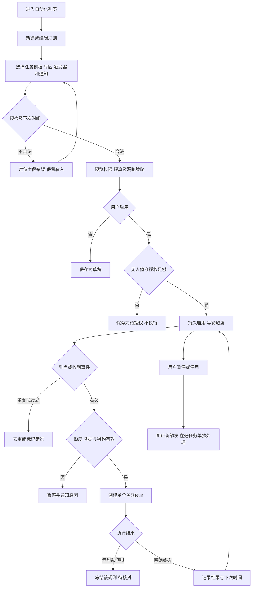

# 任务包26：定时与事件自动化
版本：完整规格稿1｜2026-11-04｜状态：SPEC_READY_FOR_ASSIGNMENT（规格已扩写，未指派/未实现/未验收）。类型：用户交互型：持久规则与无人值守边界。用户已通过09/10示范深度并授权本轮扩写；本包下列“待用户拍板”仍为建议，不能当既定产品决定。原01–08据用户确认已由Gemini完成，本轮不重写；交付、主审、集成、上线状态分开登记。
阅读：[主台账](REFACTOR-MASTER-TRACKER-20261103.md)、[研发交付流程](ENGINEERING-DELIVERY-WORKFLOW.md)、[技术入门](DEVELOPER-ONBOARDING.md)。领取填写负责人、实现者、独立测试者、实际base/branch、OS/Node、dirty文件归属及依赖契约版本；bbd9997仅历史参考，不是自动可发布版本。

## 1. 结果、范围与分类依据
用户设定时区、周期/事件、输入范围及通知，预览下次执行后启用，可暂停、查看错过执行和失败原因。系统不把机器重启后的所有漏跑任务自动补发成付费洪峰。
先受限周期/具名事件与只读任务；自动写入/媒体/持续循环须明确无人值守授权与预算。DSH workflow/jobs能复用不等于已有完整持久调度服务，先核查实际锁定能力。

## 2. 复用核查、依赖与所有权
先对锁定DSH 0.1.1-rc.2交“需求—原生/插件/现有接缝—版本/导出证据—配置或接线—缺口—AC”矩阵，原生直接用→配置→产品接线→现插件/受控升级→证据缺口最小补充。下表是开工核查点，不是本轮已跑SDK/已证实新能力；负责人确认缺口后才能实现，不另造Agent循环、执行器或审批引擎。

| 能力/核查来源 | 本包接线、证明及缺口边界 |
|---|---|
| DSH workflow/jobs、shell/runtime/session-scheduler.cjs | 核对持久触发/租约覆盖；复用执行引擎，补触发账本而非新Agent |
| 05审批、13工作流、27批量与29通知 | 统一无人值守范围、预算、Run状态和通知，不复制权威状态 |

依赖及并行边界：05/13/27/29/33；上线前需要18稳定worker与明确PT后台资格，不能先默认开无人值守媒体。
独占交付：`shell/candidates/product-automation-20261103/`（CONTRACT.md、REUSE-MATRIX.md、实现或方案、UI/fixture、接线建议）、`tests/probes/product-automation-20261103.mjs`、`docs/refactor/evidence/PRODUCT-AUTOMATION-20261103.md`。方案/验收包交可执行方案与证据，不制造空产品模块。共享server/runner/public/tenant/profile/迁移/package/lock由负责人集成，只交补丁建议；不改Gemini原8包、Bug窗口、tests/e2e/或其他包。测试目录所有权先协调；禁覆盖dirty文件、旧归档或线上r28。
本包不产生部署、付费、外发、资源采购、merge/push或电脑控制授权；真实操作按具体范围另核已有授权。日志/报告不存Key、Cookie、私密原文、签名URL，fixture合成且数据/凭据/DB与生产隔离。

## 3. 用户旅程决策树
范围内每条边由下表解释；后台契约不能替代默认界面和恢复动作。刷新、权限撤销、并发及未知结果也列入验收。

## 4. 分步详解表

| 节点/触发 | 默认界面与系统动作 | 用户动作、兜底条件与禁止行为 | 对应AC |
|---|---|---|---|
| A/B/C 规则配置 | 显示时区、周期/事件、模板版本、输入来源和通知通道，默认草稿 | 无模板/权限先补齐，非法表达式/未知事件不默选 | 26-01 |
| D/E 时间预览 | 展示未来若干触发时间和夏令时影响 | 时区必须显式，DST跳时/重复时按决策说明，不伪本地时间 | 26-02 |
| F/G/H 启用确认 | 列触发次数预测、范围、费用/预算、漏跑/重叠策略 | 保存草稿与启用分开，修改已启用规则需新版本/确认 | 26-03 |
| I/J 无人值守资格 | 说明哪些动作需人工批准，不能自动回答05问题 | 凭据/预算不够保存待授权；付费未知不自动执行 | 26-04 |
| K/L/M 触发与去重 | 展示计划时间/事件来源、实际触发与跳过原因 | 事件验签防重放；漏跑不无限补，重复trigger只一Run | 26-05 |
| N/O/P 执行预检 | 重验scope、配额、租约，Run绑定规则版本和原输入 | token过期/资源满暂停并通知，不换Key/模型重提 | 26-06 |
| Q/R/S 结果 | 失败、未决副作用、成功分列，展示下次时间/费用来源 | 未知冻结等待核对，不自动重试写入；纯查询重试须有界 | 26-07 |
| T/U 暂停/修改/删除/刷新 | 暂停阻新触发，显示在途Run，刷新从持久规则恢复 | 停用不等于取消已在上游的任务；删除采用保留历史的停用 | 26-08 |

## 5. 建议方案与待确认决策
以下是建议与决策责任；“待用户拍板”未获确认前不作为已定范围。负责人技术核实及外部回执不是要求用户代做调查。未决项阻断对应AC，不阻断无依赖的契约/fixture工作。

| 决策/责任 | 建议、原因与代价 | 未确认边界或需要的证据 |
|---|---|---|
| 26-D1 待用户拍板 | 建议漏跑默认跳过且记录，用户可选仅补最近一次；不补全部历史 | 漏跑/DST重复/同规则重叠策略需确认，建议同规则串行 |
| 26-D2 待用户拍板 | 首版自动任务只读且限定时段/次数，付费写入待单独无人值守授权 | 是否开放具体收费任务和额度范围需拍板，不凭一次手工批准永久授权 |
| 26-D3 负责人技术核实 | 优先原生jobs/workflow与现有scheduler，持久触发仅补原生缺口 | 交租约/时钟/重启/多worker去重证据，不能只用进程内setInterval |
| 26-D4 待用户拍板 | 默认站内通知，邮件/推送归29单独通道授权 | 触发事件白名单与验签密钥归属由负责人核实，不收任意未验Webhook |

## 6. 契约、数据与恢复
接口名称为目标语义，不自动表示现有HTTP端点已实现。CONTRACT冻结可信身份、输入/输出/schema版本、错误码与UI/调用方映射；复用现有错误，拒绝将失败全部报500。

| 操作/记录 | 必须保持的语义 |
|---|---|
| 规则 | ruleId/version、templateSnapshot、timezone/trigger、scope/approval/limits、state/nextFireAt、misfire/overlapPolicy |
| 触发账本 | ruleVersion/scheduledTime或eventId/digest、lease、RunRef与去重唯一键；触发intent先持久 |
| 授权与结果 | 有效期/撤销、运行费用边界、未决operation；stop新触发与cancel在途分别记录 |

跨边界读写逐次校验owner/tenant及本包project/device/Run范围；客户端ID不授予权限。状态和版本持久化，重复同operation同payload返回原结果，异参冲突；取消/超时/断网不自动证明外部动作失败或停止计费。外部写入未知先核对，不盲重试/换模型重提。存储变更需真实PGlite及隔离PG验证，迁移编号由负责人分配；纯调查包此项按无产品写入注明不适用。历史源证据不可覆写，修订形成新版本。

## 7. 验收矩阵与测试责任
每个AC交实现/方案位置、fixture、执行命令、退出码、PASS/FAIL/BLOCKED与脱敏证据；未决或未授权不计PASS。下列是将来执行要求，本轮没有实现或业务通过声明。

| AC | 通过标准 | 验证方式 |
|---|---|---|
| 26-01 | A/B/C：草稿不会执行，配置错误保留输入 | 确定性接口/SDK＋staging点击E2E |
| 26-02 | D/E：跨时区/DST/月底/闰日用冻结时钟测试 | 确定性接口/SDK＋staging点击E2E |
| 26-03 | F/G/H：确认摘要与实际调度版本一致 | 确定性接口/SDK＋staging点击E2E |
| 26-04 | I/J：无授权/审批过期/费用未知零外发 | 确定性接口/SDK＋staging点击E2E |
| 26-05 | K/L/M：同触发跨worker/重启/DST最多一次创建 | 确定性接口/SDK＋staging点击E2E |
| 26-06 | N/O/P：过期/配额/lease丢失均无越权重复任务 | 确定性接口/SDK＋staging点击E2E |
| 26-07 | Q/R/S：异常后状态/通知与外部调用次数符合契约 | 确定性接口/SDK＋staging点击E2E |
| 26-08 | T/U：并发停用/到点、历史恢复与在途提示正确 | 确定性接口/SDK＋staging点击E2E |
| 26-09 | 伪造身份/资源引用、权限撤销、日志/证据敏感信息均拒绝或脱敏，不扩大依赖权限 | 双身份/仓储负向及证据扫描 |
| 26-10 | 重复操作、并发版本变化、断线/重启与结果未知不造成重复副作用；恢复依据权威记录 | 并发/故障fixture；方案包核实执行证据 |
| 26-11 | 本包变更与同版累计功能兼容；未跑真实上游/生产的项目仍待验，不将fixture写成上线成功 | 负责人受影响回归＋独立测试/证据复核 |

开发者/执行者交`node tests/probes/product-automation-20261103.mjs`的实现后实际运行方法（方案包可由该入口验证清单/证据或交等价可复跑命令并解释），真实调用候选/锁定SDK/协议服务/存储而非镜像常量，失败非零。无代码阶段不制造假探针通过。独立测试者复核负向反例；涉及界面的AC必须实际点击，API辅助不能全部替代；纯后端包不强制点击E2E，核实业务影响即可。
真实PT调用与付费次数、生产写入/故障、电脑动作独立授权；确定性模型/本地协议轨、真实PT轨、staging与production证据分开。未获授权保留BLOCKED，不能抹掉失败或把未执行算不适用。测试证据绑定应用/配置/迁移/用例版本与fixture SHA。

## 8. 资源、Plan B与进度影响
持久时钟/租约、PG、多worker和DST fixture；33评估PT在途与错过执行峰值，真实任务限次数授权。
## PT依赖、Plan B与进度影响
| PT依赖/需求编号 | Plan B | 进度/验收影响 |
|---|---|---|
| PT-03/04/07，付费后台可靠性 | 持久调度+单次提交；未知暂停等人工 | 定时基础继续；无人值守媒体可靠性缺口保留未完成 |
依据：[PT接口规格v1.1第15节](PT-API-REQUIREMENTS-20261104.md)。PT未接受建议接口形态时先映射既有协议；遵循DSH最大复用原则。上述Plan B为规划候选，不表示已验证或获准额外模型/资源/供应商调用；原范围未满足仍标未完成，变更需用户确认。签署协议仅已签署/未签署，无有效期/续签；资产启用及凭据/缓存/资源有效期分别处理。

## 9. 里程碑、交付与接入
| 阶段 | 本包产出与放行依据 |
|---|---|
| M0 冻结 | 分类、范围、复用矩阵、依赖契约、上述决策、节点/阶段→AC及可量化限制；负责人确认接口缺口，用户只拍板产品/成本/资源选择 |
| M1 核心候选/方案 | 规则/下次触发/授权预览及持久账本 |
| M2 失败与恢复 | DST/重启/重复Webhook/暂停竞态/未知冻结反例 |
| M3 独立主审/接入 | 调度到Run及站内通知接线；负责人独占共享接线，运行受影响回归 |
| M4 同版验收/发布 | 配置→启用→触发→失效暂停→恢复/停用E2E；有发布授权才冻结归档并切换，production专属租户受控冒烟 |

交付报告含base/commit/文件SHA、依赖契约版本、命令/退出码/通过失败阻塞数、AC映射、替身/真实边界、遗留Bug与责任、安装/挂载/清理/回退说明。Bug原作者自测后独立复测，主审/集成/发布各阶段分别登记。关闭新入口不等于撤销已提交数据或终止外部任务；回退保留历史可读和必要对账，数据库不自动逆迁。当前仅规格扩写完成，尚未分配、实现、主审、集成、本地/测试环境验收或发布；不能凭文档数量计算产品完成度。
