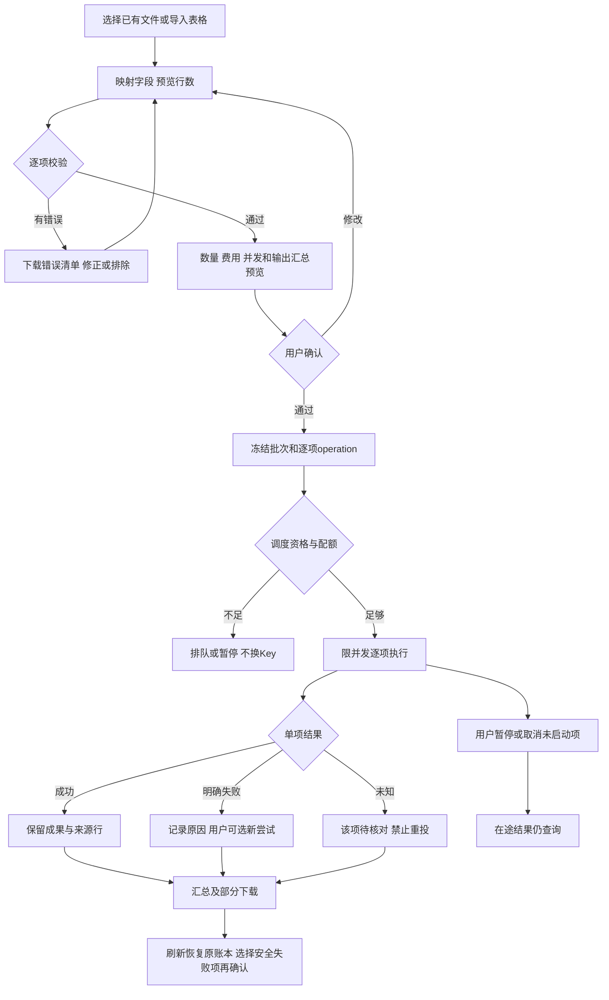

# 任务包27：批量任务
版本：完整规格稿1｜2026-11-04｜状态：SPEC_READY_FOR_ASSIGNMENT（规格已扩写，未指派/未实现/未验收）。类型：用户交互型：逐项账本与部分结果。用户已通过09/10示范深度并授权本轮扩写；本包下列“待用户拍板”仍为建议，不能当既定产品决定。原01–08据用户确认已由Gemini完成，本轮不重写；交付、主审、集成、上线状态分开登记。
阅读：[主台账](REFACTOR-MASTER-TRACKER-20261103.md)、[研发交付流程](ENGINEERING-DELIVERY-WORKFLOW.md)、[技术入门](DEVELOPER-ONBOARDING.md)。领取填写负责人、实现者、独立测试者、实际base/branch、OS/Node、dirty文件归属及依赖契约版本；bbd9997仅历史参考，不是自动可发布版本。

## 1. 结果、范围与分类依据
用户导入多个文件或表格行，先校验映射、数量、每项任务和费用，再启动受限批次；每项成功/失败/未知可见，可下载部分成果。恢复不重投已成功或未知项。
首期有界批次、逐项状态与汇总，不承诺事务式全有全无；并发按33测量，媒体批量不因08路由存在自动获准。

## 2. 复用核查、依赖与所有权
先对锁定DSH 0.1.1-rc.2交“需求—原生/插件/现有接缝—版本/导出证据—配置或接线—缺口—AC”矩阵，原生直接用→配置→产品接线→现插件/受控升级→证据缺口最小补充。下表是开工核查点，不是本轮已跑SDK/已证实新能力；负责人确认缺口后才能实现，不另造Agent循环、执行器或审批引擎。

| 能力/核查来源 | 本包接线、证明及缺口边界 |
|---|---|
| DSH工具/子任务、08路由及13/既有scheduler | 复用单项执行，批次只聚合输入/确认/账本，不复制Agent |
| 03产物/导出与既有CSV解析 | 复用格式校验、产物ACL和下载，不按表格字符串拼命令 |

依赖及并行边界：03/08/13/33及05审批、07费用；26可引用已批准批量模板但不绕过本包预览授权。
独占交付：`shell/candidates/product-batch-20261103/`（CONTRACT.md、REUSE-MATRIX.md、实现或方案、UI/fixture、接线建议）、`tests/probes/product-batch-20261103.mjs`、`docs/refactor/evidence/PRODUCT-BATCH-20261103.md`。方案/验收包交可执行方案与证据，不制造空产品模块。共享server/runner/public/tenant/profile/迁移/package/lock由负责人集成，只交补丁建议；不改Gemini原8包、Bug窗口、tests/e2e/或其他包。测试目录所有权先协调；禁覆盖dirty文件、旧归档或线上r28。
本包不产生部署、付费、外发、资源采购、merge/push或电脑控制授权；真实操作按具体范围另核已有授权。日志/报告不存Key、Cookie、私密原文、签名URL，fixture合成且数据/凭据/DB与生产隔离。

## 3. 用户旅程决策树
范围内每条边由下表解释；后台契约不能替代默认界面和恢复动作。刷新、权限撤销、并发及未知结果也列入验收。

## 4. 分步详解表

| 节点/触发 | 默认界面与系统动作 | 用户动作、兜底条件与禁止行为 | 对应AC |
|---|---|---|---|
| A/B 选输入与映射 | 默认选已有授权文件，需新文件才上传；显示表头/样例、行数、必填映射 | CSV公式/路径/单元格作为数据不执行，超限具名拒绝 | 27-01 |
| C/D 逐项预检 | 显示有效/无效/重复数量与行号错误，允许下载错误表 | 用户主动排除错误项后重算，不静默少跑；隐私字段脱敏 | 27-02 |
| E/F 确认 | 显示模式/模型、每项参数、费用已知程度、并发上限和部分失败策略 | 未知总费用不装精确总价；权限/预算不够禁启动 | 27-03 |
| G 冻结批次 | 分配稳定batch/item ID和输入摘要，防双击同批创建 | 同文件内容相同不等于同操作；显式新批次需新确认 | 27-04 |
| H/I/J 逐项执行 | 等待/运行/配额暂停逐项展示，取消未启动项可见 | 不绕PT限额，失租worker不重复派发，不自动切付费模型 | 27-05 |
| K/L/M/N 单项终态 | 成功有成果；失败有明确原因；未知独立待核对 | 未知不能选“失败重试”；已成功不跟着全批重跑 | 27-06 |
| O/P 暂停取消 | 暂停停新派发，取消未启动项；在途分本地/上游提示 | 不能把部分取消报全取消，已成功成果保留 | 27-07 |
| Q/R 汇总重试/重开 | 下载汇总含行号、结果/错误/费用状态；选择确证安全失败项新尝试 | 新尝试新ID并关联旧项、重新确认；恢复只读旧账本 | 27-08 |

## 5. 建议方案与待确认决策
以下是建议与决策责任；“待用户拍板”未获确认前不作为已定范围。负责人技术核实及外部回执不是要求用户代做调查。未决项阻断对应AC，不阻断无依赖的契约/fixture工作。

| 决策/责任 | 建议、原因与代价 | 未确认边界或需要的证据 |
|---|---|---|
| 27-D1 待用户拍板 | 建议首版最多100项、默认串行，先量成本和资源后提并发 | 100为建议非能力实测，媒体批次需更小上限/专门授权 |
| 27-D2 待用户拍板 | 默认遇普通单项错误继续其他独立项，安全/凭据/预算错误暂停整批 | 失败策略和用户可选排除方式确认后冻结 |
| 27-D3 负责人技术核实 | 逐项账本和lease复用13/现有scheduler，不新建执行引擎 | PG跨worker/崩溃与上游幂等事实需证据 |
| 27-D4 待用户拍板 | 汇总先CSV/ZIP受控下载，未知项单独清单 | ZIP大小/结果保留期由33确认，不承诺永久缓存所有媒体 |

## 6. 契约、数据与恢复
接口名称为目标语义，不自动表示现有HTTP端点已实现。CONTRACT冻结可信身份、输入/输出/schema版本、错误码与UI/调用方映射；复用现有错误，拒绝将失败全部报500。

| 操作/记录 | 必须保持的语义 |
|---|---|
| 批次 | batchId/version、inputSHA、mapping/model/params、confirmedItems、approval/budget/concurrency |
| 单项 | itemId/inputDigest/operation/attempt、lease/RunRef、state/result/error/billing，未知与失败不同 |
| 汇总 | row→attempt→resultRef，下载范围按owner，重试新attempt仅确证未受理项 |

跨边界读写逐次校验owner/tenant及本包project/device/Run范围；客户端ID不授予权限。状态和版本持久化，重复同operation同payload返回原结果，异参冲突；取消/超时/断网不自动证明外部动作失败或停止计费。外部写入未知先核对，不盲重试/换模型重提。存储变更需真实PGlite及隔离PG验证，迁移编号由负责人分配；纯调查包此项按无产品写入注明不适用。历史源证据不可覆写，修订形成新版本。

## 7. 验收矩阵与测试责任
每个AC交实现/方案位置、fixture、执行命令、退出码、PASS/FAIL/BLOCKED与脱敏证据；未决或未授权不计PASS。下列是将来执行要求，本轮没有实现或业务通过声明。

| AC | 通过标准 | 验证方式 |
|---|---|---|
| 27-01 | A/B：格式/编码/空表/重复行/恶意单元格校验通过 | 确定性接口/SDK＋staging点击E2E |
| 27-02 | C/D：排除前后数量、行映射及输入版本一致 | 确定性接口/SDK＋staging点击E2E |
| 27-03 | E/F：确认内容与请求一致，未确认零调用 | 确定性接口/SDK＋staging点击E2E |
| 27-04 | G：重复operation幂等、异参冲突、原输入不可变 | 确定性接口/SDK＋staging点击E2E |
| 27-05 | H/I/J：在途上限、租约和队列公平可测 | 确定性接口/SDK＋staging点击E2E |
| 27-06 | K/L/M/N：多状态混合及外部提交计数正确 | 确定性接口/SDK＋staging点击E2E |
| 27-07 | O/P：各阶段取消/重启/晚到状态单调 | 确定性接口/SDK＋staging点击E2E |
| 27-08 | Q/R：部分下载/跨租户/刷新/安全重试不重投成功或未知项 | 确定性接口/SDK＋staging点击E2E |
| 27-09 | 伪造身份/资源引用、权限撤销、日志/证据敏感信息均拒绝或脱敏，不扩大依赖权限 | 双身份/仓储负向及证据扫描 |
| 27-10 | 重复操作、并发版本变化、断线/重启与结果未知不造成重复副作用；恢复依据权威记录 | 并发/故障fixture；方案包核实执行证据 |
| 27-11 | 本包变更与同版累计功能兼容；未跑真实上游/生产的项目仍待验，不将fixture写成上线成功 | 负责人受影响回归＋独立测试/证据复核 |

开发者/执行者交`node tests/probes/product-batch-20261103.mjs`的实现后实际运行方法（方案包可由该入口验证清单/证据或交等价可复跑命令并解释），真实调用候选/锁定SDK/协议服务/存储而非镜像常量，失败非零。无代码阶段不制造假探针通过。独立测试者复核负向反例；涉及界面的AC必须实际点击，API辅助不能全部替代；纯后端包不强制点击E2E，核实业务影响即可。
真实PT调用与付费次数、生产写入/故障、电脑动作独立授权；确定性模型/本地协议轨、真实PT轨、staging与production证据分开。未获授权保留BLOCKED，不能抹掉失败或把未执行算不适用。测试证据绑定应用/配置/迁移/用例版本与fixture SHA。

## 8. 资源、Plan B与进度影响
输入/结果临时盘、ZIP流式下载、DB逐项账本与PT在途；先小规模测量，未知不重投优先于吞吐。
## PT依赖、Plan B与进度影响
| PT依赖/需求编号 | Plan B | 进度/验收影响 |
|---|---|---|
| PT-04/07，批量额度和恢复 | 保守串行/限并发、逐项账本、未知人工 | 批量UI/调度继续；扩量/无人值守验收受影响 |
依据：[PT接口规格v1.1第15节](PT-API-REQUIREMENTS-20261104.md)。PT未接受建议接口形态时先映射既有协议；遵循DSH最大复用原则。上述Plan B为规划候选，不表示已验证或获准额外模型/资源/供应商调用；原范围未满足仍标未完成，变更需用户确认。签署协议仅已签署/未签署，无有效期/续签；资产启用及凭据/缓存/资源有效期分别处理。

## 9. 里程碑、交付与接入
| 阶段 | 本包产出与放行依据 |
|---|---|
| M0 冻结 | 分类、范围、复用矩阵、依赖契约、上述决策、节点/阶段→AC及可量化限制；负责人确认接口缺口，用户只拍板产品/成本/资源选择 |
| M1 核心候选/方案 | 输入/映射/预检与费用数量确认 |
| M2 失败与恢复 | 逐项持久状态、部分失败/未知、取消/重启反例 |
| M3 独立主审/接入 | 限并发与逐项产物/汇总接线；负责人独占共享接线，运行受影响回归 |
| M4 同版验收/发布 | 导入→排错→确认→部分结果→安全重试重开E2E；有发布授权才冻结归档并切换，production专属租户受控冒烟 |

交付报告含base/commit/文件SHA、依赖契约版本、命令/退出码/通过失败阻塞数、AC映射、替身/真实边界、遗留Bug与责任、安装/挂载/清理/回退说明。Bug原作者自测后独立复测，主审/集成/发布各阶段分别登记。关闭新入口不等于撤销已提交数据或终止外部任务；回退保留历史可读和必要对账，数据库不自动逆迁。当前仅规格扩写完成，尚未分配、实现、主审、集成、本地/测试环境验收或发布；不能凭文档数量计算产品完成度。
