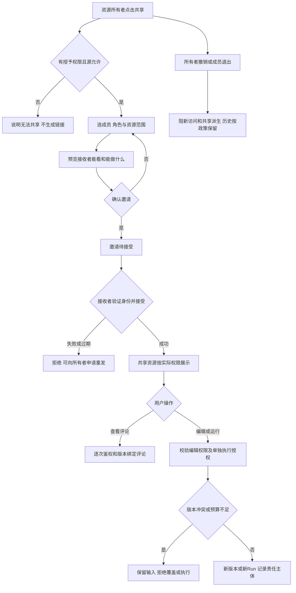

# 任务包28：团队共享与协作
版本：完整规格稿1｜2026-11-04｜状态：SPEC_READY_FOR_ASSIGNMENT（规格已扩写，未指派/未实现/未验收）。类型：用户交互型：资源授权和撤销。用户已通过09/10示范深度并授权本轮扩写；本包下列“待用户拍板”仍为建议，不能当既定产品决定。原01–08据用户确认已由Gemini完成，本轮不重写；交付、主审、集成、上线状态分开登记。
阅读：[主台账](REFACTOR-MASTER-TRACKER-20261103.md)、[研发交付流程](ENGINEERING-DELIVERY-WORKFLOW.md)、[技术入门](DEVELOPER-ONBOARDING.md)。领取填写负责人、实现者、独立测试者、实际base/branch、OS/Node、dirty文件归属及依赖契约版本；bbd9997仅历史参考，不是自动可发布版本。

## 1. 结果、范围与分类依据
用户对项目、资料、模板或成果选择查看/编辑范围，接收者看见来源与权限，可评论或按范围协作；撤销、成员退出和源权限变化立即限制新访问，不共享Key或放大源权限。
首期具名成员/邀请和资源ACL，不默认公共匿名链接，不承诺多人实时同文编辑。Run执行权限、资源编辑和模型计费主体分别说明。

## 2. 复用核查、依赖与所有权
先对锁定DSH 0.1.1-rc.2交“需求—原生/插件/现有接缝—版本/导出证据—配置或接线—缺口—AC”矩阵，原生直接用→配置→产品接线→现插件/受控升级→证据缺口最小补充。下表是开工核查点，不是本轮已跑SDK/已证实新能力；负责人确认缺口后才能实现，不另造Agent循环、执行器或审批引擎。

| 能力/核查来源 | 本包接线、证明及缺口边界 |
|---|---|
| 原生Session/产物/工具权限 | 复用会话投影但不将Session当团队ACL；共享不复制执行凭据 |
| 19项目/22批注与tenant授权仓储 | 资源范围/版本/评论用既有数据模型，加入grant交集检查 |

依赖及并行边界：19项目、22批注、35C数据/凭据；不把团队共享当跨tenant任意读取豁免。
独占交付：`shell/candidates/product-collab-20261103/`（CONTRACT.md、REUSE-MATRIX.md、实现或方案、UI/fixture、接线建议）、`tests/probes/product-collab-20261103.mjs`、`docs/refactor/evidence/PRODUCT-COLLAB-20261103.md`。方案/验收包交可执行方案与证据，不制造空产品模块。共享server/runner/public/tenant/profile/迁移/package/lock由负责人集成，只交补丁建议；不改Gemini原8包、Bug窗口、tests/e2e/或其他包。测试目录所有权先协调；禁覆盖dirty文件、旧归档或线上r28。
本包不产生部署、付费、外发、资源采购、merge/push或电脑控制授权；真实操作按具体范围另核已有授权。日志/报告不存Key、Cookie、私密原文、签名URL，fixture合成且数据/凭据/DB与生产隔离。

## 3. 用户旅程决策树
范围内每条边由下表解释；后台契约不能替代默认界面和恢复动作。刷新、权限撤销、并发及未知结果也列入验收。

## 4. 分步详解表

| 节点/触发 | 默认界面与系统动作 | 用户动作、兜底条件与禁止行为 | 对应AC |
|---|---|---|---|
| A/B/C 共享入口 | 显示资源来源和当前权限，只有可授予者有共享操作 | 源不允许再共享时禁用，不凭拥有副本元数据扩大权限 | 28-01 |
| D/E/F 选成员/角色 | 默认具名查看权限，列文件/子资源及继承范围，确认后发邀请 | 角色提升需显式确认，不自动包含个人记忆/Key/未选资料 | 28-02 |
| G/H/I 接受邀请 | 登录验证目标身份后展示邀请内容、有效期和接受/拒绝 | 错账号/过期/已撤销拒绝，不因知道URL就授权 | 28-03 |
| J/K/L 查看评论 | 按权限只读，评论绑定资源版本，作者可识别 | 评论不执行模型或改变文件；撤权后旧页面请求被拒 | 28-04 |
| M/N/O/P 编辑或运行 | 显示谁承担任务/费用，编辑生成新版本，执行走计划确认 | 有编辑权不等于能用所有者Key；冲突保留修改不覆盖 | 28-05 |
| Q/R 撤销/退出 | 预览受影响资源和活动Run，撤销后阻新请求/新共享 | 已发外部任务不假停；已下载副本不能承诺远程收回 | 28-06 |
| J 归档/来源失效/重开 | 源删除或归档标不可用，历史记录保留来源与权限变化 | 没有源权不能靠共享ACL继续取原文，归档不创建新Run | 28-07 |

## 5. 建议方案与待确认决策
以下是建议与决策责任；“待用户拍板”未获确认前不作为已定范围。负责人技术核实及外部回执不是要求用户代做调查。未决项阻断对应AC，不阻断无依赖的契约/fixture工作。

| 决策/责任 | 建议、原因与代价 | 未确认边界或需要的证据 |
|---|---|---|
| 28-D1 待用户拍板 | 建议首期仅具名成员、查看/编辑两级，不做匿名公开链接 | 团队组织范围、邀请渠道和成员管理方式需确认 |
| 28-D2 待用户拍板 | 默认共享不带个人记忆/密钥，执行使用执行者获准Key或明确团队账单主体 | 团队公共Key/账单若要支持须独立安全/费用方案，不自动实现 |
| 28-D3 负责人技术核实 | 有效权限是资源共享与源权限交集，变更需失效缓存 | 源系统/文件引用的再共享能力及活动Run撤权边界与35C核实 |
| 28-D4 待用户拍板 | 建议评论可保留为脱敏历史，撤权成员不能新读取正文 | 成员退出后的评论署名/数据保留与删除权待政策确认 |

## 6. 契约、数据与恢复
接口名称为目标语义，不自动表示现有HTTP端点已实现。CONTRACT冻结可信身份、输入/输出/schema版本、错误码与UI/调用方映射；复用现有错误，拒绝将失败全部报500。

| 操作/记录 | 必须保持的语义 |
|---|---|
| 邀请/grant | issuer/recipient、tenant/team/resource/scope/role/version、expires/revoked、一次accept操作 |
| 资源权限 | sourceACL∩grant∩actorRole，下载/批注/编辑/Run单独检查；授权缓存有失效版本 |
| 审计 | 分享/接受/提升/撤销/退出actor及时间，执行费用主体单独绑定，不记录Key |

跨边界读写逐次校验owner/tenant及本包project/device/Run范围；客户端ID不授予权限。状态和版本持久化，重复同operation同payload返回原结果，异参冲突；取消/超时/断网不自动证明外部动作失败或停止计费。外部写入未知先核对，不盲重试/换模型重提。存储变更需真实PGlite及隔离PG验证，迁移编号由负责人分配；纯调查包此项按无产品写入注明不适用。历史源证据不可覆写，修订形成新版本。

## 7. 验收矩阵与测试责任
每个AC交实现/方案位置、fixture、执行命令、退出码、PASS/FAIL/BLOCKED与脱敏证据；未决或未授权不计PASS。下列是将来执行要求，本轮没有实现或业务通过声明。

| AC | 通过标准 | 验证方式 |
|---|---|---|
| 28-01 | A/B：所有者/只读者/源禁止共享三态正确 | 确定性接口/SDK＋staging点击E2E |
| 28-02 | D/E/F：ACL摘要与实际可见集合一致，重复邀请幂等 | 确定性接口/SDK＋staging点击E2E |
| 28-03 | G/H/I：邀请泄漏/转发/重复接受不越权 | 确定性接口/SDK＋staging点击E2E |
| 28-04 | J/L：查看/评论/预览下载ACL一致 | 确定性接口/SDK＋staging点击E2E |
| 28-05 | M/N/O/P：并发编辑/预算/Key隔离与新批准通过 | 确定性接口/SDK＋staging点击E2E |
| 28-06 | Q/R：缓存失效、邀请撤回、成员退出与在途边界可查 | 确定性接口/SDK＋staging点击E2E |
| 28-07 | J：源ACL交集、历史重开和跨团队访问拒绝 | 确定性接口/SDK＋staging点击E2E |
| 28-08 | 伪造身份/资源引用、权限撤销、日志/证据敏感信息均拒绝或脱敏，不扩大依赖权限 | 双身份/仓储负向及证据扫描 |
| 28-09 | 重复操作、并发版本变化、断线/重启与结果未知不造成重复副作用；恢复依据权威记录 | 并发/故障fixture；方案包核实执行证据 |
| 28-10 | 本包变更与同版累计功能兼容；未跑真实上游/生产的项目仍待验，不将fixture写成上线成功 | 负责人受影响回归＋独立测试/证据复核 |

开发者/执行者交`node tests/probes/product-collab-20261103.mjs`的实现后实际运行方法（方案包可由该入口验证清单/证据或交等价可复跑命令并解释），真实调用候选/锁定SDK/协议服务/存储而非镜像常量，失败非零。无代码阶段不制造假探针通过。独立测试者复核负向反例；涉及界面的AC必须实际点击，API辅助不能全部替代；纯后端包不强制点击E2E，核实业务影响即可。
真实PT调用与付费次数、生产写入/故障、电脑动作独立授权；确定性模型/本地协议轨、真实PT轨、staging与production证据分开。未获授权保留BLOCKED，不能抹掉失败或把未执行算不适用。测试证据绑定应用/配置/迁移/用例版本与fixture SHA。

## 8. 资源、Plan B与进度影响
多身份/团队fixture、邀请测试渠道；站内邀请可先做，外发消息需要明确通道授权。
## PT依赖、Plan B与进度影响
| PT依赖/需求编号 | Plan B | 进度/验收影响 |
|---|---|---|
| 无新增；共享模型任务沿既有能力 | DSH会话/产物+团队ACL | 协作独立推进；不得共享Key或放大源权限 |
依据：[PT接口规格v1.1第15节](PT-API-REQUIREMENTS-20261104.md)。PT未接受建议接口形态时先映射既有协议；遵循DSH最大复用原则。上述Plan B为规划候选，不表示已验证或获准额外模型/资源/供应商调用；原范围未满足仍标未完成，变更需用户确认。签署协议仅已签署/未签署，无有效期/续签；资产启用及凭据/缓存/资源有效期分别处理。

## 9. 里程碑、交付与接入
| 阶段 | 本包产出与放行依据 |
|---|---|
| M0 冻结 | 分类、范围、复用矩阵、依赖契约、上述决策、节点/阶段→AC及可量化限制；负责人确认接口缺口，用户只拍板产品/成本/资源选择 |
| M1 核心候选/方案 | 成员/角色/资源范围与邀请UI |
| M2 失败与恢复 | 转发邀请、撤权、源权限交集、并发反例 |
| M3 独立主审/接入 | 项目/产物/批注ACL及费用主体接线；负责人独占共享接线，运行受影响回归 |
| M4 同版验收/发布 | 共享→接受→协作→撤销/退出→历史E2E；有发布授权才冻结归档并切换，production专属租户受控冒烟 |

交付报告含base/commit/文件SHA、依赖契约版本、命令/退出码/通过失败阻塞数、AC映射、替身/真实边界、遗留Bug与责任、安装/挂载/清理/回退说明。Bug原作者自测后独立复测，主审/集成/发布各阶段分别登记。关闭新入口不等于撤销已提交数据或终止外部任务；回退保留历史可读和必要对账，数据库不自动逆迁。当前仅规格扩写完成，尚未分配、实现、主审、集成、本地/测试环境验收或发布；不能凭文档数量计算产品完成度。
