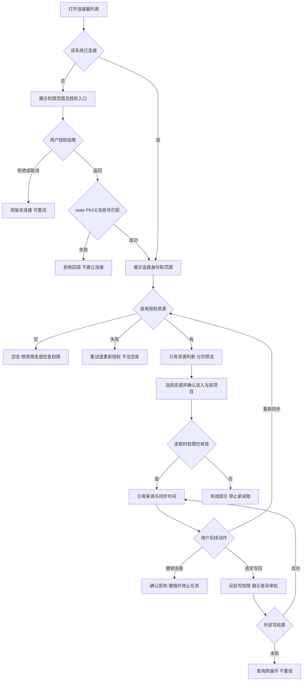

# 任务包25：第三方资料与应用连接
版本：完整规格稿1｜2026-11-04｜状态：SPEC_READY_FOR_ASSIGNMENT（规格已扩写，未指派/未实现/未验收）。类型：用户交互型：授权跳转与资源选择。用户已通过09/10示范深度并授权本轮扩写；本包下列“待用户拍板”仍为建议，不能当既定产品决定。原01–08据用户确认已由Gemini完成，本轮不重写；交付、主审、集成、上线状态分开登记。
阅读：[主台账](REFACTOR-MASTER-TRACKER-20261103.md)、[研发交付流程](ENGINEERING-DELIVERY-WORKFLOW.md)、[技术入门](DEVELOPER-ONBOARDING.md)。领取填写负责人、实现者、独立测试者、实际base/branch、OS/Node、dirty文件归属及依赖契约版本；bbd9997仅历史参考，不是自动可发布版本。

## 1. 结果、范围与分类依据
先闭合一个核心第三方系统的显式连接、授权返回、已有资料选择、引用使用、失效重连和撤销流程；用户看清读取与写回范围。连接成功不表示拥有整个组织或全部文件的权限。
首期单系统只读，写回作为有独立确认的后续模式；不能承诺一次覆盖所有应用。Google登录与资料连接授权分开，不替换现有登录、不索取第三方密码。

## 2. 复用核查、依赖与所有权
先对锁定DSH 0.1.1-rc.2交“需求—原生/插件/现有接缝—版本/导出证据—配置或接线—缺口—AC”矩阵，原生直接用→配置→产品接线→现插件/受控升级→证据缺口最小补充。下表是开工核查点，不是本轮已跑SDK/已证实新能力；负责人确认缺口后才能实现，不另造Agent循环、执行器或审批引擎。

| 能力/核查来源 | 本包接线、证明及缺口边界 |
|---|---|
| 锁定DSH MCP/工具插件与provider | 先查所选系统已有插件/协议，不另造工具调用循环 |
| shell/tenant.cjs与既有连接凭据/资料入口 | 核对现有授权存储和source ACL，复用项目/检索/产物仓储，不混登录token与BYOK |

依赖及并行边界：04联网、05审批、19项目、35C凭据；31模型工具接线不提供第三方数据访问权。
独占交付：`shell/candidates/product-connectors-20261103/`（CONTRACT.md、REUSE-MATRIX.md、实现或方案、UI/fixture、接线建议）、`tests/probes/product-connectors-20261103.mjs`、`docs/refactor/evidence/PRODUCT-CONNECTORS-20261103.md`。方案/验收包交可执行方案与证据，不制造空产品模块。共享server/runner/public/tenant/profile/迁移/package/lock由负责人集成，只交补丁建议；不改Gemini原8包、Bug窗口、tests/e2e/或其他包。测试目录所有权先协调；禁覆盖dirty文件、旧归档或线上r28。
本包不产生部署、付费、外发、资源采购、merge/push或电脑控制授权；真实操作按具体范围另核已有授权。日志/报告不存Key、Cookie、私密原文、签名URL，fixture合成且数据/凭据/DB与生产隔离。

## 3. 用户旅程决策树
范围内每条边由下表解释；后台契约不能替代默认界面和恢复动作。刷新、权限撤销、并发及未知结果也列入验收。

## 4. 分步详解表

| 节点/触发 | 默认界面与系统动作 | 用户动作、兜底条件与禁止行为 | 对应AC |
|---|---|---|---|
| A/B/C 连接入口 | 默认展示已支持系统、未连接态、具体只读权限和用途 | 未选定首系统不假展示全支持；无连接先授权而非报通用错误 | 25-01 |
| D/E/F/G 外部授权 | 新页授权，返回核对state/PKCE/nonce与当前账号/连接请求 | 用户拒绝/关闭/超时有返回重试，伪造/重复回调拒绝，换账号不误绑 | 25-02 |
| H 连接状态 | 显示外部账号匿名身份、已授scope和更新时间 | token失效不重复弹窗，用户主动重连；不显示secret | 25-03 |
| I/J/K/L 资源列表 | 已有资源优先，按来源/类型分页筛选并有界预览 | 空/筛选空/接口错/权限不足分开；不因列表失败扫描全部组织 | 25-04 |
| M/N/O/P 加入与读取 | 预览加入项目影响，确认后只保留授权引用及来源时间 | 源权限变更/删除时停新读取并标失效，不使用跨租户缓存兜底 | 25-05 |
| Q 同步/离开 | 显示同步中/最后成功/部分失败，刷新恢复原操作 | 同一资源重复点击不重复写库；取消本地同步不承诺停止第三方 | 25-06 |
| R 撤销 | 显示会影响项目/任务，确认后撤token并阻新访问 | 历史是否留快照按治理决策；正在外部写入未知先核对 | 25-07 |
| S/T/U 后续写回 | 只在已批准写模式显示，预览目标、差异、费用/副作用和确认 | 无写scope禁用；结果未知查原operation，不能重试覆盖 | 25-08 |

## 5. 建议方案与待确认决策
以下是建议与决策责任；“待用户拍板”未获确认前不作为已定范围。负责人技术核实及外部回执不是要求用户代做调查。未决项阻断对应AC，不阻断无依赖的契约/fixture工作。

| 决策/责任 | 建议、原因与代价 | 未确认边界或需要的证据 |
|---|---|---|
| 25-D1 待用户拍板 | 首期先选一个最常用系统只读接入，建议按实际资料量和现有原生插件覆盖选择 | 具体系统尚未选定，负责人先交候选能力/授权成本，不由实现者自选承诺 |
| 25-D2 待用户拍板 | 默认引用不复制全库，用户显式选择才同步到项目 | 离线快照保留/删除政策与35C联动确认，撤权后新访问必须停 |
| 25-D3 负责人技术核实 | 优先DSH已有MCP/connector及官方OAuth，客户端注册/回调需测试环境隔离 | token加密、scope与资源ACL、第三方速率限制提供实际证据 |
| 25-D4 待用户拍板 | 写回后置，首轮验收只读完整闭环 | 若确需首版写回，需明确系统/对象/冲突策略及审批，不能默认扩scope |

## 6. 契约、数据与恢复
接口名称为目标语义，不自动表示现有HTTP端点已实现。CONTRACT冻结可信身份、输入/输出/schema版本、错误码与UI/调用方映射；复用现有错误，拒绝将失败全部报500。

| 操作/记录 | 必须保持的语义 |
|---|---|
| 连接 | tenant/owner/connectorId/providerAccountRef、scope、encryptedTokenRef、state/expiry/version，账号绑定不可由客户端伪造 |
| 资料 | sourceRef/version/permissionSnapshot、projectLink、syncCursor/lastSuccess；读时重新检查源权限 |
| 授权/写回操作 | 一次authRequest/state/PKCE、批准/target/baseVersion/operation；外部结果未知独立记录，不自动重复 |

跨边界读写逐次校验owner/tenant及本包project/device/Run范围；客户端ID不授予权限。状态和版本持久化，重复同operation同payload返回原结果，异参冲突；取消/超时/断网不自动证明外部动作失败或停止计费。外部写入未知先核对，不盲重试/换模型重提。存储变更需真实PGlite及隔离PG验证，迁移编号由负责人分配；纯调查包此项按无产品写入注明不适用。历史源证据不可覆写，修订形成新版本。

## 7. 验收矩阵与测试责任
每个AC交实现/方案位置、fixture、执行命令、退出码、PASS/FAIL/BLOCKED与脱敏证据；未决或未授权不计PASS。下列是将来执行要求，本轮没有实现或业务通过声明。

| AC | 通过标准 | 验证方式 |
|---|---|---|
| 25-01 | A/B/C：已连接/未连接/不支持状态正确 | 确定性接口/SDK＋staging点击E2E |
| 25-02 | D/E/F/G：拒绝/过期/重放/账号不符均无token入错租户 | 确定性接口/SDK＋staging点击E2E |
| 25-03 | H：只读/过期/revoked界面与实际scope一致 | 确定性接口/SDK＋staging点击E2E |
| 25-04 | I/J/K/L：分页、失败重试、搜索ACL及超大资源限制通过 | 确定性接口/SDK＋staging点击E2E |
| 25-05 | M/N/O/P：跨账号/撤权/删除同步与引用来源正确 | 确定性接口/SDK＋staging点击E2E |
| 25-06 | Q：同步幂等、限流/超时/刷新不重复读取成本失控 | 确定性接口/SDK＋staging点击E2E |
| 25-07 | R：撤销后后台任务/新Run不能继续使用凭据 | 确定性接口/SDK＋staging点击E2E |
| 25-08 | S/T/U：默认只读零外写，写回批准/未知/并发冲突反例通过 | 确定性接口/SDK＋staging点击E2E |
| 25-09 | 伪造身份/资源引用、权限撤销、日志/证据敏感信息均拒绝或脱敏，不扩大依赖权限 | 双身份/仓储负向及证据扫描 |
| 25-10 | 重复操作、并发版本变化、断线/重启与结果未知不造成重复副作用；恢复依据权威记录 | 并发/故障fixture；方案包核实执行证据 |
| 25-11 | 本包变更与同版累计功能兼容；未跑真实上游/生产的项目仍待验，不将fixture写成上线成功 | 负责人受影响回归＋独立测试/证据复核 |

开发者/执行者交`node tests/probes/product-connectors-20261103.mjs`的实现后实际运行方法（方案包可由该入口验证清单/证据或交等价可复跑命令并解释），真实调用候选/锁定SDK/协议服务/存储而非镜像常量，失败非零。无代码阶段不制造假探针通过。独立测试者复核负向反例；涉及界面的AC必须实际点击，API辅助不能全部替代；纯后端包不强制点击E2E，核实业务影响即可。
真实PT调用与付费次数、生产写入/故障、电脑动作独立授权；确定性模型/本地协议轨、真实PT轨、staging与production证据分开。未获授权保留BLOCKED，不能抹掉失败或把未执行算不适用。测试证据绑定应用/配置/迁移/用例版本与fixture SHA。

## 8. 资源、Plan B与进度影响
需所选系统测试租户/应用注册/回调域名、只读测试账号和官方限流资料；没有这些可先协议fixture，不冒充实际授权完成。
## PT依赖、Plan B与进度影响
| PT依赖/需求编号 | Plan B | 进度/验收影响 |
|---|---|---|
| PT-03调用工具；外部系统授权独立 | 现有DSH插件/MCP，先只读单系统 | 连接器可独立做；外部系统授权也是单独依赖 |
依据：[PT接口规格v1.1第15节](PT-API-REQUIREMENTS-20261104.md)。PT未接受建议接口形态时先映射既有协议；遵循DSH最大复用原则。上述Plan B为规划候选，不表示已验证或获准额外模型/资源/供应商调用；原范围未满足仍标未完成，变更需用户确认。签署协议仅已签署/未签署，无有效期/续签；资产启用及凭据/缓存/资源有效期分别处理。

## 9. 里程碑、交付与接入
| 阶段 | 本包产出与放行依据 |
|---|---|
| M0 冻结 | 分类、范围、复用矩阵、依赖契约、上述决策、节点/阶段→AC及可量化限制；负责人确认接口缺口，用户只拍板产品/成本/资源选择 |
| M1 核心候选/方案 | 单系统scope/原生复用矩阵与授权资源UI |
| M2 失败与恢复 | 回调攻击、失效撤销、ACL、限流与重复同步反例 |
| M3 独立主审/接入 | 凭据/来源/项目和只读工具接线；负责人独占共享接线，运行受影响回归 |
| M4 同版验收/发布 | 授权→选资源→引用→失效重连→撤销E2E；有发布授权才冻结归档并切换，production专属租户受控冒烟 |

交付报告含base/commit/文件SHA、依赖契约版本、命令/退出码/通过失败阻塞数、AC映射、替身/真实边界、遗留Bug与责任、安装/挂载/清理/回退说明。Bug原作者自测后独立复测，主审/集成/发布各阶段分别登记。关闭新入口不等于撤销已提交数据或终止外部任务；回退保留历史可读和必要对账，数据库不自动逆迁。当前仅规格扩写完成，尚未分配、实现、主审、集成、本地/测试环境验收或发布；不能凭文档数量计算产品完成度。
