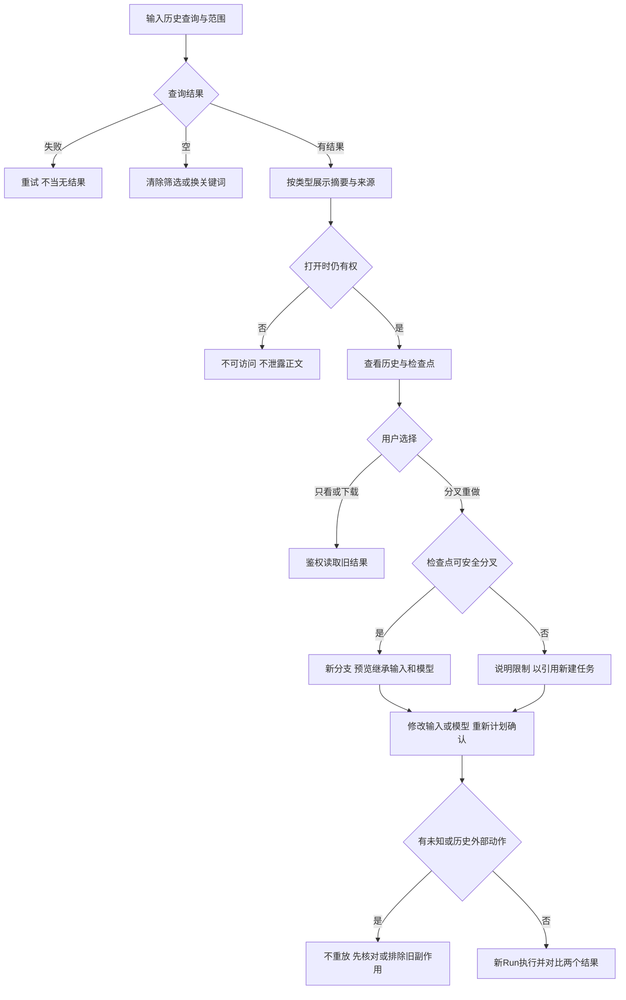

# 任务包23：历史搜索、分叉与重做
版本：完整规格稿1｜2026-11-04｜状态：SPEC_READY_FOR_ASSIGNMENT（规格已扩写，未指派/未实现/未验收）。类型：用户交互型：可追溯检索与安全分叉。用户已通过09/10示范深度并授权本轮扩写；本包下列“待用户拍板”仍为建议，不能当既定产品决定。原01–08据用户确认已由Gemini完成，本轮不重写；交付、主审、集成、上线状态分开登记。
阅读：[主台账](REFACTOR-MASTER-TRACKER-20261103.md)、[研发交付流程](ENGINEERING-DELIVERY-WORKFLOW.md)、[技术入门](DEVELOPER-ONBOARDING.md)。领取填写负责人、实现者、独立测试者、实际base/branch、OS/Node、dirty文件归属及依赖契约版本；bbd9997仅历史参考，不是自动可发布版本。

## 1. 结果、范围与分类依据
用户按项目/对话/Run/产物找到历史，从确切检查点新建分支，改输入或模型后重新确认执行，并能对照旧结果。历史不是可以任意重放副作用的脚本。
首期权限过滤关键词检索＋可验证的Session分叉；全文/向量检索只有锁定能力和索引权限证据后开。无安全恢复语义时允许带引用创建新任务，不能冒充原地继续。

## 2. 复用核查、依赖与所有权
先对锁定DSH 0.1.1-rc.2交“需求—原生/插件/现有接缝—版本/导出证据—配置或接线—缺口—AC”矩阵，原生直接用→配置→产品接线→现插件/受控升级→证据缺口最小补充。下表是开工核查点，不是本轮已跑SDK/已证实新能力；负责人确认缺口后才能实现，不另造Agent循环、执行器或审批引擎。

| 能力/核查来源 | 本包接线、证明及缺口边界 |
|---|---|
| DSH Session查询/投影/分叉能力 | 核实锁定导出和持久事件兼容，不另造Session历史引擎 |
| shell/tasks/session-runs.cjs与产物ACL | 索引范围与打开权限双检；数据源删除同步失效投影 |

依赖及并行边界：14累计验收、15恢复、17版本、20计划与19项目；原历史不因分叉被迁移或清空。
独占交付：`shell/candidates/product-history-20261103/`（CONTRACT.md、REUSE-MATRIX.md、实现或方案、UI/fixture、接线建议）、`tests/probes/product-history-20261103.mjs`、`docs/refactor/evidence/PRODUCT-HISTORY-20261103.md`。方案/验收包交可执行方案与证据，不制造空产品模块。共享server/runner/public/tenant/profile/迁移/package/lock由负责人集成，只交补丁建议；不改Gemini原8包、Bug窗口、tests/e2e/或其他包。测试目录所有权先协调；禁覆盖dirty文件、旧归档或线上r28。
本包不产生部署、付费、外发、资源采购、merge/push或电脑控制授权；真实操作按具体范围另核已有授权。日志/报告不存Key、Cookie、私密原文、签名URL，fixture合成且数据/凭据/DB与生产隔离。

## 3. 用户旅程决策树
范围内每条边由下表解释；后台契约不能替代默认界面和恢复动作。刷新、权限撤销、并发及未知结果也列入验收。

## 4. 分步详解表

| 节点/触发 | 默认界面与系统动作 | 用户动作、兜底条件与禁止行为 | 对应AC |
|---|---|---|---|
| A/B/C/D 搜索 | 默认当前项目/本人授权范围、关键词、类型/时间筛选，分页 | 无结果与索引故障区别；内容摘要只取已授权字段 | 23-01 |
| E/F/G 打开结果 | 显示来源、时间、项目与可用性，打开再鉴权 | 索引残留的撤权资源不得回显正文，403/失效不枚举 | 23-02 |
| H/I/J 查看检查点 | 历史步骤/输入/工具结果/费用状态可读，已有产物单独下载 | 不因点开重执行工具，缺快照说明不可分叉 | 23-03 |
| K/L 不支持分叉 | 说明缺检查点或版本不兼容，提供选定引用新建任务 | 不能伪装恢复整个旧上下文，用户确认继承范围 | 23-04 |
| M 建立分支 | 展示父Session/checkpoint、新分支名和输入引用 | 原历史不变，不继承旧审批/token/Key授权；来源重验 | 23-05 |
| N 改输入/模型 | 展示新计划与能力/参数变化，要求新确认 | 不默带旧模型专属参数，重新核对费用和工具能力 | 23-06 |
| O/P 旧副作用未知 | 列已完成/未决外部任务和为何不能重放 | 默认排除旧写入；需重做者作为新操作重新确认，未知先人工核对 | 23-07 |
| Q 执行与对比/重开 | 新Run与父Run结果并列，标模型/输入/版本差异 | 结果失败/部分完成如实显示，不覆写旧成果 | 23-08 |

## 5. 建议方案与待确认决策
以下是建议与决策责任；“待用户拍板”未获确认前不作为已定范围。负责人技术核实及外部回执不是要求用户代做调查。未决项阻断对应AC，不阻断无依赖的契约/fixture工作。

| 决策/责任 | 建议、原因与代价 | 未确认边界或需要的证据 |
|---|---|---|
| 23-D1 待用户拍板 | 建议关键词＋范围筛选先行，全文/向量后置按规模评估 | 不把DSH默认关闭的搜索能力当无条件可用 |
| 23-D2 待用户拍板 | 建议分叉复制引用和输入快照，不复制旧工具执行权限 | 历史资源无法重新授权时是排除还是阻断整任务待确认 |
| 23-D3 负责人技术核实 | 先验证原生Session查询/分叉及检查点版本兼容 | 不能实现安全分叉时明确仅“引用新建”，缺分叉保持未完成 |
| 23-D4 待用户拍板 | 结果对比先元数据/文本/产物版本，复杂媒体内容差异后置 | 不额外调用模型自动评价两个结果，费用另授权 |

## 6. 契约、数据与恢复
接口名称为目标语义，不自动表示现有HTTP端点已实现。CONTRACT冻结可信身份、输入/输出/schema版本、错误码与UI/调用方映射；复用现有错误，拒绝将失败全部报500。

| 操作/记录 | 必须保持的语义 |
|---|---|
| 索引 | entityType/ref/version、scope、摘要与sourceACLVersion；撤权/删除失效，不缓存私密正文无界副本 |
| 分叉 | parentSession/checkpoint、childSession/Run、selectedInputRefs、能力快照与新批准，不继承执行token |
| 比较 | 左右Run/版本/参数/结果引用，保留失败和费用来源，不改旧证据 |

跨边界读写逐次校验owner/tenant及本包project/device/Run范围；客户端ID不授予权限。状态和版本持久化，重复同operation同payload返回原结果，异参冲突；取消/超时/断网不自动证明外部动作失败或停止计费。外部写入未知先核对，不盲重试/换模型重提。存储变更需真实PGlite及隔离PG验证，迁移编号由负责人分配；纯调查包此项按无产品写入注明不适用。历史源证据不可覆写，修订形成新版本。

## 7. 验收矩阵与测试责任
每个AC交实现/方案位置、fixture、执行命令、退出码、PASS/FAIL/BLOCKED与脱敏证据；未决或未授权不计PASS。下列是将来执行要求，本轮没有实现或业务通过声明。

| AC | 通过标准 | 验证方式 |
|---|---|---|
| 23-01 | A/B/C/D：范围过滤、分页、空/失败及跨项目检索正确 | 确定性接口/SDK＋staging点击E2E |
| 23-02 | E/F/G：删除/撤权后搜索与点开均不泄露 | 确定性接口/SDK＋staging点击E2E |
| 23-03 | H/J：历史阅读零模型/写入副作用 | 确定性接口/SDK＋staging点击E2E |
| 23-04 | K/L：不支持/不兼容时有明确新建路径及限制 | 确定性接口/SDK＋staging点击E2E |
| 23-05 | M：父子关系可追，撤权输入无法继承 | 确定性接口/SDK＋staging点击E2E |
| 23-06 | N：切模型参数清理、费用未知和确认绑定正确 | 确定性接口/SDK＋staging点击E2E |
| 23-07 | O/P：重做不会重投旧operation或复制批准 | 确定性接口/SDK＋staging点击E2E |
| 23-08 | Q：分支刷新、失败结果和差异来源可查 | 确定性接口/SDK＋staging点击E2E |
| 23-09 | 伪造身份/资源引用、权限撤销、日志/证据敏感信息均拒绝或脱敏，不扩大依赖权限 | 双身份/仓储负向及证据扫描 |
| 23-10 | 重复操作、并发版本变化、断线/重启与结果未知不造成重复副作用；恢复依据权威记录 | 并发/故障fixture；方案包核实执行证据 |
| 23-11 | 本包变更与同版累计功能兼容；未跑真实上游/生产的项目仍待验，不将fixture写成上线成功 | 负责人受影响回归＋独立测试/证据复核 |

开发者/执行者交`node tests/probes/product-history-20261103.mjs`的实现后实际运行方法（方案包可由该入口验证清单/证据或交等价可复跑命令并解释），真实调用候选/锁定SDK/协议服务/存储而非镜像常量，失败非零。无代码阶段不制造假探针通过。独立测试者复核负向反例；涉及界面的AC必须实际点击，API辅助不能全部替代；纯后端包不强制点击E2E，核实业务影响即可。
真实PT调用与付费次数、生产写入/故障、电脑动作独立授权；确定性模型/本地协议轨、真实PT轨、staging与production证据分开。未获授权保留BLOCKED，不能抹掉失败或把未执行算不适用。测试证据绑定应用/配置/迁移/用例版本与fixture SHA。

## 8. 资源、Plan B与进度影响
有界索引、分页、检查点存储；大库全文/向量资源由33/34核实，关键词兜底不冒充语义召回。
## PT依赖、Plan B与进度影响
| PT依赖/需求编号 | Plan B | 进度/验收影响 |
|---|---|---|
| 搜索分叉无新增；重做用PT-03/04 | 原生Session查询/检查点，重新审批付费 | 历史功能继续；无安全恢复只分叉不自动重放副作用 |
依据：[PT接口规格v1.1第15节](PT-API-REQUIREMENTS-20261104.md)。PT未接受建议接口形态时先映射既有协议；遵循DSH最大复用原则。上述Plan B为规划候选，不表示已验证或获准额外模型/资源/供应商调用；原范围未满足仍标未完成，变更需用户确认。签署协议仅已签署/未签署，无有效期/续签；资产启用及凭据/缓存/资源有效期分别处理。

## 9. 里程碑、交付与接入
| 阶段 | 本包产出与放行依据 |
|---|---|
| M0 冻结 | 分类、范围、复用矩阵、依赖契约、上述决策、节点/阶段→AC及可量化限制；负责人确认接口缺口，用户只拍板产品/成本/资源选择 |
| M1 核心候选/方案 | 权限过滤检索与检查点可分叉矩阵 |
| M2 失败与恢复 | 撤权索引/版本不兼容/未知副作用反例 |
| M3 独立主审/接入 | 原生分叉与新计划确认/结果对比接线；负责人独占共享接线，运行受影响回归 |
| M4 同版验收/发布 | 检索→分叉→换模型→确认→对比→重开E2E；有发布授权才冻结归档并切换，production专属租户受控冒烟 |

交付报告含base/commit/文件SHA、依赖契约版本、命令/退出码/通过失败阻塞数、AC映射、替身/真实边界、遗留Bug与责任、安装/挂载/清理/回退说明。Bug原作者自测后独立复测，主审/集成/发布各阶段分别登记。关闭新入口不等于撤销已提交数据或终止外部任务；回退保留历史可读和必要对账，数据库不自动逆迁。当前仅规格扩写完成，尚未分配、实现、主审、集成、本地/测试环境验收或发布；不能凭文档数量计算产品完成度。
