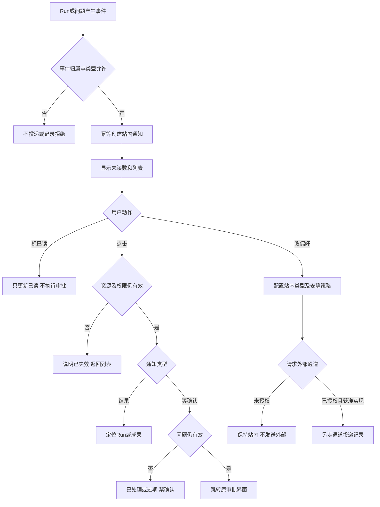

# 任务包29：通知与任务收件箱
版本：完整规格稿1｜2026-11-04｜状态：SPEC_READY_FOR_ASSIGNMENT（规格已扩写，未指派/未实现/未验收）。类型：用户交互型：站内事件到任务定位。用户已通过09/10示范深度并授权本轮扩写；本包下列“待用户拍板”仍为建议，不能当既定产品决定。原01–08据用户确认已由Gemini完成，本轮不重写；交付、主审、集成、上线状态分开登记。
阅读：[主台账](REFACTOR-MASTER-TRACKER-20261103.md)、[研发交付流程](ENGINEERING-DELIVERY-WORKFLOW.md)、[技术入门](DEVELOPER-ONBOARDING.md)。领取填写负责人、实现者、独立测试者、实际base/branch、OS/Node、dirty文件归属及依赖契约版本；bbd9997仅历史参考，不是自动可发布版本。

## 1. 结果、范围与分类依据
用户在站内看到完成、失败和等待确认通知，点击直接回到对应Run/问题/成果，已读与处理状态分开。通知不成为执行权威，不因看过通知就自动同意任务。
首期站内通知及偏好/去重；邮件/系统推送为V2并需通道授权。通知正文最小化，不含Key、私密全文或可泄漏签名链接。

## 2. 复用核查、依赖与所有权
先对锁定DSH 0.1.1-rc.2交“需求—原生/插件/现有接缝—版本/导出证据—配置或接线—缺口—AC”矩阵，原生直接用→配置→产品接线→现插件/受控升级→证据缺口最小补充。下表是开工核查点，不是本轮已跑SDK/已证实新能力；负责人确认缺口后才能实现，不另造Agent循环、执行器或审批引擎。

| 能力/核查来源 | 本包接线、证明及缺口边界 |
|---|---|
| DSH Session/tool/questions事件 | 复用事件来源和持久问题，不建第二审批状态机 |
| 21进度/05审批与既有auth | 深链回到原控制面，通知只存引用及最小摘要 |

依赖及并行边界：05/21主事件、14独立点击验证；外部通道后置不阻站内闭环。
独占交付：`shell/candidates/product-inbox-20261103/`（CONTRACT.md、REUSE-MATRIX.md、实现或方案、UI/fixture、接线建议）、`tests/probes/product-inbox-20261103.mjs`、`docs/refactor/evidence/PRODUCT-INBOX-20261103.md`。方案/验收包交可执行方案与证据，不制造空产品模块。共享server/runner/public/tenant/profile/迁移/package/lock由负责人集成，只交补丁建议；不改Gemini原8包、Bug窗口、tests/e2e/或其他包。测试目录所有权先协调；禁覆盖dirty文件、旧归档或线上r28。
本包不产生部署、付费、外发、资源采购、merge/push或电脑控制授权；真实操作按具体范围另核已有授权。日志/报告不存Key、Cookie、私密原文、签名URL，fixture合成且数据/凭据/DB与生产隔离。

## 3. 用户旅程决策树
范围内每条边由下表解释；后台契约不能替代默认界面和恢复动作。刷新、权限撤销、并发及未知结果也列入验收。

## 4. 分步详解表

| 节点/触发 | 默认界面与系统动作 | 用户动作、兜底条件与禁止行为 | 对应AC |
|---|---|---|---|
| A/B/C/D 事件投影 | 按owner/tenant/Run/eventType生成唯一站内通知 | 重复事件不叠未读，乱序终态事件去重，不把通知投给其他账号 | 29-01 |
| E 列表与未读 | 默认最近未读，类型筛选/分页、加载/空/错误分别显示 | 加载失败不清未读，分页不重复，换账号清缓存 | 29-02 |
| F/G 标读 | 单条/批量标已读有反馈 | 标读不批准问题、不下载/执行任务，重复更新幂等 | 29-03 |
| H/I/K 点击定位 | 打开真实Run/产物并再次鉴权，能回列表 | 资源删除/撤权/旧深链只说明不可访问，不泄露旧正文 | 29-04 |
| J/L/M/N 等待确认 | 定位当前原问题，显示操作摘要和有效性 | 已回答/过期/Run取消则只读，不从通知直接重放旧approve | 29-05 |
| O 偏好/离线重开 | 站内类型开关和持久未读，恢复拉取漏掉事件 | 关键安全/费用核对通知是否可关按决策；离线不外发兜底 | 29-06 |
| P/Q/R 外部通道 | 未授权时清楚说明仍仅站内 | 没有通道批准不发邮件/推送，拒绝权限后不循环请求 | 29-07 |

## 5. 建议方案与待确认决策
以下是建议与决策责任；“待用户拍板”未获确认前不作为已定范围。负责人技术核实及外部回执不是要求用户代做调查。未决项阻断对应AC，不阻断无依赖的契约/fixture工作。

| 决策/责任 | 建议、原因与代价 | 未确认边界或需要的证据 |
|---|---|---|
| 29-D1 待用户拍板 | 建议首期只站内，完成/失败可选，待确认/费用未知默认保留 | 用户能否关关键通知与安静时间需确认，不偷加邮件兜底 |
| 29-D2 待用户拍板 | 建议站内保存30天、已读可清理，任务记录按自身保留期 | 30天为建议，容量与审计要求由33/35C核实 |
| 29-D3 负责人技术核实 | 通知以原Run/问题ID定位，点击重新鉴权，状态来自原权威服务 | 事件去重键和补投游标需与05/21冻结 |
| 29-D4 待用户拍板 | 外发通道V2另列收件范围/内容/费用/撤销 | 本包不产生任何外发授权，不要求提供邮箱密码 |

## 6. 契约、数据与恢复
接口名称为目标语义，不自动表示现有HTTP端点已实现。CONTRACT冻结可信身份、输入/输出/schema版本、错误码与UI/调用方映射；复用现有错误，拒绝将失败全部报500。

| 操作/记录 | 必须保持的语义 |
|---|---|
| 通知 | notificationId、owner/tenant、eventId/type、Run/question/artifactRef、createdAt、dedupeKey |
| 阅读偏好 | readAt与taskActionState分离，类型/安静策略/version；无正文密钥 |
| 投递 | 站内状态与channel授权/外发attempt分离，未授权外发拒绝 |

跨边界读写逐次校验owner/tenant及本包project/device/Run范围；客户端ID不授予权限。状态和版本持久化，重复同operation同payload返回原结果，异参冲突；取消/超时/断网不自动证明外部动作失败或停止计费。外部写入未知先核对，不盲重试/换模型重提。存储变更需真实PGlite及隔离PG验证，迁移编号由负责人分配；纯调查包此项按无产品写入注明不适用。历史源证据不可覆写，修订形成新版本。

## 7. 验收矩阵与测试责任
每个AC交实现/方案位置、fixture、执行命令、退出码、PASS/FAIL/BLOCKED与脱敏证据；未决或未授权不计PASS。下列是将来执行要求，本轮没有实现或业务通过声明。

| AC | 通过标准 | 验证方式 |
|---|---|---|
| 29-01 | A/B/D：双租户/重复/乱序事件投递正确 | 确定性接口/SDK＋staging点击E2E |
| 29-02 | E：空/故障/分页与多标签未读一致 | 确定性接口/SDK＋staging点击E2E |
| 29-03 | F/G：已读状态与任务待处理状态互不混淆 | 确定性接口/SDK＋staging点击E2E |
| 29-04 | H/I/K：失效/权限/跨租户深链安全 | 确定性接口/SDK＋staging点击E2E |
| 29-05 | J/L/M/N：旧通知与最新问题状态一致，重复点击不执行两次 | 确定性接口/SDK＋staging点击E2E |
| 29-06 | O：偏好/断线补投/重启不漏关键事件 | 确定性接口/SDK＋staging点击E2E |
| 29-07 | P/Q/R：默认零外发，获准通道与站内投递分别可审计 | 确定性接口/SDK＋staging点击E2E |
| 29-08 | 伪造身份/资源引用、权限撤销、日志/证据敏感信息均拒绝或脱敏，不扩大依赖权限 | 双身份/仓储负向及证据扫描 |
| 29-09 | 重复操作、并发版本变化、断线/重启与结果未知不造成重复副作用；恢复依据权威记录 | 并发/故障fixture；方案包核实执行证据 |
| 29-10 | 本包变更与同版累计功能兼容；未跑真实上游/生产的项目仍待验，不将fixture写成上线成功 | 负责人受影响回归＋独立测试/证据复核 |

开发者/执行者交`node tests/probes/product-inbox-20261103.mjs`的实现后实际运行方法（方案包可由该入口验证清单/证据或交等价可复跑命令并解释），真实调用候选/锁定SDK/协议服务/存储而非镜像常量，失败非零。无代码阶段不制造假探针通过。独立测试者复核负向反例；涉及界面的AC必须实际点击，API辅助不能全部替代；纯后端包不强制点击E2E，核实业务影响即可。
真实PT调用与付费次数、生产写入/故障、电脑动作独立授权；确定性模型/本地协议轨、真实PT轨、staging与production证据分开。未获授权保留BLOCKED，不能抹掉失败或把未执行算不适用。测试证据绑定应用/配置/迁移/用例版本与fixture SHA。

## 8. 资源、Plan B与进度影响
事件投影/未读索引、分页及断线补投fixture；不需新付费消息服务，若引入先评估授权/成本。
## PT依赖、Plan B与进度影响
| PT依赖/需求编号 | Plan B | 进度/验收影响 |
|---|---|---|
| 无新增PT接口 | 站内Run事件/提问通知 | 站内独立推进；邮件/推送需独立通道授权 |
依据：[PT接口规格v1.1第15节](PT-API-REQUIREMENTS-20261104.md)。PT未接受建议接口形态时先映射既有协议；遵循DSH最大复用原则。上述Plan B为规划候选，不表示已验证或获准额外模型/资源/供应商调用；原范围未满足仍标未完成，变更需用户确认。签署协议仅已签署/未签署，无有效期/续签；资产启用及凭据/缓存/资源有效期分别处理。

## 9. 里程碑、交付与接入
| 阶段 | 本包产出与放行依据 |
|---|---|
| M0 冻结 | 分类、范围、复用矩阵、依赖契约、上述决策、节点/阶段→AC及可量化限制；负责人确认接口缺口，用户只拍板产品/成本/资源选择 |
| M1 核心候选/方案 | 站内事件去重/列表/未读和深链UI |
| M2 失败与恢复 | 过期问题、撤权资源、重复/离线补投反例 |
| M3 独立主审/接入 | Run/问题定位与偏好存储接线；负责人独占共享接线，运行受影响回归 |
| M4 同版验收/发布 | 完成/失败/待确认→点击→处理→重开E2E；有发布授权才冻结归档并切换，production专属租户受控冒烟 |

交付报告含base/commit/文件SHA、依赖契约版本、命令/退出码/通过失败阻塞数、AC映射、替身/真实边界、遗留Bug与责任、安装/挂载/清理/回退说明。Bug原作者自测后独立复测，主审/集成/发布各阶段分别登记。关闭新入口不等于撤销已提交数据或终止外部任务；回退保留历史可读和必要对账，数据库不自动逆迁。当前仅规格扩写完成，尚未分配、实现、主审、集成、本地/测试环境验收或发布；不能凭文档数量计算产品完成度。
