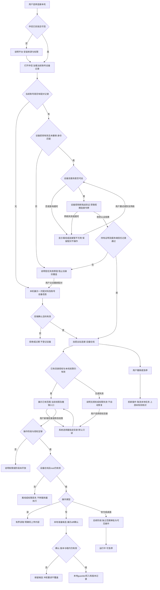

# 任务包32：本地连接器与电脑操作
版本：完整规格稿2｜2026-11-04｜状态：SPEC_READY_FOR_ASSIGNMENT（规格已扩写，未指派/未实现/未验收）。本次修订补齐“有效老设备直接重连”，不重复首次配对，也不自动恢复已撤销权限或补发离线操作。类型：用户交互型：设备配对、目录授权与可见执行。用户已通过09/10示范深度并授权本轮扩写；本包下列“待用户拍板”仍为建议，不能当既定产品决定。原01–08据用户确认已由Gemini完成，本轮不重写；交付、主审、集成、上线状态分开登记。
阅读：[主台账](REFACTOR-MASTER-TRACKER-20261103.md)、[研发交付流程](ENGINEERING-DELIVERY-WORKFLOW.md)、[技术入门](DEVELOPER-ONBOARDING.md)。领取填写负责人、实现者、独立测试者、实际base/branch、OS/Node、dirty文件归属及依赖契约版本；bbd9997仅历史参考，不是自动可发布版本。

## 1. 结果、范围与分类依据
用户主动安装可信伴侣并配对设备，只授权指定目录；从本地读/写diff确认开始，逐阶段扩展命令/jobs、浏览器/桌面。用户能看见目标设备与操作，撤销或急停；离线不切到服务器继续执行。
阶段L1配对/指定目录读写，L2命令/jobs，L3浏览器/桌面，分别交卷验收；L1通过不代表L2/L3完成。Tauri/Electron/MCP是待选方案，MCP不是沙箱，视觉模型不提供本地控制权。默认文件留本地，只传用户选择输入/成果。

## 2. 复用核查、依赖与所有权
先对锁定DSH 0.1.1-rc.2交“需求—原生/插件/现有接缝—版本/导出证据—配置或接线—缺口—AC”矩阵，原生直接用→配置→产品接线→现插件/受控升级→证据缺口最小补充。下表是开工核查点，不是本轮已跑SDK/已证实新能力；负责人确认缺口后才能实现，不另造Agent循环、执行器或审批引擎。

| 能力/核查来源 | 本包接线、证明及缺口边界 |
|---|---|
| DSH ctx.fs、tool-fs/editor、bash/jobs与06隔离 | 复用本地执行器/版本护栏，核实远端provider边界，不重新写FS/命令引擎 |
| 09文件预览/审批、13任务、31provider接口 | 只补设备transport与scope绑定，GUI驱动/模型按平台另证，不能说现成插件已通过 |

依赖及并行边界：05/06/09/13/31/35C；PT工具调用影响智能操作，基础文件无需新增PT；L3视觉/驱动缺口归34评估，不绕权限。
独占交付：`shell/candidates/product-local-20261103/`（CONTRACT.md、REUSE-MATRIX.md、实现或方案、UI/fixture、接线建议）、`tests/probes/product-local-20261103.mjs`、`docs/refactor/evidence/PRODUCT-LOCAL-20261103.md`。方案/验收包交可执行方案与证据，不制造空产品模块。共享server/runner/public/tenant/profile/迁移/package/lock由负责人集成，只交补丁建议；不改Gemini原8包、Bug窗口、tests/e2e/或其他包。测试目录所有权先协调；禁覆盖dirty文件、旧归档或线上r28。
本包不产生部署、付费、外发、资源采购、merge/push或电脑控制授权；真实操作按具体范围另核已有授权。日志/报告不存Key、Cookie、私密原文、签名URL，fixture合成且数据/凭据/DB与生产隔离。

## 3. 用户旅程决策树
范围内每条边由下表解释；后台契约不能替代默认界面和恢复动作。刷新、权限撤销、并发及未知结果也列入验收。默认优先读取当前账号已有设备及授权记录；有有效配对的设备通过设备密钥持有证明直接重连，不重新生成配对码。配对信任关系、在线连接/短期令牌、目录/操作权限分别校验，不能相互替代。

## 4. 分步详解表

| 节点/触发 | 默认界面与系统动作 | 用户动作、兜底条件与禁止行为 | 对应AC |
|---|---|---|---|
| A/B/C/D/PAIR 安装与已有设备入口 | 默认展示当前账号已配对设备、连接状态及现有权限；伴侣未安装才说明OS/可信安装来源并引导安装；打开后先查配对记录 | 不支持平台不提供假下载；权限拒绝仍可用云端功能；不能无条件生成配对码，不跨账号自动认领同一物理设备 | 32-01/32-02 |
| E/F/G/H 首次或主动重新配对 | 仅无配对记录或用户主动重建信任时，双端显示账号/设备名、短期一次码并确认；成功建立信任记录 | 过期/重放/错账号/中间人拒绝；仅打开页面或看见设备ID不能配对；重配不得恢复旧目录权限或重发旧操作 | 32-02 |
| TRUST/NET/OFFLINE/RECONNECT/VERIFIED/H 有效老设备重连 | 密钥有效、身份匹配且未撤销时，用新挑战验证私钥持有及服务端记录，获取新短期连接令牌直接进入H；无配对码、无首次配对弹窗 | 离线/超时显示最后在线和重试，保留原信任记录，不当未配对、不提示必须重新配对；连接令牌过期可经设备身份重新认证，不等于设备密钥失效；认证确认失败才走REPAIR | 32-02/32-05/32-11 |
| REPAIR 信任失效或账号不符 | 明确已撤销/密钥失效/身份不匹配，拒绝旧身份访问；提供当前账号的主动重配入口 | 不因网络错误清除信任、不自动换账号；新配对建立新信任版本，不继承旧授权；重连过程中被撤销也必须拒绝 | 32-02/32-10/32-12 |
| ROOT/ROOTBLOCK/I/J 复用或新增目录授权 | 重连后先展示仍有效的已有root及当前权限，不重开目录选择器；无授权/被撤销/OS权限丢失显示原因，用户主动选择目录时默认只读 | 不默认整盘/home；root变更或写权限增加重新批准；有效只读授权不自动升级，设备信任不能恢复被撤销目录或绕过本机最终权限检查 | 32-03/32-05 |
| K/L 阶段/能力 | 设备卡显示只读/文件写/命令/桌面分别是否开放 | 未开放L2/L3禁用并解释，不把MCP连接当桌面授权 | 32-04 |
| M/N 在线权限预检 | 显示最后在线、授权根状态和当前操作设备，预检后才执行 | 离线不排队自动补发写入、不转服务器，重连重新核对未决operation | 32-05 |
| O/P 读取/上传 | 本地有界预览用户选择内容，说明传云内容及用途 | 不自动上传全目录、隐私文件或后台全量索引；取消上传单独状态 | 32-06 |
| Q/S/T/U 文件修改 | 本地隔离候选diff，绑定设备/root/file/base，确认后guarded commit | 新版本冲突重读，断线结果未知查询原operation，不盲写 | 32-07 |
| R 命令/jobs阶段 | 显示命令、cwd、网络/环境权限与输出上限，逐操作确认 | shell注入、越root、继承secret拒绝；不因文本编辑授权允许执行 | 32-08 |
| R/V 桌面阶段 | 显示将操作的应用/页面/动作、可见运行状态与急停 | 验证码/系统授权需用户介入，模型低置信度停下，不盲点 | 32-09 |
| W/X 撤销急停 | 设备/目录级撤销阻新操作，急停控制通道优先，列在途动作 | 不能承诺逆转已写文件或上游已提交任务，费用未知另核对 | 32-10 |
| D/H 多设备/重开/卸载 | 重开先查当前账号设备记录，再按信任/在线状态直连或等待；展示权限和最近操作，未决operation仅查询；卸载说明解绑/留存 | 同文件跨设备不假设同一版本；切换账号清除前账号视图/短期令牌，不自动迁移配对；卸载/重装丢失设备私钥时不可只凭旧deviceId重连 | 32-02/32-11/32-13 |

## 5. 建议方案与待确认决策
以下是建议与决策责任；“待用户拍板”未获确认前不作为已定范围。负责人技术核实及外部回执不是要求用户代做调查。未决项阻断对应AC，不阻断无依赖的契约/fixture工作。

| 决策/责任 | 建议、原因与代价 | 未确认边界或需要的证据 |
|---|---|---|
| 32-D1 待用户拍板 | 建议L1优先Mac/Windows各一个受支持版本，先指定目录再命令再GUI | 首发平台、分阶段必交范围与安装维护成本需确认，不承诺全平台一次交付 |
| 32-D2 负责人技术评估 | 优先DSH本地FS/editor/bash/jobs与可替换伴侣transport | Tauri/Electron/已有MCP桥按签名更新、隔离、体积、团队能力比较后选，不先定技术名 |
| 32-D3 待用户拍板 | 默认数据留本机，上传必须显式选文件/片段，远端索引默认关闭 | 允许自动同步的目录/类型及保留期若要增加须单独确认 |
| 32-D4 负责人技术冻结 | 有效老设备优先直接重连，绑定user/device/trustVersion；配对密钥、短期连接令牌、root/Run/operation授权分层，设备身份重新认证不要求重复配对 | 密钥留本机安全存储；新挑战防重放、撤销版本和并发重连规则M0核实；连接令牌过期不等于配对失效。离线写不补发、未知只核对，OS权限不是server许可替代；具体密钥轮换/信任最长存续期另交建议，不凭短期令牌TTL推导每次重配 |
| 32-D5 待用户拍板 | 命令/桌面每次有操作预览，连续授权需限定窗口/次数/应用且可随时撤销 | 首期不开放无人值守GUI，付费视觉模型另授权 |

## 6. 契约、数据与恢复
接口名称为目标语义，不自动表示现有HTTP端点已实现。CONTRACT冻结可信身份、输入/输出/schema版本、错误码与UI/调用方映射；复用现有错误，拒绝将失败全部报500。

| 操作/记录 | 必须保持的语义 |
|---|---|
| 设备配对与信任记录 | trustedUser/tenant/deviceId、devicePublicKey/keyRef、trustVersion/state（active/revoked/invalid）、一次pairRequest/expiry与双端批准；私钥在本机安全存储，不传到服务器/日志；主动加密出站，无公网入站要求 |
| 老设备重连 | connectRequest/challengeNonce/expiry、user/device/trustVersion绑定的持有证明，服务端校验一次新挑战和当前未撤销信任后签发短期连接令牌；本机及服务端双向身份校验。有效老设备不得调用创建配对码接口；令牌过期可重新认证，密钥失效/撤销/账号不符禁止凭旧deviceId续连 |
| 网络、权限与未决恢复 | 离线/请求超时不改变信任state；重连前后检查撤销版本，撤销与重连竞态不得签发仍可使用的旧信任令牌。连接成功后再验root/OS/操作权限，不恢复已撤销授权；重连只查询原operation/journal，不重放离线写入或已提交上游任务 |
| 授权根与操作 | rootRef/权限/lease、Run/operation/baseVersion/digest绑定，绝对路径本机映射，服务端不能任传root |
| 本地记录 | candidate/journal/commit、取消/撤销与重连查询，外发数据清单；本地进程最终执行前再验token/root |
| 后续命令/GUI | 明确app/cwd/network/action scope、可见状态/急停、输出与时长上限，独立阶段开关 |

跨边界读写逐次校验owner/tenant及本包project/device/Run范围；客户端ID不授予权限。状态和版本持久化，重复同operation同payload返回原结果，异参冲突；取消/超时/断网不自动证明外部动作失败或停止计费。外部写入未知先核对，不盲重试/换模型重提。存储变更需真实PGlite及隔离PG验证，迁移编号由负责人分配；纯调查包此项按无产品写入注明不适用。历史源证据不可覆写，修订形成新版本。

## 7. 验收矩阵与测试责任
每个AC交实现/方案位置、fixture、执行命令、退出码、PASS/FAIL/BLOCKED与脱敏证据；未决或未授权不计PASS。下列是将来执行要求，本轮没有实现或业务通过声明。

| AC | 通过标准 | 验证方式 |
|---|---|---|
| 32-01 | A/B/C/D：平台矩阵/安装完整性/权限拒绝与回退入口通过 | 确定性接口/SDK＋staging点击E2E |
| 32-02 | D/PAIR/TRUST/NET/OFFLINE/RECONNECT/VERIFIED/REPAIR/E/F/G/H：首次配对双端确认、一次码过期/重放拒绝；有效老设备重开及重启后以设备密钥证明直接进入H，配对码创建次数为0且不显示首次配对弹窗；短期连接令牌过期经设备身份重新认证；离线/超时保留配对且不强制重配；密钥失效/撤销/错账号/伪造deviceId拒绝，重连挑战重放及撤销竞态拒绝；重新配对只由用户主动发起且不继承旧授权 | 真实协议fixture计数＋持久信任/重启/并发反例＋staging点击E2E |
| 32-03 | ROOT/ROOTBLOCK/I/J：有效老root重连后直接展示且保留原权限，不弹目录选择器或升级只读；无root/撤销/OS权限丢失仅在用户主动选择后授权；越界/软硬链/TOCTOU拒绝 | 确定性接口/SDK＋staging点击E2E |
| 32-04 | K/L：仅L1时命令/GUI请求均被拒 | 确定性接口/SDK＋staging点击E2E |
| 32-05 | NET/OFFLINE/ROOT/ROOTBLOCK/M/N：断线/超时仅改变连接健康，不误删配对或自动重配；恢复网络后重验身份/撤root/旧令牌/设备切换，连接成功仍无权执行失效root，不转服务器执行 | 确定性接口/SDK＋staging点击E2E |
| 32-06 | O/P：只选内容传输、大小限制及取消无泄漏 | 确定性接口/SDK＋staging点击E2E |
| 32-07 | Q/S/T/U：原文件确认前不变、CAS/幂等/崩溃对账成立 | 确定性接口/SDK＋staging点击E2E |
| 32-08 | R：L2独立sandbox/取消/输出限制证据，未实现保持待验 | 确定性接口/SDK＋staging点击E2E |
| 32-09 | R/V：L3独立驱动/OS权限/定位失败和停止证据 | 确定性接口/SDK＋staging点击E2E |
| 32-10 | W/X：撤销令牌失效、急停延迟/残余进程有实测 | 确定性接口/SDK＋staging点击E2E |
| 32-11 | D/H：多设备/重开优先列出已有设备，在线直连、离线等待、失效阻断；账号切换隔离旧设备视图/令牌；卸载解绑及重装丢私钥不凭deviceId恢复；历史归属通过 | 确定性接口/SDK＋staging点击E2E |
| 32-12 | 伪造身份/资源引用、权限撤销、日志/证据敏感信息均拒绝或脱敏，不扩大依赖权限 | 双身份/仓储负向及证据扫描 |
| 32-13 | 重复操作、并发版本变化、断线/重启与结果未知不造成重复副作用；恢复依据权威记录 | 并发/故障fixture；方案包核实执行证据 |
| 32-14 | 本包变更与同版累计功能兼容；未跑真实上游/生产的项目仍待验，不将fixture写成上线成功 | 负责人受影响回归＋独立测试/证据复核 |

开发者/执行者交`node tests/probes/product-local-20261103.mjs`的实现后实际运行方法（方案包可由该入口验证清单/证据或交等价可复跑命令并解释），真实调用候选/锁定SDK/协议服务/存储而非镜像常量，失败非零。无代码阶段不制造假探针通过。独立测试者复核负向反例；涉及界面的AC必须实际点击，API辅助不能全部替代；纯后端包不强制点击E2E，核实业务影响即可。
真实PT调用与付费次数、生产写入/故障、电脑动作独立授权；确定性模型/本地协议轨、真实PT轨、staging与production证据分开。未获授权保留BLOCKED，不能抹掉失败或把未执行算不适用。测试证据绑定应用/配置/迁移/用例版本与fixture SHA。

## 8. 资源、Plan B与进度影响
Mac/Windows测试设备或VM、签名/更新资源、独立配对服务与端到端传输测试；申请由33/负责人整理，不自行控制本机。
## PT依赖、Plan B与进度影响
| PT依赖/需求编号 | Plan B | 进度/验收影响 |
|---|---|---|
| 基础FS无新增；智能工具PT-03，GUI可涉15 | 本地DSH FS/命令+确定性DOM；无可靠视觉不盲点 | 目录/配对可继续；通用桌面控制后置；PT不提供本地授权 |
依据：[PT接口规格v1.1第15节](PT-API-REQUIREMENTS-20261104.md)。PT未接受建议接口形态时先映射既有协议；遵循DSH最大复用原则。上述Plan B为规划候选，不表示已验证或获准额外模型/资源/供应商调用；原范围未满足仍标未完成，变更需用户确认。签署协议仅已签署/未签署，无有效期/续签；资产启用及凭据/缓存/资源有效期分别处理。

## 9. 里程碑、交付与接入
| 阶段 | 本包产出与放行依据 |
|---|---|
| M0 冻结 | 分类、范围、复用矩阵、依赖契约、上述决策、节点/阶段→AC及可量化限制；负责人确认接口缺口，用户只拍板产品/成本/资源选择 |
| M1 核心候选/方案 | 平台/伴侣选型与L1契约UI，分别交首次配对、有效老设备直连、离线等待、信任失效主动重配、已有目录复用分支 |
| M2 失败与恢复 | 断网/撤销/链接竞态/CAS/敏感上传反例 |
| M3 独立主审/接入 | 复用DSH本地执行和05/09接线；L2/L3另给真实证据；负责人独占共享接线，运行受影响回归 |
| M4 同版验收/发布 | 首次安装→配对→授权目录→预览写入；再次打开→有效老设备直连→复用有效root→仅查询未决操作；离线/撤销/主动重配各独立E2E。阶段分别放行；有发布授权才冻结归档并切换，production专属租户受控冒烟 |

交付报告含base/commit/文件SHA、依赖契约版本、命令/退出码/通过失败阻塞数、AC映射、替身/真实边界、遗留Bug与责任、安装/挂载/清理/回退说明。Bug原作者自测后独立复测，主审/集成/发布各阶段分别登记。关闭新入口不等于撤销已提交数据或终止外部任务；回退保留历史可读和必要对账，数据库不自动逆迁。当前仅规格扩写完成，尚未分配、实现、主审、集成、本地/测试环境验收或发布；不能凭文档数量计算产品完成度。
