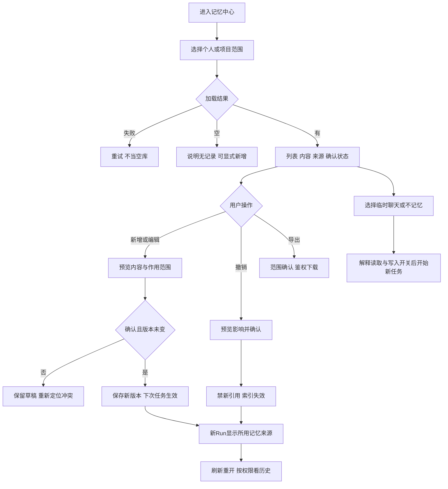

# 任务包30：知识与记忆管理中心
版本：完整规格稿1｜2026-11-04｜状态：SPEC_READY_FOR_ASSIGNMENT（规格已扩写，未指派/未实现/未验收）。类型：用户交互型：可见来源、范围与撤销。用户已通过09/10示范深度并授权本轮扩写；本包下列“待用户拍板”仍为建议，不能当既定产品决定。原01–08据用户确认已由Gemini完成，本轮不重写；交付、主审、集成、上线状态分开登记。
阅读：[主台账](REFACTOR-MASTER-TRACKER-20261103.md)、[研发交付流程](ENGINEERING-DELIVERY-WORKFLOW.md)、[技术入门](DEVELOPER-ONBOARDING.md)。领取填写负责人、实现者、独立测试者、实际base/branch、OS/Node、dirty文件归属及依赖契约版本；bbd9997仅历史参考，不是自动可发布版本。

## 1. 结果、范围与分类依据
用户看到每条记忆的内容、来源、确认状态和适用范围，可编辑、撤销、导出，选择临时聊天/不记忆并理解影响。项目知识与个人记忆分栏，不将管理中心变成任意目录自动扫描。
复用现有确认式记忆/检索/CRUD，不新建记忆Agent或embedding引擎；原记录/新Run引用/导出权限与删除传播分别验证。

## 2. 复用核查、依赖与所有权
先对锁定DSH 0.1.1-rc.2交“需求—原生/插件/现有接缝—版本/导出证据—配置或接线—缺口—AC”矩阵，原生直接用→配置→产品接线→现插件/受控升级→证据缺口最小补充。下表是开工核查点，不是本轮已跑SDK/已证实新能力；负责人确认缺口后才能实现，不另造Agent循环、执行器或审批引擎。

| 能力/核查来源 | 本包接线、证明及缺口边界 |
|---|---|
| shell/memory.cjs、shell/memory/provenance-store.cjs与既有检索 | 复用确认/CRUD/来源，核实实际挂载而非只见候选文件 |
| DSH上下文/Skill与shell/tasks/memory-run-invalidation.cjs | 复用注入及撤销传播，个人与项目范围宿主控制 |

依赖及并行边界：现有记忆/来源链、19项目、35C治理；34/31的embedding接口只影响后续大库语义目标。
独占交付：`shell/candidates/product-memory-ui-20261103/`（CONTRACT.md、REUSE-MATRIX.md、实现或方案、UI/fixture、接线建议）、`tests/probes/product-memory-ui-20261103.mjs`、`docs/refactor/evidence/PRODUCT-MEMORY-UI-20261103.md`。方案/验收包交可执行方案与证据，不制造空产品模块。共享server/runner/public/tenant/profile/迁移/package/lock由负责人集成，只交补丁建议；不改Gemini原8包、Bug窗口、tests/e2e/或其他包。测试目录所有权先协调；禁覆盖dirty文件、旧归档或线上r28。
本包不产生部署、付费、外发、资源采购、merge/push或电脑控制授权；真实操作按具体范围另核已有授权。日志/报告不存Key、Cookie、私密原文、签名URL，fixture合成且数据/凭据/DB与生产隔离。

## 3. 用户旅程决策树
范围内每条边由下表解释；后台契约不能替代默认界面和恢复动作。刷新、权限撤销、并发及未知结果也列入验收。

## 4. 分步详解表

| 节点/触发 | 默认界面与系统动作 | 用户动作、兜底条件与禁止行为 | 对应AC |
|---|---|---|---|
| A/B/C/D/E 范围与列表 | 默认个人范围，项目切换显式；内容/来源/确认/更新时间分列 | 空、查询失败、无权分开；不把项目知识混入个人 | 30-01 |
| F 详情来源 | 显示谁确认、何时、从何来源及当前是否可用 | 来源撤销显示失效，不以旧摘要授新权，敏感来源不全量回显 | 30-02 |
| G/H/I/J/K 新增编辑 | 用户输入/建议内容先预览，明确范围后确认保存新版本 | 模型建议不自动记忆；并发冲突保留草稿，换范围需新确认 | 30-03 |
| L/M 撤销删除 | 列影响范围和已引用历史，确认后新Run不再检索 | 索引失效可观察，不能声称撤销就修改所有旧聊天；物理删除按政策 | 30-04 |
| N 导出 | 先选择个人/项目范围，显示数量与敏感提醒，下载有ACL | 不能导出当前无权来源全文或他人记忆，失败不建新记忆 | 30-05 |
| O/P 临时聊天/不记忆 | 明确“是否读取已有记忆”和“是否保存新记忆”两独立开关 | 只关写入不冒充完全无记忆；切换仅影响新任务，不改已在途输入 | 30-06 |
| Q 任务使用 | 按可获准范围选择记忆，Run显示来源引用与版本 | token/Secret不得提取入记忆，不重新启用任意目录扫描 | 30-07 |
| R 刷新/换账号/索引故障 | 持久CRUD状态可查，索引故障退关键词或明确暂不可用 | 不能用跨账号缓存兜底；模型重生成不是检索兜底 | 30-08 |

## 5. 建议方案与待确认决策
以下是建议与决策责任；“待用户拍板”未获确认前不作为已定范围。负责人技术核实及外部回执不是要求用户代做调查。未决项阻断对应AC，不阻断无依赖的契约/fixture工作。

| 决策/责任 | 建议、原因与代价 | 未确认边界或需要的证据 |
|---|---|---|
| 30-D1 待用户拍板 | 建议临时聊天默认不读也不写记忆，另设“本次不保存”只关写入 | 两种文案/默认行为须确认，不合并一个含糊开关 |
| 30-D2 待用户拍板 | 撤销立即阻新引用，物理删除/历史保留按35C统一政策 | 保留期、导出格式及用户删除权需拍板，不承诺旧聊天自动抹除 |
| 30-D3 负责人技术核实 | 复用memory.cjs和provenance/检索仓储，索引不是第二权威 | 撤销传播、缓存失效、PG/PGlite与既有记忆API逐项核实 |
| 30-D4 待用户拍板 | 首期关键词/现有检索继续，大库语义召回另给资源和质量目标 | 无embedding支持时明确降级，不自建模型或新供应商付费 |

## 6. 契约、数据与恢复
接口名称为目标语义，不自动表示现有HTTP端点已实现。CONTRACT冻结可信身份、输入/输出/schema版本、错误码与UI/调用方映射；复用现有错误，拒绝将失败全部报500。

| 操作/记录 | 必须保持的语义 |
|---|---|
| 记忆 | memoryId/version、scope/owner/project、contentDigest/加密引用、sourceRefs、confirmedBy/state |
| 使用与撤销 | Run memorySnapshot/version、索引/缓存失效版本、revokedAt，历史引用不授新权 |
| 临时与导出 | readMemory/writeMemory明确双开关绑定新Run，导出operation/范围/ACL与保留策略 |

跨边界读写逐次校验owner/tenant及本包project/device/Run范围；客户端ID不授予权限。状态和版本持久化，重复同operation同payload返回原结果，异参冲突；取消/超时/断网不自动证明外部动作失败或停止计费。外部写入未知先核对，不盲重试/换模型重提。存储变更需真实PGlite及隔离PG验证，迁移编号由负责人分配；纯调查包此项按无产品写入注明不适用。历史源证据不可覆写，修订形成新版本。

## 7. 验收矩阵与测试责任
每个AC交实现/方案位置、fixture、执行命令、退出码、PASS/FAIL/BLOCKED与脱敏证据；未决或未授权不计PASS。下列是将来执行要求，本轮没有实现或业务通过声明。

| AC | 通过标准 | 验证方式 |
|---|---|---|
| 30-01 | A/B/C/D/E：双范围/空错/分页和跨项目权限正确 | 确定性接口/SDK＋staging点击E2E |
| 30-02 | F：来源链、权限与确认状态准确 | 确定性接口/SDK＋staging点击E2E |
| 30-03 | G/H/I/J/K：未确认零写、CAS冲突/重复操作安全 | 确定性接口/SDK＋staging点击E2E |
| 30-04 | L/M：新Run/检索缓存不含已撤项，历史政策一致 | 确定性接口/SDK＋staging点击E2E |
| 30-05 | N：导出格式/数量/权限/下载过期正确 | 确定性接口/SDK＋staging点击E2E |
| 30-06 | O/P：四种读写组合与实际注入/写入一致 | 确定性接口/SDK＋staging点击E2E |
| 30-07 | Q：真实提示上下文与来源范围/版本一致 | 确定性接口/SDK＋staging点击E2E |
| 30-08 | R：刷新/撤权/关键词降级标识与账号隔离通过 | 确定性接口/SDK＋staging点击E2E |
| 30-09 | 伪造身份/资源引用、权限撤销、日志/证据敏感信息均拒绝或脱敏，不扩大依赖权限 | 双身份/仓储负向及证据扫描 |
| 30-10 | 重复操作、并发版本变化、断线/重启与结果未知不造成重复副作用；恢复依据权威记录 | 并发/故障fixture；方案包核实执行证据 |
| 30-11 | 本包变更与同版累计功能兼容；未跑真实上游/生产的项目仍待验，不将fixture写成上线成功 | 负责人受影响回归＋独立测试/证据复核 |

开发者/执行者交`node tests/probes/product-memory-ui-20261103.mjs`的实现后实际运行方法（方案包可由该入口验证清单/证据或交等价可复跑命令并解释），真实调用候选/锁定SDK/协议服务/存储而非镜像常量，失败非零。无代码阶段不制造假探针通过。独立测试者复核负向反例；涉及界面的AC必须实际点击，API辅助不能全部替代；纯后端包不强制点击E2E，核实业务影响即可。
真实PT调用与付费次数、生产写入/故障、电脑动作独立授权；确定性模型/本地协议轨、真实PT轨、staging与production证据分开。未获授权保留BLOCKED，不能抹掉失败或把未执行算不适用。测试证据绑定应用/配置/迁移/用例版本与fixture SHA。

## 8. 资源、Plan B与进度影响
现有仓储＋有界检索、双账号/双项目fixture；导出文件与索引容量由33测，不能默认恢复目录扫描。
## PT依赖、Plan B与进度影响
| PT依赖/需求编号 | Plan B | 进度/验收影响 |
|---|---|---|
| 基础无新增；大规模检索涉及PT-13 | 现有检索/记忆+关键词；本地向量另评估 | 管理中心继续；大库语义召回目标不虚报 |
依据：[PT接口规格v1.1第15节](PT-API-REQUIREMENTS-20261104.md)。PT未接受建议接口形态时先映射既有协议；遵循DSH最大复用原则。上述Plan B为规划候选，不表示已验证或获准额外模型/资源/供应商调用；原范围未满足仍标未完成，变更需用户确认。签署协议仅已签署/未签署，无有效期/续签；资产启用及凭据/缓存/资源有效期分别处理。

## 9. 里程碑、交付与接入
| 阶段 | 本包产出与放行依据 |
|---|---|
| M0 冻结 | 分类、范围、复用矩阵、依赖契约、上述决策、节点/阶段→AC及可量化限制；负责人确认接口缺口，用户只拍板产品/成本/资源选择 |
| M1 核心候选/方案 | 个人/项目列表、来源/确认、CRUD/导出UI |
| M2 失败与恢复 | 读写双开关、撤销传播/缓存/权限/版本反例 |
| M3 独立主审/接入 | 原记忆API/Run注入/来源引用接线；负责人独占共享接线，运行受影响回归 |
| M4 同版验收/发布 | 确认→编辑→使用→临时聊天→撤销→导出重开E2E；有发布授权才冻结归档并切换，production专属租户受控冒烟 |

交付报告含base/commit/文件SHA、依赖契约版本、命令/退出码/通过失败阻塞数、AC映射、替身/真实边界、遗留Bug与责任、安装/挂载/清理/回退说明。Bug原作者自测后独立复测，主审/集成/发布各阶段分别登记。关闭新入口不等于撤销已提交数据或终止外部任务；回退保留历史可读和必要对账，数据库不自动逆迁。当前仅规格扩写完成，尚未分配、实现、主审、集成、本地/测试环境验收或发布；不能凭文档数量计算产品完成度。
