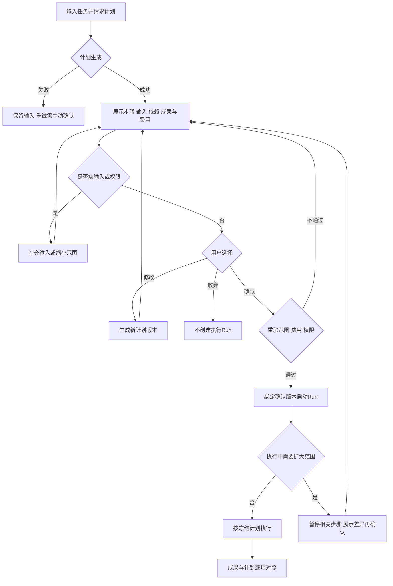

# 任务包20：执行计划与范围确认
版本：完整规格稿1｜2026-11-04｜状态：SPEC_READY_FOR_ASSIGNMENT（规格已扩写，未指派/未实现/未验收）。类型：用户交互型：执行前控制面。用户已通过09/10示范深度并授权本轮扩写；本包下列“待用户拍板”仍为建议，不能当既定产品决定。原01–08据用户确认已由Gemini完成，本轮不重写；交付、主审、集成、上线状态分开登记。
阅读：[主台账](REFACTOR-MASTER-TRACKER-20261103.md)、[研发交付流程](ENGINEERING-DELIVERY-WORKFLOW.md)、[技术入门](DEVELOPER-ONBOARDING.md)。领取填写负责人、实现者、独立测试者、实际base/branch、OS/Node、dirty文件归属及依赖契约版本；bbd9997仅历史参考，不是自动可发布版本。

## 1. 结果、范围与分类依据
用户先看到将做什么、用哪些输入/工具、产生什么成果和可能费用，修改并确认后才执行；计划版本与实际Run绑定，执行中扩大范围必须再确认。
复用原生plan-mode/questions，不新建规划引擎。计划确认不自动批准每次高风险工具/付费外部动作；05及原工具策略仍生效。

## 2. 复用核查、依赖与所有权
先对锁定DSH 0.1.1-rc.2交“需求—原生/插件/现有接缝—版本/导出证据—配置或接线—缺口—AC”矩阵，原生直接用→配置→产品接线→现插件/受控升级→证据缺口最小补充。下表是开工核查点，不是本轮已跑SDK/已证实新能力；负责人确认缺口后才能实现，不另造Agent循环、执行器或审批引擎。

| 能力/核查来源 | 本包接线、证明及缺口边界 |
|---|---|
| DSH plan-mode / user-questions | 核实锁定版本计划/问题/批准事件及持久恢复，不新写计划解析器 |
| 08配置路由、12 todo/goal与现有Run | 计划引用真实模型/任务能力，计划状态不替代执行状态 |

依赖及并行边界：05/08/12及19项目，13/21执行；生成计划与执行任务分别记费用与权限。
独占交付：`shell/candidates/product-plan-20261103/`（CONTRACT.md、REUSE-MATRIX.md、实现或方案、UI/fixture、接线建议）、`tests/probes/product-plan-20261103.mjs`、`docs/refactor/evidence/PRODUCT-PLAN-20261103.md`。方案/验收包交可执行方案与证据，不制造空产品模块。共享server/runner/public/tenant/profile/迁移/package/lock由负责人集成，只交补丁建议；不改Gemini原8包、Bug窗口、tests/e2e/或其他包。测试目录所有权先协调；禁覆盖dirty文件、旧归档或线上r28。
本包不产生部署、付费、外发、资源采购、merge/push或电脑控制授权；真实操作按具体范围另核已有授权。日志/报告不存Key、Cookie、私密原文、签名URL，fixture合成且数据/凭据/DB与生产隔离。

## 3. 用户旅程决策树
范围内每条边由下表解释；后台契约不能替代默认界面和恢复动作。刷新、权限撤销、并发及未知结果也列入验收。

## 4. 分步详解表

| 节点/触发 | 默认界面与系统动作 | 用户动作、兜底条件与禁止行为 | 对应AC |
|---|---|---|---|
| A/B/C 请求计划 | 显示生成中、可取消，说明规划本身是否使用模型与预算 | 生成失败不自动重试收费，保留原任务；无规划模型可手工计划但不能称智能生成通过 | 20-01 |
| D 查看计划 | 默认步骤、输入来源、工具/模型、依赖、成果格式、费用已知或未知 | 不能以自然语言“会完成”假装已有能力，未验证项显式阻塞 | 20-02 |
| E/F 缺输入/权限 | 逐项显示缺资料/权限/Key，优先选择已有资源 | 用户补充或缩范围；不自动扫描目录/绑Key/扩大来源 | 20-03 |
| G/H/I 编辑与放弃 | 步骤/输入可编辑，保留新旧差异与版本 | 每次变更废旧确认；放弃不启动执行Run，保留计划按留存策略 | 20-04 |
| J/K 确认启动 | 汇总确切版本与外部动作，重验后创建唯一执行Run | 过期能力/费用或权限变化返回计划；双击不启动两次 | 20-05 |
| L/M/N 执行偏离 | 显示新增工具/费用/输入与原计划差异，暂停受影响步骤 | 不扩大已给权限，不取消已完成副作用伪装未执行 | 20-06 |
| O 对照成果/重开 | 展示完成/失败/未执行步骤和产物链接，历史可看原计划 | 计划勾完成不改Run终态；重做必须新确认，刷新不重新执行 | 20-07 |

## 5. 建议方案与待确认决策
以下是建议与决策责任；“待用户拍板”未获确认前不作为已定范围。负责人技术核实及外部回执不是要求用户代做调查。未决项阻断对应AC，不阻断无依赖的契约/fixture工作。

| 决策/责任 | 建议、原因与代价 | 未确认边界或需要的证据 |
|---|---|---|
| 20-D1 待用户拍板 | 建议初版所有会产生外部写入/付费的任务先展示计划，纯只读短问答可直接回答 | 哪些任务强制计划需确认，不能默认给所有聊天加确认 |
| 20-D2 待用户拍板 | 未知费用默认不允许计划直接授权高风险执行，需明确单次/次数限制 | 是否允许特殊未知费用路径及预算接受范围待拍板 |
| 20-D3 负责人技术核实 | 原生plan-mode与questions负责生成/批准，宿主保存版本与展示差异 | 锁定插件不可用先做手工计划，缺智能计划保留未完成 |
| 20-D4 待用户拍板 | 建议扩大范围只暂停受影响分支，已完成结果保留 | 全任务暂停或局部暂停策略确认后由13/21统一实现 |

## 6. 契约、数据与恢复
接口名称为目标语义，不自动表示现有HTTP端点已实现。CONTRACT冻结可信身份、输入/输出/schema版本、错误码与UI/调用方映射；复用现有错误，拒绝将失败全部报500。

| 操作/记录 | 必须保持的语义 |
|---|---|
| 计划 | planId/version、steps/dependencies、inputRefs/outputs、capabilitySnapshot、costKind/estimateSource/digest |
| 确认 | trustedActor、planVersion/digest、scope、approval/expiry；修改或权限变化作废 |
| 执行绑定 | planVersion→Run及各step结果，偏离形成新计划版本而非原地改已批准记录 |

跨边界读写逐次校验owner/tenant及本包project/device/Run范围；客户端ID不授予权限。状态和版本持久化，重复同operation同payload返回原结果，异参冲突；取消/超时/断网不自动证明外部动作失败或停止计费。外部写入未知先核对，不盲重试/换模型重提。存储变更需真实PGlite及隔离PG验证，迁移编号由负责人分配；纯调查包此项按无产品写入注明不适用。历史源证据不可覆写，修订形成新版本。

## 7. 验收矩阵与测试责任
每个AC交实现/方案位置、fixture、执行命令、退出码、PASS/FAIL/BLOCKED与脱敏证据；未决或未授权不计PASS。下列是将来执行要求，本轮没有实现或业务通过声明。

| AC | 通过标准 | 验证方式 |
|---|---|---|
| 20-01 | A/B/C：失败/取消/费用归属与默认非执行状态正确 | 确定性接口/SDK＋staging点击E2E |
| 20-02 | D：计划字段与真实能力快照对齐，无假精确价格 | 确定性接口/SDK＋staging点击E2E |
| 20-03 | E/F：缺项修复或范围缩小后才可确认，来源ACL有效 | 确定性接口/SDK＋staging点击E2E |
| 20-04 | G/H：多次修改、放弃及双标签旧确认不可执行 | 确定性接口/SDK＋staging点击E2E |
| 20-05 | J/K：绑定planVersion/digest/approval与Run，同操作幂等 | 确定性接口/SDK＋staging点击E2E |
| 20-06 | L/N：范围扩大必须新批准，未确认相关动作零外发 | 确定性接口/SDK＋staging点击E2E |
| 20-07 | O：计划与Run/产物引用可追，重开无副作用 | 确定性接口/SDK＋staging点击E2E |
| 20-08 | 伪造身份/资源引用、权限撤销、日志/证据敏感信息均拒绝或脱敏，不扩大依赖权限 | 双身份/仓储负向及证据扫描 |
| 20-09 | 重复操作、并发版本变化、断线/重启与结果未知不造成重复副作用；恢复依据权威记录 | 并发/故障fixture；方案包核实执行证据 |
| 20-10 | 本包变更与同版累计功能兼容；未跑真实上游/生产的项目仍待验，不将fixture写成上线成功 | 负责人受影响回归＋独立测试/证据复核 |

开发者/执行者交`node tests/probes/product-plan-20261103.mjs`的实现后实际运行方法（方案包可由该入口验证清单/证据或交等价可复跑命令并解释），真实调用候选/锁定SDK/协议服务/存储而非镜像常量，失败非零。无代码阶段不制造假探针通过。独立测试者复核负向反例；涉及界面的AC必须实际点击，API辅助不能全部替代；纯后端包不强制点击E2E，核实业务影响即可。
真实PT调用与付费次数、生产写入/故障、电脑动作独立授权；确定性模型/本地协议轨、真实PT轨、staging与production证据分开。未获授权保留BLOCKED，不能抹掉失败或把未执行算不适用。测试证据绑定应用/配置/迁移/用例版本与fixture SHA。

## 8. 资源、Plan B与进度影响
需计划版本仓储/差异视图和确定性规划fixture；真实PT规划与工具执行各自获准样本。
## PT依赖、Plan B与进度影响
| PT依赖/需求编号 | Plan B | 进度/验收影响 |
|---|---|---|
| 模型计划需PT-03；费用需06 | 原生plan/questions+已知费率或明确未知 | 计划交互继续；不伪造精确费用或工具成功 |
依据：[PT接口规格v1.1第15节](PT-API-REQUIREMENTS-20261104.md)。PT未接受建议接口形态时先映射既有协议；遵循DSH最大复用原则。上述Plan B为规划候选，不表示已验证或获准额外模型/资源/供应商调用；原范围未满足仍标未完成，变更需用户确认。签署协议仅已签署/未签署，无有效期/续签；资产启用及凭据/缓存/资源有效期分别处理。

## 9. 里程碑、交付与接入
| 阶段 | 本包产出与放行依据 |
|---|---|
| M0 冻结 | 分类、范围、复用矩阵、依赖契约、上述决策、节点/阶段→AC及可量化限制；负责人确认接口缺口，用户只拍板产品/成本/资源选择 |
| M1 核心候选/方案 | 原生计划/问题契约与可编辑版本UI |
| M2 失败与恢复 | 范围/费用/权限变化及旧批准拒绝 |
| M3 独立主审/接入 | 计划版本与实际Run/步骤接线；负责人独占共享接线，运行受影响回归 |
| M4 同版验收/发布 | 生成→修改→确认→偏离再确认→成果对照E2E；有发布授权才冻结归档并切换，production专属租户受控冒烟 |

交付报告含base/commit/文件SHA、依赖契约版本、命令/退出码/通过失败阻塞数、AC映射、替身/真实边界、遗留Bug与责任、安装/挂载/清理/回退说明。Bug原作者自测后独立复测，主审/集成/发布各阶段分别登记。关闭新入口不等于撤销已提交数据或终止外部任务；回退保留历史可读和必要对账，数据库不自动逆迁。当前仅规格扩写完成，尚未分配、实现、主审、集成、本地/测试环境验收或发布；不能凭文档数量计算产品完成度。
