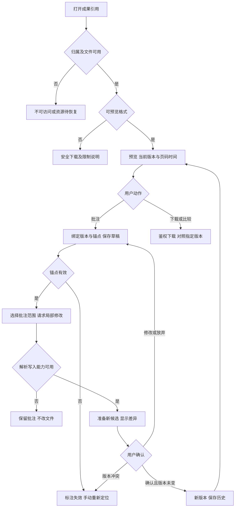

# 任务包22：成果预览与批注迭代
版本：完整规格稿1｜2026-11-04｜状态：SPEC_READY_FOR_ASSIGNMENT（规格已扩写，未指派/未实现/未验收）。类型：用户交互型：多格式成果与版本。用户已通过09/10示范深度并授权本轮扩写；本包下列“待用户拍板”仍为建议，不能当既定产品决定。原01–08据用户确认已由Gemini完成，本轮不重写；交付、主审、集成、上线状态分开登记。
阅读：[主台账](REFACTOR-MASTER-TRACKER-20261103.md)、[研发交付流程](ENGINEERING-DELIVERY-WORKFLOW.md)、[技术入门](DEVELOPER-ONBOARDING.md)。领取填写负责人、实现者、独立测试者、实际base/branch、OS/Node、dirty文件归属及依赖契约版本；bbd9997仅历史参考，不是自动可发布版本。

## 1. 结果、范围与分类依据
用户在成果面板预览文件，对段落、单元格或时间点批注，选定需要修改的范围，经差异确认形成新版本，再比较/下载/历史重开。批注不会直接写文件或让Agent自动改全部成果。
先按格式交付可支持的锚点矩阵：PDF页/区域、表格单元格、图片区域、音视频时间点；Word段落要有稳定解析映射。未支持格式提供下载和具名限制，不假称全格式原位编辑。

## 2. 复用核查、依赖与所有权
先对锁定DSH 0.1.1-rc.2交“需求—原生/插件/现有接缝—版本/导出证据—配置或接线—缺口—AC”矩阵，原生直接用→配置→产品接线→现插件/受控升级→证据缺口最小补充。下表是开工核查点，不是本轮已跑SDK/已证实新能力；负责人确认缺口后才能实现，不另造Agent循环、执行器或审批引擎。

| 能力/核查来源 | 本包接线、证明及缺口边界 |
|---|---|
| shell/runtime/artifact-open.cjs、既有产物ACL与DSH结果 | 复用引用/下载协议与原生卡片，不新建成果权威存储 |
| 03 writer/解析器与09 guarded editing | 按格式接既有实现，先核实锚点与版本，禁止二进制字符串替换 |

依赖及并行边界：03输出、09编辑、19项目/资源、28共享；复杂格式可分期，但每格式都需预览→批注→修改→新版本闭环。
独占交付：`shell/candidates/product-preview-20261103/`（CONTRACT.md、REUSE-MATRIX.md、实现或方案、UI/fixture、接线建议）、`tests/probes/product-preview-20261103.mjs`、`docs/refactor/evidence/PRODUCT-PREVIEW-20261103.md`。方案/验收包交可执行方案与证据，不制造空产品模块。共享server/runner/public/tenant/profile/迁移/package/lock由负责人集成，只交补丁建议；不改Gemini原8包、Bug窗口、tests/e2e/或其他包。测试目录所有权先协调；禁覆盖dirty文件、旧归档或线上r28。
本包不产生部署、付费、外发、资源采购、merge/push或电脑控制授权；真实操作按具体范围另核已有授权。日志/报告不存Key、Cookie、私密原文、签名URL，fixture合成且数据/凭据/DB与生产隔离。

## 3. 用户旅程决策树
范围内每条边由下表解释；后台契约不能替代默认界面和恢复动作。刷新、权限撤销、并发及未知结果也列入验收。

## 4. 分步详解表

| 节点/触发 | 默认界面与系统动作 | 用户动作、兜底条件与禁止行为 | 对应AC |
|---|---|---|---|
| A/B/C 打开成果 | 显示归属、名称/版本，加载后再预览 | 权限撤销、缺文件、网络错分别说明；不泄露别人成果 | 22-01 |
| D/E/F 格式预览 | 支持格式内嵌预览，unsupported明确下载，HTML/脚本隔离 | 转换失败不显示空白成功，不执行嵌入脚本，不自动付费转换 | 22-02 |
| G/H 新增批注 | 用户选段/格/区域/时间点，展示锚点和版本，草稿保存有状态 | 切文件/版本提示草稿；文字批注不直接执行模型 | 22-03 |
| I/J 锚点变化 | 原版本仍能查看，当前版显示失效/需重定位 | 不靠猜坐标悄悄把旧批注贴错段；重新定位需用户确认 | 22-04 |
| K/L/M 请求局部修改 | 选择一个或多个批注，展示将改范围与可用工具 | Office只走03 writer，文本走09；无解析/写入能力保留批注不字符串替换 | 22-05 |
| N/O 差异与确认 | 展示新旧版本/内容变化、费用和未完成批注 | 版本变更重预览，改候选废旧批准，放弃不发布 | 22-06 |
| P 发布新版本 | 新artifactVersion与来源/批注关联，旧版本可读 | 不能用模型声称已改代替真实文件；记录哪些批注已解决 | 22-07 |
| Q 比较下载/重开 | 选择两个明确版本对照，下载后刷新仍可定位 | 过期URL先重取受控引用，下载失败不重生成 | 22-08 |

## 5. 建议方案与待确认决策
以下是建议与决策责任；“待用户拍板”未获确认前不作为已定范围。负责人技术核实及外部回执不是要求用户代做调查。未决项阻断对应AC，不阻断无依赖的契约/fixture工作。

| 决策/责任 | 建议、原因与代价 | 未确认边界或需要的证据 |
|---|---|---|
| 22-D1 待用户拍板 | 建议首版按格式分步开放锚点，不承诺Word任意复杂版式无损编辑 | 首轮必须支持的格式和锚点深度需确认，未支持保留未完成 |
| 22-D2 待用户拍板 | 批注默认只私有讨论，点“请求修改”才发模型 | 协作批注权限交28，不默认共享正文或自动执行 |
| 22-D3 负责人技术核实 | 用稳定结构ID/内容摘要＋版本绑定，跨版自动重定位仅在可证明唯一时建议给用户确认 | 各解析器锚点映射/渲染/写入一致性需真实文件样本 |
| 22-D4 待用户拍板 | 建议大媒体时间点精度按秒起步，缩略图和转码按配额 | 波形/逐帧编辑后置，资源费用先交33测量 |

## 6. 契约、数据与恢复
接口名称为目标语义，不自动表示现有HTTP端点已实现。CONTRACT冻结可信身份、输入/输出/schema版本、错误码与UI/调用方映射；复用现有错误，拒绝将失败全部报500。

| 操作/记录 | 必须保持的语义 |
|---|---|
| 预览 | artifactRef/version、MIME/size、previewRef、sourceMap与授权；预览转换不改原文 |
| 批注 | commentId/version/anchorKind/anchorData/contentDigest、owner、state；批注与执行请求分离 |
| 修改与版本 | selectedComments、baseVersion、proposal/approval、新artifactVersion、resolvedCommentRefs；CAS防覆写 |

跨边界读写逐次校验owner/tenant及本包project/device/Run范围；客户端ID不授予权限。状态和版本持久化，重复同operation同payload返回原结果，异参冲突；取消/超时/断网不自动证明外部动作失败或停止计费。外部写入未知先核对，不盲重试/换模型重提。存储变更需真实PGlite及隔离PG验证，迁移编号由负责人分配；纯调查包此项按无产品写入注明不适用。历史源证据不可覆写，修订形成新版本。

## 7. 验收矩阵与测试责任
每个AC交实现/方案位置、fixture、执行命令、退出码、PASS/FAIL/BLOCKED与脱敏证据；未决或未授权不计PASS。下列是将来执行要求，本轮没有实现或业务通过声明。

| AC | 通过标准 | 验证方式 |
|---|---|---|
| 22-01 | A/B：越权/失效/可恢复引用分别拒绝或重查 | 确定性接口/SDK＋staging点击E2E |
| 22-02 | D/E/F：各格式/转换失败/XSS/下载兜底通过 | 确定性接口/SDK＋staging点击E2E |
| 22-03 | G/H：锚点数据正确、空批注/失效位置拒绝、无自动修改 | 确定性接口/SDK＋staging点击E2E |
| 22-04 | I/J：版本变化后失效锚点明确且不误改 | 确定性接口/SDK＋staging点击E2E |
| 22-05 | K/L/M：支持/不支持格式路由正确，原文件不变 | 确定性接口/SDK＋staging点击E2E |
| 22-06 | N/O：确认前原SHA不变，冲突/拒绝/重复保存受控 | 确定性接口/SDK＋staging点击E2E |
| 22-07 | P：真实文件可打开、版本关系和批注处理可追 | 确定性接口/SDK＋staging点击E2E |
| 22-08 | Q：下载ACL/失败恢复、历史页/时间定位正确 | 确定性接口/SDK＋staging点击E2E |
| 22-09 | 伪造身份/资源引用、权限撤销、日志/证据敏感信息均拒绝或脱敏，不扩大依赖权限 | 双身份/仓储负向及证据扫描 |
| 22-10 | 重复操作、并发版本变化、断线/重启与结果未知不造成重复副作用；恢复依据权威记录 | 并发/故障fixture；方案包核实执行证据 |
| 22-11 | 本包变更与同版累计功能兼容；未跑真实上游/生产的项目仍待验，不将fixture写成上线成功 | 负责人受影响回归＋独立测试/证据复核 |

开发者/执行者交`node tests/probes/product-preview-20261103.mjs`的实现后实际运行方法（方案包可由该入口验证清单/证据或交等价可复跑命令并解释），真实调用候选/锁定SDK/协议服务/存储而非镜像常量，失败非零。无代码阶段不制造假探针通过。独立测试者复核负向反例；涉及界面的AC必须实际点击，API辅助不能全部替代；纯后端包不强制点击E2E，核实业务影响即可。
真实PT调用与付费次数、生产写入/故障、电脑动作独立授权；确定性模型/本地协议轨、真实PT轨、staging与production证据分开。未获授权保留BLOCKED，不能抹掉失败或把未执行算不适用。测试证据绑定应用/配置/迁移/用例版本与fixture SHA。

## 8. 资源、Plan B与进度影响
预览/转换CPU、临时盘、视频带宽与有界缩略图缓存；需中文/复杂表格/多页/长视频合成样本，资源不足不无界转码。
## PT依赖、Plan B与进度影响
| PT依赖/需求编号 | Plan B | 进度/验收影响 |
|---|---|---|
| 预览无新增；模型修改需PT-03 | 已有解析/writer+原生产物协议 | 预览/批注继续；智能修改按模型验收 |
依据：[PT接口规格v1.1第15节](PT-API-REQUIREMENTS-20261104.md)。PT未接受建议接口形态时先映射既有协议；遵循DSH最大复用原则。上述Plan B为规划候选，不表示已验证或获准额外模型/资源/供应商调用；原范围未满足仍标未完成，变更需用户确认。签署协议仅已签署/未签署，无有效期/续签；资产启用及凭据/缓存/资源有效期分别处理。

## 9. 里程碑、交付与接入
| 阶段 | 本包产出与放行依据 |
|---|---|
| M0 冻结 | 分类、范围、复用矩阵、依赖契约、上述决策、节点/阶段→AC及可量化限制；负责人确认接口缺口，用户只拍板产品/成本/资源选择 |
| M1 核心候选/方案 | 格式/锚点支持矩阵与预览批注UI |
| M2 失败与恢复 | 锚点失效、二进制/脚本、转换失败及版本冲突 |
| M3 独立主审/接入 | 成果版本/批注/编辑审批接线；负责人独占共享接线，运行受影响回归 |
| M4 同版验收/发布 | 预览→局部批注→确认改版→比较下载重开E2E；有发布授权才冻结归档并切换，production专属租户受控冒烟 |

交付报告含base/commit/文件SHA、依赖契约版本、命令/退出码/通过失败阻塞数、AC映射、替身/真实边界、遗留Bug与责任、安装/挂载/清理/回退说明。Bug原作者自测后独立复测，主审/集成/发布各阶段分别登记。关闭新入口不等于撤销已提交数据或终止外部任务；回退保留历史可读和必要对账，数据库不自动逆迁。当前仅规格扩写完成，尚未分配、实现、主审、集成、本地/测试环境验收或发布；不能凭文档数量计算产品完成度。
