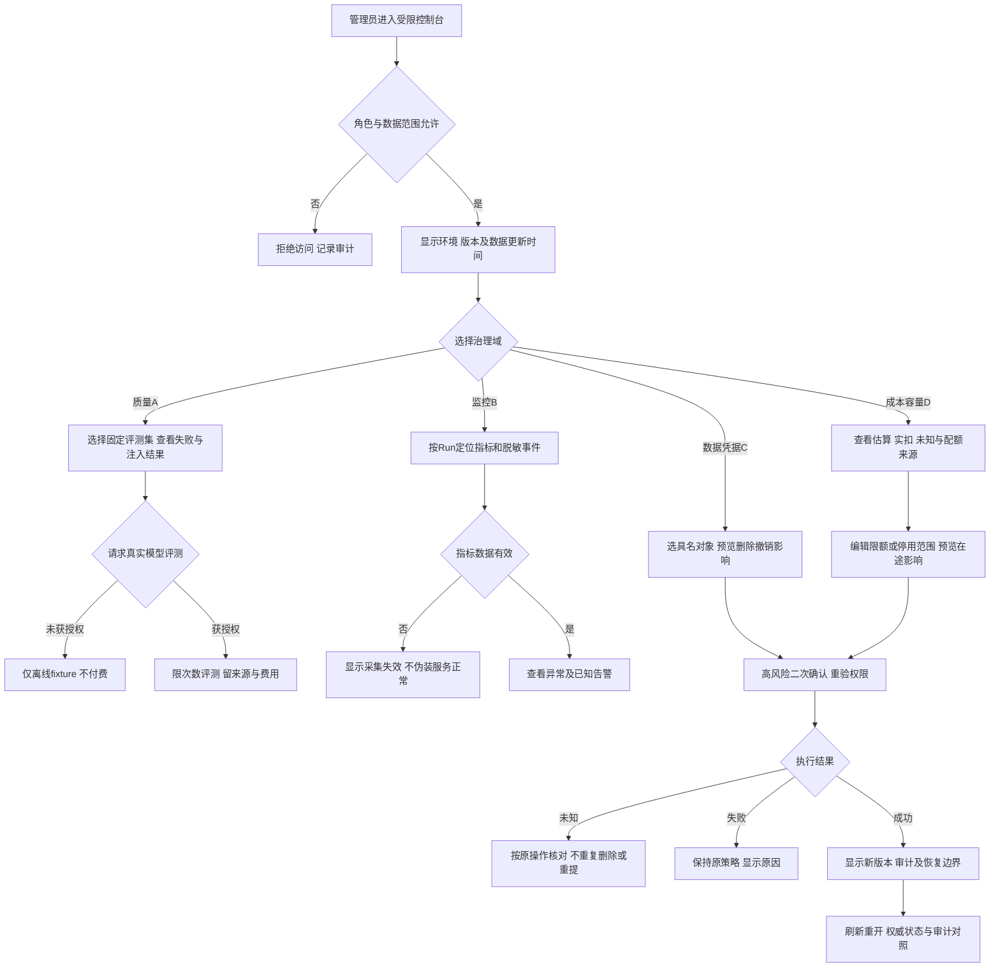

# 任务包35：生产基础补强：质量、监控、数据与成本
版本：完整规格稿1｜2026-11-04｜状态：SPEC_READY_FOR_ASSIGNMENT（规格已扩写，未指派/未实现/未验收）。类型：混合型：四条后端治理链＋受限管理控制台。用户已通过09/10示范深度并授权本轮扩写；本包下列“待用户拍板”仍为建议，不能当既定产品决定。原01–08据用户确认已由Gemini完成，本轮不重写；交付、主审、集成、上线状态分开登记。
阅读：[主台账](REFACTOR-MASTER-TRACKER-20261103.md)、[研发交付流程](ENGINEERING-DELIVERY-WORKFLOW.md)、[技术入门](DEVELOPER-ONBOARDING.md)。领取填写负责人、实现者、独立测试者、实际base/branch、OS/Node、dirty文件归属及依赖契约版本；bbd9997仅历史参考，不是自动可发布版本。

## 1. 结果、范围与分类依据
负责人能够用可审计控制面发现质量/注入风险、定位服务异常、处理数据/凭据和成本/容量策略；每次高风险变更显示影响、确认和真实结果。35A/B/C/D分别交付与验收，不能用一个控制台截图宣布四项完成。
35A质量评测/注入；35B监控SLO/控制台；35C数据/凭据治理；35D成本/容量控制。复用14–18/31/33成果而非复制测试/恢复引擎。只有管理控制台操作走用户三件套，后台指标采集/评测按独立契约验证。

## 2. 复用核查、依赖与所有权
先对锁定DSH 0.1.1-rc.2交“需求—原生/插件/现有接缝—版本/导出证据—配置或接线—缺口—AC”矩阵，原生直接用→配置→产品接线→现插件/受控升级→证据缺口最小补充。下表是开工核查点，不是本轮已跑SDK/已证实新能力；负责人确认缺口后才能实现，不另造Agent循环、执行器或审批引擎。

| 能力/核查来源 | 本包接线、证明及缺口边界 |
|---|---|
| DSH事件、工具权限、已有Run/usage | 复用原生拒绝与事件投影，策略不能凭提示词代替可信权限 |
| 14–18验收/故障/CI/治理/恢复 | 35A引用测试证据，35B引用健康，35C引用恢复集合，不复制维护多份权威 |
| 07账单/31facade/33资源限额 | 35D展示来源和实施准入，监控/预算不把估算升级为实扣 |

依赖及并行边界：14–18、31/33，07账单和29站内通知；四域可分批实现，但每域验收/上线单独登记，不能互相替代。
独占交付：`shell/candidates/product-production-20261103/`（CONTRACT.md、REUSE-MATRIX.md、实现或方案、UI/fixture、接线建议）、`tests/probes/product-production-20261103.mjs`、`docs/refactor/evidence/PRODUCT-PRODUCTION-20261103.md`。方案/验收包交可执行方案与证据，不制造空产品模块。共享server/runner/public/tenant/profile/迁移/package/lock由负责人集成，只交补丁建议；不改Gemini原8包、Bug窗口、tests/e2e/或其他包。测试目录所有权先协调；禁覆盖dirty文件、旧归档或线上r28。
本包不产生部署、付费、外发、资源采购、merge/push或电脑控制授权；真实操作按具体范围另核已有授权。日志/报告不存Key、Cookie、私密原文、签名URL，fixture合成且数据/凭据/DB与生产隔离。

## 3. 用户旅程决策树
范围内每条边由下表解释；后台契约不能替代默认界面和恢复动作。刷新、权限撤销、并发及未知结果也列入验收。

## 4. 分步详解表

| 节点/触发 | 默认界面与系统动作 | 用户动作、兜底条件与禁止行为 | 对应AC |
|---|---|---|---|
| A/B/C 管理入口 | 明确当前环境/版本和可见治理域，非管理员拒绝 | 普通用户/测试环境角色不可操作生产；scope不由客户端勾选 | 35-01 |
| D/E 数据时效 | 指标卡显示时间窗、采集时间、缺失/过期标签 | 没有数据不是0错误或100%健康，不用加载动画遮掩采集失败 | 35-02 |
| F 35A固定评测 | 展示版本化样本/期望/失败，prompt注入和越权反例可追 | 私密用户正文不默认入评测集，模型建议不改真实系统权限 | 35-03 |
| G/H/I 35A真实评测 | 管理员选择模型/次数/范围，已授权才可启动并显示成本来源 | 真实评测不是部署测试，未知费用按策略拒绝，不自动大规模重跑 | 35-04 |
| J/M 35B诊断 | 从异常定位Run/工具/来源链和脱敏事件，显示可见权限范围 | trace不采Key/全文，不对普通用户开放跨租户诊断 | 35-05 |
| K/L 35B指标告警 | 区分应用错误、PT错误、计费未知与采集故障，告警按规则去重 | 外发告警通道未授权则仅站内/已有日志，不擅自发信 | 35-06 |
| N 35C选择对象 | 显示数据/来源/凭据安全引用、所属范围与依赖，删除/撤销影响预览 | 不能显示明文Key；备份和外部副本不能承诺即时全删 | 35-07 |
| O/U 35C执行删除撤销 | 高风险确认绑定对象/version/影响摘要，执行后显示实际完成与未完成 | 进行中任务不能凭删除记录假停；外部撤销未知只核对 | 35-08 |
| P 35D成本视图 | 估算、实扣、余额、费用未知分列，显示来源/单位/时间 | 没有PT证据不显示精确实扣或免费；币种和精度不混算 | 35-09 |
| Q 35D限额策略 | 按tenant/model/task显示阈值和当前在途，变更预览只阻新操作 | 本地预算不假称上游硬封顶，降阈值不撤销已受理任务 | 35-10 |
| O/R/S/T 高风险变更 | 二次确认/权限重验后原子发布新策略版本，结果未知显示核对中 | 双击/并发旧版本拒绝；失败保持旧策略，不“重试”盲删 | 35-11 |
| V 回退与重开 | 显示当前权威策略、审计及可恢复点，重开只查结果 | 回滚策略不恢复已删除数据/已花费用，数据恢复走18联合恢复 | 35-12 |

## 5. 建议方案与待确认决策
以下是建议与决策责任；“待用户拍板”未获确认前不作为已定范围。负责人技术核实及外部回执不是要求用户代做调查。未决项阻断对应AC，不阻断无依赖的契约/fixture工作。

| 决策/责任 | 建议、原因与代价 | 未确认边界或需要的证据 |
|---|---|---|
| 35-D1 待用户拍板 | 35A首期合成/授权脱敏样本，质量阈值基于业务样本基线后定 | 需要哪些业务质量维度/可接受错误率待确认，不凭测试数量定义质量 |
| 35-D2 待用户拍板 | 35B先应用/worker/DB/PT错误和费用未知指标，SLO目标待实测 | 采样率/日志保留/告警通道与费用需确认；不自动开OTEL记录正文 |
| 35-D3 待用户拍板 | 35C按数据类别确认保留期、用户删除权、备份到期清理与凭据轮换 | 未拍板不自动批量删除/轮换；安全撤销与历史保留分别说明 |
| 35-D4 待用户拍板 | 35D本地预算默认只限制新准入，实扣/硬封顶需PT事实 | 是否允许费用未知任务、预算单位/时区/周期及停用影响需拍板 |
| 35-D5 负责人技术冻结 | 四域独立feature flag/AC/报告，管理操作最小权限＋二次确认＋审计 | 优先复用现有事件/日志/ACL/策略，禁止新建第二账单/任务/备份引擎 |
| 35-D6 负责人资源核实 | 评测、指标索引/日志、备份和策略检查开销纳入33测量 | 没有留存资源不承诺长时追溯，没有官方能力不承诺撤回上游动作 |

## 6. 契约、数据与恢复
接口名称为目标语义，不自动表示现有HTTP端点已实现。CONTRACT冻结可信身份、输入/输出/schema版本、错误码与UI/调用方映射；复用现有错误，拒绝将失败全部报500。

| 操作/记录 | 必须保持的语义 |
|---|---|
| 35A评测 | dataset/version/license/source/expected、模型/应用版本、真实或fixture、结果/失败/费用证据，严禁私密正文默认回流 |
| 35B指标 | metric/unit/scope/window/observedAt/source、missing/采样状态、SLO分母/排除规则；trace只存脱敏ID |
| 35C策略 | dataClass/retention/deleteScope、credentialRef/rotation/revocation、index/cache/backup传播及审计状态 |
| 35D限额 | policy/version/scope/unit/period/timezone、usageKind/来源/时效、准入/在途分别，原操作未知保持 |
| 管理操作 | actor/role/environment、target/version/digest、approval/operation、outcome、auditRef；二次鉴权且审计不可由操作者改写 |

跨边界读写逐次校验owner/tenant及本包project/device/Run范围；客户端ID不授予权限。状态和版本持久化，重复同operation同payload返回原结果，异参冲突；取消/超时/断网不自动证明外部动作失败或停止计费。外部写入未知先核对，不盲重试/换模型重提。存储变更需真实PGlite及隔离PG验证，迁移编号由负责人分配；纯调查包此项按无产品写入注明不适用。历史源证据不可覆写，修订形成新版本。

## 7. 验收矩阵与测试责任
每个AC交实现/方案位置、fixture、执行命令、退出码、PASS/FAIL/BLOCKED与脱敏证据；未决或未授权不计PASS。下列是将来执行要求，本轮没有实现或业务通过声明。

| AC | 通过标准 | 验证方式 |
|---|---|---|
| 35-01 | A/B/C：A/B租户及管理员/只读/操作角色边界通过 | 确定性接口/SDK＋staging点击E2E |
| 35-02 | D：无数据/过期/权限不足和真实0值分别显示 | 确定性接口/SDK＋staging点击E2E |
| 35-03 | F：离线质量/注入集可复跑，坏样本确实触发失败 | 确定性接口/SDK＋staging点击E2E |
| 35-04 | G/H/I：真实/fixture轨分开，未授权零付费 | 确定性接口/SDK＋staging点击E2E |
| 35-05 | J/M：采样/检索/下载trace均受ACL，敏感字段脱敏 | 确定性接口/SDK＋staging点击E2E |
| 35-06 | K/L：指标缺失、重复告警、恢复通知与SLO计算可复核 | 确定性接口/SDK＋staging点击E2E |
| 35-07 | N：具名对象、关联任务/索引/备份范围和权限准确 | 确定性接口/SDK＋staging点击E2E |
| 35-08 | O/U：凭据撤销后新访问拒绝，数据/索引/缓存清理可验证 | 确定性接口/SDK＋staging点击E2E |
| 35-09 | P：07/31账单映射、延迟/缺失/未知状态正确 | 确定性接口/SDK＋staging点击E2E |
| 35-10 | Q：本地准入/余额/上游限额分层正确，超限具名拒绝 | 确定性接口/SDK＋staging点击E2E |
| 35-11 | O/R/S/T：CAS、幂等、崩溃和未知结果均无重复破坏 | 确定性接口/SDK＋staging点击E2E |
| 35-12 | V：审计与实际状态一致，回退范围如实标注 | 确定性接口/SDK＋staging点击E2E |
| 35-13 | 伪造身份/资源引用、权限撤销、日志/证据敏感信息均拒绝或脱敏，不扩大依赖权限 | 双身份/仓储负向及证据扫描 |
| 35-14 | 重复操作、并发版本变化、断线/重启与结果未知不造成重复副作用；恢复依据权威记录 | 并发/故障fixture；方案包核实执行证据 |
| 35-15 | 本包变更与同版累计功能兼容；未跑真实上游/生产的项目仍待验，不将fixture写成上线成功 | 负责人受影响回归＋独立测试/证据复核 |

开发者/执行者交`node tests/probes/product-production-20261103.mjs`的实现后实际运行方法（方案包可由该入口验证清单/证据或交等价可复跑命令并解释），真实调用候选/锁定SDK/协议服务/存储而非镜像常量，失败非零。无代码阶段不制造假探针通过。独立测试者复核负向反例；涉及界面的AC必须实际点击，API辅助不能全部替代；纯后端包不强制点击E2E，核实业务影响即可。
真实PT调用与付费次数、生产写入/故障、电脑动作独立授权；确定性模型/本地协议轨、真实PT轨、staging与production证据分开。未获授权保留BLOCKED，不能抹掉失败或把未执行算不适用。测试证据绑定应用/配置/迁移/用例版本与fixture SHA。

## 8. 资源、Plan B与进度影响
需最小管理角色、合成攻击集、指标/日志/审计存储、隔离删除/撤销fixture；告警外发、真实模型评测、凭据变更与清理独立授权。
## PT依赖、Plan B与进度影响
| PT依赖/需求编号 | Plan B | 进度/验收影响 |
|---|---|---|
| PT-01/04/06/07的关联/账单/容量事实 | 本地trace/策略/评测与故障控制；未知保留 | 基础可继续；无上游证据不宣称实扣/可靠取消/真实吞吐 |
依据：[PT接口规格v1.1第15节](PT-API-REQUIREMENTS-20261104.md)。PT未接受建议接口形态时先映射既有协议；遵循DSH最大复用原则。上述Plan B为规划候选，不表示已验证或获准额外模型/资源/供应商调用；原范围未满足仍标未完成，变更需用户确认。签署协议仅已签署/未签署，无有效期/续签；资产启用及凭据/缓存/资源有效期分别处理。

## 9. 里程碑、交付与接入
| 阶段 | 本包产出与放行依据 |
|---|---|
| M0 冻结 | 分类、范围、复用矩阵、依赖契约、上述决策、节点/阶段→AC及可量化限制；负责人确认接口缺口，用户只拍板产品/成本/资源选择 |
| M1 核心候选/方案 | 四域范围/阈值来源/ACL/策略与控制台候选 |
| M2 失败与恢复 | 注入/采集故障/撤权清理/成本未知及高风险变更反例 |
| M3 独立主审/接入 | 复用14–18/31/33的真实接缝并四域独立主审；负责人独占共享接线，运行受影响回归 |
| M4 同版验收/发布 | 四域分别同版E2E/后端门禁，发布范围和未完成项明确；有发布授权才冻结归档并切换，production专属租户受控冒烟 |

交付报告含base/commit/文件SHA、依赖契约版本、命令/退出码/通过失败阻塞数、AC映射、替身/真实边界、遗留Bug与责任、安装/挂载/清理/回退说明。Bug原作者自测后独立复测，主审/集成/发布各阶段分别登记。关闭新入口不等于撤销已提交数据或终止外部任务；回退保留历史可读和必要对账，数据库不自动逆迁。当前仅规格扩写完成，尚未分配、实现、主审、集成、本地/测试环境验收或发布；不能凭文档数量计算产品完成度。
