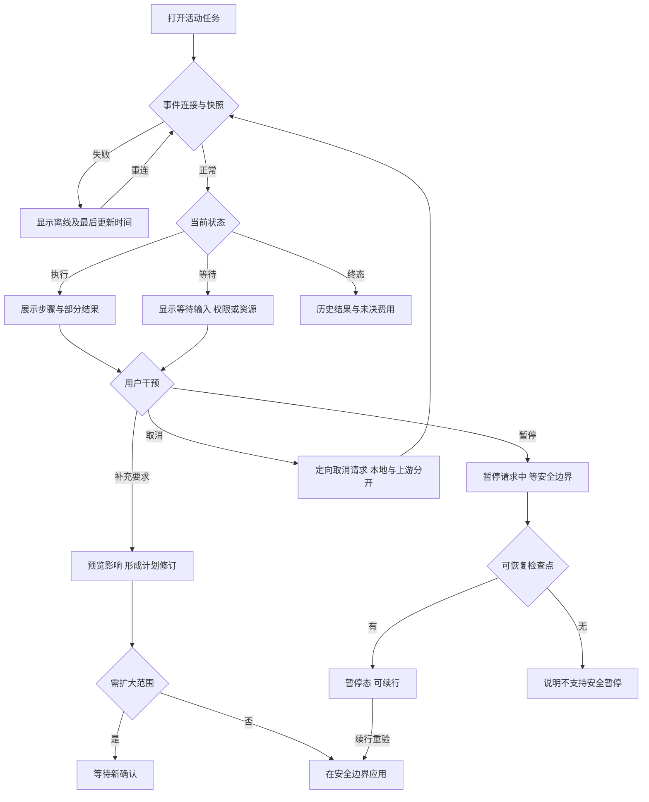

# 任务包21：进度与中途干预
版本：完整规格稿1｜2026-11-04｜状态：SPEC_READY_FOR_ASSIGNMENT（规格已扩写，未指派/未实现/未验收）。类型：用户交互型：活动Run安全控制。用户已通过09/10示范深度并授权本轮扩写；本包下列“待用户拍板”仍为建议，不能当既定产品决定。原01–08据用户确认已由Gemini完成，本轮不重写；交付、主审、集成、上线状态分开登记。
阅读：[主台账](REFACTOR-MASTER-TRACKER-20261103.md)、[研发交付流程](ENGINEERING-DELIVERY-WORKFLOW.md)、[技术入门](DEVELOPER-ONBOARDING.md)。领取填写负责人、实现者、独立测试者、实际base/branch、OS/Node、dirty文件归属及依赖契约版本；bbd9997仅历史参考，不是自动可发布版本。

## 1. 结果、范围与分类依据
用户看见当前步骤、等待原因、已有成果及更新时间，可补充要求、暂停或取消；页面控制与真实执行状态一致，断线不会被画成任务已停。
无可靠百分比只显示阶段，不编造进度。暂停只在可恢复边界成立；外部任务可能继续，不能承诺取消停费。

## 2. 复用核查、依赖与所有权
先对锁定DSH 0.1.1-rc.2交“需求—原生/插件/现有接缝—版本/导出证据—配置或接线—缺口—AC”矩阵，原生直接用→配置→产品接线→现插件/受控升级→证据缺口最小补充。下表是开工核查点，不是本轮已跑SDK/已证实新能力；负责人确认缺口后才能实现，不另造Agent循环、执行器或审批引擎。

| 能力/核查来源 | 本包接线、证明及缺口边界 |
|---|---|
| DSH Session/tool事件、cancel和questions | 复用原生生命周期/问题，不新写任务控制引擎 |
| shell/tasks/session-runs.cjs、session-scheduler与持久Runner | 核实事件游标/控制请求/检查点投影，原生不支持的暂停明确禁用 |

依赖及并行边界：05问题、13工作流、15故障、20计划，29收件箱只投影等待通知不成为第二状态机。
独占交付：`shell/candidates/product-progress-20261103/`（CONTRACT.md、REUSE-MATRIX.md、实现或方案、UI/fixture、接线建议）、`tests/probes/product-progress-20261103.mjs`、`docs/refactor/evidence/PRODUCT-PROGRESS-20261103.md`。方案/验收包交可执行方案与证据，不制造空产品模块。共享server/runner/public/tenant/profile/迁移/package/lock由负责人集成，只交补丁建议；不改Gemini原8包、Bug窗口、tests/e2e/或其他包。测试目录所有权先协调；禁覆盖dirty文件、旧归档或线上r28。
本包不产生部署、付费、外发、资源采购、merge/push或电脑控制授权；真实操作按具体范围另核已有授权。日志/报告不存Key、Cookie、私密原文、签名URL，fixture合成且数据/凭据/DB与生产隔离。

## 3. 用户旅程决策树
范围内每条边由下表解释；后台契约不能替代默认界面和恢复动作。刷新、权限撤销、并发及未知结果也列入验收。

## 4. 分步详解表

| 节点/触发 | 默认界面与系统动作 | 用户动作、兜底条件与禁止行为 | 对应AC |
|---|---|---|---|
| A/B/C 打开/断线 | 先加载持久快照再接事件，离线显示最后时间与重连 | 不能因SSE断线标失败/已取消，刷新只订阅原Run | 21-01 |
| D/E 执行中 | 阶段、工具、耗时及部分成果可读，进度有来源 | 无百分比数据不估假数字；隐藏敏感参数 | 21-02 |
| D/F 等待状态 | 明确等用户/审批/资源/上游，给可执行动作 | 排队与查询失败分开；问题引用过期禁回答 | 21-03 |
| H/I/J/K 补充要求 | 保留输入并显示会改变哪些步骤/成果/费用 | 扩大范围重走20确认，不把文本立即注入已在途工具 | 21-04 |
| M/N/O/P 暂停 | 显示暂停请求中/已到安全边界/不支持 | 不暂停已在上游跑的任务，不能把不支持显示暂停成功 | 21-05 |
| O/L 续行 | 显示检查点、待执行步骤并重验权限/预算 | 无安全检查点或未知副作用先核对，不重放已完成工具 | 21-06 |
| Q 取消 | 本地请求中、上游能力与确认分别展示 | 重复点击幂等；完成竞态显示真实完成，费用未知保留 | 21-07 |
| G 历史/刷新 | 终态结果、部分成果及待核对项保留，controls按终态禁用 | 晚到事件不回退状态；新任务是独立确认而非复活旧Run | 21-08 |

## 5. 建议方案与待确认决策
以下是建议与决策责任；“待用户拍板”未获确认前不作为已定范围。负责人技术核实及外部回执不是要求用户代做调查。未决项阻断对应AC，不阻断无依赖的契约/fixture工作。

| 决策/责任 | 建议、原因与代价 | 未确认边界或需要的证据 |
|---|---|---|
| 21-D1 待用户拍板 | 建议只有明确安全检查点的任务显示暂停按钮，其余说明不支持 | 不能为了统一UI提供假暂停，支持任务清单需确认 |
| 21-D2 待用户拍板 | 补充要求默认生成修订，非立即改变当前工具参数 | 是否允许低风险只读后续步骤直接更新由20统一规则确认 |
| 21-D3 负责人技术核实 | 事件断线后快照＋游标恢复，状态以服务端为准 | 原生Session/cancel/questions事件和worker边界必须实测 |
| 21-D4 待用户拍板 | 建议部分成果始终可见但标未完成，不等所有步骤结束才展示 | 部分文件可下载的格式/完整性限制由22/03给证据 |

## 6. 契约、数据与恢复
接口名称为目标语义，不自动表示现有HTTP端点已实现。CONTRACT冻结可信身份、输入/输出/schema版本、错误码与UI/调用方映射；复用现有错误，拒绝将失败全部报500。

| 操作/记录 | 必须保持的语义 |
|---|---|
| 状态快照 | Run/version、step/status、lastEvent/updatedAt、waitReason与partialArtifactRefs |
| 控制请求 | pause/cancel/resume、actor/operation/expectedVersion、capability与ackState，控制请求不等于执行终态 |
| 修订 | 原planVersion/newRevision、输入摘要、影响与批准；下一个安全边界应用 |

跨边界读写逐次校验owner/tenant及本包project/device/Run范围；客户端ID不授予权限。状态和版本持久化，重复同operation同payload返回原结果，异参冲突；取消/超时/断网不自动证明外部动作失败或停止计费。外部写入未知先核对，不盲重试/换模型重提。存储变更需真实PGlite及隔离PG验证，迁移编号由负责人分配；纯调查包此项按无产品写入注明不适用。历史源证据不可覆写，修订形成新版本。

## 7. 验收矩阵与测试责任
每个AC交实现/方案位置、fixture、执行命令、退出码、PASS/FAIL/BLOCKED与脱敏证据；未决或未授权不计PASS。下列是将来执行要求，本轮没有实现或业务通过声明。

| AC | 通过标准 | 验证方式 |
|---|---|---|
| 21-01 | A/B/C：断线重连顺序/去重、最后状态与事件不丢 | 确定性接口/SDK＋staging点击E2E |
| 21-02 | D/E：真实事件映射、未知阶段与部分结果可复核 | 确定性接口/SDK＋staging点击E2E |
| 21-03 | D/F：各等待原因/失效审批不误导无限排队 | 确定性接口/SDK＋staging点击E2E |
| 21-04 | H/I/J/K：原计划冻结、修订版本和未确认零副作用 | 确定性接口/SDK＋staging点击E2E |
| 21-05 | M/N/O/P：支持/不支持/超时/取消竞态分支可见 | 确定性接口/SDK＋staging点击E2E |
| 21-06 | O/L：续行只做未执行步骤，权限撤销拒绝 | 确定性接口/SDK＋staging点击E2E |
| 21-07 | Q：定向取消不影响其他Run，不承诺停费 | 确定性接口/SDK＋staging点击E2E |
| 21-08 | G：终态单调、晚到处理与历史重开正确 | 确定性接口/SDK＋staging点击E2E |
| 21-09 | 伪造身份/资源引用、权限撤销、日志/证据敏感信息均拒绝或脱敏，不扩大依赖权限 | 双身份/仓储负向及证据扫描 |
| 21-10 | 重复操作、并发版本变化、断线/重启与结果未知不造成重复副作用；恢复依据权威记录 | 并发/故障fixture；方案包核实执行证据 |
| 21-11 | 本包变更与同版累计功能兼容；未跑真实上游/生产的项目仍待验，不将fixture写成上线成功 | 负责人受影响回归＋独立测试/证据复核 |

开发者/执行者交`node tests/probes/product-progress-20261103.mjs`的实现后实际运行方法（方案包可由该入口验证清单/证据或交等价可复跑命令并解释），真实调用候选/锁定SDK/协议服务/存储而非镜像常量，失败非零。无代码阶段不制造假探针通过。独立测试者复核负向反例；涉及界面的AC必须实际点击，API辅助不能全部替代；纯后端包不强制点击E2E，核实业务影响即可。
真实PT调用与付费次数、生产写入/故障、电脑动作独立授权；确定性模型/本地协议轨、真实PT轨、staging与production证据分开。未获授权保留BLOCKED，不能抹掉失败或把未执行算不适用。测试证据绑定应用/配置/迁移/用例版本与fixture SHA。

## 8. 资源、Plan B与进度影响
需要SSE断线/晚到/取消/检查点fixture；大量连接与重连风暴由33测，不凭UI宣称吞吐。
## PT依赖、Plan B与进度影响
| PT依赖/需求编号 | Plan B | 进度/验收影响 |
|---|---|---|
| 无新增；取消状态涉及PT-04 | 原生事件/cancel；未知外部任务人工核对 | 进度UI继续；取消不承诺停止上游计费 |
依据：[PT接口规格v1.1第15节](PT-API-REQUIREMENTS-20261104.md)。PT未接受建议接口形态时先映射既有协议；遵循DSH最大复用原则。上述Plan B为规划候选，不表示已验证或获准额外模型/资源/供应商调用；原范围未满足仍标未完成，变更需用户确认。签署协议仅已签署/未签署，无有效期/续签；资产启用及凭据/缓存/资源有效期分别处理。

## 9. 里程碑、交付与接入
| 阶段 | 本包产出与放行依据 |
|---|---|
| M0 冻结 | 分类、范围、复用矩阵、依赖契约、上述决策、节点/阶段→AC及可量化限制；负责人确认接口缺口，用户只拍板产品/成本/资源选择 |
| M1 核心候选/方案 | 活动快照/事件/等待原因与控制能力UI |
| M2 失败与恢复 | 断线/终态竞态、暂停边界及续行反例 |
| M3 独立主审/接入 | 负责人接真实Run控制和计划修订；负责人独占共享接线，运行受影响回归 |
| M4 同版验收/发布 | 多标签查看→补充→暂停/取消→历史重开E2E；有发布授权才冻结归档并切换，production专属租户受控冒烟 |

交付报告含base/commit/文件SHA、依赖契约版本、命令/退出码/通过失败阻塞数、AC映射、替身/真实边界、遗留Bug与责任、安装/挂载/清理/回退说明。Bug原作者自测后独立复测，主审/集成/发布各阶段分别登记。关闭新入口不等于撤销已提交数据或终止外部任务；回退保留历史可读和必要对账，数据库不自动逆迁。当前仅规格扩写完成，尚未分配、实现、主审、集成、本地/测试环境验收或发布；不能凭文档数量计算产品完成度。
