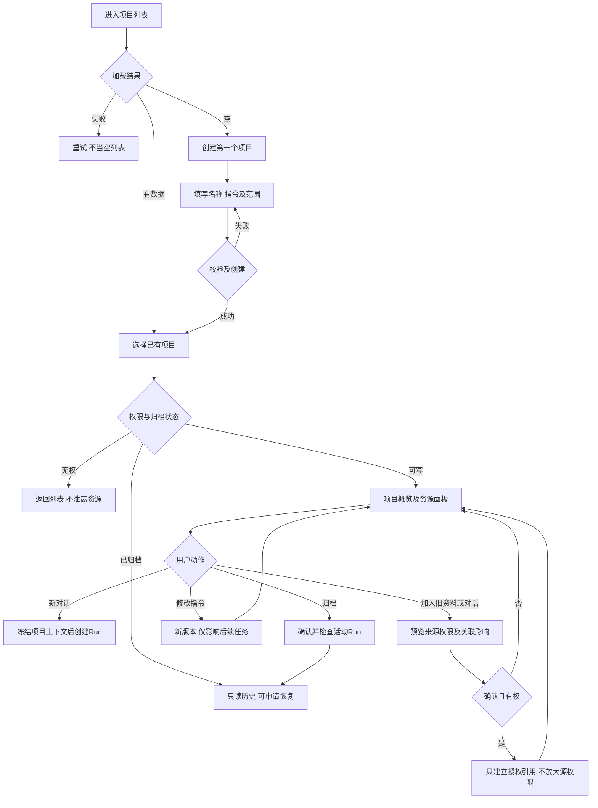

# 任务包19：项目与工作空间
版本：完整规格稿1｜2026-11-04｜状态：SPEC_READY_FOR_ASSIGNMENT（规格已扩写，未指派/未实现/未验收）。类型：用户交互型：项目容器与资料范围。用户已通过09/10示范深度并授权本轮扩写；本包下列“待用户拍板”仍为建议，不能当既定产品决定。原01–08据用户确认已由Gemini完成，本轮不重写；交付、主审、集成、上线状态分开登记。
阅读：[主台账](REFACTOR-MASTER-TRACKER-20261103.md)、[研发交付流程](ENGINEERING-DELIVERY-WORKFLOW.md)、[技术入门](DEVELOPER-ONBOARDING.md)。领取填写负责人、实现者、独立测试者、实际base/branch、OS/Node、dirty文件归属及依赖契约版本；bbd9997仅历史参考，不是自动可发布版本。

## 1. 结果、范围与分类依据
用户创建项目后，在同一授权范围找到对话、资料、成果和项目指令；切换项目不会携带另一项目的私密上下文。项目知识与个人记忆分开，已有对话可显式加入，归档后仍能按权限查历史。
首期单人项目容器/指令/资源引用/归档；团队共享归28，个人记忆归30，文件编辑归09。项目元数据与执行工作目录不是同一个授权凭据，不从projectId推任意磁盘路径。

## 2. 复用核查、依赖与所有权
先对锁定DSH 0.1.1-rc.2交“需求—原生/插件/现有接缝—版本/导出证据—配置或接线—缺口—AC”矩阵，原生直接用→配置→产品接线→现插件/受控升级→证据缺口最小补充。下表是开工核查点，不是本轮已跑SDK/已证实新能力；负责人确认缺口后才能实现，不另造Agent循环、执行器或审批引擎。

| 能力/核查来源 | 本包接线、证明及缺口边界 |
|---|---|
| DSH Session/Skill上下文 | 复用会话与固定Skill注入，项目元数据只做范围绑定，不新建Session引擎 |
| shell/workspace/index.cjs、shell/tasks/session-runs.cjs及tenant | 核实workspace授权/会话接缝，项目ACL由可信宿主维护 |

依赖及并行边界：02/03资料/产物、09编辑、30记忆；基础容器先不强依赖全部格式或语义检索，28共享后置。
独占交付：`shell/candidates/product-project-20261103/`（CONTRACT.md、REUSE-MATRIX.md、实现或方案、UI/fixture、接线建议）、`tests/probes/product-project-20261103.mjs`、`docs/refactor/evidence/PRODUCT-PROJECT-20261103.md`。方案/验收包交可执行方案与证据，不制造空产品模块。共享server/runner/public/tenant/profile/迁移/package/lock由负责人集成，只交补丁建议；不改Gemini原8包、Bug窗口、tests/e2e/或其他包。测试目录所有权先协调；禁覆盖dirty文件、旧归档或线上r28。
本包不产生部署、付费、外发、资源采购、merge/push或电脑控制授权；真实操作按具体范围另核已有授权。日志/报告不存Key、Cookie、私密原文、签名URL，fixture合成且数据/凭据/DB与生产隔离。

## 3. 用户旅程决策树
范围内每条边由下表解释；后台契约不能替代默认界面和恢复动作。刷新、权限撤销、并发及未知结果也列入验收。

## 4. 分步详解表

| 节点/触发 | 默认界面与系统动作 | 用户动作、兜底条件与禁止行为 | 对应AC |
|---|---|---|---|
| A/B/C/D 项目列表 | 显示最近访问项目、搜索与新建，空态解释项目用途 | 失败显示重试；无权限不显示其他人项目名称 | 19-01 |
| F/G 创建 | 填写名称/可选说明/项目指令，显示归属与私人默认范围 | 名称冲突/超限保留输入；重复点击返回同项目，不自动建共享 | 19-02 |
| E/H/I/J 进入项目 | 按可读/可写/归档显示概览和禁用原因 | 失效链接/撤权返回通用不可访问，归档不执行新Run | 19-03 |
| K/L/M 项目内新任务 | 明确当前项目及将注入的指令/资料来源，选择模型再提交 | 范围变化重新确认，不把个人记忆默认复制进项目 | 19-04 |
| N/O/P 加入既有资源 | 默认选已有授权资料/对话，预览范围和关联后确认 | 源无权限不能关联；关联不等于复制或开放下载，移出不删原资源 | 19-05 |
| Q 修改指令 | 保存新版本并说明仅对后续Run生效 | 活动Run保持冻结输入，冲突重载不覆盖别人的指令 | 19-06 |
| R/J 归档与恢复 | 显示受影响资源、活动任务及只读效果，确认后归档 | 不自动取消/删任务；未决任务先显示并按决策门禁处理，恢复再验权限 | 19-07 |
| K 切换/离开/刷新 | 有未保存指令提醒，刷新加载持久项目和关联资源 | 换项目清除旧选择/搜索缓存，保留未决操作记录 | 19-08 |

## 5. 建议方案与待确认决策
以下是建议与决策责任；“待用户拍板”未获确认前不作为已定范围。负责人技术核实及外部回执不是要求用户代做调查。未决项阻断对应AC，不阻断无依赖的契约/fixture工作。

| 决策/责任 | 建议、原因与代价 | 未确认边界或需要的证据 |
|---|---|---|
| 19-D1 待用户拍板 | 建议首期归档而非永久删除项目，降低误删与联合资源清理风险 | 永久删除及保留期后置，归档是否等活动Run结束需确认 |
| 19-D2 待用户拍板 | 项目内默认继承项目指令，个人记忆须显式选择是否参与 | 跨范围默认选择确认前不自动带个人记忆 |
| 19-D3 负责人技术核实 | 项目与workspace用可信引用映射，不强迫09等先改全部路径 | 现有workspace/session/project适配及迁移编号先交；无目录权限不能凭项目授予 |
| 19-D4 待用户拍板 | 建议旧对话只关联引用，不迁移所有历史归属 | 需要转移所有权时另做确认与ACL迁移，不在首期无声移动 |

## 6. 契约、数据与恢复
接口名称为目标语义，不自动表示现有HTTP端点已实现。CONTRACT冻结可信身份、输入/输出/schema版本、错误码与UI/调用方映射；复用现有错误，拒绝将失败全部报500。

| 操作/记录 | 必须保持的语义 |
|---|---|
| 项目 | tenant/owner/projectId、state、name/instructionVersion、workspaceRef；根路径服务端映射 |
| 资源关联 | projectId/sourceRef/sourceScope/version、linkOperation；读时同时校验项目与源权限，移除仅删链接 |
| Run上下文 | projectVersion、instructionDigest、allowedSourceRefs、memoryScope；启动冻结，后续编辑不改已提交请求 |

跨边界读写逐次校验owner/tenant及本包project/device/Run范围；客户端ID不授予权限。状态和版本持久化，重复同operation同payload返回原结果，异参冲突；取消/超时/断网不自动证明外部动作失败或停止计费。外部写入未知先核对，不盲重试/换模型重提。存储变更需真实PGlite及隔离PG验证，迁移编号由负责人分配；纯调查包此项按无产品写入注明不适用。历史源证据不可覆写，修订形成新版本。

## 7. 验收矩阵与测试责任
每个AC交实现/方案位置、fixture、执行命令、退出码、PASS/FAIL/BLOCKED与脱敏证据；未决或未授权不计PASS。下列是将来执行要求，本轮没有实现或业务通过声明。

| AC | 通过标准 | 验证方式 |
|---|---|---|
| 19-01 | A/B/D：空/加载错/分页与权限筛选正确 | 确定性接口/SDK＋staging点击E2E |
| 19-02 | F/G：创建幂等、非法名称与长度/配额边界通过 | 确定性接口/SDK＋staging点击E2E |
| 19-03 | E/H/J：他项目ID/归档/撤权入口无越权 | 确定性接口/SDK＋staging点击E2E |
| 19-04 | K/M：Run绑定正确project/contextVersion，无跨项目串上下文 | 确定性接口/SDK＋staging点击E2E |
| 19-05 | N/O/P：跨项目引用ACL、重复关联/移除不误删原文 | 确定性接口/SDK＋staging点击E2E |
| 19-06 | Q：并发CAS、活动/新Run指令版本区别可查 | 确定性接口/SDK＋staging点击E2E |
| 19-07 | R/J：归档历史可读、后续执行禁用，恢复不扩大权限 | 确定性接口/SDK＋staging点击E2E |
| 19-08 | K：两项目/两账号缓存隔离、刷新和草稿提醒通过 | 确定性接口/SDK＋staging点击E2E |
| 19-09 | 伪造身份/资源引用、权限撤销、日志/证据敏感信息均拒绝或脱敏，不扩大依赖权限 | 双身份/仓储负向及证据扫描 |
| 19-10 | 重复操作、并发版本变化、断线/重启与结果未知不造成重复副作用；恢复依据权威记录 | 并发/故障fixture；方案包核实执行证据 |
| 19-11 | 本包变更与同版累计功能兼容；未跑真实上游/生产的项目仍待验，不将fixture写成上线成功 | 负责人受影响回归＋独立测试/证据复核 |

开发者/执行者交`node tests/probes/product-project-20261103.mjs`的实现后实际运行方法（方案包可由该入口验证清单/证据或交等价可复跑命令并解释），真实调用候选/锁定SDK/协议服务/存储而非镜像常量，失败非零。无代码阶段不制造假探针通过。独立测试者复核负向反例；涉及界面的AC必须实际点击，API辅助不能全部替代；纯后端包不强制点击E2E，核实业务影响即可。
真实PT调用与付费次数、生产写入/故障、电脑动作独立授权；确定性模型/本地协议轨、真实PT轨、staging与production证据分开。未获授权保留BLOCKED，不能抹掉失败或把未执行算不适用。测试证据绑定应用/配置/迁移/用例版本与fixture SHA。

## 8. 资源、Plan B与进度影响
项目/关联元数据和隔离fixture；不按项目复制全部文件，容量由33测引用/快照增量。
## PT依赖、Plan B与进度影响
| PT依赖/需求编号 | Plan B | 进度/验收影响 |
|---|---|---|
| 无新增；智能项目任务沿PT-03 | DSH Session/上下文+项目业务接线 | 项目可继续，具体新模态任务独立受影响 |
依据：[PT接口规格v1.1第15节](PT-API-REQUIREMENTS-20261104.md)。PT未接受建议接口形态时先映射既有协议；遵循DSH最大复用原则。上述Plan B为规划候选，不表示已验证或获准额外模型/资源/供应商调用；原范围未满足仍标未完成，变更需用户确认。签署协议仅已签署/未签署，无有效期/续签；资产启用及凭据/缓存/资源有效期分别处理。

## 9. 里程碑、交付与接入
| 阶段 | 本包产出与放行依据 |
|---|---|
| M0 冻结 | 分类、范围、复用矩阵、依赖契约、上述决策、节点/阶段→AC及可量化限制；负责人确认接口缺口，用户只拍板产品/成本/资源选择 |
| M1 核心候选/方案 | 项目/资源/指令范围与页面候选 |
| M2 失败与恢复 | 跨项目/归档/活动Run/权限撤销反例 |
| M3 独立主审/接入 | 负责人迁移/入口/Run上下文接线；负责人独占共享接线，运行受影响回归 |
| M4 同版验收/发布 | 创建→关联→任务→成果→归档重开独立E2E；有发布授权才冻结归档并切换，production专属租户受控冒烟 |

交付报告含base/commit/文件SHA、依赖契约版本、命令/退出码/通过失败阻塞数、AC映射、替身/真实边界、遗留Bug与责任、安装/挂载/清理/回退说明。Bug原作者自测后独立复测，主审/集成/发布各阶段分别登记。关闭新入口不等于撤销已提交数据或终止外部任务；回退保留历史可读和必要对账，数据库不自动逆迁。当前仅规格扩写完成，尚未分配、实现、主审、集成、本地/测试环境验收或发布；不能凭文档数量计算产品完成度。
