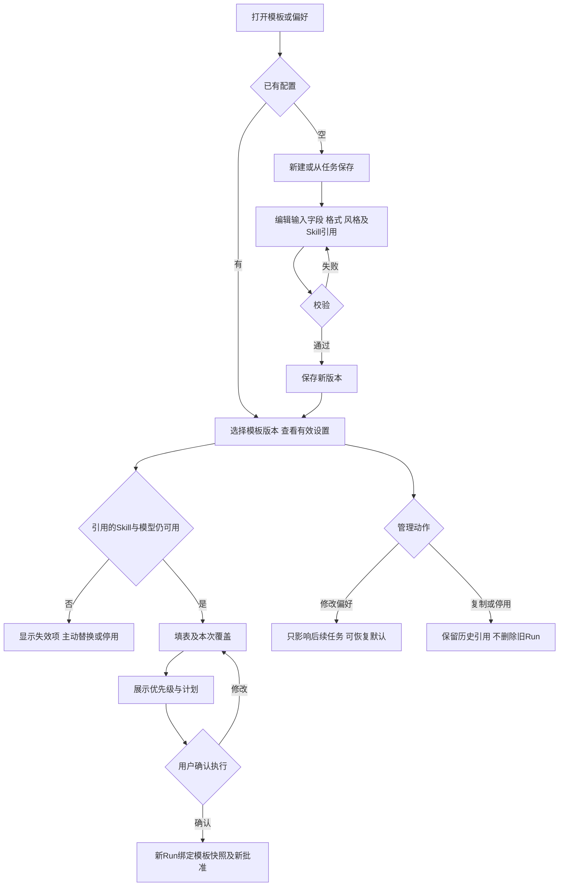

# 任务包24：任务模板与个人偏好
版本：完整规格稿1｜2026-11-04｜状态：SPEC_READY_FOR_ASSIGNMENT（规格已扩写，未指派/未实现/未验收）。类型：用户交互型：固定模板、版本与有效设置。用户已通过09/10示范深度并授权本轮扩写；本包下列“待用户拍板”仍为建议，不能当既定产品决定。原01–08据用户确认已由Gemini完成，本轮不重写；交付、主审、集成、上线状态分开登记。
阅读：[主台账](REFACTOR-MASTER-TRACKER-20261103.md)、[研发交付流程](ENGINEERING-DELIVERY-WORKFLOW.md)、[技术入门](DEVELOPER-ONBOARDING.md)。领取填写负责人、实现者、独立测试者、实际base/branch、OS/Node、dirty文件归属及依赖契约版本；bbd9997仅历史参考，不是自动可发布版本。

## 1. 结果、范围与分类依据
用户保存可复用任务表单、输出格式、语言风格和固定Skill版本，使用时先填写输入并看本次有效设置，再按实际任务确认。模板只复用需求，不携带过去批准或提升工具权限。
个人偏好与项目/模板/本次覆盖分层；首期模板保存/复制/版本/停用和偏好管理。模板不是Skill parser或调度器，不允许任意导入代码/扩展权限。

## 2. 复用核查、依赖与所有权
先对锁定DSH 0.1.1-rc.2交“需求—原生/插件/现有接缝—版本/导出证据—配置或接线—缺口—AC”矩阵，原生直接用→配置→产品接线→现插件/受控升级→证据缺口最小补充。下表是开工核查点，不是本轮已跑SDK/已证实新能力；负责人确认缺口后才能实现，不另造Agent循环、执行器或审批引擎。

| 能力/核查来源 | 本包接线、证明及缺口边界 |
|---|---|
| DSH Skill registry/上下文 | 复用固定Skill选择/停用，模板只存引用/表单不解析新Skill |
| 12任务体验/19项目/20计划与现有偏好入口 | 复用已有配置存取，统一一次有效设置解析来源 |

依赖及并行边界：12/19/20；28团队共享后置，原生固定Skill发布链保持现有权限。
独占交付：`shell/candidates/product-template-20261103/`（CONTRACT.md、REUSE-MATRIX.md、实现或方案、UI/fixture、接线建议）、`tests/probes/product-template-20261103.mjs`、`docs/refactor/evidence/PRODUCT-TEMPLATE-20261103.md`。方案/验收包交可执行方案与证据，不制造空产品模块。共享server/runner/public/tenant/profile/迁移/package/lock由负责人集成，只交补丁建议；不改Gemini原8包、Bug窗口、tests/e2e/或其他包。测试目录所有权先协调；禁覆盖dirty文件、旧归档或线上r28。
本包不产生部署、付费、外发、资源采购、merge/push或电脑控制授权；真实操作按具体范围另核已有授权。日志/报告不存Key、Cookie、私密原文、签名URL，fixture合成且数据/凭据/DB与生产隔离。

## 3. 用户旅程决策树
范围内每条边由下表解释；后台契约不能替代默认界面和恢复动作。刷新、权限撤销、并发及未知结果也列入验收。

## 4. 分步详解表

| 节点/触发 | 默认界面与系统动作 | 用户动作、兜底条件与禁止行为 | 对应AC |
|---|---|---|---|
| A/B/C 模板列表 | 显示本人模板/版本/最近使用及新建，空态可从已选任务保存 | 失败重试不当空；从历史提取需用户审阅，不默认保存敏感原输入 | 24-01 |
| E/F/G 编辑保存 | 字段类型/必填/默认值、格式、语言风格和Skill固定引用 | 非法schema/版本冲突保留草稿；同名按规则新版本不覆盖旧任务 | 24-02 |
| D/H/I 引用失效 | 显示确切Skill版本/模型和不可用原因 | 不自动改用最新Skill或模型，不静默删除参数；用户选替代再确认 | 24-03 |
| J 填写使用 | 显示必填/来源选择和本次覆盖，敏感输入不固化进模板 | 类型/大小不符定位字段；缺权限选其他授权输入 | 24-04 |
| K 有效设置 | 展示本次、模板、项目、个人偏好各来源与最终生效值 | 冲突按已冻结优先级，用户可恢复默认；系统安全策略最高优先 | 24-05 |
| L/M 执行 | 生成新计划和本次批准，Run绑定模板版本与输入摘要 | 模板里“自动同意”无效；收费/写入按实际范围再确认 | 24-06 |
| N/O/P 管理/离开 | 偏好改动提示仅影响后续；停用模板保留旧Run和版本历史 | 有草稿离开提示；换账号不携带偏好，停用不取消在途Run | 24-07 |

## 5. 建议方案与待确认决策
以下是建议与决策责任；“待用户拍板”未获确认前不作为已定范围。负责人技术核实及外部回执不是要求用户代做调查。未决项阻断对应AC，不阻断无依赖的契约/fixture工作。

| 决策/责任 | 建议、原因与代价 | 未确认边界或需要的证据 |
|---|---|---|
| 24-D1 待用户拍板 | 建议有效设置优先级为本次显式值＞模板＞项目默认＞个人偏好，安全策略不可覆盖 | 优先级需确认，界面必须解释来源，不能实现者猜 |
| 24-D2 待用户拍板 | 从历史保存默认只保存表单结构和脱敏示例，不保存Key或私密原文 | 是否可显式包含普通输入文本待确认并说明范围 |
| 24-D3 负责人技术核实 | 模板固定Skill版本，停用即阻新执行，旧记录仍读 | 原生Skill registry/版本契约先核，不重写Skill parser |
| 24-D4 待用户拍板 | 首期私人模板，分享归28，模型自动生成模板仅作为草稿 | 团队模板与导入可执行扩展均不默认开放 |

## 6. 契约、数据与恢复
接口名称为目标语义，不自动表示现有HTTP端点已实现。CONTRACT冻结可信身份、输入/输出/schema版本、错误码与UI/调用方映射；复用现有错误，拒绝将失败全部报500。

| 操作/记录 | 必须保持的语义 |
|---|---|
| 模板 | templateId/version、fieldSchema、output/style、skillRef/version、owner/state；无授权token |
| 偏好 | scope/user/project、settings/version，effectiveSettings注明每项来源，安全策略不被覆盖 |
| 执行 | templateSnapshot/digest、inputRefs、本次覆盖、planVersion/approval及Run；在途不受模板修改影响 |

跨边界读写逐次校验owner/tenant及本包project/device/Run范围；客户端ID不授予权限。状态和版本持久化，重复同operation同payload返回原结果，异参冲突；取消/超时/断网不自动证明外部动作失败或停止计费。外部写入未知先核对，不盲重试/换模型重提。存储变更需真实PGlite及隔离PG验证，迁移编号由负责人分配；纯调查包此项按无产品写入注明不适用。历史源证据不可覆写，修订形成新版本。

## 7. 验收矩阵与测试责任
每个AC交实现/方案位置、fixture、执行命令、退出码、PASS/FAIL/BLOCKED与脱敏证据；未决或未授权不计PASS。下列是将来执行要求，本轮没有实现或业务通过声明。

| AC | 通过标准 | 验证方式 |
|---|---|---|
| 24-01 | A/B/C：空/失败/从历史保存都不泄密 | 确定性接口/SDK＋staging点击E2E |
| 24-02 | E/F/G：schema校验、幂等保存与并发版本通过 | 确定性接口/SDK＋staging点击E2E |
| 24-03 | D/H/I：Skill停用/无权/模型下架均阻对应执行 | 确定性接口/SDK＋staging点击E2E |
| 24-04 | J：不同输入/缺项/授权来源正确，旧secret不复用 | 确定性接口/SDK＋staging点击E2E |
| 24-05 | K：层级覆盖/安全不可覆盖、默认恢复可测 | 确定性接口/SDK＋staging点击E2E |
| 24-06 | L/M：旧批准不可复用，执行快照刷新可查 | 确定性接口/SDK＋staging点击E2E |
| 24-07 | N/O/P：停用/版本历史/账号隔离和草稿提醒正确 | 确定性接口/SDK＋staging点击E2E |
| 24-08 | 伪造身份/资源引用、权限撤销、日志/证据敏感信息均拒绝或脱敏，不扩大依赖权限 | 双身份/仓储负向及证据扫描 |
| 24-09 | 重复操作、并发版本变化、断线/重启与结果未知不造成重复副作用；恢复依据权威记录 | 并发/故障fixture；方案包核实执行证据 |
| 24-10 | 本包变更与同版累计功能兼容；未跑真实上游/生产的项目仍待验，不将fixture写成上线成功 | 负责人受影响回归＋独立测试/证据复核 |

开发者/执行者交`node tests/probes/product-template-20261103.mjs`的实现后实际运行方法（方案包可由该入口验证清单/证据或交等价可复跑命令并解释），真实调用候选/锁定SDK/协议服务/存储而非镜像常量，失败非零。无代码阶段不制造假探针通过。独立测试者复核负向反例；涉及界面的AC必须实际点击，API辅助不能全部替代；纯后端包不强制点击E2E，核实业务影响即可。
真实PT调用与付费次数、生产写入/故障、电脑动作独立授权；确定性模型/本地协议轨、真实PT轨、staging与production证据分开。未获授权保留BLOCKED，不能抹掉失败或把未执行算不适用。测试证据绑定应用/配置/迁移/用例版本与fixture SHA。

## 8. 资源、Plan B与进度影响
表单/版本仓储和Skill失效fixture；无新增PT接口，执行沿所选模型验证，模板编辑不付费。
## PT依赖、Plan B与进度影响
| PT依赖/需求编号 | Plan B | 进度/验收影响 |
|---|---|---|
| 无新增；模板执行沿实际模型任务 | 固定模板/表单+原生Skill/偏好 | 配置复用继续；不把模板当权限或供应商能力 |
依据：[PT接口规格v1.1第15节](PT-API-REQUIREMENTS-20261104.md)。PT未接受建议接口形态时先映射既有协议；遵循DSH最大复用原则。上述Plan B为规划候选，不表示已验证或获准额外模型/资源/供应商调用；原范围未满足仍标未完成，变更需用户确认。签署协议仅已签署/未签署，无有效期/续签；资产启用及凭据/缓存/资源有效期分别处理。

## 9. 里程碑、交付与接入
| 阶段 | 本包产出与放行依据 |
|---|---|
| M0 冻结 | 分类、范围、复用矩阵、依赖契约、上述决策、节点/阶段→AC及可量化限制；负责人确认接口缺口，用户只拍板产品/成本/资源选择 |
| M1 核心候选/方案 | 模板schema/版本/偏好层级及表单UI |
| M2 失败与恢复 | 失效Skill、敏感默认值、权限/版本冲突反例 |
| M3 独立主审/接入 | 模板快照与计划/Run/偏好接线；负责人独占共享接线，运行受影响回归 |
| M4 同版验收/发布 | 保存→改偏好→套用→确认→停用→历史重开E2E；有发布授权才冻结归档并切换，production专属租户受控冒烟 |

交付报告含base/commit/文件SHA、依赖契约版本、命令/退出码/通过失败阻塞数、AC映射、替身/真实边界、遗留Bug与责任、安装/挂载/清理/回退说明。Bug原作者自测后独立复测，主审/集成/发布各阶段分别登记。关闭新入口不等于撤销已提交数据或终止外部任务；回退保留历史可读和必要对账，数据库不自动逆迁。当前仅规格扩写完成，尚未分配、实现、主审、集成、本地/测试环境验收或发布；不能凭文档数量计算产品完成度。
