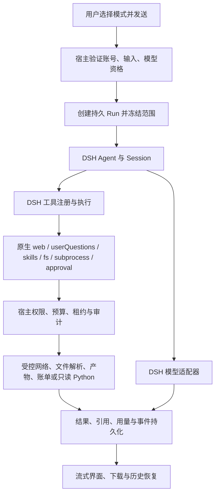

# R34 功能清单与 DSH 能力对应表

> 产品目标纠偏：本表登记的是已上线R34实际范围。用户要求的单聊天框自动规划、按需组合工具及逐模型重试，尚未完成，见[单聊天框AUTO改进方案](AUTO-CHAT-PRODUCT-IMPROVEMENT-PLAN-20261111.md)。不能将本表的组件上线解释为该目标已实现。

版本：2026-11-11。对象：已部署的 R34。用途：产品范围核对、测试设计、开发交接。本文说明产品能够做什么，以及执行这些操作所需的条件。

**结论：R34 已部署 Gemini 01–08 接线、已有基础功能及本轮 Bug 修复。模型通过 DSH 执行。高权限工具仍受限制。当前发布状态为 DEPLOYED_FOR_QA。上线不等于独立验收通过。**

## 1. 阅读规则与版本依据

本文参考 [ASD-STE100 官方说明](https://asd-ste100.org/about.html)的受控语言原则：固定术语、短句、明确主语、明确条件。每项说明使用同一术语。中文本文不是按英文受控词典认证的 ASD-STE100 合规文件。

| 术语 | 本文含义 |
|---|---|
| DSH | 已锁定的 DeepSeek Harness。它提供模型、Agent、Session、工具及执行服务 |
| 宿主 | Northstar 服务端。它处理身份、权限、数据库、文件及产品界面 |
| Run | 一次持久化任务。它有独立身份、状态、事件和预算 |
| Session | DSH 保存的模型上下文。一个对话可以包含多个 Run |
| 原生复用 | 直接使用锁定 DSH 的服务、插件或接口 |
| 宿主补充 | 补足产品接线或原生能力缺口。它不替代 DSH 的 Agent 循环 |
| 已启用 | 对应服务或产品入口已接入发行代码 |
| 受限启用 | 用户、账号、模式、运行条件或预算必须先满足要求 |
| 已关闭 | 发行配置禁用该插件，或模型工具策略拒绝该操作 |
| 仅有声明 | 配置或依赖存在。本文未据此确认可执行 |
| 未知 | 缺少所需事实。未知不代表免费，也不代表成功 |
| 待验收 | 代码或部署已有证据。同版本独立业务测试尚未通过 |

| 冻结项目 | 值 |
|---|---|
| 运行源码 | `1586f765b53fde0a767ef13def3a47e56ca0c726` |
| 代码分支 | `integration/r34-final-all8-20261109` |
| 最终归档 | `northstar-controlled-trial-20261111-r34-all8-1586f76-target.tar.gz` |
| 归档 SHA256 | `cb36cdc5002bdc70a855fd30558893632c9442d847dd609534ea027efe94e4bf` |
| 清单 SHA256 | `8ee72b3d955eb79918409536380fe83c9b2eaf3e8a83cb9303e127aed9bb46c9` |
| DSH 版本 | `0.1.1-rc.2`；依赖以发行锁文件为准 |
| 正式环境 | `https://agent-fat.adorado.top`；只有一个正式环境 |
| 发布后服务 | `northstar-shell`，PID `494892`，active，NRestarts `0` |
| 独立上线核对 | 1095 个成员及文件权限、健康 PID、公网 JS/CSS 匹配 |
| 数据库 | 迁移数从 30 到 35；本轮追加 030–034 |
| 发布状态 | `DEPLOYED_FOR_QA`；Bug-12 为 `DEGRADED_PREVIEW` |

运行源码提交与后续文档提交分别记录。本文新增或修订不会改变上述运行包。运行状态以[上线回执](evidence/R34-ONLINE-AND-QA-HANDOVER-20261111.md)和[独立核对记录](evidence/R34-INDEPENDENT-ONLINE-POSTCHECK-20261111.json)为准。

## 2. 系统如何执行任务

DSH 决定模型与工具的执行流程。宿主校验产品权限并保存业务事实。文件解析器、Whisper、OCR 和文档 writer 是处理组件。它们不是另一套 Agent 引擎。

## 3. R34 保留的基础产品功能

下表列出 R34 的已有功能。账号授权、外部服务和工具模式可能限制使用。表中“接入”不表示每个账号已经完成外部授权。

| 编号 | 具体功能 | DSH 对应能力 | 宿主实现与条件 |
|---|---|---|---|
| B01 | 登录、退出、用户身份及租户隔离 | DSH 不直接承担 Web 登录 | 宿主认证、Cookie、用户/租户检查；DSH 不对用户开放端口 |
| B02 | 保存和移除个人模型 API Key | 模型 provider 凭据输入 | 宿主加密保存；按当前身份解密；不向无关工具下发 |
| B03 | 创建、重命名、搜索、归档、恢复和删除对话 | `agents`、`sessions` | 宿主保存对话元数据和消息；按用户检查所有权 |
| B04 | 多轮对话与流式回答 | Agent、LLM stream、Session | SSE 展示正文与状态；Run 事件可查询 |
| B05 | 重新生成和对话分岔 | 新轮次或新 Session | 宿主构造所选历史范围；不把旧上下文直接当新分支 |
| B06 | 停止任务与任务恢复查看 | Agent cancel、原生取消信号 | 持久 Run 状态、事件续读及历史重开；不自动重提费用未知请求 |
| B07 | 选择模型和 AUTO | `installModelSelection`、LLM provider | 目录、账号权限、DSH 配置、能力事实和资格过滤；见 08 |
| B08 | 设置推理强度 | 适配器支持的 reasoning 参数 | 仅对支持该参数的模型生效；区分不支持与查询失败 |
| B09 | 图片输入及历史图片理解 | 原生 image message、attachment 服务 | 当前账号和模型必须具有图片输入资格；文本模型不自动变成视觉模型 |
| B10 | 上下文连续使用及压缩 | Session、`ctx.compaction.compactNow()` | 保存原生 Session 标识；产品“压缩上下文”入口调用原生服务 |
| B11 | 长期记忆与来源记录 | 记忆文本进入 DSH 上下文 | 宿主保存范围、确认状态、来源版本；模型不能自行确认候选记忆 |
| B12 | 资料库检索、选择引用、删除资料 | 相关文本进入模型上下文 | 绑定文件哈希、版本与定位；删除会失效旧上下文并停止受影响 Run |
| B13 | CSV 范围选择及确定性分析 | DSH 注册工具 `csv_analyze` | 用户先确认范围；宿主解析、分析并生成受控产物 |
| B14 | 发布、选择、固定版本和停用 Skill | 原生 skills registry、`skill`、FileSystemSkillProvider | 宿主发布快照和哈希；每个 Run 固定版本；附属资源只读 |
| B15 | 对话导出 Markdown、JSON、Word、PDF | 不要求模型调用工具 | 宿主从已有对话生成导出；与 03 的模型主动生成文件分开 |
| B16 | 生成产物的预览、下载与历史入口 | DSH 工具结果 | 宿主检查 Run/租户所有权、路径及文件类型；不是任意文件下载 |
| B17 | 工具调用、Token、任务步骤与用量日志 | Session usage、tool events | 宿主持久化并提供列表和 CSV；缺少用量时保留未知 |
| B18 | 成员、角色和工作区权限入口 | 不由原生 Agent 自动管理 | 宿主权限与业务工作区检查；用户只能访问已授权资源 |
| B19 | 归因面板、只读分享、广告数据导入及导入记录 | 可由注册业务工具接入 | 宿主/独立 analytics 服务；Google Ads、Meta、X 文件导入入口保留 |
| B20 | GA、归因、埋点质量等既有业务工具入口 | DSH 工具注册与宿主 RPC | 依赖业务连接、工作区权限和工具模式；默认对话不开放全部业务工具 |

### 3.1 基础功能的具体限制

| 功能 | 发行行为 |
|---|---|
| 长期记忆范围 | 用户范围或当前对话范围。未选择对话时，不能静默扩大为用户范围 |
| 记忆确认 | 手动确认记录可参与召回。候选推断必须先由用户确认 |
| 记忆容量 | 列表最多 100 条。每次召回最多 20 条、4000 字符 |
| 来源失效 | 来源被删除、哈希或版本不符时，不继续召回对应记录 |
| 记忆修改 | 保存、确认或删除会停止相关运行并清除旧模型上下文。历史消息保留 |
| 资料范围 | 界面最多显示 100 条资料；一次可选 8 条。检索返回原文及真实定位 |
| Skill 来源 | 仅使用本次固定的已发布版本。不自动发现服务器用户目录中的 Skill |
| Skill 失效 | 保留引用并提示不可用。用户决定移除或更换，不静默解绑 |
| Skill 权限 | 文本 Skill 和附属文本资源不授予脚本执行或系统权限 |
| 上下文压缩 | 复用原生 compaction。摘要输出上限为 128 token，压缩重试为 0。这不是上下文窗口大小 |
| 时间查询 | `get_current_time` 在普通模式可用。它是宿主工具。它不发起外部请求 |
| 调度页面 | 当前主要展示上传记录和首次接通时间。数据在重新上传时更新；不能据页面名称认定已有自动定时工作流 |
| 示例数据 | 某些业务界面有显式示例或标注的未接入回退。示例不作为真实业务执行证据 |

基础实现：[server.cjs](../../shell/server.cjs)、[tenant.cjs](../../shell/tenant.cjs)、[app.js](../../shell/public/app.js)、[记忆来源存储](../../shell/memory/provenance-store.cjs)、[固定 Skill provider](../../shell/runtime/published-skill-provider.mjs)。

## 4. Gemini 01–08：已实现的具体范围

### 01 音视频理解

| 子功能 | 实现行为 | DSH 关系 | 条件或限制 |
|---|---|---|---|
| 上传验证 | 按登录身份读取持久化上传快照；验证类型和文件内容 | 宿主输入处理 | 当前一次处理一个媒体输入 |
| 音轨提取 | FFmpeg 将音轨转为受控 PCM 输入 | 原生缺口的宿主补充 | 固定程序及参数；不是通用终端 |
| 本地语音转写 | whisper.cpp tiny 模型输出文本和时间段 | 转写文本进入原生上下文 | 本地 CPU；不依赖外部付费 ASR；不保证逐字准确 |
| 视频画面理解 | 最多提取三帧；记录实际画面时间 | 使用 DSH 原生 image 附件 | 需要模型图片输入资格；不是原生连续视频内容块 |
| 音画证据 | 保留原文件 SHA256、时长、转写段和帧定位 | DSH 消息消费这些证据 | 证据作为输入数据，不作为可执行指令 |
| 取消与退出 | Run 取消传给处理进程；等待退出后清理 | 与原生运行取消联动 | 解析失败时，在正常模型调用前返回错误 |

限制：输入最多 50 MiB，媒体时长最多 300 秒，处理器一次只运行一个媒体任务。Whisper 单次子进程超时上限为 150 秒。发行包包含审核的 FFmpeg、Whisper、Tesseract、模型和依赖清单。

锁定 DSH 的该消息通道使用 text/image 内容块。R34 没有把 audio/video 内容块标为原生已支持。音视频生成与音视频理解是不同功能。

实现：[local-content-runtime.cjs](../../shell/media/local-content-runtime.cjs)、[原生图片消息](../../shell/runtime/native-image-message.mjs)。证据：[媒体/OCR 集成](evidence/R34-MEDIA-OCR-PROGRESS-20261110.md)。

### 02 文档输入、OCR、旧 Office 与 ZIP

| 输入 | 提取内容 | 真实定位 | 未开放或未承诺 |
|---|---|---|---|
| TXT、Markdown | 受控文本 | 文本块或检索范围 | 不执行文本中的命令 |
| CSV | 行、列和值 | 行列坐标 | 不把所有字符串强制当数值 |
| DOCX | 正文及结构化文本块 | 提取块定位 | 不伪造 Word 原页码 |
| XLSX | 工作表和单元格内容 | 工作表/单元格定位 | 不承诺公式重新计算或完整 Excel 引擎 |
| PPTX | 幻灯片文字 | 幻灯片定位 | 不承诺动画或全版式理解 |
| 文字 PDF | 每页文字层 | PDF 物理页码 | 复杂阅读顺序可能与视觉顺序不同 |
| 扫描 PDF | 空文字页渲染后 OCR | 物理页码及 OCR 标记 | 不是无上限扫描件处理；识别可有误差 |
| DOC、XLS、PPT | catdoc/xls2csv/catppt 提取文字和值 | 导出表坐标或提取段定位 | 不承诺无损格式、原页码、公式执行 |
| ZIP | 顺序解析支持的文档成员 | 原 ZIP 哈希、成员名/哈希、内部定位 | 不向工作区展开任意目录；不运行成员 |

DSH 复用：原生附件、消息和上下文通道。宿主补充：文件解码、成熟解析器、OCR、索引、范围校验和引用。DSH 不替代这些格式解析器。

| 限额或拒绝条件 | 发行行为 |
|---|---|
| PDF | 最多 20 MiB、200 页、提取文本 5 MiB |
| PDF OCR | 最多 10 个空文字页；单页最多 300 万像素、PNG 2 MiB；中文简体和英文 OCR |
| 现代 Office 容器 | 压缩输入最多 20 MiB；解码展开最多 64 MiB、512 项；拒绝活动对象和不安全成员路径 |
| 解析执行 | 有界 worker；共享两个解析槽位；取消后等待 worker/处理子进程退出 |
| ZIP 输入 | 最多 20 MiB；目录项最多 64；文档成员最多 16 |
| ZIP 展开内容 | 单成员最多 10 MiB；合计最多 20 MiB；检查实际展开字节和 CRC |
| ZIP 成员格式 | TXT、MD、CSV、DOCX、XLSX、PPTX、PDF、DOC、XLS、PPT |
| ZIP 拒绝 | 路径穿越、符号链接、重复名称、加密、不支持的成员及嵌套通用压缩包 |
| 活跃内容 | 拒绝识别到的宏、嵌入执行内容、加密旧 Office 及文件类型不匹配 |
| macOS 元数据 | 忽略已识别的元数据成员，并记录警告 |
| 来源删除 | 原索引与旧模型上下文失效；历史记录仍保留 |

输入限额叠加执行。文件满足解析器限额，不表示它也满足每次上下文或只读分析的更小限额。

实现：[office-document-parser.cjs](../../shell/attachments/office-document-parser.cjs)、[PDF 解析](../../shell/attachments/pdf-text-parser.cjs)、[旧 Office](../../shell/attachments/legacy-office.cjs)、[ZIP](../../shell/attachments/document-bundle-worker.cjs)、[来源存储](../../shell/attachments/source-store.cjs)。证据：[旧 Office/ZIP 集成](evidence/R34-LEGACY-ZIP-INTEGRATION-20261111.md)。

### 03 模型生成 Word、中文 PDF 与 Excel

| 子功能 | 实现行为 | DSH 对应能力 |
|---|---|---|
| 明确开启 | 用户勾选“生成文件” | 本次 Run 工具白名单 |
| 模型提交内容 | `document_export` 接收格式、标题、章节、段落和表格 | 原生 `tools.register()` 和工具执行 |
| DOCX | writer 生成 Word 文件 | 工具结果返回产物 |
| PDF | PDFKit 生成 PDF；嵌入中文字体 | 工具结果返回产物 |
| XLSX | 生成工作簿；保护公式样字符串 | 工具结果返回产物 |
| 产物持久化 | 随机文件名、不可覆盖、记录哈希 | Run 事件与助手历史 |
| 下载授权 | 验证当前用户对 Run 的所有权；限制到受控目录 | 宿主权限和文件读取 |
| 历史恢复 | 刷新或重开后可继续访问下载入口 | 持久历史与产物引用 |

输入上限：64 KiB 结构化数据、20 章节、500 段落、1000 表格数据行、5000 单元格。输出文件最多 5 MiB。worker 为 128 MiB、10 秒、两个槽位。取消或租约失效后不得发布新产物。

本包不执行模型提交的脚本，不计算 Excel 公式，不嵌入宏，不生成 PPTX。03 的新文档生成与基础对话导出分别存在。

实现：[document-export-handler.cjs](../../shell/tasks/document-export-handler.cjs)、[persistent-runner.mjs](../../shell/persistent-runner.mjs)。证据：[结构化导出](evidence/R34-STRUCTURED-EXPORT-20261110.md)。

### 04 可信联网

| 子功能 | 实现行为 | DSH 对应能力 |
|---|---|---|
| 明确开启 | 用户勾选“可信联网” | 本次 Run 只开放对应联网工具 |
| 搜索 | `web_search` 通过宿主 provider 查询 DuckDuckGo HTML | 原生 `ctx.web` 与 `dsh-tool-web` |
| 网页读取 | `web_fetch` 通过受信 transport 抓取正文 | 原生 fetch provider 和输出契约 |
| 请求身份 | 将用户、租户、Run、工具 call 与租约绑定 | 原生执行上下文加宿主验证 |
| 地址校验 | HTTPS、DNS、公开 IP、逐跳重定向及 socket pinning 校验 | 原生 provider 后的宿主网络策略 |
| 大小/时间校验 | 约束真实字节、流式读取和超时；取消中止底层请求 | 原生取消信号联动 transport |
| 错误处理 | 非 2xx 不包装成成功引用；区分超时与取消 | 原生工具错误与宿主错误码 |
| 证据保存 | 保存来源、时间和正文哈希；搜索摘要哈希与正文哈希分开 | Run 来源 API、SSE、历史来源卡片 |

发行默认策略：`github.com`、`githubusercontent.com`、`powertokens.ai`、`deepseek.com`、`openai.com`、`wikipedia.org`、`bing.com`、`duckduckgo.com`。匹配和收敛由 provider 执行。默认请求正文限额为 128 KiB，网络超时为 10 秒。单次调用不能扩大服务器白名单。

上述是发行默认值。运营可通过 `PT_TRUSTED_WEB_CONFIG_FILE` 提供审核配置。本文未读取私有环境文件，不把默认值误记为已独立检查的运营覆盖值。

DSH 的默认 `deepseek-official` 搜索 provider 不是 R34 当前选择的 provider。R34 选用 `northstar-host`。这样不会为搜索另起一笔隐含的 DeepSeek 辅助模型请求。正常对话模型仍可能计费。DuckDuckGo 无结果时返回明确失败，不生成虚假引用。

发行配置关闭默认 `tool-web` 插件实例。Runner 再用该官方包的 `applyWebSearchTool()` 和 `applyWebFetchTool()` 接入受控工具。这是重新配置原生工具，不是自建联网 Agent。

实现：[native-web-provider.mjs](../../shell/runtime/native-web-provider.mjs)、[host-service.cjs](../../shell/web/host-service.cjs)、[默认策略](../../shell/web/default-policy.json)。证据：[04/07 集成](evidence/R34-WEB04-BILLING07-INTEGRATION-20261110.md)。

### 05 普通澄清与精确审批

澄清和审批使用不同权限语义。回答问题只提供信息。批准精确操作才允许执行该操作。

| 子功能 | 实现行为 | DSH 对应能力 |
|---|---|---|
| 普通澄清 | 用户勾选“允许向我提问”；模型可调用 `ask_user_question` | `dsh-tool-ask-user`、`ctx.userQuestions` |
| 回答形式 | 单选、多选和自定义答复；校验问题与答案 | 原生问题 schema；宿主卡片与验证 |
| 同 Run 继续 | 提交答复后继续原模型轮次 | 原生等待与恢复；宿主持久问题状态 |
| 生命周期 | 处理取消、过期、刷新和重开后的待答状态 | 原生取消信号；数据库状态 |
| 精确操作审批 | 展示具体 Python 代码和执行范围；用户批准或拒绝 | 原生 `ctx.approval` |
| 审批绑定 | 绑定用户、租户、Run、call、租约、策略版本及参数哈希 | 宿主持久审批记录 |
| 一次消费 | 批准记录仅消费一次；过期、取消或哈希不符则拒绝 | 原生审批入口加数据库原子消费 |
| 审批历史 | 保存等待、批准、拒绝、消费等事实 | Run 事件和查询 API |

问题服务使用 `agent_run_questions` 和 `agent_question_scopes`。生产已补齐运行身份的 SELECT/INSERT/UPDATE，不授予 DELETE。精确审批另使用 `agent_run_approvals`。

普通澄清不与媒体生成授权、固定 Skill 或 CSV 范围模式混用。普通澄清也不能批准任意命令、文件写入或网络访问。R33 的问答失败与预算耗尽必须用新 R34 Run 复测；ACL 修复本身不证明历史完整因果链。

实现：[native-question-provider.mjs](../../shell/runtime/native-question-provider.mjs)、[native-operation-approval.mjs](../../shell/runtime/native-operation-approval.mjs)、[questions](../../shell/questions)。

### 06 受限文件读取与只读 Python 分析

| 子功能 | 实现行为 | DSH 对应能力 |
|---|---|---|
| 明确开启 | 用户勾选“只读分析” | 独立工具白名单与预算 |
| 输入快照 | 从 owned 上传文件复制不可变输入并核对哈希 | 宿主可信输入，不接受模型指定任意路径 |
| 输入列表 | `analysis_list` 只列出本 Run 的输入 | 原生 `ctx.fs.resolve/listDir` |
| 文本读取 | `analysis_read` 读取允许的 UTF-8 文件 | 原生 `ctx.fs.readBytes` |
| Python 分析 | `run_script` 只接受 Python 与精确代码 | 原生 `ctx.approval` 和 `ctx.subprocess` |
| 文件隔离 | Landlock 限制只读范围；允许必要运行文件 | DSH 使用的原生 Landlock launcher |
| 系统调用隔离 | seccomp 限制网络、派生进程及文件修改 | 宿主最小内核策略补充 |
| 生命周期 | 超时、取消、输出超限或宿主退出后终止并等待子进程 | 原生 subprocess 的 done/terminate/waitForExit 与独立监督器 |

| 限制 | 值或行为 |
|---|---|
| 平台 | Linux x64；要求完整 Landlock 支持；不满足则拒绝 |
| 输入 | 最多 8 个；单文件 1 MiB；合计 2 MiB |
| 文本读取返回 | 最多 16000 字符；二进制输入不假装 UTF-8 文本 |
| Python 代码 | 最多 8192 字节 |
| Python 环境 | `/usr/bin/python3 -I -S -B`；不安装依赖，不承诺 NumPy/Pandas |
| 单次执行 | 墙钟 5 秒、CPU 4 秒、地址空间 128 MiB |
| 输出 | stdout/stderr 受 16 KiB 限额与截断检查约束 |
| 并发 | 输入准备最多两个预留；原生分析 provider 内一次一个执行 |
| 禁止 | 外网、写输入/工作区文件、启动任意子进程、安装软件、任意系统终端 |

支持上传二进制文档，不表示 `analysis_read` 会替代文档解析器。生成 Word/Excel 应使用 03。该环境共享宿主内核，不是完整虚拟机。

实现：[native-analysis-provider.mjs](../../shell/runtime/native-analysis-provider.mjs)、[offline-analysis.mjs](../../shell/runtime/offline-analysis.mjs)、[analysis-workspace.cjs](../../shell/tasks/analysis-workspace.cjs)。证据：[分析/审批集成](evidence/R34-ANALYSIS-AND-PRICE-INTEGRATION-20261110.md)。

### 07 官方账单与本地估算

| 子功能 | 实现行为 | DSH 对应能力 |
|---|---|---|
| 账单授权 | 保存、检查和移除独立 PT 登录令牌 | 宿主授权；不复用模型 API Key 当登录令牌 |
| 令牌隔离 | AES-GCM 保存；绑定用户、租户和用途 | 不把登录令牌传入 DSH 子进程 |
| 设置页查询 | 直接查询官方余额和账单汇总 | 宿主只读 API；无需模型工具 |
| 对话查询 | 用户勾选“查询官方账单”；调用 `billing_query` | DSH 原生工具注册和 RPC |
| 查询类型 | `balance`、`usage`、`agreement`、`latest` | 宿主调用已核对的 PT 协议 |
| 协议校验 | 归一化 model/total_cost；正确解析字符串 false；拒绝 HTTP 失败中的成功形 body | 宿主协议客户端 |
| 本地估算 | 按冻结的审核价格、请求时段和实际 Token 独立计算 | DSH usage 事件加宿主价格存储 |
| 费用展示 | 官方 credits 与本地 USD 估算分别显示 | 宿主用量抽屉与日志 |

**计费按双轨验收。** 官方实扣必须与同账号、时间范围和币种的官方记录核对。本地估算必须标“估算”，并可从价格快照和 Token 复算。没有官方换算规则时，USD 与 credits 不换算。

本轮已导入两个模型的审核快照：`deepseek-v4-pro` 和 `glm-4.7`。DeepSeek 的工作日 UTC+8 09:00–12:00、14:00–18:00 使用审核的倍率规则。请求前冻结对应时段的不可变价格快照。原始基础价格不重复乘倍率。

这些是发行审核快照，不是对未来官方价格不变的保证。新审核目录可替代旧目录。其他模型、未知缓存写入维度或缺少用量的记录继续显示 unknown。R34 不倒填过去 Run 的未知费用。官方账户汇总不等于已逐笔关联到本 Run。

实现：[billing-account-service.cjs](../../shell/usage/billing-account-service.cjs)、[模型意图记录](../../shell/usage/model-intent-handler.cjs)、[审核价格](../../shell/usage/reviewed-text-prices-20261110.json)、[价格存储](../../shell/usage/price-catalog-store.cjs)。

### 08 AUTO、调用前候备与重复提交保护

| 子功能 | 实现行为 | DSH 对应能力 |
|---|---|---|
| 手动选模 | 先检查当前目录、权限和适配状态 | DSH 模型选择与配置资格 |
| 文本 AUTO | 按候选顺序选择合格模型 | 宿主 `routeChatTask`，DSH 执行所选模型 |
| 图片路由 | 要求图片输入事实与当前账号权限 | 原生 image 输入和模型能力检查 |
| 路由配置 | 可选审核配置规定任务候选顺序，记录版本和 SHA | 宿主只读配置；未配置时使用原资格路由 |
| 请求固定 | 固定当前模型、目录范围和能力版本 | DSH `installModelSelection`；宿主 revision 校验 |
| 每次提交前复核 | 重新检查资格；范围或版本变化则阻断 | 可信模型意图 RPC |
| 持久预留 | 请求发送前保存 attempt、参数摘要、价格及租约 | PostgreSQL `model_request_attempts` |
| 幂等/恢复保护 | 重复、旧租约或未确认的提交不盲目重放 | 数据库原子预留、Run 租约与 fencing |
| 调用额度 | 限制模型/工具/恢复次数和时长 | Runner 准入与原生执行钩子 |

真实选模链为 `server.cjs:selectChatModel → routeWithPolicy → task-router.cjs:routeChatTask`。不能用旧 `model-catalog.cjs:routeModelFor()` 的关键词逻辑解释当前全链路。

“调用前候备”表示未发送请求前跳过不合格候选。它不表示调用失败后自动换模型。请求已提交而结果或费用未知时，R34 保留未知事实并阻断盲目重提。官方零扣费仍需同版本真实账单证据；不能从静态过滤或 maxRetries=0 推出“绝对零费用”。

实现：[AUTO 配置](../../shell/models/auto-route-policy.cjs)、[任务路由](../../shell/models/task-router.cjs)、[持久预留](../../shell/tasks/store.cjs)、[原生上下文门禁](../../shell/runtime/dsh-native-context-r4-candidate.mjs)。文件名含 candidate 不代表该文件未接入；此处按实际 import 和发行清单判断。

## 5. DSH 服务启用表

本表区分“服务存在”和“模型工具可执行”。DSH 基础包可能加载一个服务，但模型仍受每个 Run 的工具白名单限制。

| DSH 能力/服务 | R34 状态 | 当前用途或边界 |
|---|---|---|
| `agents` / Agent loop | 已启用 | 模型轮次、工具调用与继续执行 |
| `sessions` / Session persistence | 已启用 | 对话上下文、原生 Session 复用和事件 |
| LLM / `llm-pi-ai` | 已启用 | 通过已配置 PowerTokens provider 调用模型 |
| `agentDefaultModel` / model selection | 已启用 | 默认模型及宿主选择的精确模型 |
| `attachments` | 受限启用 | 原生图片输入；其余输入先由宿主解析 |
| `tools` / `defineTool` / `tools.restrict` | 已启用 | 注册工具、按 Run 隐藏非授权继承工具 |
| `userQuestions` | 受限启用 | 普通澄清模式；宿主负责持久状态 |
| `approval` | 受限启用 | 精确 Python 操作审批；不是全局许可 |
| `web` | 受限启用 | 选择 `northstar-host` 的 search/fetch provider |
| `dsh-tool-web` | 受限启用 | 默认插件实例关闭；官方函数重新注册受控搜索/抓取 |
| `skills` / `tool-skill` | 受限启用 | 只提供本 Run 固定的已发布 Skill |
| `FileSystemSkillProvider` | 受限复用 | 读取审核的临时只读快照；不扫描默认 Skill 根目录 |
| `fs` 服务 | 受限启用 | 分析输入的 resolve/listDir/readBytes；通用文件工具关闭 |
| `subprocess` 服务 | 受限启用 | 固定隔离程序和只读 Python；通用终端工具关闭 |
| Landlock launcher | 受限启用 | Linux 只读分析与旧 Office 固定转换器的文件范围 |
| `sandbox` / 权限服务 | 基础包配置保留 | 不单独当作禁网或内核隔离证明；分析另有强制内核策略 |
| `compaction-basic` | 已启用 | 原生上下文压缩；128 token 摘要、0 次压缩重试 |
| `systemPrompt` | 已启用 | 组合身份、约束、业务数据、记忆及资料上下文 |
| usage / Session events | 已启用 | 主请求及可记录辅助调用用量；缺失部分标未知 |
| 自动 LLM 标题 | 已关闭 | `session-title-llm` 禁用；避免额外标题模型请求 |
| HMR 自动重载 | 已关闭 | 配置重载使用重启流程；兼容 watcher 不提供热更新 |
| 原生 `/compact` 命令插件 | 已关闭，产品入口已接通 | 产品按钮触发宿主命令路径，调用 `compactNow()` |
| 默认 Skill 文件系统发现 | 已关闭 | 不自动导入服务器本地 Skill |
| 子代理及 fork 控制 | 已关闭 | 不给模型开放子代理创建、查询或控制 |
| Workflow worker/tools | 已关闭 | 不开放模型自主工作流执行 |
| goal/todo/ralph 模型工具 | 已关闭 | 基础服务声明不能当作自主长期任务已开放 |
| 默认 DeepSeek 官方联网 provider | 非当前选择 | 改用宿主 provider；不走其辅助模型搜索路径 |
| `web-search-pro` / CLI 后端声明 | 仅有声明 | 设置文件中存在配置；不能据此认定 gh/bili/yt-dlp 可由模型执行 |
| `mcpServers: ryze` 声明 | 仅有声明 | 设置中有代理地址；不代表所有 Run 已有 MCP 工具授权或所有业务已接通 |
| OpenTelemetry 外发 | 本文未作生产启用判定 | 基础包默认 DISABLED；未读取私有环境覆盖，也未做外发抓包 |

配置依据：[dsh-adapter.cjs](../../shell/runtime/dsh-adapter.cjs) 的 `PROFILE_PATCH`、[persistent-runner.mjs](../../shell/persistent-runner.mjs) 的显式安装与工具限制、[dsh-settings.yaml](../../shell/dsh-settings.yaml)。不能仅凭 package.json 中“已安装”判断启用。

## 6. 模型工具完整注册表

以下 17 个名称来自 Runner 的 HOST_RUN_TOOL_NAMES 与 NATIVE_RUN_TOOL_NAMES。注册不是授权。实际模型可见工具由当前模式决定。宿主 API 还会再次验证模式、身份和 Run。

| 工具名 | 原生/宿主关系 | 本版模型调用条件 |
|---|---|---|
| `get_current_time` | 宿主函数，经原生工具注册 | 普通模式；本地时间查询特殊豁免工具次数；显式专用模式不自动授予 |
| `ask_user_question` | 原生 ask-user 工具和 userQuestions | 仅普通澄清模式 |
| `web_search` | 原生 dsh-tool-web / ctx.web | 仅可信联网模式 |
| `web_fetch` | 原生 dsh-tool-web / ctx.web | 仅可信联网模式 |
| `billing_query` | 宿主协议客户端，经原生工具注册 | 仅账单模式；另需用户令牌 |
| `document_export` | 宿主 writer，经原生工具注册 | 仅生成文件模式 |
| `analysis_list` | 原生 ctx.fs 的受限包装 | 仅只读分析模式 |
| `analysis_read` | 原生 ctx.fs 的受限包装 | 仅只读分析模式 |
| `run_script` | 原生 approval/subprocess 加内核限制 | 仅只读分析模式；先批准精确代码 |
| `csv_analyze` | 宿主确定性分析，经原生工具注册 | 已确认单个 CSV 范围；或 Skill+CSV 模式 |
| `media_route` | 宿主媒体执行，经原生工具注册 | 明确媒体授权、任务类型和模型资格；或 Skill+媒体模式 |
| `skill` | DSH 原生 skill 工具 | 固定 Skill、Skill+CSV、Skill+媒体模式 |
| `skill_resource` | 宿主快照读取，经原生工具注册 | 与固定 Skill 对应；不读取任意文件 |
| `ga_query` | 宿主 GA 连接器，经原生工具注册 | 已注册；当前发行预算文件未向普通/专用对话放行。业务 API 条件另核 |
| `attribution_query` | 宿主归因查询，经原生工具注册 | 已注册；当前发行预算文件未放行任意模型直接调用 |
| `attribution_quality` | 宿主归因质量工具，经原生工具注册 | 已注册；当前发行预算文件未放行任意模型直接调用 |
| `tracking_quality_audit` | 宿主埋点审计，经原生工具注册 | 已注册；当前发行预算文件未放行任意模型直接调用 |

因此，“业务流库出现一个工具”不等于“当前聊天模式能调用该工具”。业务注册表、直接 API 和模型 Run 白名单是三条不同的接入路径。

## 7. 用户开关与实际预算

五个复选框默认不选中。界面互斥选择：只读分析、生成文件、官方账单、可信联网、普通澄清。服务端选择一个预算配置，不把勾选项目叠加成全权限。不要依赖伪造请求中的多个 true 字段获得组合权限。

| 模式/触发条件 | 模型调用上限 | 工具调用上限 | 框架恢复额度 | 每次模型输出上限 | 可用工具 |
|---|---:|---:|---:|---:|---|
| 普通对话 | 3 | 0；时间查询特殊豁免 | 1 | 128 token | `get_current_time` |
| 允许向我提问 | 3 | 1 | 1 | 128 token | `ask_user_question` |
| 可信联网 | 4 | 2 | 0 | 512 token | `web_search`、`web_fetch` |
| 查询官方账单 | 3 | 1 | 0 | 512 token | `billing_query` |
| 生成文件 | 3 | 1 | 0 | 2048 token | `document_export` |
| 只读分析 | 5 | 3 | 0 | 2048 token | `analysis_list`、`analysis_read`、`run_script` |
| 已确认 CSV | 3 | 1 | 0 | 512 token | `csv_analyze` |
| 已授权媒体任务 | 3 | 1 | 0 | 512 token | `media_route`，固定本次 taskType |
| 固定 Skill | 4 | 2 | 0 | 512 token | `skill`、`skill_resource` |
| Skill+CSV | 5 | 3 | 0 | 512 token | Skill 工具与 `csv_analyze` |
| Skill+媒体 | 5 | 3 | 0 | 512 token | Skill 工具与固定 `media_route` |

全部配置的 Run 时长上限为 180 秒。每个配置预留一个上下文辅助模型调用额度；它包含在模型调用上限内，不额外相加。每个工具参数键最多调用一次；工具总额不等于可以无限重复同一调用。

`llm-pi-ai` provider 自动重试配置为 0。普通/澄清预算中的 1 是框架恢复上限，不能写成“所有层次重试均为 0”。恢复仍受模型次数、持久请求预留和未知提交保护约束。次数限制不是金额保证。默认对话的 128 token 输出是当前真实发行限制，不是无限长回答模式。

预算依据：[run-budget.json](../../shell/runtime/run-budget.json) 及同目录 `run-budget-*.json`、[Runner](../../shell/persistent-runner.mjs)。

## 8. 明确关闭的原生插件或工具

下表来自发行 `PROFILE_PATCH` 的显式禁用项。关闭默认工具，不会自动关闭其底层服务。第 5 节列出受控复用的例外。

| 禁用 ID | 禁用的能力 | 当前替代或边界 |
|---|---|---|
| `session-title-llm` | 自动模型命名会话 | 保留产品重命名；不增加该辅助请求 |
| `command-compact` | DSH 默认压缩命令入口 | 产品按钮调用原生 compaction 服务 |
| `tool-bash`、`tool-pwsh` | 任意终端命令 | 仅精确审批的只读 Python 和固定处理程序 |
| `tool-jobs` | 模型操作后台任务 | 宿主管理持久 Run；不是开放 jobs 工具 |
| `tool-fs`、`tool-fs-search` | 通用文件读写及全盘搜索 | 仅 analysis_list/read 与宿主资料检索 |
| `skill-filesystem` | 自动发现默认目录 Skill | 固定发布快照 provider |
| `subagent` | 子代理基础插件 | 不开放模型委派 |
| `subagent-spawn-in-process`、`subagent-fork-in-process` | 创建/分叉子代理 | 关闭 |
| `tool-subagent-control`、`tool-subagent-list-agents` | 子代理控制/列出 | 关闭 |
| `tool-subagent`、`tool-subagent-fork`、`tool-subagent-report` | 子代理相关工具 | 关闭 |
| `workflow-worker-thread`、`tool-workflow` | 模型工作流执行 | 关闭；业务上传记录页面不等于工作流引擎 |
| `tool-result-pruner` | 独立工具结果裁剪插件 | 不作为开放功能；保留基本上下文压缩 |
| `tool-todo`、`tool-goal`、`tool-ralph` | 自主待办、目标与循环工具 | 不开放自主长任务 |
| `tool-str-replace-editor` | 修改任意文件 | 关闭；不是已交付编辑器 |
| `repeat-tool-reminder` | 默认重复工具提醒插件 | 宿主用调用额度和重复键检查限制重复 |
| `tool-web` | 基础包默认联网工具实例 | 用官方函数安装受信 search/fetch，见 04 |
| `hmr` | 动态热重载 | 配置通过受控升级与重启生效 |

本版未因 05/06 审批接入而开放通用写文件、Shell、包安装、数据库修改或任意 HTTP。批准一次 Python 代码不能提升这些权限。

## 9. 媒体生成与运营开关：需要区分的范围

音视频理解已在 01 接入。既有图片/视频生成使用另一条媒体工具链。两者不能互相证明可用。

| 项目 | 发行代码事实 | 当前说明边界 |
|---|---|---|
| 文生图/图生图 | 标准审核目录有 `seedream-5-0-260128` | 仍需同账号目录、授权和实际生成验收 |
| 文生视频 | 标准审核目录有 `wan2.7-t2v` | 仍需对应授权与执行条件 |
| 图生视频 | Runner 知道该 taskType | 仅注册名称不表示已发布资格；`standard3` 模式不允许 |
| Seedance | 发行目录策略过滤 Seedance | 不将旧名称或兼容代码当已开放模型 |
| 媒体 AUTO | 审核资格映射只准备有界手动试用，不伪造 verified/autoEligible | 不按媒体目录可见性宣告 AUTO 全开 |
| 未知外部提交 | 保留 intent/operation/task/reconciliation 状态 | 不盲目重新创建付费任务 |
| 外部操作日志 | 显示状态、任务号和查单信息 | provider 费用或币种不能确认时仍未知 |
| `PT_MEDIA_GENERATION=off` | 关闭生成 | 与 01 的本地媒体理解分开 |
| `PT_MEDIA_GENERATION=standard3` | 限定文生图、图生图、文生视频 | 这是开关语义；不以旧版本配置替代当前环境核验 |
| `PT_CONTROLLED_MEDIA_AUTHORIZATION` | 控制受限媒体授权路径 | 实际用户操作仍需 Run 及授权门禁 |

本次只读检查未在 systemd 的公开 `Environment` 属性中找到这些开关。它们可能来自私有 EnvironmentFile。本文没有读取该文件，因此不把“未公开声明”解释为“关闭”。按账号查询的 `/api/models` 资格视图及实际运营配置，才用于确认某用户此刻能生成什么。见[公开配置检查记录](evidence/R34-PUBLIC-CAPABILITY-CONFIG-20261111.json)。

同样，`PT_AUTO08_ROUTE_CONFIG_FILE`、`PT_TRUSTED_WEB_CONFIG_FILE` 的运营覆盖值未在本文读取。本文按发行默认和代码接缝说明功能，不编造生产覆盖配置。

### 9.1 DSH 已配置的对话模型

发行模板声明 27 个对话模型。除 qwen3.8-flash 显式声明 text/image 外，其余条目沿用 text 输入。此表只证明配置存在，不证明当前账号有权使用、真实请求已通过或可进入 AUTO。

| 模型组 | 精确 ID | 发行输入声明 |
|---|---|---|
| DeepSeek | `deepseek-v3-2-251201`、`deepseek-v4-pro`、`deepseek-flash`、`deepseek-v4-1-flash-260910` | text |
| GLM | `glm-4.5-air`、`glm-4.7`、`glm-4.7-flash`、`glm-5`、`glm-5-turbo`、`glm-5.1`、`glm-5.2` | text |
| MiniMax | `MiniMax-M3`、`MiniMax-M2.5`、`MiniMax-M2.5-highspeed`、`MiniMax-M2.7`、`MiniMax-M2.7-highspeed` | text |
| Qwen 文本 | `qwen3-coder-plus`、`qwen3-max`、`qwen3.5-flash`、`qwen3.6-plus` | text |
| Qwen 图片输入 | `qwen3.8-flash` | text、image；仍需图片资格检查 |
| Seed 文本 | `seed-1-6-250915`、`seed-1-6-flash-250715`、`seed-1-8-251228`、`seed-2-0-lite-260228`、`seed-2-0-mini-260215`、`seed-2-0-pro-260328` | text |

模板默认模型是 `deepseek-v4-pro`。产品中已保存的用户/对话选择及 AUTO 路由可以影响本次选择。PT 动态目录中出现新 ID，不会自动扩大 DSH 配置或授权。目录可见、配置存在、适配通过、真实验证、AUTO 资格是不同事实。

### 9.2 用户可以怎样使用已接通的能力

| 目标 | 操作顺序 | 应看到的结果 |
|---|---|---|
| 理解录音 | 上传音频。输入要分析的问题。发送任务 | 转写内容进入回答上下文；保留时间段及原文件证据 |
| 核对扫描报告 | 上传 PDF。选择资料并提问 | 按物理页显示来源；无文字层的允许页执行 OCR |
| 汇总一批文档 | 上传仅含支持文档的 ZIP。提问 | 引用同时包含成员身份和内部定位 |
| 查公开技术资料 | 勾选“可信联网”。输入问题。发送 | 搜索/抓取返回受信来源；回答后能查看已保存来源 |
| 执行计算 | 上传允许的输入。勾选“只读分析”。发送分析要求。检查代码后批准或拒绝 | 批准后运行精确 Python；拒绝后不运行；结果是有界文本 |
| 生成报告文件 | 勾选“生成文件”。指定 Word、PDF 或 Excel。发送 | 出现真实产物及下载入口；刷新后可恢复 |
| 补充需求 | 勾选“允许向我提问”。回答出现的问题卡片 | 原 Run 继续执行；回答不授予执行权限 |
| 查官方余额 | 在账户设置保存账单授权。使用设置页查询，或选择账单模式发送 | 官方币种数据与本地估算分开显示 |
| 使用已发布 Skill | 选择固定版本 Skill。发送对应请求 | Run 记录精确版本；停用时明确提示并等待用户选择 |

一次 Run 只选择一个专用工具模式。需要“联网→分析→生成文件”时，应分步执行并明确提供后一步输入。R34 不宣称一个 Run 已拥有这三类工具的任意组合。

## 10. Bug 修复与 QA 整改内容

| 修复项 | R34 行为 | 不应扩大成的结论 |
|---|---|---|
| 流式停止 | 保留已收到的当前 Run 文字；停止后保存部分结果 | 不承诺尚未收到的供应商文字 |
| 超时/错误/进程退出 | 处理 partial、close、取消与租约变化；防止迟到帧覆盖 | 接口回归不替代浏览器全流程复测 |
| 多会话并发 | 将 partial 和状态绑定实际 Run/会话 | 不把另一活动会话文字写入当前会话 |
| 媒体意图 | 区分明确生成请求与否定、询问语句 | 询问“如何生成”不应触发付费生成 |
| 媒体模型/用量 | 有真实执行证据才写实际模型；未知字段保留空或未知 | 不能按 taskType 猜模型或伪造 Token |
| 首次接通时间 | 不可变 first-connected 首值原子发布；迟到写不能覆盖 | 不再依赖锁龄删锁或 PID 推断来证明首值安全 |
| 工作区查询失败 | 错误显示不可用；503 不伪装“未接通” | 失败不是空业务状态 |
| 价格缺失 | 两个审核模型快照已导入；新请求可冻结价格 | 不代表全模型都有价格或历史费用已补齐 |
| 表格列宽 | 短列不拆字；长列可折行；窄屏可横向滚动 | 不以静态 CSS 检查代替设备复测 |
| 来源面板 | 可关闭资料检索并恢复普通输入流程 | 不应继续携带已清除的资料选择 |
| reasoning 错误 | 区分模型不支持与实际查询/执行失败 | 不将所有失败标成“不支持” |
| 图标 | `/favicon.ico` 路由及缓存处理 | 不表示业务功能验收 |
| 失效 Skill | 提示失效，等待用户选择 | 不静默移除绑定 |
| 记忆范围 | 无会话时拒绝会话范围提交 | 不静默转为全用户记忆 |
| 问答 ACL | 正式问答表的运行身份权限已补齐 | 不把历史 RPC→模型重试的全部因果写成已证明 |
| Bug-12 HTML | 普通回答 HTML 保留原文与复制，维持降级提示 | 不自动物化成 HTML 文件、伪造 URL 或标完整预览通过 |

已有受控 HTML 产物的预览/下载与普通回答 HTML 自动物化是两项功能。已存在的产物仍按类型、CSP 和所有权检查处理。

证据：[Bug3 集成](evidence/R34-BUG3-INTEGRATION-20261110.md)。首值文件随运行状态备份保存。

## 11. 已证明与仍需证明的事实

| 证据层 | 当前事实 |
|---|---|
| 作者交付 | 多轮修订已经接收；作者自测保留为作者证据 |
| 主程接入 | 原生 SDK、实际 HTTP/存储、解析器和选定浏览器流程已有分层验证 |
| 目标 Linux | 真实媒体处理、旧 Office、PDF/OCR、依赖及隔离边界有验证记录 |
| 正式发布 | 备份隔离恢复、迁移、运行权限、价格导入和切换成功 |
| 独立线上核对 | 实际目录、健康 PID、1095 个成员及权限、公网静态资源匹配 |
| R34 独立 QA | 待测试工程师同版本执行；不能沿用 R33 或作者结果勾选 |
| 真实模型业务 | 需按具体模型验证输出、工具选择、上下文及视觉理解 |
| 官方账单 | 需用本次真实账号/时间/credits 逐项核对；R33 旧记录不能替代 |
| 零费用结论 | 必须有对应请求和账单证据；静态拒绝、预算或部署不能单独证明 |
| 全格式/全账号/所有设备 | 未作此范围保证 |

证据文档中的“未部署”可能属于早期候选记录。遇到时间冲突时，以本版正式发布回执为准。遇到能力范围冲突时，以冻结运行代码、实际配置及当前账号资格为准。

## 12. 后续仍未交付或未开放的能力

通用代码编辑、任意工作区写入、任意终端、子代理、模型自主工作流、包安装、任意站点浏览、PPTX 生成、全模型价格自动维护、USD/credits 自动换算、所有媒体 AUTO，以及 Bug-12 普通 HTML 自动物化，均不能列为本版已完整开放功能。

其他两位程序员的 C01/C02/C03 与后续路线图仍单独排队。R34 不因任务书存在、文件名出现或库已安装，就把这些未来功能算入当前产品。

## 13. 主要核对入口

| 目的 | 权威入口 |
|---|---|
| 上线和 QA 指令 | [正式发布/QA 交接](evidence/R34-ONLINE-AND-QA-HANDOVER-20261111.md) |
| 运行指纹 | [完整候选说明](evidence/R34-FINAL-CANDIDATE-20261111.md)、[独立上线核对 JSON](evidence/R34-INDEPENDENT-ONLINE-POSTCHECK-20261111.json) |
| 原生服务及禁用项 | [dsh-adapter.cjs](../../shell/runtime/dsh-adapter.cjs)：PROFILE_PATCH、PROFILE_SOURCE_FILES |
| 注册工具与模式 | [persistent-runner.mjs](../../shell/persistent-runner.mjs)：工具集合、loadRunBudgetPolicy、tools.restrict |
| 产品开关与路由 | [server.cjs](../../shell/server.cjs)、[index.html](../../shell/public/index.html)、[app.js](../../shell/public/app.js) |
| 全局模型配置 | [dsh-settings.yaml](../../shell/dsh-settings.yaml)、[package-lock.json](../../shell/package-lock.json) |
| 运营开关核对范围 | [公开 systemd 配置检查](evidence/R34-PUBLIC-CAPABILITY-CONFIG-20261111.json)；未读取私有 EnvironmentFile |
| 路线与下一批任务 | [主台账](REFACTOR-MASTER-TRACKER-20261103.md)；长期维护版本同时保存在 handoff 分支 |
| 写作原则来源 | [ASD-STE100 官方说明](https://asd-ste100.org/about.html)、[官方 Issue 9](https://www.asd-ste100.org/assets/files/ASD-STE100_ISSUE9.pdf) |
