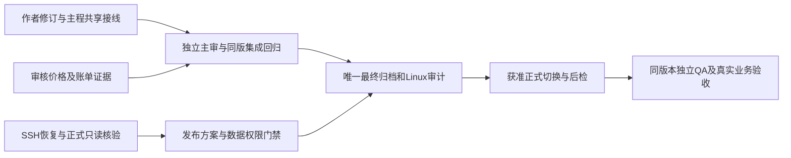

# R34主程剩余任务与本轮推进（2026-11-09）
结论：主程仍有共享接线、原生复用/范围核对、价格与账单、正式只读核验、整包集成和发布QA工作。本轮完成只读诊断准备及Linux验证、联网宿主缺口实测与契约冻结；未接入新web生产能力、未生成最终归档、未部署。作者返修与主程工作分开推进。

| 主程任务 | 当前证据/状态 | 下一完成条件 |
|---|---|---|
| R33实际故障核验 | 新只读脚本隔离PG5组+Linux入口3组通过；SSH认证失败、旧socket不存在 | 用户恢复连接；主程核对实时服务、运行账号与表权限，保存只读证据；需要sudo时给已上传且SHA绑定的具体脚本 |
| 04共享接线 | 真实SDK证明native请求无可信Run/tenant、宿主web_fetch未接；[主程契约](R34-WEB-HOST-INTEGRATION-CONTRACT-20261109.md)已冻结 | Codex接execution scope、host准入、显式预算、来源持久与UI/历史；与Gemini实际transport/资源/错误修复联合验收 |
| 真实价格/估算 | 现有导入CLI只支持离线PGlite；snapshot选择器强制四费率及固定pricing来源，已归档公开观察有缺失/时段语义 | 冻结允许的官方证据及计价合同，解决未知维度/时段与来源兼容、PG受控导入方案，真实价格审核后才导入；不造cache-write=0或回填历史生效时间 |
| 官方实扣/07接线 | 已读用户API文档：余额和账单单位credits，model/total_cost汇总与媒体formula均有定义；未找到USD统一兑换或文本缓存四费率规则 | 复用F3 consume normalizer/external operations，按同用户凭证及API授权种类接入；逐笔证据缺关联字段时保留unknown/BLOCKED，不用余额差冒充 |
| 01/02/03及05/06范围 | 全量scope原缺口继续保留，作者局部PASS不升级整体 | 主程按锁定DSH/既有worker/真实后端逐项审查并接线，审批/隔离或资源依赖不足明确阻断；不吞并另一两位程序员的C01/02/03任务 |
| Bug/08兼容与集成回归 | Bug a69源码ee仍有三项状态问题，Gemini33仍有transport等阻断；08调用前持久预留已有本地证据 | 选择性接入审核通过差异，保留问答/08/预算/列宽整改；完整同版PG/SDK/浏览器及Linux闭包回归 |
| 最终冻结/部署/QA | 暂不上线，旧AUTO M1包范围已被取代 | 整体范围完成后唯一新归档、完整指纹/迁移/ACL/备份恢复/回退与后检；核对届时有效的发布指令与范围，满足条件后切换唯一正式环境，再下发同版QA |

目前需要用户的具体协助只有恢复SSH登录，命令及诊断边界见[R33只读核验准备](R33-READONLY-QUESTION-DIAGNOSTIC-RUNBOOK-20261109.md)。不发送密码或Token。尚未请求新的付费调用、供应商账号权限或部署动作；价格缺少的事实先继续查验现有官方/用户协议，不先编造数据满足门禁。
作者Bug分支当前出现e4b6bd6文档修订（未据此重跑旧源码或改变放行）；04仍33fc6240。下次源码变更再按其实际差异验证。旧归档及作者工作树保留，当前无本轮后台测试容器。
