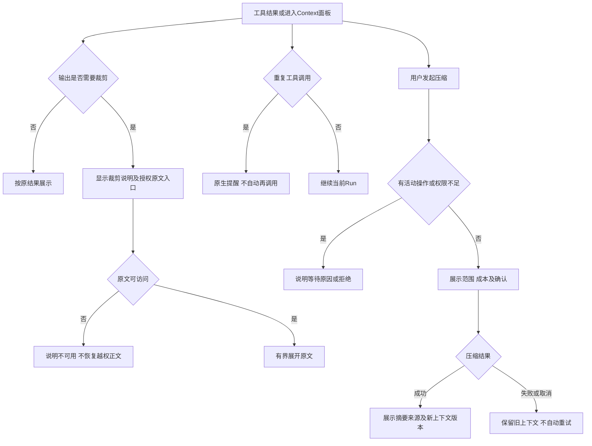

# 任务包11：上下文辅助插件
版本：完整规格稿1｜2026-11-04｜状态：SPEC_READY_FOR_ASSIGNMENT（规格已扩写，未指派/未实现/未验收）。类型：混合型：原生插件＋已有压缩入口交互。用户已通过09/10示范深度并授权本轮扩写；本包下列“待用户拍板”仍为建议，不能当既定产品决定。原01–08据用户确认已由Gemini完成，本轮不重写；交付、主审、集成、上线状态分开登记。
阅读：[主台账](REFACTOR-MASTER-TRACKER-20261103.md)、[研发交付流程](ENGINEERING-DELIVERY-WORKFLOW.md)、[技术入门](DEVELOPER-ONBOARDING.md)。领取填写负责人、实现者、独立测试者、实际base/branch、OS/Node、dirty文件归属及依赖契约版本；bbd9997仅历史参考，不是自动可发布版本。

## 1. 结果、范围与分类依据
长工具输出和重复调用由原生插件受控处理，用户能看清裁剪范围、访问获准原始结果，并在现有Context入口明确决定是否压缩。压缩只改变后续上下文视图，不篡改历史、usage或权限证据。
首期包含pruner/reminder及已有手动压缩入口一致性；command-compact单独评估，不新增第二个同义按钮。非自动全文扫描、不因裁剪授予新资源权限。

## 2. 复用核查、依赖与所有权
先对锁定DSH 0.1.1-rc.2交“需求—原生/插件/现有接缝—版本/导出证据—配置或接线—缺口—AC”矩阵，原生直接用→配置→产品接线→现插件/受控升级→证据缺口最小补充。下表是开工核查点，不是本轮已跑SDK/已证实新能力；负责人确认缺口后才能实现，不另造Agent循环、执行器或审批引擎。

| 能力/核查来源 | 本包接线、证明及缺口边界 |
|---|---|
| dsh-tool-result-pruner / repeat-tool-reminder | 读取锁定插件README/导出及可裁字段，复用原生裁剪/提醒，不写新去重循环 |
| shell/runtime/dsh-native-context-r4-candidate.mjs与原Context链 | 核对实际主线调用关系，不把候选名当已集成；原生command-compact与手动入口语义对照 |

依赖及并行边界：现有Context、05审批及07费用契约；插件无模型调用可先验，模型摘要另验。不得改Gemini原8包。
独占交付：`shell/candidates/context-tools-20261103/`（CONTRACT.md、REUSE-MATRIX.md、实现或方案、UI/fixture、接线建议）、`tests/probes/refactor-context-tools-20261103.mjs`、`docs/refactor/evidence/REFACTOR-CONTEXT-TOOLS-20261103.md`。方案/验收包交可执行方案与证据，不制造空产品模块。共享server/runner/public/tenant/profile/迁移/package/lock由负责人集成，只交补丁建议；不改Gemini原8包、Bug窗口、tests/e2e/或其他包。测试目录所有权先协调；禁覆盖dirty文件、旧归档或线上r28。
本包不产生部署、付费、外发、资源采购、merge/push或电脑控制授权；真实操作按具体范围另核已有授权。日志/报告不存Key、Cookie、私密原文、签名URL，fixture合成且数据/凭据/DB与生产隔离。

## 3. 用户旅程决策树
范围内每条边由下表解释；后台契约不能替代默认界面和恢复动作。刷新、权限撤销、并发及未知结果也列入验收。

## 4. 分步详解表

| 节点/触发 | 默认界面与系统动作 | 用户动作、兜底条件与禁止行为 | 对应AC |
|---|---|---|---|
| A/C 进入面板/收到结果 | 默认显示当前上下文版本、来源与容量，工具结果只裁模型视图 | 加载失败可重试；不能让用户误以为源文件已被删 | 11-01 |
| B/D 超过阈值 | 显示裁剪原因、已保留窗口和原文入口 | 只在原文仍保留且获准时展开；来源、权限、usage、审计字段不能裁 | 11-02 |
| E/F/G 展开全文 | 有界分页展开并再次鉴权 | 原文过期/权限撤销显示不可用，不从日志或跨租户缓存兜底 | 11-03 |
| H/I/J 重复调用 | 原生提醒展示已调用摘要和结果引用 | 提醒不自动发新请求，不把有意重复操作判成功 | 11-04 |
| K/L/M 用户压缩 | 显示影响范围与是否含模型调用 | 活动工具/审批/未决外部请求时禁压缩或等待安全边界，不能丢待确认卡 | 11-05 |
| N 确认压缩 | 预览来源范围、成本已知/未知与保留策略 | 取消返回原视图；参数变化废弃旧确认，不自动选择收费模型 | 11-06 |
| O/P/Q 压缩完成或失败 | 成功显示摘要、来源引用和新版本；失败保留原上下文 | 超时/取消不覆盖旧摘要，响应未知先核对；不谎称节省量 | 11-07 |
| P 刷新与旧摘要 | 重新加载持久摘要和来源，用户可看历史版本 | 来源撤销后不在下一Run引用；摘要是否仍可见按范围权限 | 11-08 |

## 5. 建议方案与待确认决策
以下是建议与决策责任；“待用户拍板”未获确认前不作为已定范围。负责人技术核实及外部回执不是要求用户代做调查。未决项阻断对应AC，不阻断无依赖的契约/fixture工作。

| 决策/责任 | 建议、原因与代价 | 未确认边界或需要的证据 |
|---|---|---|
| 11-D1 待用户拍板 | 建议pruner/reminder默认开在目标profile，手动压缩保留一个入口；减少认知重复 | command-compact是否替代旧入口须实测事件等价后再决定，未确认不双开 |
| 11-D2 负责人技术核实 | 裁剪阈值按模型上下文/工具类型配置，不统一截掉尾部 | 交字段保留清单、原文留存配额与真实SDK事件证据 |
| 11-D3 待用户拍板 | 模型压缩显示费用未知时不自动执行，确认后单次调用 | 压缩是否允许后台自动触发未定，首期只手动 |
| 11-D4 负责人技术核实 | 压缩在Run安全边界生成新投影，旧历史不变 | 取消/重启/并发与现有Context版本契约先冻结 |

## 6. 契约、数据与恢复
接口名称为目标语义，不自动表示现有HTTP端点已实现。CONTRACT冻结可信身份、输入/输出/schema版本、错误码与UI/调用方映射；复用现有错误，拒绝将失败全部报500。

| 操作/记录 | 必须保持的语义 |
|---|---|
| 结果投影 | originalRef、window、truncated、protectedFields与权限引用；原始工具结果与模型窗口分开存储 |
| 压缩操作 | contextVersion、sourceRefs/digest、operation、批准及模型usage；CAS发布新摘要，失败保留旧版本 |
| 原文读取 | tenant/Run/source ACL再次校验，有界读取与过期码；不从任意目录扫描恢复 |

跨边界读写逐次校验owner/tenant及本包project/device/Run范围；客户端ID不授予权限。状态和版本持久化，重复同operation同payload返回原结果，异参冲突；取消/超时/断网不自动证明外部动作失败或停止计费。外部写入未知先核对，不盲重试/换模型重提。存储变更需真实PGlite及隔离PG验证，迁移编号由负责人分配；纯调查包此项按无产品写入注明不适用。历史源证据不可覆写，修订形成新版本。

## 7. 验收矩阵与测试责任
每个AC交实现/方案位置、fixture、执行命令、退出码、PASS/FAIL/BLOCKED与脱敏证据；未决或未授权不计PASS。下列是将来执行要求，本轮没有实现或业务通过声明。

| AC | 通过标准 | 验证方式 |
|---|---|---|
| 11-01 | A：空/正常/加载失败、源引用和版本展示分别可复现 | 确定性接口/SDK＋staging点击E2E |
| 11-02 | B/D：长文本/结构化结果保留安全字段，原始记录SHA不变 | 确定性接口/SDK＋staging点击E2E |
| 11-03 | E/G：展开/过期/越权/配额四分支无泄露 | 确定性接口/SDK＋staging点击E2E |
| 11-04 | H/I：真实SDK触发提醒，无额外模型或工具调用 | 确定性接口/SDK＋staging点击E2E |
| 11-05 | K/L：活动Run、审批及闲置态的压缩门禁正确 | 确定性接口/SDK＋staging点击E2E |
| 11-06 | N：取消不调用模型，确认绑定范围及版本 | 确定性接口/SDK＋staging点击E2E |
| 11-07 | O/P/Q：成功/错误/取消/并发版本冲突无丢历史 | 确定性接口/SDK＋staging点击E2E |
| 11-08 | P：刷新可重开，撤销来源后新Run不携带旧权限 | 确定性接口/SDK＋staging点击E2E |
| 11-09 | 伪造身份/资源引用、权限撤销、日志/证据敏感信息均拒绝或脱敏，不扩大依赖权限 | 双身份/仓储负向及证据扫描 |
| 11-10 | 重复操作、并发版本变化、断线/重启与结果未知不造成重复副作用；恢复依据权威记录 | 并发/故障fixture；方案包核实执行证据 |
| 11-11 | 本包变更与同版累计功能兼容；未跑真实上游/生产的项目仍待验，不将fixture写成上线成功 | 负责人受影响回归＋独立测试/证据复核 |

开发者/执行者交`node tests/probes/refactor-context-tools-20261103.mjs`的实现后实际运行方法（方案包可由该入口验证清单/证据或交等价可复跑命令并解释），真实调用候选/锁定SDK/协议服务/存储而非镜像常量，失败非零。无代码阶段不制造假探针通过。独立测试者复核负向反例；涉及界面的AC必须实际点击，API辅助不能全部替代；纯后端包不强制点击E2E，核实业务影响即可。
真实PT调用与付费次数、生产写入/故障、电脑动作独立授权；确定性模型/本地协议轨、真实PT轨、staging与production证据分开。未获授权保留BLOCKED，不能抹掉失败或把未执行算不适用。测试证据绑定应用/配置/迁移/用例版本与fixture SHA。

## 8. 资源、Plan B与进度影响
需要合成长工具结果、隔离存储及staging Context入口；只测裁剪不消耗PT，摘要质量/费用须获准模型样本。
## PT依赖、Plan B与进度影响
| PT依赖/需求编号 | Plan B | 进度/验收影响 |
|---|---|---|
| 压缩摘要需PT-03，提醒/裁剪无新增模态 | 原生pruner/reminder；已有压缩链 | 可继续复用；摘要真实质量/费用仍待模型验证 |
依据：[PT接口规格v1.1第15节](PT-API-REQUIREMENTS-20261104.md)。PT未接受建议接口形态时先映射既有协议；遵循DSH最大复用原则。上述Plan B为规划候选，不表示已验证或获准额外模型/资源/供应商调用；原范围未满足仍标未完成，变更需用户确认。签署协议仅已签署/未签署，无有效期/续签；资产启用及凭据/缓存/资源有效期分别处理。

## 9. 里程碑、交付与接入
| 阶段 | 本包产出与放行依据 |
|---|---|
| M0 冻结 | 分类、范围、复用矩阵、依赖契约、上述决策、节点/阶段→AC及可量化限制；负责人确认接口缺口，用户只拍板产品/成本/资源选择 |
| M1 核心候选/方案 | 真实SDK裁剪/提醒和来源保留清单 |
| M2 失败与恢复 | 压缩候选、活动操作门禁及失败保留旧版本 |
| M3 独立主审/接入 | 唯一Context入口投影接线与累计来源/记忆回归；负责人独占共享接线，运行受影响回归 |
| M4 同版验收/发布 | 独立点击压缩/展开与授权真实摘要质量验收；有发布授权才冻结归档并切换，production专属租户受控冒烟 |

交付报告含base/commit/文件SHA、依赖契约版本、命令/退出码/通过失败阻塞数、AC映射、替身/真实边界、遗留Bug与责任、安装/挂载/清理/回退说明。Bug原作者自测后独立复测，主审/集成/发布各阶段分别登记。关闭新入口不等于撤销已提交数据或终止外部任务；回退保留历史可读和必要对账，数据库不自动逆迁。当前仅规格扩写完成，尚未分配、实现、主审、集成、本地/测试环境验收或发布；不能凭文档数量计算产品完成度。
