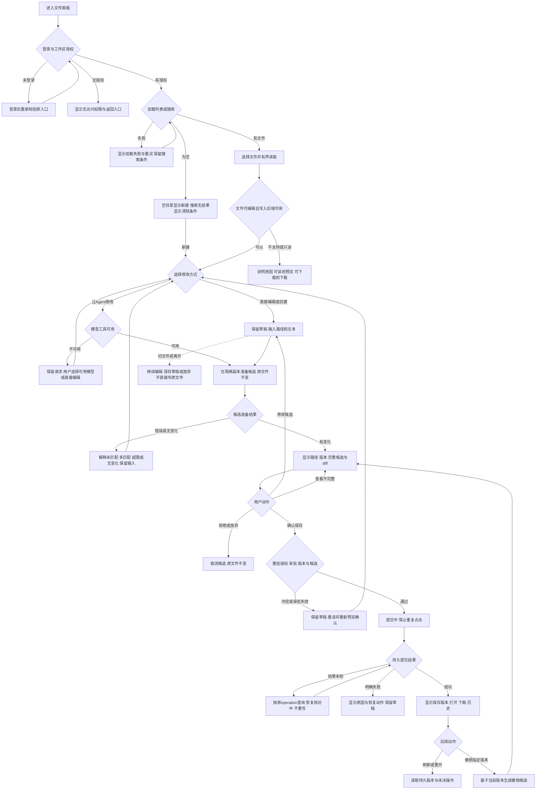

# 任务包09：授权工作区文件编辑（完整示范包）
版本：评审稿2｜2026-11-04｜状态：SPEC_REVIEW_PENDING，待用户确认任务包格式、用户旅程与设计决策；不是已领取/已开发。保留评审稿1的契约、安全与交付要求，本次补全用户分支及其验收映射。负责人：主程序；实现责任人：程序员A或B待分配；独立测试：测试Agent待安排。
先读[新人入门](DEVELOPER-ONBOARDING.md)、[协作验收流程](ENGINEERING-DELIVERY-WORKFLOW.md)、[主台账](REFACTOR-MASTER-TRACKER-20261103.md)。领取时填写实际base、分支、OS/Node、文件归属和依赖CONTRACT版本；bbd9997仅历史参考。
## 1. 用户价值与交付结果
用户在服务器上自己的授权工作区中选择文件，通过直接编辑或对话提出修改，查看确切diff，确认后保存，刷新可重开历史，并可通过新版本撤销。未经确认不得写入原文件；用户手工修改或其他Run已改文件时不覆盖。
示例：用户选report.md，要求把“本周销售额”改为“本月销售额”；Agent读取并提出修改→UI展示原文/新文与路径→用户确认→原子保存并记录版本→刷新仍可查看→用户撤销生成新版本。若确认前别人修改report.md，返回冲突，必须重读并重新确认。
这是一条完整产品链，不是只交一个字符串替换函数，也不是一套新文件编辑引擎。

## 2. 范围与分期
| 范围 | 本包要求 |
|---|---|
| V1必须 | 授权服务器工作区内列表/有界名称与内容搜索、UTF-8文本读取、创建、完整替换、唯一匹配局部编辑、diff预览、确认、版本、撤销、历史重开/下载 |
| 支持格式 | .txt/.md/.csv/.json/.html/.css/.js/.cjs/.mjs/.yaml/.yml；按有效UTF-8/普通文件双检查，不仅扩展名；脚本作为文本编辑不等于允许执行 |
| 初版限制（本包设计值） | 单文件<=1MiB；搜索最多1000文件/10MiB扫描字节/200命中、单片段<=500字符；diff显示最多2000行，超过则可下载完整diff但初版禁提交，缩小修改后重新预览；上限可调，改动需验证，详见F-D2 |
| 二进制/Office | 明确拒绝文本替换；09负责识别和引导到03文档工具，不在本包新增Word/Excel编辑引擎 |
| 不包含 | 任意系统目录、用户本机访问（32负责）、命令执行、批量替换、自动合并冲突、删除/移动/重命名、无条件自动确认、运行HTML/脚本 |
| 与19项目关系 | V1基于现有tenant/workspace身份，不强制先建project系统；未来project通过可信workspaceRef注入，不能让客户端任意传绝对根路径 |
超出限制必须具名失败，不静默截断后写回。新文件首次限制在已授权且存在的目录，不自动递归创建任意目录。UTF-8 BOM/换行形式需读后保留，若规范化则必须显示diff并重新确认。

## 3. DSH复用与架构决定
本轮已读锁定依赖README/类型；以下不是新代码实现证据：
| 原生能力/证据 | 已有语义 | 本包动作 |
|---|---|---|
| dsh-tool-fs/README.zh.md | read/read_image/write/edit；edit唯一匹配或replace_all；原生diff卡片元数据 | 默认复用read/write/edit，产品初版禁replace_all；不另写模型工具schema/替换引擎 |
| dsh-fs/README.zh.md | ctx.fs.resolve/stat/readText/listDir/writeText/editText；原子变更/可选版本前置 | 复用提供方约定；版本为opaque，不自行猜测version格式 |
| dsh-fs-observation-policy（需实测装配） | 先观察后编辑；fs/write-intent、fs/edit-intent、fs/observed | 必须核实挂载；不能使用未防护的默认无条件覆盖 |
| dsh-tool-str-replace-editor | 原生str_replace_editor入口 | 与read/write/edit择一为默认修改入口，避免两套工具语义并存；首选tool-fs，provider模型如需另一入口再单审 |
| tool-fs-search | 原生搜索插件候选 | 开工先读其接口/范围限制/是否经隔离执行；可用直接接，不把“搜索不在ctx.fs”理解成DSH无搜索 |
| 原生审批/工具事件 | 审批、调用、结果 | 复用05的持久提问/批准协议与06隔离，不另造审批状态机或执行器 |
重要：ctx.fs原生只有可选版本防护，裸提供方不是租户沙箱。工具返回diff通常在执行后，本包要求“确认前原文件不变”，不能先改原文件再把事后diff冒充预览。
推荐接线：原生工具在06限定的隔离暂存副本上准备候选，使用DSH原生编辑和渲染；宿主仅记录授权、base/target SHA与不可变候选、审批、版本元数据和最终受控发布。如05/06已有安全preview/审批seam则直接复用，不新增平行暂存层。最终写回优先原生guarded writeText/CAS，禁止手写不带版本的read+write。若原生/隔离后端无法提供安全发布和崩溃恢复，停在只读/预览并报缺口，不冒险开启写入。
启动里程碑M0交复用矩阵及真实SDK探针，负责人确认宿主缺口后再实现；不允许以方案名义提前重写ctx.fs/editor。是否开放tool-str-replace-editor由M0决定，不是本包必须两个插件都开。

## 4. 前置依赖与文件所有权
| 依赖 | 最小交付契约 | 未完成时能做什么 |
|---|---|---|
| 05 QUESTIONS（Gemini） | 请求/答案绑定owner/tenant/Run/operation/digest、一次消费、过期/撤销、重启恢复 | 用严格fixture开发；标未联测，不能写原文件或声称审批已集成 |
| 06 ISOLATION（Gemini） | rootRef/工作目录不可伪造；受限ctx.fs provider；链接/进程/凭据边界及取消 | 只在专属fixture目录做候选测试；无后端生产写入关闭 |
| 现有Run/工具门禁 | 当前Agent+call、ACL、预算/取消、持久事件 | 负责人接共享seam，候选不绕过 |
| staging/E2E（18/33/16/14） | 测试域名、独立DB/文件/账号、固定版本、E2E入口所有权 | 本地可继续；独立staging验收BLOCKED直到资源就绪 |
候选独占：shell/candidates/fileedit-20261103/（CONTRACT.md、实现、UI模块、fixture、迁移/接线建议、说明）；tests/probes/refactor-fileedit-20261103.mjs；docs/refactor/evidence/REFACTOR-FILEEDIT-20261103.md。
禁止直接改server.cjs、persistent-runner.mjs、public/*、tenant、共享迁移/profile/package/lock及其他包。程序员交可应用补丁或明确挂载点；负责人独占主线共享接线。tests/e2e/现归Gemini，测试Agent先协调所有权，不自行读改。候选必须包含实际可运行模块，不能只交伪代码补丁。
开工阅读顺序：shell/runtime/dsh-adapter.cjs→persistent-runner.mjs原生工具门禁→tasks/host-tool-handler.cjs→runtime/artifact-open.cjs与artifacts.cjs→tenant.cjs→05/06 CONTRACT→上述DSH README/类型。不要求通读历史日志或用户文件。

## 5. 服务契约与状态
以下为本包目标契约，尚非现有API。M0时与05/06核对并冻结；不同字段名可映射，安全语义不可降级。
| 操作 | 输入/输出 |
|---|---|
| list/search/read | 服务端authContext、workspaceRef、fileRef/有界query；返回归属内结果、version、SHA、size、文本窗口/截断标志，不泄漏绝对系统路径 |
| prepare | conversationId、workspaceRef、fileRef或新文件相对路径、baseVersion/baseSHA、operation=create/replace/edit、规范操作参数；model来源还需可信Run/call；返回proposalId、before/after SHA、diff、candidateRef、大小/截断与expiry |
| approve/commit | proposalId、一次approvalRef、expectedVersion、operationId；输出commit/version/产物及Run关联；可信身份重新校验 |
| history | fileRef、cursor/limit；返回版本、变更/撤销关系、时间与匿名actor，内容另经鉴权读取 |
| revert | fileRef、targetVersion、expectedCurrentVersion；创建新proposal，重新确认后新提交，不直接倒写历史 |
UI建议挂载于/api/workspace-files下；list/search/read/proposals/history/commit/revert路由由负责人审查分配，明确401/403或防枚举404、409冲突、413超限、422非文本、503隔离不可用。模型工具不直接绕过服务调用commit。
authContext由会话cookie或受信服务构造，至少owner/tenant/会话/Run/call可用范围；请求不能声明“我是另一个租户”。用户直接编辑使用持久业务操作记录，不伪造模型tool-call。prepare返回完整候选身份，批准绑定owner、tenant、workspace、file、base、afterSHA、操作类型与显示内容摘要；UI修改候选即作废旧批准。
状态：prepared→awaiting_approval→approved→committing→committed；另有rejected/expired/conflicted/canceled/failed/reconciliation_required。状态可复用05/06服务，不另搞重复权威。提交开始后取消为best effort，已经提交则如实返回committed，不谎称未写入。
原生tool调用可以在原生审批处等待或返回需要确认，两者择符合05协议方式；不得无限占用执行槽。Run关闭后未提交proposal须按契约过期/取消，不能让延迟点击绕过已撤销Run权限。

## 6. 数据一致性、版本与安全
版本元数据至少：tenant/workspace/file、versionId、parentVersion、base/after SHA、大小/MIME/编码、候选/快照引用、operationId、Run/call或直接用户操作、批准引用、时间、revertedFrom。数据放既有仓储/产物体系；新增SQL由负责人编号，PGlite/PG两分支验证。
原文件发布与元数据不是天然跨DB/FS事务。使用可恢复journal：持久intent/候选及before引用→锁内重新校验当前版本/权限/候选SHA→原子写回→持久commit/版本→完成。崩溃恢复依据operation与实际SHA只对账，不重新运行模型或再次盲写；无法判定时reconciliation_required且冻结该文件变更。不能写成功但历史缺失仍显示无条件成功。
同operation同payload重复返回同一结果；异payload冲突；同base两个提交最多一成功。撤销也是CAS新版本，当前有后续修改时冲突而非覆盖。历史快照不可变，原上传来源/既有产物不可原地改写，应编辑工作副本并产生新版本。
根目录由服务端授权引用映射；拒绝../、绝对路径、编码变体、NUL、链接越界、设备/FIFO/socket、硬链接别名（初版全部拒绝硬链接nlink>1）、系统secrets与运行配置目录。打开/写入时都验证，不能只启动时realpath；06必须提供抗TOCTOU边界，无能力不开放。
HTML/脚本预览必须转义或隔离，不执行文件脚本；搜索结果/文件内容不作为权限指令。日志只放SHA/ID/大小/错误，不记录全文/Key。待确认编辑器内容离开页面提示；新版本到达保留本地未保存草稿，禁止静默覆盖。
单文件限制以实际字节验证；磁盘不足/快照无法落地/审批过期/权限撤销时不写原文件。所有读/搜索也受范围和配额控制。

## 7. UI与可观察行为
本节为实现和点击E2E的共同输入。F节点描述用户经过的分支，第9节AC描述可验证结果；不能只实现主路径。入口为授权工作区文件面板，19项目未集成时也可进入。以下默认交互是建议方案，待第7.3节确认后冻结，不是现有产品行为。

### 7.1 用户旅程与决策树

### 7.2 分步详解与异常恢复

| 节点/触发 | 默认展示及系统动作 | 用户选择、兜底条件与禁止行为 | 验收 |
|---|---|---|---|
| F0/F1 进入或登录失效 | 显示工作区名称及加载态；先鉴权再读取 | 未登录去登录后重验；无权限显示返回入口，不展示文件名；编辑中失效保留会话内草稿但禁提交，重新登录后重验，不串给另一账号 | 09-06/19 |
| F2 列表/搜索 | 默认当前授权目录，名称搜索与内容搜索分开；显示范围、命中数、截断及加载更多 | 空目录显示“新建文件”；无搜索结果显示“清除筛选”；请求失败显示重试，不能冒充空目录；达到扫描上限提示缩小范围，不能宣称全目录搜完 | 09-02/20 |
| F3 读取文件 | 展示名称、相对路径、版本、编码及文本窗口，空文件显示可编辑空内容 | 文件消失刷新列表；大文件/非UTF8/二进制解释限制，授权下载或引导03，不自动转码；只读仍可读，权限不足不泄露存在性 | 09-02/04/21 |
| F4 写入依赖不可用 | 可读范围保持预览，说明“当前不能保存”及原因 | 05/06未接、磁盘不可用或权限只读时禁保存；不悄悄降成无审批写入；无法安全准备候选则也禁Agent修改 | 09-07/11/21 |
| F5/F6 直接编辑/新建 | 选定文件编辑正文；新建先选授权目录、填写文件名；明确“未保存” | 同名文件不覆盖，改名或主动打开已有文件；扩展名/大小/路径预校验与后端复验；空文件可创建；脚本只作文本 | 09-03/07/22 |
| F7/F8 Agent修改 | 已选文件显式带入请求，未选文件先让用户选；显示生成中与取消，原文件SHA不变 | 模型不兼容/调用失败保留请求与草稿，用户主动选兼容模型或直接编辑；不自动切模型重提、不冒充生成成功；取消模型请求不保证上游停止计费 | 09-03/05/17/23 |
| F9 准备候选 | 校验唯一匹配、文本和大小；无差异显示“没有需要保存的变更” | 零匹配/多匹配给定位建议，重新选段或改请求；准备失败保留输入；不自动replace_all，不自动扩大文件范围 | 09-04/23 |
| F10 预览 | 同屏展示相对路径、创建/修改、base版本、diff、完整候选入口，说明尚未改原文件 | diff截断显示明确警示，完整diff在鉴权视图可看/下载；超过初版展示上限禁确认，不能拿“下载过”当已理解证明；方案待7.3冻结 | 09-03/16/24 |
| F11 修改/拒绝/过期 | 提供“返回修改”“放弃”“确认保存”；修改内容即废弃原候选批准 | 拒绝使候选不可再提交，保留草稿供继续编辑；过期提示重新生成预览；Run撤销后旧确认卡禁用；模型说“已保存”不能改变UI状态 | 09-10/25 |
| F12 冲突 | 显示“文件已有新版本，未覆盖”，保留本人候选，可查看当前版本与原候选 | 用户重读后手工合并再预览；不自动覆盖、不提供强制保存；文件已删除不自动当新建，须明确选择新建且重验 | 09-08/14/25 |
| F13/F14 提交/断网 | 显示保存中，按钮防双击；网络中断显示“保存结果待确认” | 查询原operation；重启仍从journal恢复；未对账前禁同文件新写；明确磁盘失败给重试准备入口，不能重复盲写；提交后取消如实显示已保存 | 09-09/11/12/26 |
| F15 成功 | 只在文件及版本记录均确认后显示“已保存”及version；可打开、下载、看历史 | 旧快照不变；下载失败只重试下载，不重做编辑；预览HTML转义，不运行脚本 | 09-13/15/26 |
| F16 撤销 | 显示目标历史版本与当前版本，先生成“恢复到此版本”的候选diff | 再批准生成新版本；已存在后续变更则重验冲突；无可恢复快照禁撤销并说明，不抹历史 | 09-13/14/27 |
| F17 刷新/多标签/离开 | 刷新查询已保存版本和未决操作；新版本到达提示，草稿不被覆盖 | 离开时“继续编辑/保存草稿后离开/放弃草稿”，保存草稿不是保存文件；未决提交不因关页取消；身份切换不显示前一账号草稿 | 09-14/19/28 |
| 全程键盘与可访问性 | 输入、预览、确认、错误及历史可用键盘操作；焦点到错误摘要/返回触发处，加载与成功状态可读 | 禁用按钮附原因，不只依赖颜色；切换模式/失败后保留已填信息；禁止泄露绝对路径/其他租户内容 | 09-06/15/16/28 |

### 7.3 建议方案与待确认决策

以下均为评审建议；用户确认后写入冻结契约。技术安全门禁继续有效，不因产品选择省略。

| 决策 | 建议方案 | 代价/未确认时的边界 |
|---|---|---|
| F-D1 草稿持久化 | 服务端按用户/工作区/文件保存显式草稿，建议7天保留且可立即删除；只在用户点击“保存草稿”时持久化，初版不自动上传每次输入 | 需要草稿ACL/配额/清理；未确认前不宣称刷新可恢复未保存内容，离开警示必须有 |
| F-D2 大diff审阅 | 初版不开放超过2000行展示上限的写入；完整diff可鉴权下载，用户缩小修改后重新预览。将来完整可访问的分页审阅通过后再放开 | 比“下载即允许确认”更易验证；与第2节限制联动，确认前按此保守方案禁提交 |
| F-D3 文件与搜索分页 | 列表建议50项/页、稳定cursor；内容搜索按第2节总扫描上限，分页不重置配额，条件变化重新开始 | 50为设计值，不是原生API能力保证；provider无cursor由受控索引/窗口接线，不全盘无界枚举 |
| F-D4 编辑入口 | 默认先选文件再选直接编辑/Agent修改；新建只允许现存授权目录，不自动递归建目录；无写权限保持只读 | 不为方便开放任意路径；创建目录/移动等后置，变更范围需再确认 |
| F-D5 冲突处理 | 初版只支持重读、手工合并、重新确认；不提供强制覆盖和自动合并 | 交互多一步，但保护并发修改；撤销也采用同样流程 |
| F-D6 设计限额与超时 | 暂沿用第2节1MiB等建议值；候选建议30分钟过期；准备/查询超时由M0测量后给具体配置与UI提示 | 未实测不承诺性能；超时不自动放宽上限或把未决提交判失败 |

## 8. 稳定错误码（候选与原生映射）
保留原生FS_NOT_TEXT/FS_TOO_LARGE/FS_STALE_VERSION/FS_NOT_OBSERVED/FS_AMBIGUOUS_EDIT/FS_EDIT_NOT_FOUND/FS_ABORTED等语义，并在CONTRACT给UI映射。
宿主增量：FILEEDIT_SCOPE_DENIED、APPROVAL_REQUIRED/EXPIRED/REPLAYED、PROPOSAL_CHANGED、OPERATION_CONFLICT、FILEEDIT_BACKEND_UNAVAILABLE、FILEEDIT_RECOVERY_REQUIRED、FILEEDIT_STORAGE_FULL。不得把取消/冲突全部报500；不在错误中回显其他租户路径/文件内容。

## 9. 验收矩阵与测试责任
每个AC对应实现位置、自动测试入口、结果/证据；BLOCKED不计PASS。fixture必须合成，不能编辑真实项目代码测试本功能。
| AC | 场景与通过标准 | 主验证层 |
|---|---|---|
| 09-01 | 真实锁定SDK加载原生read/write/edit与策略；diff/版本事件可追踪，profile范围受控 | 开发者SDK；负责人复核 |
| 09-02 | 读取/分页/搜索受字节/命中限制，中文路径与空文件正常 | 单元/接口 |
| 09-03 | 创建、唯一替换、完整替换各经预览批准；批准前原文件SHA不变 | SDK/接口+点击E2E |
| 09-04 | 多匹配/无匹配/相同old/new/非UTF8/二进制明确失败，不改原文件 | 单元/原生工具 |
| 09-05 | 直接修改和Agent修改同样绑定授权/版本；伪造租户/Run/call拒绝 | 接口/SDK负向 |
| 09-06 | 跨租户列表/搜索/读取/候选/提交/历史/下载全部拒绝 | 双账号接口+E2E |
| 09-07 | 路径穿越/绝对路径/软硬链/父目录替换竞态/特殊文件无越界 | 06联测/OS真实fixture |
| 09-08 | 批准前文件变化、双Run同base、已读但过期版本仅一提交或全部拒绝 | 并发/PG |
| 09-09 | 重复同操作一次版本，异参冲突；重启后仍不重复提交 | 存储/重启 |
| 09-10 | 审批篡改/跨文件复用/过期/重复消费/撤销权限/Run取消均拒绝 | 05联测 |
| 09-11 | 超限/磁盘失败/快照失败/取消均不留半文件，提交后取消不误报回滚 | 故障注入 |
| 09-12 | DB提交前后/文件rename前后崩溃可恢复核对，无无声丢版本或重复写 | PGlite+PG/进程 |
| 09-13 | 版本、diff、下载刷新重开；撤销产生新版本，旧历史不变 | 点击E2E/存储 |
| 09-14 | 当前有新修改再撤销返回冲突；本地未保存草稿不被静默覆盖 | 点击E2E |
| 09-15 | 文件内HTML/注入内容不执行、不授新权限；日志/截图不泄露 | UI/安全 |
| 09-16 | 键盘、空态、超限、错误恢复、双击提交、截断diff完整查看 | 点击E2E |
| 09-17 | 真实PT已授权工具模型：提出修改→实际原生工具→确认→真实文件结果→历史 | staging真实业务 |
| 09-18 | 原聊天/Skill/资料/CSV产物与下载不退化；只在本包profile开放目标工具 | 负责人集成+累计E2E |
| 09-19 | F0/F1/F17：未登录、无工作区、权限撤销、会话过期和换账号分支；重验前不读取/提交，不泄露旧草稿 | 双账号接口+点击E2E |
| 09-20 | F2：目录空、搜索空、查询失败和扫描截断分别显示；分页无漏项重复，搜索改条件无旧结果串入 | 接口+点击E2E |
| 09-21 | F3/F4：空文本、大文件、非UTF8、二进制、文件消失、只读、隔离不可用均有具体下一步 | fixture接口+点击E2E |
| 09-22 | F5/F6：新建同名不覆盖；非法路径/文件名、超限拦截，修正后保留正文，空文件可新建 | 接口+点击E2E |
| 09-23 | F7/F9：未选文件、模型不兼容/失败/取消、零匹配/多匹配/无差异均保持原SHA，不自动扩大修改或切模型 | 确定性模型+SDK+点击E2E |
| 09-24 | F10：显示精确路径/base/after；截断显著提示、完整diff鉴权，超过初版展示上限时不能确认提交 | 接口+点击E2E |
| 09-25 | F11/F12：返回修改废弃旧批准、拒绝/过期/撤销Run禁提交；冲突保留草稿，重读后新候选才可确认 | 05联测+点击E2E |
| 09-26 | F13/F15：双击/响应丢失/刷新只查询原operation；成功以文件及历史均落地为准；下载失败不再编辑 | 故障注入+点击E2E |
| 09-27 | F16：选历史版本→撤销diff→确认→新version；无快照/新并发修改均不盲写，历史下载独立鉴权 | 存储+点击E2E |
| 09-28 | F17/全程：离开三选项、多标签新版本、键盘与焦点、草稿隔离和按期清理；未冻结F-D1时该项相应BLOCKED | 点击E2E+时钟fixture |

### 开发者交付命令（实现后必须提供）
node tests/probes/refactor-fileedit-20261103.mjs，应依次执行真实临时文件、原生SDK、接口与持久化边界，失败非零；新增本包测试入口写在独占目录并从主探针调用。提供隔离PG运行方法与测试DSN注入说明，禁止默认连接生产。全量默认/PG回归由负责人按影响在集成时执行，开发者先交本包与受影响清单。
### 独立测试Agent操作脚本要求
在staging建A/B两用户、独立授权目录和fixture report.md；A进入面板→读取→让Agent修改→检查待确认与原SHA→批准→预览/下载→刷新→历史→撤销；B尝试访问A引用拒绝；A开两标签编辑触发冲突；审批期间变更文件触发拒绝；检查无意外网络/控制台错误。每步有截图/断言，额外API校验可辅助但不能替代点击。
确定性模型轨覆盖UI可重复性；09-17真实PT单独授权模型/次数/预算，未执行则待验。production仅专属测试租户做获准创建/编辑/恢复冒烟，不编辑真实用户文件。
## 10. PT、资源、Plan B与进度
模型驱动编辑依PT-03的可靠工具调用，无需PT新增文件API；基础文件/差异/版本功能无新增PT依赖。PT不支持某模型工具时用已授权已验证兼容模型；没有可用工具模型则直接编辑/预览可推进，Agent修改保持未完成，不能把fixture算真实业务。禁止为绕过PT而另造Agent引擎。
资源：staging独立DB/工作目录/测试账号，OS文件权限与可用隔离后端、临时快照盘；PG并发测试环境；真实PT测试Key及有限次数授权。初版不要求GPU/新对象存储，已有产物体系可满足先复用；33依据快照增长估算配额和保留期。
05/06未交或staging未建会阻断对应联测/放行，不阻断M0和候选自测；本地连接32后置，09完成不表示能编辑用户电脑。资源/权限不足明确BLOCKED，负责人提出具体协助项。

## 11. 里程碑、交付与主线接入
| 阶段 | 开发者交付 | 负责人/测试门禁 |
|---|---|---|
| M0契约 | 复用矩阵、真实SDK最小探针、05/06接口对照、UI状态/数据模型/风险 | 确认无重复编辑器、preview/CAS/崩溃语义；冻结契约 |
| M1只读/预览 | 列表搜索读取、原生工具候选/diff、错误反例 | 批准前不改原文件，scope检查 |
| M2提交/版本 | 审批接线、幂等CAS/journal、历史/撤销、并发与故障证据 | PG/PGlite负向及恢复主审 |
| M3 UI候选 | 可挂载UI及staging接线建议、自测、交付报告 | 负责人集成共享入口/迁移/profile/依赖并回归 |
| M4独立验收 | 修复独立测试反馈，不自行宣布结项 | staging点击E2E/真实PT→冻结同版发布→production冒烟 |
交付目录必须含CONTRACT.md、REUSE-MATRIX.md、README（安装/挂载/测试）、实现/UI、fixture、测试、接线补丁/迁移建议、报告；报告含base/commit/文件SHA、命令/退出码/AC映射、替身边界、缺陷和外部依赖。不能只给“COMPLETED”。
负责人按读取入口/审批服务/执行provider/Run事件/版本仓储/产物ACL/UI/profile顺序集成，迁移编号集中分配；首次写入默认关闭，只有05/06/AC门禁通过且授权范围明确才在目标profile开启。回退关闭新写入入口，历史保持可读；数据库不自动逆迁，已提交文件不因回滚版本自动恢复，按journal/显式撤销处理。
## 12. 当前进度与审阅点
- [ ] 用户确认示范任务包结构/详细度
- [ ] 分配实现者、分支/base与独占范围
- [ ] M0复用矩阵/依赖契约主审
- [ ] 开发者实现及AC自测交付
- [ ] 负责人独立主审/主线集成/本地门禁
- [ ] 测试环境独立点击E2E与真实PT适用证据
- [ ] 同版上线及正式冒烟/缺陷关闭
当前：仅规格评审稿2；未开发、未启用原生文件工具、未建立staging、未启动测试Agent。本轮另以10 Seedance作为外部状态/素材选择交互样本；其余33包不批量扩写，原01–08仍归Gemini。用户重点审阅第7节用户旅程、F-D1–6建议及09-19–28验收；确认后后续包按“分支→默认界面→动作/兜底→依赖→AC”的深度逐包补齐，保留各包特有需求。
