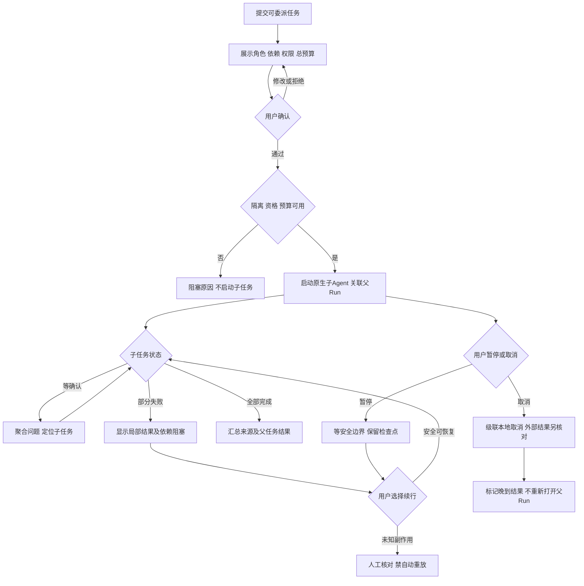

# 任务包13：子Agent与工作流
版本：完整规格稿1｜2026-11-04｜状态：SPEC_READY_FOR_ASSIGNMENT（规格已扩写，未指派/未实现/未验收）。类型：混合型：原生委派＋用户控制与汇报。用户已通过09/10示范深度并授权本轮扩写；本包下列“待用户拍板”仍为建议，不能当既定产品决定。原01–08据用户确认已由Gemini完成，本轮不重写；交付、主审、集成、上线状态分开登记。
阅读：[主台账](REFACTOR-MASTER-TRACKER-20261103.md)、[研发交付流程](ENGINEERING-DELIVERY-WORKFLOW.md)、[技术入门](DEVELOPER-ONBOARDING.md)。领取填写负责人、实现者、独立测试者、实际base/branch、OS/Node、dirty文件归属及依赖契约版本；bbd9997仅历史参考，不是自动可发布版本。

## 1. 结果、范围与分类依据
用户能看清父任务将委派哪些角色、权限与预算，确认后追踪各子任务、查看部分结果并取消或在安全边界续行。父子Run关联和累计费用可解释，不把某个子任务成功当整个工作流完成。
先有限并行委派和有向无环工作流；持续循环/ralph、PowerShell及无人值守付费单列后置。原生插件逐个给启用/维持关闭决定，不承诺全开。

## 2. 复用核查、依赖与所有权
先对锁定DSH 0.1.1-rc.2交“需求—原生/插件/现有接缝—版本/导出证据—配置或接线—缺口—AC”矩阵，原生直接用→配置→产品接线→现插件/受控升级→证据缺口最小补充。下表是开工核查点，不是本轮已跑SDK/已证实新能力；负责人确认缺口后才能实现，不另造Agent循环、执行器或审批引擎。

| 能力/核查来源 | 本包接线、证明及缺口边界 |
|---|---|
| DSH subagent系列、tool-workflow/workflow-worker-thread、tool-jobs | 核对创建/分叉/查询/汇报/控制及取消契约；不新建Agent或工作流解析器 |
| dsh-adapter与shell/runtime/session-scheduler.cjs | 父子Run、全局在途预算和worker租约接线；tool-ralph不默认加载 |

依赖及并行边界：05/06/08（Gemini交付主审接线另验）、07费用、20计划、21进度；无隔离只做fixture，不开真实子执行。
独占交付：`shell/candidates/orchestration-20261103/`（CONTRACT.md、REUSE-MATRIX.md、实现或方案、UI/fixture、接线建议）、`tests/probes/refactor-orchestration-20261103.mjs`、`docs/refactor/evidence/REFACTOR-ORCHESTRATION-20261103.md`。方案/验收包交可执行方案与证据，不制造空产品模块。共享server/runner/public/tenant/profile/迁移/package/lock由负责人集成，只交补丁建议；不改Gemini原8包、Bug窗口、tests/e2e/或其他包。测试目录所有权先协调；禁覆盖dirty文件、旧归档或线上r28。
本包不产生部署、付费、外发、资源采购、merge/push或电脑控制授权；真实操作按具体范围另核已有授权。日志/报告不存Key、Cookie、私密原文、签名URL，fixture合成且数据/凭据/DB与生产隔离。

## 3. 用户旅程决策树
范围内每条边由下表解释；后台契约不能替代默认界面和恢复动作。刷新、权限撤销、并发及未知结果也列入验收。

## 4. 分步详解表

| 节点/触发 | 默认界面与系统动作 | 用户动作、兜底条件与禁止行为 | 对应AC |
|---|---|---|---|
| A/B 任务可委派 | 预览角色、子任务输入、依赖图、并发上限和总预算 | 不能确定权限/费用时明确未知，不自动创建无限子任务 | 13-01 |
| C/D/E 确认启动 | 冻结父计划版本并校验隔离、模型和配额 | 依赖缺失显示BLOCKED，不能退回宿主裸执行 | 13-02 |
| F 原生启动 | 父面板显示子Run列表、角色和当前状态 | 只继承必要范围，不拷贝原始Key给子进程；超限排队不偷偷加并发 | 13-03 |
| G/H 子任务等待确认 | 展示哪个角色在问什么，点击可定位且绑定子Run | 审批过期/父取消禁批准，不能将一个答案广播所有子任务 | 13-04 |
| G/I 部分失败 | 保留成功产物，列失败原因和下游阻塞 | 不自动重做已成功或未知的外部操作；用户选修正/安全重试 | 13-05 |
| J 汇总 | 显示各结果来源、冲突及未完成项，父Run单独结算 | 不能只取最后子任务一句“完成”；不丢失败和usage | 13-06 |
| K/L/M 暂停取消 | 显示请求中、已达安全边界或取消未确认 | 本地线程/进程及外部任务分开，暂停不冻结上游计费 | 13-07 |
| N/O/P 恢复或晚到 | 从检查点显示可恢复步骤，父终态后晚到产物隔离标注 | 未知结果人工核对；父结束不被晚到消息重开，不重复创建子Run | 13-08 |

## 5. 建议方案与待确认决策
以下是建议与决策责任；“待用户拍板”未获确认前不作为已定范围。负责人技术核实及外部回执不是要求用户代做调查。未决项阻断对应AC，不阻断无依赖的契约/fixture工作。

| 决策/责任 | 建议、原因与代价 | 未确认边界或需要的证据 |
|---|---|---|
| 13-D1 待用户拍板 | 建议初版最多3个子任务并行，按总预算而非每子任务独立无界预算 | 3是设计建议，33/PT额度实测后冻结，不是容量结果 |
| 13-D2 待用户拍板 | 建议失败后停止依赖它的分支，其他已独立获准分支可完成 | 是否全停与部分结果保留策略须确认，未确认保守不新派生 |
| 13-D3 待用户拍板 | 持续循环默认关闭，只对具名目标/次数/预算显式授权 | ralph、无人值守媒体和后台无限循环不列初版完成条件 |
| 13-D4 负责人技术核实 | 优先原生subagent/workflow/jobs控制面，工具/执行方式逐平台验证 | 真实锁定导出、父子取消、worker持久恢复证据先交；插件缺口主审后补 |

## 6. 契约、数据与恢复
接口名称为目标语义，不自动表示现有HTTP端点已实现。CONTRACT冻结可信身份、输入/输出/schema版本、错误码与UI/调用方映射；复用现有错误，拒绝将失败全部报500。

| 操作/记录 | 必须保持的语义 |
|---|---|
| 工作流定义 | version、节点/边、角色、权限/模型/预算、确认摘要；拒绝循环/未知角色/越权继承 |
| 父子执行 | parentRun、childRun、nodeAttempt、lease、权限引用及配额；节点状态单调，幂等派发 |
| 检查点和汇总 | 来源/部分产物/未知外部operation引用；恢复只做获准未开始节点，晚到不改变父终态 |

跨边界读写逐次校验owner/tenant及本包project/device/Run范围；客户端ID不授予权限。状态和版本持久化，重复同operation同payload返回原结果，异参冲突；取消/超时/断网不自动证明外部动作失败或停止计费。外部写入未知先核对，不盲重试/换模型重提。存储变更需真实PGlite及隔离PG验证，迁移编号由负责人分配；纯调查包此项按无产品写入注明不适用。历史源证据不可覆写，修订形成新版本。

## 7. 验收矩阵与测试责任
每个AC交实现/方案位置、fixture、执行命令、退出码、PASS/FAIL/BLOCKED与脱敏证据；未决或未授权不计PASS。下列是将来执行要求，本轮没有实现或业务通过声明。

| AC | 通过标准 | 验证方式 |
|---|---|---|
| 13-01 | A/B：预览与实际创建参数一致，未确认零子任务 | 确定性接口/SDK＋staging点击E2E |
| 13-02 | C/D/E：缺05/06、无资格或额度时无进程/付费副作用 | 确定性接口/SDK＋staging点击E2E |
| 13-03 | F：真实SDK创建/清单/查询匹配父子关系 | 确定性接口/SDK＋staging点击E2E |
| 13-04 | G/H：跨子Run答案/过期审批拒绝且不串任务 | 确定性接口/SDK＋staging点击E2E |
| 13-05 | G/I：部分失败与汇总状态正确，提交次数可数 | 确定性接口/SDK＋staging点击E2E |
| 13-06 | J：输出引用、失败项和累计usage可追踪 | 确定性接口/SDK＋staging点击E2E |
| 13-07 | K/L/M：取消定向、无孤儿进程、外部未知保留 | 确定性接口/SDK＋staging点击E2E |
| 13-08 | N/O/P：重启、父结束、晚到和安全续行不重复副作用 | 确定性接口/SDK＋staging点击E2E |
| 13-09 | 伪造身份/资源引用、权限撤销、日志/证据敏感信息均拒绝或脱敏，不扩大依赖权限 | 双身份/仓储负向及证据扫描 |
| 13-10 | 重复操作、并发版本变化、断线/重启与结果未知不造成重复副作用；恢复依据权威记录 | 并发/故障fixture；方案包核实执行证据 |
| 13-11 | 本包变更与同版累计功能兼容；未跑真实上游/生产的项目仍待验，不将fixture写成上线成功 | 负责人受影响回归＋独立测试/证据复核 |

开发者/执行者交`node tests/probes/refactor-orchestration-20261103.mjs`的实现后实际运行方法（方案包可由该入口验证清单/证据或交等价可复跑命令并解释），真实调用候选/锁定SDK/协议服务/存储而非镜像常量，失败非零。无代码阶段不制造假探针通过。独立测试者复核负向反例；涉及界面的AC必须实际点击，API辅助不能全部替代；纯后端包不强制点击E2E，核实业务影响即可。
真实PT调用与付费次数、生产写入/故障、电脑动作独立授权；确定性模型/本地协议轨、真实PT轨、staging与production证据分开。未获授权保留BLOCKED，不能抹掉失败或把未执行算不适用。测试证据绑定应用/配置/迁移/用例版本与fixture SHA。

## 8. 资源、Plan B与进度影响
需独立worker资源、PG并发/租约、受控进程fixture；PT总在途与预算单独测，启动并行不是本轮授权。
## PT依赖、Plan B与进度影响
| PT依赖/需求编号 | Plan B | 进度/验收影响 |
|---|---|---|
| PT-03/07；无人值守媒体涉及04 | DSH编排+保守并发；未知操作转人工不重提 | 本地编排继续；可靠媒体自动恢复与扩量依上游 |
依据：[PT接口规格v1.1第15节](PT-API-REQUIREMENTS-20261104.md)。PT未接受建议接口形态时先映射既有协议；遵循DSH最大复用原则。上述Plan B为规划候选，不表示已验证或获准额外模型/资源/供应商调用；原范围未满足仍标未完成，变更需用户确认。签署协议仅已签署/未签署，无有效期/续签；资产启用及凭据/缓存/资源有效期分别处理。

## 9. 里程碑、交付与接入
| 阶段 | 本包产出与放行依据 |
|---|---|
| M0 冻结 | 分类、范围、复用矩阵、依赖契约、上述决策、节点/阶段→AC及可量化限制；负责人确认接口缺口，用户只拍板产品/成本/资源选择 |
| M1 核心候选/方案 | 原生创建/列表/报告与有限DAG契约 |
| M2 失败与恢复 | 取消级联、租约/重启、权限缩小及未知副作用 |
| M3 独立主审/接入 | 父子面板与总预算接线及累计并发回归；负责人独占共享接线，运行受影响回归 |
| M4 同版验收/发布 | 用户确认→委派→部分失败→控制→汇总独立E2E；有发布授权才冻结归档并切换，production专属租户受控冒烟 |

交付报告含base/commit/文件SHA、依赖契约版本、命令/退出码/通过失败阻塞数、AC映射、替身/真实边界、遗留Bug与责任、安装/挂载/清理/回退说明。Bug原作者自测后独立复测，主审/集成/发布各阶段分别登记。关闭新入口不等于撤销已提交数据或终止外部任务；回退保留历史可读和必要对账，数据库不自动逆迁。当前仅规格扩写完成，尚未分配、实现、主审、集成、本地/测试环境验收或发布；不能凭文档数量计算产品完成度。
