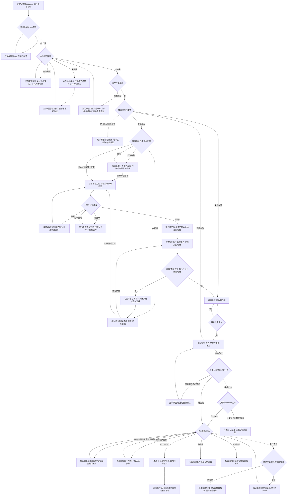

# 任务包10：Seedance独立功能（交互示范包）
版本：评审稿2｜2026-11-04｜状态：SPEC_REVIEW_PENDING，待用户确认用户旅程、决策和范围；未指派、未开发、未开启线上Seedance。与[09文件编辑](REFACTOR-FILEEDIT-PACKAGE-20261103.md)共同作为任务包深度样本，不代表其余包已扩写或获准执行。原01–08仍归Gemini。
主台账：[完整重构](REFACTOR-MASTER-TRACKER-20261103.md)；先读[新人入门](DEVELOPER-ONBOARDING.md)及[交付流程](ENGINEERING-DELIVERY-WORKFLOW.md)。bbd9997仅历史基线；领取时记录实际base、分支、工作区差异、Node/OS和独占文件。本稿已吸收原Seedance用户旅程文档的流程图、分步表及边界；本包是唯一维护正文，旧路径仅保留迁移指引。

## 1. 用户价值、范围与完成定义
用户从选择确切Seedance模型开始，完成协议检查与必要签署、素材库优先选材、明确素材角色、参数填写及一次确认提交，能够看到可信任务状态、恢复查询、取消反馈、播放下载和历史重开。不能用“已有生成接口”替代完整旅程，也不能把“点取消”描述成停止上游或停止计费。

| 范围 | 要求及边界 |
|---|---|
| 必须闭合 | 协议查询/签署返回重查、资产库启用检查、资格、模式、已有素材优先/空库上传、角色、参数、确认、一次提交、状态/未知受理核对、取消、结果/历史 |
| 逐模式开放 | 文生视频、图生视频、多参考、首尾帧等按确切模型/渠道证据列支持矩阵；不因名称Seedance宣称全部支持。未验证模式隐藏或禁用并解释，必需模式缺失保留未完成 |
| 素材 | 只列本用户已授权素材；按模式和角色过滤、分页、处理状态；已有素材复用优先于本地上传，多角色可以混用不同来源 |
| 外部状态 | agreement_accepted仅已签署/未签署，无到期/续签；asset_library_enabled独立，凭据/缓存/任务/URL有效期分别处理 |
| 不包含 | 媒体AUTO、未经确认批量付费、自动换模型重提、自建Agent/审批/资产库引擎、其他供应商补位、r28自动开启 |
| 完成证据 | 每个开放模式有同版UI→Run/任务→PT适配→结果/费用边界证据；确定性轨、本地协议轨、真实PT轨、生产冒烟分别报告 |

## 2. 用户旅程与决策树
图中S节点对应第3节分步表和第8节AC。接口名/状态名来自现有材料及拟议契约；本轮未逐Key实测。GET /v1/asset/agreement/status是材料所列路径，认证方式、签署URL、素材列表、幂等查询及取消能力须按M0契约核实，不据图自动认定PT已支持。不能把原材料中的“已确认”标签当成当前证据。

图中“取消请求”返回状态查询，只有权威终态确认才显示已取消；图中未画出的登录失效、离开/刷新、并发、模式切换与结果恢复均在下表显式约束。主路径以资格前检减少无效选材，提交前再次重验，不能只依赖最初缓存。

## 3. 分步详解表：默认界面、动作与兜底

| 节点/触发条件 | 系统动作与默认界面 | 分支、用户选择及兜底限制 | 接口/依赖与验收 |
|---|---|---|---|
| S0 登录/Key/环境 | 显示选定模型、Key匿名标识及草稿；未登录引导登录，未绑Key引导设置 | 401/失效只显示当前Key问题；返回重验，不静默换Key；切账号清除前账号素材和表单访问 | auth/资格；10-01/19 |
| S1 查协议 | 显示“正在检查使用资格”，加载期间禁生成；分别解析两个boolean | 网络/5xx/缺字段显示查询失败或状态未知，可重试；不能当未签署；用户可退出，草稿保留 | agreement状态；10-02 |
| S2 未签署 | 显示“需先签署协议”及核实后的PT入口，新标签打开 | 无可靠签署URL只提供官方帮助/联系入口，不能拼猜URL；未签完返回仍留此态；跳转不是签署成功 | PT开通路径；10-03 |
| S3 从PT返回 | 建议仅对本次待签署流程在页面重新可见时自动查一次，并常显“我已签署，重新检查”按钮 | 不持续后台轮询、不依赖未经证实回调；仍未签署说明状态未更新，允许手动重查并节流；查询失败保留已有表单，禁提交 | 决策S-D1；10-03 |
| S4 资产库启用 | 已签署但未启用显示独立“资产库未启用”，给核实后的启用/帮助路径与重查 | true/false/未知分开；初版建议全部Seedance入口先阻断，纯文生是否可绕过待PT确认和用户决策；不让用户重复签署 | S-D2；10-04 |
| S5 模型/模式 | 先校验当前Key资格，列确切模式与参数约束；不可用项附原因 | 无权限/余额/限流/下架按实际reason分类；查不到能力显示未知而非支持；用户主动换模型/Key，重新检查并提示受影响参数，不自动切换 | 资格/模式schema；10-05/19 |
| S6 查询素材库 | 按当前角色所需类型过滤，显示加载态；本用户范围内查询 | 确认空库直接显示上传引导；筛选无结果显示清除筛选和上传；请求失败显示错误重试，不冒充空库、不自动弹文件选择器，用户可主动上传 | 列表/过滤；10-06 |
| S7 有素材 | 默认网格缩略图，名称/类型/ready或processing标签、预览、搜索和加载更多；已选角色槽常驻 | 仅ready可选；分页保留已选；缩略图失败仍保留可识别信息并可重试；类型/角色不兼容禁选并解释；不默认要求重新上传 | S-D3/素材服务；10-07 |
| S8 用户主动/空库上传 | 明示类型/大小/时长限制，选文件后显示上传进度，可取消上传；不让选择不支持格式 | 前后端双检；失败区分格式/配额/网络，保留其他角色；上传响应丢失先按上传记录核对，无查询则待核对，不盲目重复注册 | 上传/配额；10-08/09 |
| S8 processing | 上传成功后显示“素材处理中”，只有确切ready可进入生成；新素材入库并选入当前角色 | 显示已等待时长和建议等待上限；超时只暂停自动查询，不判处理失败，不重传；可返回其他工作，重开查原素材；失败换文件而不抹其他选择 | S-D4；10-09 |
| S9 角色/归属 | 显式角色槽first_frame/last_frame/reference_image/reference_audio，依确切模型显示；每槽可分别选库或上传 | 不从数组顺序推断；校验类型/数量/必选与互斥；跨租户/已删/撤销访问统一拒绝且不泄露；相同素材允许多Run只读引用，是否能同素材占多个角色以schema为准 | typed资产引用；10-10/20 |
| S10 参数/切模式 | 合法选项由模型schema提供，prompt/duration/aspect/resolution/音轨逐字段校验；无素材的模式跳过素材步骤 | 切模式保留兼容字段，不兼容项提示清除并可撤回；旧角色不能隐藏后继续发出；后端再验，错误定位字段，保留合法输入 | 参数schema；10-11/19 |
| S11 确认 | 汇总模型、模式、素材缩略图/角色、参数和费用信息，明确一次外部提交；生成按钮防双击 | 有可靠estimate显示币种/单位/估算时间且注明非实扣；无估算显示“费用未知”；是否允许未知费用提交待S-D5确认，不假设免费 | 05/07、S-D5；10-12 |
| S12 提交 | 持久operation/请求摘要/批准关联，再提交；重验协议、资格、素材和参数，页面显示提交中 | 重复点击/双标签同operation最多一次提交；用户改表单使批准失效；只有确证未受理才能修正后新确认；429/5xx/断网缺受理证据一律未知 | operation/05；10-13/14 |
| S13 受理未知 | 显示“提交结果待确认，请勿重复生成”，按原operation查询 | 查询能力未获证实或无法判定则人工核对；不把not found立即当未受理，须有一致性窗口和明确未受理契约；不换模型/Key、不自动重提 | PT-04、S-D6；10-14 |
| S14 轮询 | 仅权威queued/running显示排队/生成，显示最后更新时间；有真实进度才画百分比 | 401需重验身份，429尊重Retry-After并有上限；5xx/无status/未知状态累计后显示“查询暂不可用”，保留最后状态，不等于排队/失败；恢复只查原任务 | S-D4/状态映射；10-15 |
| S15 成功/失败/过期 | succeeded有合法结果引用才展示播放下载；failed显示已知原因及费用状态；expired单独说明任务状态 | succeeded无URL显示结果待获取，仅查询不生成；费用未知不写未扣费；任务过期但已保存结果可用时继续展示，资源过期不倒改任务终态 | 结果/07；10-16/18 |
| S16 取消各阶段 | 提交前可放弃候选且不外发；受理未知先核对；queued/running按确切渠道取消能力展示按钮/原因 | 支持时先显示取消请求中/best_effort，confirmed后显示已取消；不支持/请求失败说明任务可能继续；已成功则显示完成不覆盖；费用独立核对，不承诺退款 | 取消契约；10-17 |
| S17 历史/下载 | 持久记录任务、模型/参数摘要、素材角色、结果引用和费用状态；重开重新鉴权 | 播放/下载失败先检查资源访问，不重生成；标准接口沿用已接受永久URL假设，透传按渠道证据；确认过期才显示过期，403/网络失败不直接说过期 | 产物ACL/历史；10-18 |
| S18 离开/刷新/多标签 | 未提交保留当前会话内草稿，离开提示；已提交保存任务引用，刷新恢复原任务查询 | 关闭页面不表示取消；刷新不提交新任务；前一标签变更不覆盖本地草稿，已提交快照不可修改；新生成须新确认及新operation | 持久Run/任务；10-19/20 |
| 全程可访问性 | 错误附下一步；表单、素材选择、角色、确认和历史可键盘操作，焦点随错误/返回恢复 | 不只用颜色区分状态；加载禁提交附原因；参数/费用/任务技术字段有面向用户说明，不暴露Key和签名URL | UI/日志；10-21 |

## 4. 建议方案与待确认决策
这些是本次评审建议，不是已批准设计或PT已交付能力。产品决定由用户确认；接口事实由负责人向PT收证据。未决项对应AC标BLOCKED，不由实现者猜。

| 决策 | 建议方案 | 需要确认/外部证据与未决处理 |
|---|---|---|
| S-D1 签署后返回 | 返回可见且处于待签署态时查一次＋手动重查按钮；同一用户Key合并在途请求，建议5秒点击节流；不常驻轮询 | 用户确认交互；PT提供可靠签署URL及状态可见延迟。无URL仅帮助路径；不存在已验证自动回调的承诺 |
| S-D2 已签署但库未启用 | 显示独立开通说明、核实后的帮助/启用入口及重查；初版全部生成阻断 | PT确认启用方式、文生视频是否也必须启用；若允许文生绕过，用户再确认放行分支，不能开发者自行省略 |
| S-D3 素材多时分页 | 一开始就分页，建议24项/页、按更新时间降序＋稳定ID排序，cursor、类型过滤、显式加载更多；选中项跨页保留 | 用户确认24项设计值；PT确认列表/搜索/排序/cursor。无列表能力可复用本产品已授权资产索引，但不能称完整PT素材库；若范围缩减需确认 |
| S-D4 等待与轮询 | 建议签署/列表请求15秒UI超时；上传processing初版自动查至2分钟；任务查询连续5次异常或连续2分钟无有效状态即暂停，后台页停止页面轮询；正常任务间隔建议2→5→10秒，遵守Retry-After且请求超时有界 | 都是设计起点，M0按PT限流和真实时延调参；前台显示具体等待及“继续查询”；超时不结束上游、不判失败、不重传/重提；全局限流避免多标签倍增 |
| S-D5 价格确认/未知费用 | 每次提交有最终确认；可靠estimate可显示，未知费用默认禁提交。若业务必须开放，须用户明确接受未知费用并具备专门授权、次数/额度控制 | 用户确认是否允许“无估算但获准”路径；现有r28无金额硬上限不能包装成新包已具备限额；无可靠限额时不承诺硬封顶，不自行放宽 |
| S-D6 幂等/查询/取消 | 优先PT原生幂等及operation查询；缺失则本地一次提交＋未知人工。取消按确切模型/渠道能力映射，不能仅因Seedance名称假定BytePlus DELETE可用 | PT提供端点/认证/一致性窗口/终态及billing语义；本地operation不能实现上游exactly-once；缺能力保留受限状态及未完成项 |
| S-D7 草稿/并发素材 | 初版会话内草稿，刷新未提交表单不承诺恢复并提前警示；已提交任务必须可恢复。同一ready素材允许多个Run只读引用，初版不引入独占占用锁 | 用户确认是否需要持久草稿；PT确认素材并发/生命周期限制，额外配额拒绝具名显示；新增草稿持久化另补ACL/保留期，不能默认进localStorage |
| S-D8 资源结果保存 | 复用已有产物/受控下载；标准URL永久为既有接受假设，透传URL按渠道说明；优先保存有权限的结果引用，需复制视频时先落实容量/保留期 | 33确认磁盘/对象存储及保留期，不默认新建存储；无法保存时明确结果与历史边界，不说“已永久备份” |

## 5. DSH复用、依赖与文件归属
遵循[DSH最大化复用原则](PRODUCT-ROADMAP-AND-RESOURCES-20261103.md#首要原则最大化复用dsh)：原生直接用→配置→接线→现插件/受控升级→证据缺口才补最小宿主。下表是M0核查任务，不是本轮新增SDK探针通过证明。

| 能力 | 优先复用/核查位置 | 仅允许的产品接线与缺口处理 |
|---|---|---|
| Agent工具、调用/结果/UI | 锁定DSH 0.1.1-rc.2的工具注册、事件、渲染、审批/Session接口；shell/runtime/dsh-adapter.cjs、persistent-runner.mjs | 不另造Agent循环；真实工具事件关联当前Run，复用原生可用卡片，补本包分支显示 |
| 媒体/任务/资产 | 仓库既有Seedream/Wan/Seedance候选、标准媒体适配和产物ACL，M0交准确文件/导出/版本证据 | 优先现有PT transport及已实现资产路径；不能因缺页面就建第二套上传/轮询/任务引擎 |
| 签署/素材/模式 | 现有PT接口材料与锁定provider支持矩阵，实际认证/状态逐项核查 | 只补类型映射与产品界面；提议字段≠已支持；无可靠证据的模式关闭 |
| 05 QUESTIONS/07 BILLING（Gemini） | 一次确认绑定owner/tenant/Run/operation/digest；真实消费/费用未知协议 | 可先严格fixture做候选，自测不算联测；不另造审批/实扣服务，不读改Gemini候选 |
| 31/34供应商契约/PT核实 | typed facade、资格与异步任务/资产/取消契约 | 已有协议可映射，不等全部新增端点；缺幂等/查询按S-D6受限处理 |
| 18/33/16/14测试环境 | 独立staging、DB/文件/凭据、测试账号/Key授权、同版E2E与业务验证 | 资源未就绪明确BLOCKED；不把agent-fat现有用户库当可清空测试库 |

候选独占：shell/candidates/seedance-20261103/；探针tests/probes/refactor-seedance-20261103.mjs；报告docs/refactor/evidence/REFACTOR-SEEDANCE-20261103.md。先交CONTRACT.md和REUSE-MATRIX.md，列实际挂载点和依赖版本。共享server/runner/public/tenant/迁移/profile/package/lock由负责人集成；开发者只交补丁建议。不改原8包、Bug窗口、tests/e2e/、历史归档或用户文件，不存凭据、Cookie、Key、原始用户数据和签名URL。领取任务不产生部署、push/merge、付费或生产干预授权。

## 6. 服务契约、持久化与恢复
以下是目标语义，不承诺现有HTTP端点/字段已可用。M0须列“需求—DSH/现有源码导出—PT实际证据—映射—缺口—AC”，主审确认后冻结。

| 操作 | 必需语义 |
|---|---|
| 资格/协议/素材列表 | 服务端可信authContext、tenant、匿名KeyRef、确切模型/渠道、mode/role；分页cursor/filter；协议和库启用分别表示known/unknown，不信客户端声明 |
| 素材上传/处理 | 当前角色、文件类型/字节/时长、配额、uploadOperation、资产引用与处理状态；异步未知仅查询；新素材加入既有库体系，非另建孤立库 |
| prepare/approve | 固定模型/渠道、mode、完整显式角色映射、规范参数、估算来源与时间、operation及摘要；05批准绑定身份/Run/候选摘要，变更即失效 |
| submit/query | 持久一次提交状态、上游任务ID/operation可查询性、请求摘要、受理证据；相同operation同参返回原状态，异参冲突；禁自动重试外部写请求 |
| cancel | 能力为supported/unsupported/unknown；请求状态与任务状态分离，best_effort/confirmed不混同；取消未知不重提生成 |
| result/history/download | 任务与产物/来源关联、ACL、结果可用性、billing_state及证据来源；签名URL仅运行时使用，不进报告/日志；刷新/重开继续查原记录 |

任务状态须与三项正交：提交受理（未提交/明确拒绝/已受理/未知）、查询健康（正常/暂停/鉴权失败）、费用（估算/已知实扣/未知）。真实终态由可信协议映射；HTTP查询错误不得覆盖任务终态。持久提交intent在外部请求之前，崩溃后不盲发；上游无幂等/查询时本地无法消除响应丢失不确定性，进入reconciliation_required。每个任务归属tenant/owner/Run，历史、查询、取消、下载重新鉴权。
共享迁移集中编号，PGlite/PG双分支验证。原Run/媒体记录可扩展则优先扩展，不能复制平行权威。结果下载复用受控服务端抓取：校验允许来源、重定向/内网边界、MIME/字节上限、流式取消，避免任意URL代理。日志只留ID/摘要/状态/时间，不记录素材内容和授权URL。

## 7. 错误、观测与容量
候选错误语义需稳定映射到用户动作：SIGNATURE_STATUS_UNAVAILABLE、AGREEMENT_REQUIRED、ASSET_LIBRARY_DISABLED/UNKNOWN、MODEL_INELIGIBLE、CAPABILITY_UNKNOWN、ASSET_LIST_UNAVAILABLE、ASSET_NOT_READY、ASSET_ACCESS_DENIED、ASSET_ROLE_INVALID、PARAMETER_INVALID、ESTIMATE_UNAVAILABLE、APPROVAL_EXPIRED、SUBMISSION_UNKNOWN、QUERY_PAUSED、CANCEL_UNSUPPORTED/UNKNOWN、RESULT_UNAVAILABLE。这是目标码清单，实际复用现有码并在CONTRACT给映射，不强迫改PT错误格式。禁止把失败都报500或把费用未知报零费用。
上传/处理/生成/结果各有字节、时长、数量、在途与查询频率限制，具体值须按模式和PT证据给配置表，未确认不自行填写“无限制”。33测量素材复用率、临时盘峰值、视频存储/带宽、PT RPM/在途、worker/DB容量；多标签合并查询，用户看最后更新时间与暂停原因。默认生产功能关闭，staging只用合成素材和独立身份。

## 8. 验收矩阵与测试责任
每项交实现位置、命令、结果及证据；未决决策/外依BLOCKED不计PASS。每个开放mode独立跑相关AC，不能文生成功替代多参考。下表是测试要求，本轮没有执行测试或声称已有实现。

| AC | 节点及通过标准 | 验证层 |
|---|---|---|
| 10-01 | S0：登录失效/未绑Key/Key无效分别引导，返回后重验，未授权不查素材 | 双账号接口+点击E2E |
| 10-02 | S1：true/false/网络/401/5xx/缺字段分别处理；查询失败绝不显示未签署，boolean不混字符串 | 协议负向+点击E2E |
| 10-03 | S2/S3：未签署→可靠外链→返回一次重查/手动重查；未签完/更新延迟/关外页/无URL各有可见动作，不据跳转放行 | 确定性状态+点击E2E |
| 10-04 | S4：已签未启用与启用未知分开，帮助/重查正确；未批准绕过时文生也不偷放行 | 协议+点击E2E |
| 10-05 | S5：资格拒绝/未知/过期缓存/模式缺失，禁生成并给原因；提交前再验，不自动切模型/Key | 接口+点击E2E |
| 10-06 | S6：非空/空库/筛选空/失败四态；有库先展示库，空才引导上传，失败不自动上传 | fixture+点击E2E |
| 10-07 | S7：分页/搜索/类型过滤、跨页选择、缩略图失败、processing禁选，越权cursor/asset拒绝 | 接口+点击E2E |
| 10-08 | S8：主动上传、取消选文件、格式/大小/配额拒绝、网络失败，保留其他角色且不重复注册 | 本地协议捕获+点击E2E |
| 10-09 | S8：processing→ready/failed/超时/刷新恢复；超时只停查询，ready入库且下次可复用；响应丢失只核对 | 状态/时钟fixture+点击E2E |
| 10-10 | S9：各模式角色类型/数量/必选/互斥及混合来源；拒绝跨租户/已删/失效asset，不靠数组序号推断 | 双账号负向+UI |
| 10-11 | S10：合法组合与字段错误，切模式移除旧隐藏角色/参数，合法输入保留；前后端约束一致 | 参数矩阵+点击E2E |
| 10-12 | S11：确认摘要与实际请求一致；估算有来源/单位/时间，无估算禁提交或按获准路径明确确认，变更废弃批准 | 05/07联测+UI |
| 10-13 | S12：双击/并发同operation一次外部提交，异参冲突；重启intent恢复不盲发；旧批准/权限撤销拒绝 | 本地协议计数+PGlite/PG |
| 10-14 | S13：提交后断网/429/5xx/响应丢失，查原operation；无查询/最终一致not found留未知，无自动重提/换模型 | 故障注入+UI |
| 10-15 | S14：queued/running/真实进度、未知状态/无status/连续5xx/429/401、Retry-After/上限/恢复查询；不无限伪排队 | 时钟/协议fixture+UI |
| 10-16 | S15：成功有结果、成功缺结果、明确失败、任务expired但结果仍在，状态与可用性/费用独立 | 状态矩阵+UI |
| 10-17 | S16：提交前/受理未知/排队/生成/完成各阶段取消；unsupported/best_effort/confirmed/失败/竞态及费用未知，不承诺停费 | 本地协议+点击E2E |
| 10-18 | S17：播放/下载/刷新/重开、ACL、已确认过期/403/网络错分别提示；结果抓取限额/SSRF负向；失败不重新生成 | 双账号+受控下载+UI |
| 10-19 | S0/S5/S10/S18：换Key/模型/模式/账号、离开/刷新，草稿有警示，已提交请求快照不变，恢复查原任务 | 多标签点击E2E |
| 10-20 | S9/S18：同素材多个Run只读复用、上游配额拒绝与素材处理中/撤销访问竞态，无跨任务状态覆盖 | 并发/接口+UI |
| 10-21 | 全程：键盘、焦点、错误原因/下一步、加载按钮、控制台/网络异常与日志脱敏可查；不忽略已知favicon问题 | 点击E2E+日志审查 |
| 10-22 | 真实锁定DSH工具/审批/结果事件与既有媒体接缝可追踪，复用矩阵无重复引擎；原Seedream/Wan/聊天/下载不退化 | SDK+负责人受影响回归 |
| 10-23 | 授权确切模型/模式/次数的真实PT：签署/资格→库选或上传→角色→确认→一次提交→状态→结果/历史，费用据实 | staging真实PT适用链 |
| 10-24 | 同一冻结应用归档经staging点击E2E后发布；production专属测试租户获准冒烟，禁直接改r28 | 发布/生产证据，未授权BLOCKED |

开发者探针入口：node tests/probes/refactor-seedance-20261103.mjs（实现后交付，失败非零）；使用真实候选/锁定SDK和本地协议服务捕获请求次数、body、取消及恢复，不能只测手写常量。交隔离PG注入方法，禁止默认连生产。独立测试在staging用A/B账号、空库/非空库/大库、混合素材角色、跨标签、超时/未知结果fixture逐项点击，有步骤、截图、请求断言、源码/依赖SHA及退出码。tests/e2e/归属先协调，只交用例/接入建议，不改他人目录；复用既有浏览器设施，不新建平行测试框架。
真实PT轨单列授权模型、渠道、模式、素材、次数与费用约束；未获授权只跑确定性/协议轨，10-23保持待验，不能拿目录资格或本地服务通过替代。

## 9. PT依赖、Plan B与进度影响

| 依赖 | Plan B | 影响/不能宣称 |
|---|---|---|
| PT-01/02/07认证、资格/配额 | 现有安全认证、人工核实白名单与本地在途限制 | 不推断Key全模态可用，不承诺服务端硬限额 |
| PT-04异步幂等/查询/取消 | 既有协议映射；本地一次提交＋未知人工；取消缺失说明不支持 | 无法保证丢响应自动恢复/停止上游，不开放无人值守或AUTO |
| PT-05素材/签署/库/结果 | 复用已授权资产体系及安全上传；列表缺失时可提议仅产品已知素材索引 | 完整PT素材库选择未满足则标未完成，范围缩减需用户确认 |
| PT-06费用/估算及07包 | 合法实扣导入/人工核对，估算注明估算 | 不能把估算算实扣；未知费用能否生成按S-D5，不自行放行 |
| PT-09确切Seedance模式 | 独立后置，保留既有Seedream/Wan | 不冒充Seedance，只有10包及相关验收受阻，不等待它才交V1 |

依据：[PT接口需求v1.1](PT-API-REQUIREMENTS-20261104.md)及[PT格式版](PT-API接口需求规格(PT文档格式版)-20261104.md)。路径/字段建议不是现有能力；签署、取消、幂等、素材库和透传URL须提供具体证据。Plan B未满足原范围的仍未完成，不以改名结项。资源申请由负责人协调33，不擅自申请/采购/对外发送材料。

## 10. 里程碑、交付与放行

| 阶段 | 必交内容 | 门禁 |
|---|---|---|
| M0 规格冻结 | S-D1–8决策、模式矩阵、DSH/源码复用矩阵、PT证据、05/07契约、参数/资源上限、节点→AC映射 | 用户确认产品范围；负责人确认缺口与挂载点，未证实的外依列BLOCKED |
| M1 资格与选材 | 协议/返回重查/启用/库优先/上传/角色/参数UI与合成fixture | 空库≠错误，角色和身份边界成立，无生成调用 |
| M2 受控任务 | 一次批准/提交、未知核对、状态/取消、结果/费用历史 | 外部调用计数及故障/并发/重启负向通过，无自动重提 |
| M3 集成与独立测试 | 可挂载UI、接线补丁/迁移建议、独立主审/本地回归/staging点击E2E | 负责人改共享入口；同应用版本、确定性与真实PT证据分开 |
| M4 发布与验收 | 精确归档、恢复方案、授权生产冒烟、缺陷复测关闭 | 另有发布授权；不自动重部署r28、不把本地PASS写生产通过 |

交付目录含CONTRACT.md、REUSE-MATRIX.md、README、可运行实现/UI、合成fixture、探针、接线/迁移建议和报告。报告记录base/commit/文件SHA、节点/AC映射、命令/退出码/通过失败阻塞数、真实PT/替身边界、未决决策和残余风险。rollback首先关闭新生成入口，保留原任务查询/历史能力；不删任务、不逆向退款、不承诺回退代码就停止上游任务。
当前只完成文档评审稿；开发、自测、主审、集成、本地闭环、staging、真实PT、上线各阶段均未在本轮执行。09与10样本待用户对齐后，再决定其余33包扩写；涉及用户流程的包必须自行枚举分支，不能复制本包节点或只套契约格式。
