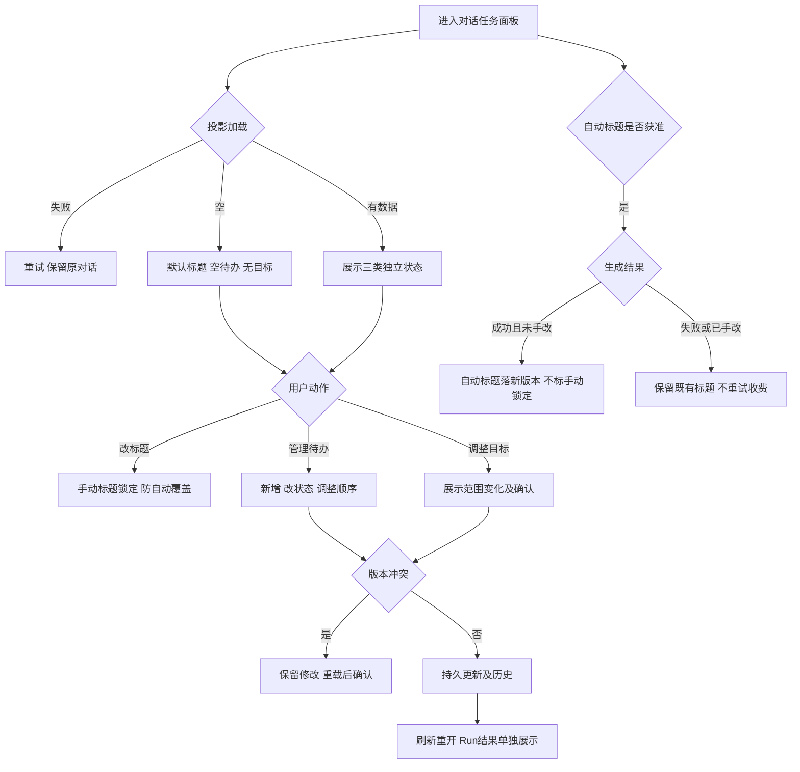

# 任务包12：标题、待办与目标体验
版本：完整规格稿1｜2026-11-04｜状态：SPEC_READY_FOR_ASSIGNMENT（规格已扩写，未指派/未实现/未验收）。类型：用户交互型：三种状态独立投影。用户已通过09/10示范深度并授权本轮扩写；本包下列“待用户拍板”仍为建议，不能当既定产品决定。原01–08据用户确认已由Gemini完成，本轮不重写；交付、主审、集成、上线状态分开登记。
阅读：[主台账](REFACTOR-MASTER-TRACKER-20261103.md)、[研发交付流程](ENGINEERING-DELIVERY-WORKFLOW.md)、[技术入门](DEVELOPER-ONBOARDING.md)。领取填写负责人、实现者、独立测试者、实际base/branch、OS/Node、dirty文件归属及依赖契约版本；bbd9997仅历史参考，不是自动可发布版本。

## 1. 结果、范围与分类依据
用户能改标题、管理待办、查看或调整目标，并识别“计划完成”和“Run真实成功”的区别。原生插件事件落为可刷新、可追溯的宿主投影；三项分别开关和验收。
范围是标题/todo/goal显示与受控修改，不让目标状态替代产物结果，不新增执行调度器。自动标题是可失败的附加调用，不能阻断主对话。

## 2. 复用核查、依赖与所有权
先对锁定DSH 0.1.1-rc.2交“需求—原生/插件/现有接缝—版本/导出证据—配置或接线—缺口—AC”矩阵，原生直接用→配置→产品接线→现插件/受控升级→证据缺口最小补充。下表是开工核查点，不是本轮已跑SDK/已证实新能力；负责人确认缺口后才能实现，不另造Agent循环、执行器或审批引擎。

| 能力/核查来源 | 本包接线、证明及缺口边界 |
|---|---|
| session-title-llm、tool-todo、tool-goal | 逐插件核对事件/工具schema/费用，复用原生状态，不另写任务引擎 |
| shell/tasks/session-runs.cjs与持久Session | 核查标题/目标投影挂载点，Run终态只读权威记录 |

依赖及并行边界：05审批、20计划、现有Run；三插件分别自测交付，不因其一缺失将全部报完成。
独占交付：`shell/candidates/task-ux-20261103/`（CONTRACT.md、REUSE-MATRIX.md、实现或方案、UI/fixture、接线建议）、`tests/probes/refactor-task-ux-20261103.mjs`、`docs/refactor/evidence/REFACTOR-TASK-UX-20261103.md`。方案/验收包交可执行方案与证据，不制造空产品模块。共享server/runner/public/tenant/profile/迁移/package/lock由负责人集成，只交补丁建议；不改Gemini原8包、Bug窗口、tests/e2e/或其他包。测试目录所有权先协调；禁覆盖dirty文件、旧归档或线上r28。
本包不产生部署、付费、外发、资源采购、merge/push或电脑控制授权；真实操作按具体范围另核已有授权。日志/报告不存Key、Cookie、私密原文、签名URL，fixture合成且数据/凭据/DB与生产隔离。

## 3. 用户旅程决策树
范围内每条边由下表解释；后台契约不能替代默认界面和恢复动作。刷新、权限撤销、并发及未知结果也列入验收。

## 4. 分步详解表

| 节点/触发 | 默认界面与系统动作 | 用户动作、兜底条件与禁止行为 | 对应AC |
|---|---|---|---|
| A/B/C/D/E/F 打开面板 | 标题/待办/目标分区，初次分别显示默认标题、空清单、未设目标 | 加载失败重试而非当空，关一项不影响其余项 | 12-01 |
| M/N/O/AUTO 自动标题 | 仅获准且未手动改名时单次生成，额外usage归属可查 | 失败保留确定性默认名，取消Run不补发标题调用 | 12-02 |
| G 用户改标题 | 显示当前标题，保存后标记手动命名 | 空白/长度限制提示；自动标题晚到不覆盖，保存未知查原操作 | 12-03 |
| H 待办操作 | 展示有序条目、来源、状态、可编辑控件 | 模型新增不自动执行；双击/并发只一次更新，失效条目具名解释 | 12-04 |
| I 目标变化 | 展示目标描述、状态和本次调整 | 扩大任务范围/费用重新走计划确认，目标“完成”不伪造Run成功 | 12-05 |
| J/K 并发或权限变化 | 保留本次输入并提示版本已变 | 重载再确认，不静默覆盖他人状态，权限撤销禁写 | 12-06 |
| L/P 刷新历史 | 从持久事件重建三种投影和真实Run状态 | 旧投影缺失可重建，不重放模型/工具；归档只读 | 12-07 |

## 5. 建议方案与待确认决策
以下是建议与决策责任；“待用户拍板”未获确认前不作为已定范围。负责人技术核实及外部回执不是要求用户代做调查。未决项阻断对应AC，不阻断无依赖的契约/fixture工作。

| 决策/责任 | 建议、原因与代价 | 未确认边界或需要的证据 |
|---|---|---|
| 12-D1 待用户拍板 | 建议自动标题默认保守关闭，手动命名始终可用；避免额外收费意外 | 是否默认启用及调用额度确认后配置，不写成已开 |
| 12-D2 待用户拍板 | 建议待办由模型提出、用户可改，自动执行另归13/20 | 待办勾选只改状态，不产生外部动作 |
| 12-D3 待用户拍板 | 建议目标完成需要结果链接或明确人工标记，不同步伪造Run终态 | 目标与Run不一致时提示“人工标记”，文案待确认 |
| 12-D4 负责人技术核实 | 单独插件开关/版本投影，手动标题优先级高于晚到自动事件 | 真实session-title-llm、tool-todo、tool-goal事件和持久化映射须核实 |

## 6. 契约、数据与恢复
接口名称为目标语义，不自动表示现有HTTP端点已实现。CONTRACT冻结可信身份、输入/输出/schema版本、错误码与UI/调用方映射；复用现有错误，拒绝将失败全部报500。

| 操作/记录 | 必须保持的语义 |
|---|---|
| 标题 | sessionId、source=manual/model/default、version、generationOperation；手动更新CAS并使旧生成失效 |
| 待办与目标 | 稳定item/goal ID、state/version、actor、sourceEvent；状态变更幂等，记录人工与模型来源 |
| 投影恢复 | 按Session事件去重重建，投影不是执行指令，不凭文案标记工具已成功 |

跨边界读写逐次校验owner/tenant及本包project/device/Run范围；客户端ID不授予权限。状态和版本持久化，重复同operation同payload返回原结果，异参冲突；取消/超时/断网不自动证明外部动作失败或停止计费。外部写入未知先核对，不盲重试/换模型重提。存储变更需真实PGlite及隔离PG验证，迁移编号由负责人分配；纯调查包此项按无产品写入注明不适用。历史源证据不可覆写，修订形成新版本。

## 7. 验收矩阵与测试责任
每个AC交实现/方案位置、fixture、执行命令、退出码、PASS/FAIL/BLOCKED与脱敏证据；未决或未授权不计PASS。下列是将来执行要求，本轮没有实现或业务通过声明。

| AC | 通过标准 | 验证方式 |
|---|---|---|
| 12-01 | A/B/D：空、失败及每项禁用互不混淆 | 确定性接口/SDK＋staging点击E2E |
| 12-02 | M/N/O：标题失败不阻对话，费用归属与取消可核对 | 确定性接口/SDK＋staging点击E2E |
| 12-03 | G：手改与晚到竞态、非法标题均有断言 | 确定性接口/SDK＋staging点击E2E |
| 12-04 | H：新增/改状态/排序、重复与冲突正确 | 确定性接口/SDK＋staging点击E2E |
| 12-05 | I：目标变化有历史，Run失败仍显示失败 | 确定性接口/SDK＋staging点击E2E |
| 12-06 | J/K：两标签冲突与权限撤销不丢草稿 | 确定性接口/SDK＋staging点击E2E |
| 12-07 | L/P：重启/刷新/归档不重复调用或串租户 | 确定性接口/SDK＋staging点击E2E |
| 12-08 | 伪造身份/资源引用、权限撤销、日志/证据敏感信息均拒绝或脱敏，不扩大依赖权限 | 双身份/仓储负向及证据扫描 |
| 12-09 | 重复操作、并发版本变化、断线/重启与结果未知不造成重复副作用；恢复依据权威记录 | 并发/故障fixture；方案包核实执行证据 |
| 12-10 | 本包变更与同版累计功能兼容；未跑真实上游/生产的项目仍待验，不将fixture写成上线成功 | 负责人受影响回归＋独立测试/证据复核 |

开发者/执行者交`node tests/probes/refactor-task-ux-20261103.mjs`的实现后实际运行方法（方案包可由该入口验证清单/证据或交等价可复跑命令并解释），真实调用候选/锁定SDK/协议服务/存储而非镜像常量，失败非零。无代码阶段不制造假探针通过。独立测试者复核负向反例；涉及界面的AC必须实际点击，API辅助不能全部替代；纯后端包不强制点击E2E，核实业务影响即可。
真实PT调用与付费次数、生产写入/故障、电脑动作独立授权；确定性模型/本地协议轨、真实PT轨、staging与production证据分开。未获授权保留BLOCKED，不能抹掉失败或把未执行算不适用。测试证据绑定应用/配置/迁移/用例版本与fixture SHA。

## 8. 资源、Plan B与进度影响
需标题失败/晚到、两标签和真实原生插件fixture；无自动标题模型时默认名/todo/goal继续开发，真实标题另验。
## PT依赖、Plan B与进度影响
| PT依赖/需求编号 | Plan B | 进度/验收影响 |
|---|---|---|
| 自动标题需PT-03；todo/goal无新增接口 | 先原生todo/goal；标题可用确定性默认名 | 不阻塞任务体验；模型标题缺验证单项待验 |
依据：[PT接口规格v1.1第15节](PT-API-REQUIREMENTS-20261104.md)。PT未接受建议接口形态时先映射既有协议；遵循DSH最大复用原则。上述Plan B为规划候选，不表示已验证或获准额外模型/资源/供应商调用；原范围未满足仍标未完成，变更需用户确认。签署协议仅已签署/未签署，无有效期/续签；资产启用及凭据/缓存/资源有效期分别处理。

## 9. 里程碑、交付与接入
| 阶段 | 本包产出与放行依据 |
|---|---|
| M0 冻结 | 分类、范围、复用矩阵、依赖契约、上述决策、节点/阶段→AC及可量化限制；负责人确认接口缺口，用户只拍板产品/成本/资源选择 |
| M1 核心候选/方案 | 三插件真实事件到独立状态投影 |
| M2 失败与恢复 | 手动覆盖优先级、并发和额外费用边界 |
| M3 独立主审/接入 | 负责人挂载面板并跑主对话回归；负责人独占共享接线，运行受影响回归 |
| M4 同版验收/发布 | 点击改名/待办/目标/刷新及适用真实标题验收；有发布授权才冻结归档并切换，production专属租户受控冒烟 |

交付报告含base/commit/文件SHA、依赖契约版本、命令/退出码/通过失败阻塞数、AC映射、替身/真实边界、遗留Bug与责任、安装/挂载/清理/回退说明。Bug原作者自测后独立复测，主审/集成/发布各阶段分别登记。关闭新入口不等于撤销已提交数据或终止外部任务；回退保留历史可读和必要对账，数据库不自动逆迁。当前仅规格扩写完成，尚未分配、实现、主审、集成、本地/测试环境验收或发布；不能凭文档数量计算产品完成度。
