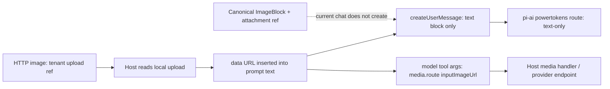

# T08 输入契约：DSH 图片消息与 Provider 边界

**结论：DSH 的 provider-neutral 图片消息使用 durable attachment reference；当前 Northstar 对话没有把上传图片作为 DSH `ImageBlock` 传给 LLM。** `createUserMessage()` 只补 `role: 'user'`、生成 ID 并深度冻结输入；图片引用由调用方放在 `content` 中，构造函数不会把 URL/base64 转成附件，也不执行图片校验。当前 runner 每次只发送文本块；上传图片经宿主转成 data URL 后作为普通 prompt 文本，供模型决定是否把它传给 `media.route`。因此“LLM 看到了图片”和“业务媒体工具收到图片 URL”是两条不同路径。

| 已确认契约 | 本地源码证据 | 含义与限制 |
|---|---|---|
| `createUserMessage({content, source})` 接受 provider-neutral `ContentBlock[]`，包括图片块 `{type:'image', attachment: ImageAttachmentRef}`。 | `shell/node_modules/@deepseek-ai/dsh-llm/lib/types/message.d.ts:125-132, 145-174`; `.../types/types.d.ts:48-58`; runtime constructor `.../types/message.js:25-48` | `ImageAttachmentRef` 是结构化、不可变存储引用；构造函数本身只生成消息 ID 并 deep-freeze，不验证图像字节、MIME、大小或可访问性。 |
| Durable image ref 不是磁盘路径、公开 URL 或内联 base64。 | `shell/node_modules/@deepseek-ai/dsh-attachment/lib/types/types.d.ts:4-27, 39-59` | 引用含不透明 `attachmentId`、受限媒体类型 `image/png/jpeg/webp/gif`、字节数、宽高及可选显示名；字节由 attachment service 按 ref 读取。`SaveImageAttachment` 才接收 `Uint8Array`，`EncodedImageAttachment` 才是上传边界的 base64 字符串。 |
| 已安装 `llm-pi-ai` adapter 支持将 user `ImageBlock` 投影为 pi-ai image content，但依赖明确的模型 image modality 与 durable attachment service。 | `shell/node_modules/@deepseek-ai/dsh-llm-pi-ai/lib/index.js:1068-1092, 1182-1223, 1718-1737, 2420-2425`; config types `.../types/config.d.ts:103-112, 130-139`; model types `.../types/catalog.d.ts:248-255` | Adapter 拒绝非 user role 的历史图片、模型未声明 `image`、或缺少 attachment service；之后按配置解引用/缩放并将 request bytes 变成 `{type:'image', data:<base64 without data: prefix>, mimeType}`。长历史图片可在请求预算超限时退化为文本占位。URL 与任意 data URL 不是 `ImageBlock` 的直接输入形状。 |
| 本项目配置的 provider route 当前声明 text-only。 | `shell/dsh-settings.yaml:4-24` | `llm-pi-ai.providers.powertokens.defaultInput: [text]`，default model 为 `deepseek-v4-pro`；该 route 的已列对话模型没有逐项 image 声明。配置注释记录了 2026-10-10 的网关模型能力核验，但这份本地配置不是当前线上 PT endpoint 的实时证明。若对话里直接传 `ImageBlock`，active pi-ai adapter 会在 provider 请求前以 `UNSUPPORTED_CONTENT` 拒绝。 |
| DeepSeek 专用 adapter也使用 durable `ImageBlock` 输入，并在 provider 序列化时才转成 file ID 或 data URL。 | `shell/node_modules/@deepseek-ai/dsh-llm-deepseek/lib/types/types.d.ts:39-64`; `.../lib/index.js:45-71, 1435-1521` | 它需要 model 的 image modality 与 attachment service；文件模式上传归一化图片并写 `file_id`，Files API 解析失败时可回退到 `image_url.url = data:<mime>;base64,...`。这是本机安装包能力，不代表当前 PowerTokens route 正在使用该 adapter，也不证明 PT endpoint 接受它生成的 wire body。 |
| 当前聊天的图片上传是 tenant upload reference；服务端读取本地上传文件并把 data URL 写入 prompt 的 `imageNote`。 | `shell/tasks/chat-request.cjs:24-57, 82-95`; `shell/server.cjs:305-321, 604-645, 717-725`; `shell/persistent-runner.mjs:596-599` | HTTP 请求不接受任意 URL/data URL 作为 `image`：必须是 tenant upload ref。对话 runner 实际 followup 是 text block，`imageNote` 可含 `data:image/...;base64,...` 原文；这让 LLM 处理的是文本中的长字符串，而非视觉 image content。图像理解能力不能从该路径推断。 |
| `media.route` 的 `inputImageUrl` 是业务工具参数契约，允许公开 HTTP(S) URL 或 image data URL，与 LLM `ImageBlock` 契约分离。 | `shell/persistent-runner.mjs:358-385`; `shell/server.cjs:604-645` | 当前宿主把受信 Run/身份交给 host handler；上传图的 data URL作为 tool 参数传递。这个 schema/提示文本只能证明应用预期的参数形式，不能单独证明所选 PowerTokens 图像/视频生成端点接受所有 MIME、尺寸或 data URL。 |

## 消息与转换边界

若未来要让 chat model 看图，调用方应构造 canonical `{type:'image', attachment: ref}`，并确保当前精确 provider/model 明确声明 image、`ctx.get('attachments')` 有 durable store、request size policy 与 tenant ownership 正确；禁止把 data URL 字符串冒充 `attachmentId` 或把 arbitrary URL 直接塞入 `ImageBlock`。Provider adapter 负责解析 attachment 并序列化到其 wire protocol。模型是否支持图片必须按具体 model route 配置，不可由 provider 名称或 DSH SDK 类型推断。

## 尚待真实 PT endpoint 验证

本次只检查本地已安装 SDK/provider 源码和仓库配置，没有向 PowerTokens 调模型或媒体 endpoint。上线前仍须在无敏感数据的受控租户，用当前实际 endpoint/model 验证：

- `/v1/models` 返回的模型、`supported_endpoint_types` 与每个模型的图片输入能力是否仍与 `shell/dsh-settings.yaml` 的 text-only 声明一致。
- 若未来打开 vision route，PT gateway 对规范 OpenAI-compatible multimodal `messages[].content` 的确切形式、MIME、图片数、字节/像素上限及错误响应。
- 业务媒体端点对公开 URL 与 `data:image/...;base64` 的支持范围、最大体积、MIME/编解码器、图生图与图生视频差异；尤其不能把 `media.route` 参数描述当成服务端实测支持证明。
- 数据 URL 经 prompt/tool-call 往返的 token/请求体上限及日志脱敏。当前路径会把 base64 当文本交给 LLM，可能显著扩张 prompt；若失败，须安全返回错误并避免记录原文。

**证据边界：** SDK 类型与 adapter 实现说明 DSH 内部可表示、读取和序列化 durable image references；当前应用配置与 runner 源码说明实际对话走 text-only route，并以 prompt text 将上传图数据交给 `media.route`。这两类本地证据都不能证明实时 PT endpoint 接受某种视觉输入或图像 URL/data URL。
