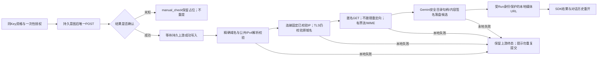

# 媒体结果托管接线断点

> 2026-10-29接续覆盖：下方“未接产品/路由尚不存在”为初始断点。writer主审后，server已接publisher、可信host配置、GET/HEAD/Range及owned Run事件/历史链接；r7确切归档Linux15项、真实锁定SDK/HTTP四任务离线链及暖会话恢复通过，详见MEDIA-managed-writer-main-review-20261029.md。公开静态CDN匿名GET也已通过，详见F1-asset-upload-main-review-20261029.md；真实生成结果及同Key付费验收仍缺。默认授权关闭，F1未交付。

结论：先持久记录上游结果，再下载/保存本地产物；本地保存失败不能改写上游成功，也不能再次POST。现有 `onExternalResult` 已可能在执行器返回URL前落库，不能把抓取器插在回调之前重新解释远端状态。

本轮新增宿主组合模块 `managed-result-publisher.cjs` 与 `pinned-asset-fetch.cjs`，尚未接产品、不进入r5归档。publisher只接受显式注入的网络fetch和落盘函数；不隐式用global fetch。返回同源 `/api/run-media/<runId>/<UUID>.<ext>`，不返回签名原URL；metadata和tenant在异步下载前快照，写入回执须匹配Run/类型/MIME/长度/SHA。执行包装器只调用执行器一次，持久成功确认完成后才发布；未知或持久确认失败不下载。

网络层复用HTTPS与既有抓取器，不增加provider引擎：只接受精确白名单HTTPS/443，无Authorization/Cookie/Referer，无环境代理/共享agent；DNS仅A记录，任一非公共/特殊IPv4即拒绝，解析后固定连接地址，原域名用于TLS证书校验，防二次DNS解析改变目标。显式不支持IPv6，特殊用途范围连其中可公开路由例外也保守拒绝。地址策略来源为[IANA IPv4特殊用途注册表](https://www.iana.org/assignments/iana-ipv4-special-registry)（本轮读取，表标注2025-10-09更新）；不能据此声称对操作系统路由或网络出口拥有控制权。DNS最多5秒、结果最多64条，整体下载由既有抓取器60秒/50MiB图片/200MiB视频及取消控制；Web流以64KiB字节预算背压，禁止按chunk数误放宽缓冲。

现有12项离线验证通过：静态地址边界、混合公共/私有DNS零连接、固定连接与原域名TLS、凭据/自定义头/端口拒绝、DNS超时/取消零晚到连接；匿名抓取、回执绑定、错误脱敏、tenant/metadata快照、结果持久确认顺序与本地失败零重提。传输为注入替身，没有真实外部资产下载，不能当真实TLS/CDN验收。

待接：Gemini `GEMINI-MANAGED-MEDIA-WRITER-PACKAGE-20261029.md` 的内容签名/安全落盘主审；复用openTenantArtifact提供GET/HEAD/Range且校验Run所有权；server的可信executor/publisher注入、托管结果事件与失败/取消时的历史恢复；最后再冻结新修订。新URL服务路由尚不存在，当前publisher模块不得启用。真实CDN精确主机需明确配置，不能从provider给出的任意URL自动扩大白名单。
