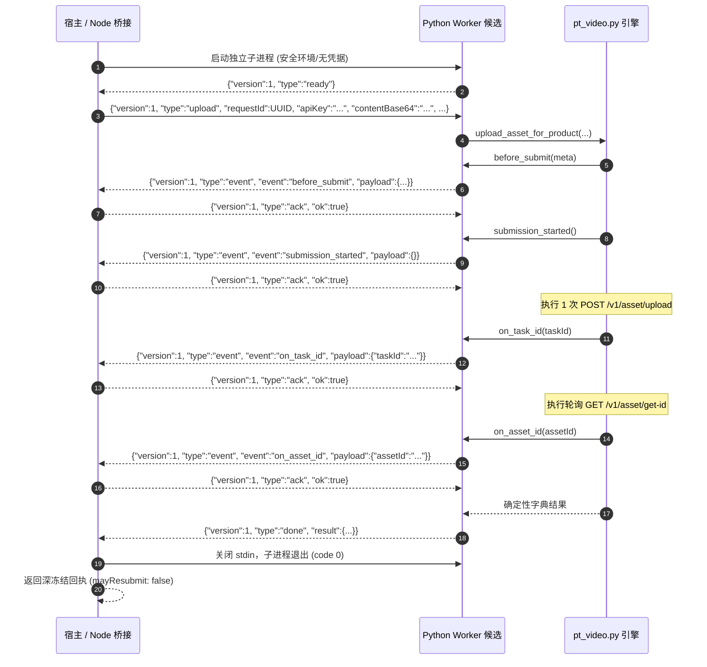

# PT 资产上传 Worker 与 Node 桥接候选证据报告 (F1 / Gemini 2026-10-29)

## 1. 结论与交付概览

本包为已审查的 Python 参考图资产上传与恢复引擎（`upload_asset_for_product` 与 `recover_uploaded_asset_for_product`）交付独立进程边界：
1. **Python 上传与恢复 Worker 候选**: [`pt-asset-upload-worker-candidate.py`](file:///Users/mmdn/Downloads/pt项目/shell/media/pt-asset-upload-worker-candidate.py)
2. **Node 进程隔离桥接候选**: [`pt-asset-upload-bridge-candidate.cjs`](file:///Users/mmdn/Downloads/pt项目/shell/media/pt-asset-upload-bridge-candidate.cjs)
3. **Node 桥接离线回归测试套件**: [`pt-asset-upload-bridge-candidate-test.mjs`](file:///Users/mmdn/Downloads/pt项目/tests/regression/pt-asset-upload-bridge-candidate-test.mjs) (22/22 PASS)
4. **Python Worker 离线回归测试套件**: [`pt-asset-upload-worker-candidate-test.py`](file:///Users/mmdn/Downloads/pt项目/tests/regression/pt-asset-upload-worker-candidate-test.py) (8/8 PASS)
5. **证据与审计报告**: [`F1-pt-asset-upload-bridge-gemini-20261029.md`](file:///Users/mmdn/Downloads/pt项目/docs/refactor/evidence/F1-pt-asset-upload-bridge-gemini-20261029.md)

---

## 2. 两层补丁应用与引擎 SHA256 验证

测试套件在完全隔离的临时目录中构造引擎，严格按**基线 -> Gemini 原补丁 -> 主审叠加补丁**顺序应用并双向验证哈希，绝不修改 vendor 既有代码：

| 阶段 | 文件状态 / 补丁 | SHA256 校验码 | 补丁验证状态 |
| :--- | :--- | :--- | :--- |
| **0. 引擎基线** | `shell/media/vendor/powertokens_video/pt_video.py` | `08268f5f4e1da2782e3729498567054562d73b0c24ecab0970f861adc90f8351` | 严格吻合 `UPSTREAM.json` |
| **1. Gemini 补丁** | `docs/refactor/candidates/pt-asset-upload-product-20261029.patch` | `3bad125b0267c1bc47c58ca8b8dc0e77700910d35fc2111f5bb0653176adebcb` | `git apply --check` & `patch -p1` PASS |
| **2. 主审叠加补丁** | `docs/refactor/candidates/pt-asset-upload-main-review-20261029.patch` | `286c9710a3b8944bb64d673be0f94a3e2c479bbd9c8564da7f539f319c184b15` | `git apply --check` & `patch -p1` PASS |

---

## 3. IPC 协议与状态机时序

Worker 与 Node 桥接之间通过标准输入输出（stdio）采用严格有界 JSON 行协议通信：

### GET-only 恢复模式 (`recover`) 时序
- 仅提供 `taskId`，**严禁传入 `apiKey`、图片内容或文件名**。
- 不触发 `before_submit` 与 `submission_started`，**零 POST 请求**。
- 仅触发 `on_asset_id` 事件，完成轮询后返回回执，不消耗新生成授权。

---

## 4. 关键安全机制与契约防线

1. **凭据单向单次隔离**:
   - `apiKey` 仅在启动后的首帧 JSON 中经子进程 `stdin` 单次传输，绝不进入 `argv`、环境变量、系统日志、错误堆栈或持久化文件。
2. **白名单子进程环境**:
   - 子进程环境仅构造 `{ PATH: '/usr/local/bin:/usr/bin:/bin', LANG: 'C.UTF-8' }`，绝不继承父进程上下文或主机密钥。每次上传均独占独立子进程（一请求一进程）。
3. **输入与启动前安全门禁**:
   - 验证 `pythonBinary`、`workerPath`、`enginePath` 为宿主固定绝对路径且存在，配置非法立即拒绝（0 进程、0 网络）。
   - 校验文件名（`/^[A-Za-z0-9_.-]{1,64}$/`，拦截 `..` 及 `/\\` 目录遍历）；校验图片大小（严格 $1 \le \text{bytes} \le 5\,\text{MiB}$）。
   - 校验网关 `baseUrl` 必须为纯净 HTTPS，禁止嵌入用户名密码、查询参数或路径污染。
4. **全链路严格资源有界**:
   - 首帧 Base64 输入限制 $\le 8\,\text{MiB}$；后续事件帧限制 $\le 128\,\text{KiB}$。
   - Worker 累计标准输出限制 $\le 1\,\text{MiB}$，累计标准错误限制 $\le 64\,\text{KiB}$，帧数上限 16 帧；杜绝无界 `JSON.parse`、内存泄露或挂起。
   - 原始二进制图片数据绝不输出至 `stdout`/`stderr`。
5. **持久化确认与不可重提保证**:
   - `onBeforeSubmit` 与 `onSubmissionStarted` 未获确认前，**绝对执行 0 次 POST**。
   - `onTaskId` 未获确认前，**绝对执行 0 次 GET**。
   - 一旦 `submission_started` 获确认，子进程即使被杀或异常退出，回执与错误对象也强制保留 `submissionMayHaveStarted: true`，且全链路硬编码 `mayResubmit: false`，杜绝重复提交扣费。
6. **双重看门狗与迟到防御**:
   - Node 设定单调超时时间（默认 120s），超时或收到取消信号时先发 `SIGTERM`，给最多 2s 宽限期后发 `SIGKILL` 强杀。
   - 状态一旦终结（超时/取消/失败），子进程后续任何迟到的 stdout 或帧均被抛弃，绝不覆盖已有失败状态。

---

## 5. 离线回归测试明细表

### Node 桥接回归测试套件 (22 项全部 PASS)

| 序号 | 测试分类 | 场景描述与断言重点 | 状态 |
| :--- | :--- | :--- | :--- |
| 1 | 协议与时序 | 完整成功上传：顺序确认 4 个 hook，记录 POST/GET 调用，返回深冻结回执 | PASS |
| 2 | GET-only 恢复 | 成功恢复已有任务：精确发起 1 次 GET，0 POST，无 key/bytes | PASS |
| 3 | 持久化防御 | `onBeforeSubmit` 拒绝：抛出异常，记录 0 次 POST | PASS |
| 4 | 持久化防御 | `onSubmissionStarted` 拒绝：抛出异常，记录 0 次 POST | PASS |
| 5 | 持久化防御 | `onTaskId` 拒绝：保留 taskId，终止轮询，记录 1 次 POST，0 次 GET | PASS |
| 6 | 持久化防御 | `onAssetId` 拒绝：保留 taskId 与 assetId，不发起第二次 POST | PASS |
| 7 | 参数门禁 | 拒绝 0 字节及超过 5 MiB 的非法 buffer | PASS |
| 8 | 参数门禁 | 拒绝包含路径穿越（`..`）、斜杠、控制字符的非法文件名 | PASS |
| 9 | 凭据门禁 | 拒绝空串、包含控制字符或超长的非法 apiKey | PASS |
| 10 | 网关门禁 | 拒绝 HTTP、包含账号密码或查询参数的非法 baseUrl | PASS |
| 11 | 注入防御 | 拒绝上传选项中混入的未受信任任意字段（如路径、shell 命令等） | PASS |
| 12 | 恢复门禁 | 恢复模式拒绝传入 apiKey、buffer、content，拒绝非法 taskId | PASS |
| 13 | 启动前配置 | pythonBinary 或 workerPath 不存在时直接拦截，0 进程启动 | PASS |
| 14 | 看门狗防御 | Worker 假死挂起时，通过 SIGTERM/SIGKILL 强制回收子进程 | PASS |
| 15 | 取消信号 | 启动前收到 AbortSignal 直接 fail-closed，0 进程启动 | PASS |
| 16 | 崩溃一致性 | `submission_started` 确认后子进程崩溃，保留 `submissionMayHaveStarted: true` | PASS |
| 17 | 崩溃一致性 | `on_task_id` 确认后子进程崩溃，保留已有 `taskId` 与提交状态 | PASS |
| 18 | 协议防御 | 拒绝未经 hook 确认的不请自来 `done` 帧 (`PROTOCOL_INVALID`) | PASS |
| 19 | 协议防御 | 拒绝乱序或跳跃的事件序号 (`eventId`) | PASS |
| 20 | 流式上限 | 拒绝单行输出超过 128 KiB 的 Worker 洪泛 (`STDOUT_LIMIT`) | PASS |
| 21 | 流式上限 | 拒绝累计输出超过 64 KiB 的 stderr 垃圾数据 (`STDERR_LIMIT`) | PASS |
| 22 | 脱敏审计 | 错误信息与异常对象中绝不泄露 `PRIVATE_SENTINEL` 或凭据 | PASS |

### Python Worker 回归测试套件 (8 项全部 PASS)

| 序号 | 测试分类 | 场景描述与断言重点 | 状态 |
| :--- | :--- | :--- | :--- |
| 1 | 协议与时序 | 完整成功上传：验证 ready -> 请求 -> 4 步 ack -> done，无 Key/原始 bytes 泄露 | PASS |
| 2 | GET-only 恢复 | 成功恢复：仅发起 GET，验证无 Authorization/Cookie 请求头 | PASS |
| 3 | 持久化防御 | `before_submit` 拒绝：记录 0 次 POST，返回 `HOOK_BEFORE_SUBMIT_FAILED` | PASS |
| 4 | 持久化防御 | `submission_started` 拒绝：记录 0 次 POST，返回 `HOOK_SUBMISSION_STARTED_FAILED` | PASS |
| 5 | 持久化防御 | `on_task_id` 拒绝：记录 1 次 POST，0 次 GET，保留 taskId | PASS |
| 6 | 持久化防御 | 恢复模式 `on_asset_id` 拒绝：记录 1 次 GET，保留两个 ID | PASS |
| 7 | 协议防御 | 协议版本错误、未知类型、非法 requestId、recover 混入 apiKey 均发出 error 帧 | PASS |
| 8 | 脱敏审计 | 错误帧与 stdout 绝不泄露入参中的 `PRIVATE_SENTINEL` | PASS |

---

## 6. 验证命令与结果

### 执行环境
- **Node.js**: v24.14.0
- **Python**: 3.13.3
- **Platform**: Darwin 25.2.0 arm64 (macOS)

### 执行命令与输出
1. 语法检查：
   - `node --check shell/media/pt-asset-upload-bridge-candidate.cjs` -> PASS
   - `node --check tests/regression/pt-asset-upload-bridge-candidate-test.mjs` -> PASS
   - `python3 -m py_compile shell/media/pt-asset-upload-worker-candidate.py` -> PASS
   - `python3 -m py_compile tests/regression/pt-asset-upload-worker-candidate-test.py` -> PASS
2. 离线回归测试执行：
   - `node --test tests/regression/pt-asset-upload-bridge-candidate-test.mjs` -> **22/22 PASS** (1.48s)
   - `python3 tests/regression/pt-asset-upload-worker-candidate-test.py` -> **8/8 PASS** (0.05s)
3. 既有套件联合运行：
   - `python3 tests/regression/pt-asset-upload-product-candidate-test.py` -> 27/27 PASS
   - `python3 tests/regression/pt-asset-upload-main-review-test.py` -> 55/55 PASS
   - `git diff --check` -> PASS (零空白/语法异常，零主线代码变动)

---

## 7. 架构边界与安全责任声明
- **离线边界候选声明**: 本包仅提供上传与恢复的独立进程 Worker 及 Node 桥接管道，不自行实现租户鉴权、Run 状态机转移、扣费授权或前端路由接入。
- **不可推断生产可用**: 尽管离线测试已覆盖所有 hook 顺序、超时强杀、流限制与异常分支，但尚未接入真实 Run 与物理网络上传，不可将本候选视为 F1 生产可用闭环。
