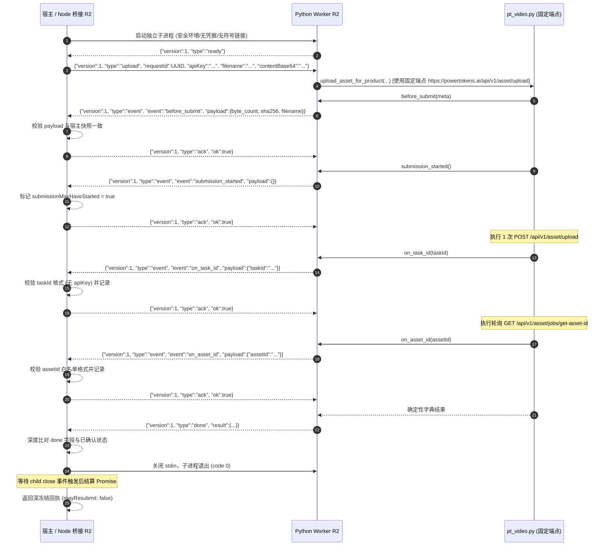

# PT 资产上传桥 R2 固定地址与协议门禁证据报告 (F1 / Gemini 2026-10-29)

## 1. 结论与交付概览

本包针对主 Agent 主审在 R1 交付中发现的生产阻断（固定端点被改写/调用方可劫持 origin、状态机与收据未深度核验、Promise 在子进程退出前过早结算、缺少符号链接/文件权限门禁），交付完全隔离的 R2 修正候选，不覆盖 R1 既有交付文件：

1. **R2 Node 桥接管道纯函数候选**: [`pt-asset-upload-bridge-r2-candidate.cjs`](file:///Users/mmdn/Downloads/pt项目/shell/media/pt-asset-upload-bridge-r2-candidate.cjs)
2. **R2 Python 独立子进程 Worker 候选**: [`pt-asset-upload-worker-r2-candidate.py`](file:///Users/mmdn/Downloads/pt项目/shell/media/pt-asset-upload-worker-r2-candidate.py)
3. **R2 Node 桥接 17 项离线专项回归套件**: [`pt-asset-upload-bridge-r2-candidate-test.mjs`](file:///Users/mmdn/Downloads/pt项目/tests/regression/pt-asset-upload-bridge-r2-candidate-test.mjs) (17/17 PASS)
4. **R2 Python Worker 8 项离线专项回归套件**: [`tests/regression/pt-asset-upload-worker-r2-candidate-test.py`](file:///Users/mmdn/Downloads/pt项目/tests/regression/pt-asset-upload-worker-r2-candidate-test.py) (8/8 PASS)
5. **证据与审计报告**: [`F1-pt-asset-upload-bridge-r2-gemini-20261029.md`](file:///Users/mmdn/Downloads/pt项目/docs/refactor/evidence/F1-pt-asset-upload-bridge-r2-gemini-20261029.md)

---

## 2. 生产阻断根因分析与 R2 加固对策

### 阻断 1：固定资产端点被改写与 URL 劫持漏洞
- **根因**: vendored `pt_video.py` 内部固定的官方资产端点为：
  - `ASSET_UPLOAD = "https://powertokens.ai/api/v1/asset/upload"`
  - `ASSET_GET_ID = "https://powertokens.ai/api/v1/asset/jobs/get-asset-id?task_id={}"`
  R1 Worker 却根据请求传入的 `baseUrl` 将其重写为 `{origin}/v1/asset/upload` 与 `{origin}/v1/asset/get-id`，不仅改变了 `/api` 根路径与 `/jobs/get-asset-id` 实际接口名，而且允许不可信调用方通过参数传入任意 `https://attacker.example`，导致首帧携带的凭据被发往外部服务器。
- **R2 对策**:
  - 生产入口**彻底剔除任何请求级 `baseUrl`**；若调用方传入 `baseUrl`，在子进程启动前即抛出 `ASSET_BRIDGE_INPUT_INVALID` 拦截，确保 0 POST、0 Key 发送。
  - Worker 严禁篡改引擎内置常量，直接使用 vendored 固定端点。离线测试断言请求 URL 必须精确匹配 `https://powertokens.ai/api/v1/asset/upload` 与 `https://powertokens.ai/api/v1/asset/jobs/get-asset-id?task_id=...`。

### 阻断 2：状态机时序跳跃与收据深度校验缺失
- **根因**: R1 Node 桥接未校验 `on_task_id` 必须紧随 `submission_started` 之后，未校验 `on_asset_id` 必须已确认 `taskId`，未按引擎白名单校验 assetId 格式，且在 `done` 帧仅简单转布尔，未比对回执中的 ID、长度及哈希是否与宿主记录一致。伪 Worker 可直接跳过确认事件伪造成功。
- **R2 对策**:
  - 严格线性状态机：上传流程强制 `before_submit -> submission_started -> on_task_id -> on_asset_id -> done`；恢复流程强制 `on_asset_id -> done`。
  - 深度校验：`before_submit` 与 `done` 帧严格校验 `byte_count` 与 `sha256Hex` 与宿主快照一致；校验 `taskId` 必须匹配 `^[a-zA-Z0-9_.:-]{1,256}$` 且不包含 `apiKey`；校验 `assetId` 必须严格匹配 `^[A-Za-z0-9_.-]{1,256}$`（拦截冒号、斜杠与特殊字符）。

### 阻断 3：Promise 过早结算与文件系统权限隐患
- **根因**: R1 `stop()` 在发出 `SIGTERM` 后立即 `reject`，不等待子进程退出，导致调用方以为已中止而后台进程仍在发起网络请求；且未校验 Worker/引擎路径的文件类型与权限，存在符号链接替换风险。
- **R2 对策**:
  - 异步终止等待：`stop()` 发送 `SIGTERM` 并设置最多 2 秒的 `SIGKILL` 宽限定时器，**严格等待 `child.once('close')` 触发后才结算 Promise**，杜绝僵尸进程后台请求。
  - 启动前文件安全核验：使用 `fs.lstatSync` 校验 `pythonBinary`、`workerPath` 及 `enginePath` 必须为常规文件（`isFile()`）、严禁符号链接（`!isSymbolicLink()`）、严禁全局可写（`mode & 0o002 === 0`）。

---

## 3. 两层补丁应用与引擎哈希校验

测试全程在独立临时目录中按规范双向校验，绝不修改 vendor 既有文件：

| 阶段 | 文件状态 / 补丁 | SHA256 校验码 | 补丁验证状态 |
| :--- | :--- | :--- | :--- |
| **0. 引擎基线** | `shell/media/vendor/powertokens_video/pt_video.py` | `08268f5f4e1da2782e3729498567054562d73b0c24ecab0970f861adc90f8351` | 严格吻合 `UPSTREAM.json` |
| **1. Gemini 补丁** | `docs/refactor/candidates/pt-asset-upload-product-20261029.patch` | `3bad125b0267c1bc47c58ca8b8dc0e77700910d35fc2111f5bb0653176adebcb` | `git apply --check` & `patch -p1` PASS |
| **2. 主审叠加补丁** | `docs/refactor/candidates/pt-asset-upload-main-review-20261029.patch` | `286c9710a3b8944bb64d673be0f94a3e2c479bbd9c8564da7f539f319c184b15` | `git apply --check` & `patch -p1` PASS |

---

## 4. R2 协议时序图

---

## 5. 离线回归测试明细表

### Node 桥接 R2 测试套件 (17 项全部 PASS)

| 序号 | 测试分类 | 场景描述与断言重点 | 状态 |
| :--- | :--- | :--- | :--- |
| 1 | 固定端点断言 | 上传直接断言 POST 为 `https://powertokens.ai/api/v1/asset/upload`，GET 为 `/jobs/get-asset-id` | PASS |
| 2 | 固定端点断言 | 恢复直接断言 GET 为 `https://powertokens.ai/api/v1/asset/jobs/get-asset-id` 且 0 POST | PASS |
| 3 | 劫持防御 | 传入 `baseUrl` 作为参数在启动前直接拒绝，0 进程、0 POST、0 Key 泄露 | PASS |
| 4 | 状态机门禁 | 拒绝未经 `submission_started` 确认的跳跃 `on_task_id` (`PROTOCOL_INVALID`) | PASS |
| 5 | 状态机门禁 | 上传模式拒绝未经 `on_task_id` 确认的跳跃 `on_asset_id` (`PROTOCOL_INVALID`) | PASS |
| 6 | 格式门禁 | 拒绝包含非法字符（冒号、斜杠等）的恶意 `assetId` (`PROTOCOL_INVALID`) | PASS |
| 7 | 完整性门禁 | 拒绝 `before_submit` 中篡改的 `byte_count` 或 `sha256` (`PROTOCOL_INVALID`) | PASS |
| 8 | 完整性门禁 | 拒绝伪造或与宿主确认状态不一致的 `done` 帧结果 (`PROTOCOL_INVALID`) | PASS |
| 9 | 看门狗生命周期 | 取消与超时在子进程 `close` 之前绝不结算 Promise，验证 SIGKILL 宽限 $\le 2\text{s}$ | PASS |
| 10 | 文件安全门禁 | 拒绝非常规文件、目录或符号链接形式的 `workerPath` (`CONFIGURATION_INVALID`) | PASS |
| 11 | 持久化门禁 | `onBeforeSubmit` 拒绝：抛出异常，记录 0 次 POST | PASS |
| 12 | 持久化门禁 | `onSubmissionStarted` 拒绝：抛出异常，记录 0 次 POST | PASS |
| 13 | 持久化门禁 | `onTaskId` 拒绝：保留 taskId，终止轮询，记录 1 次 POST，0 次 GET | PASS |
| 14 | 崩溃一致性 | `submission_started` 确认后子进程崩溃，保留 `submissionMayHaveStarted: true` | PASS |
| 15 | 输入有界门禁 | 拒绝 0 字节及超过 5 MiB 的非法 buffer | PASS |
| 16 | 流式上限 | 拒绝单行输出超过 128 KiB 或累计 stderr 超过 64 KiB 的洪泛 | PASS |
| 17 | 脱敏审计 | 错误信息与异常对象中绝不泄露 `PRIVATE_SENTINEL` 或凭据 | PASS |

### Python Worker R2 测试套件 (8 项全部 PASS)

| 序号 | 测试分类 | 场景描述与断言重点 | 状态 |
| :--- | :--- | :--- | :--- |
| 1 | 固定端点断言 | 完整成功上传：断言 POST/GET 目标为 vendored 固定完整 URL，无重写 | PASS |
| 2 | 固定端点断言 | 成功恢复：断言 GET 目标为固定 URL，无 Authorization/Cookie 头 | PASS |
| 3 | 劫持防御 | 首帧传入 `baseUrl` 直接发出 error 帧拒绝，0 POST，0 网络调用 | PASS |
| 4 | 持久化门禁 | `before_submit` 拒绝：记录 0 次 POST，返回 `HOOK_BEFORE_SUBMIT_FAILED` | PASS |
| 5 | 持久化门禁 | `submission_started` 拒绝：记录 0 次 POST，返回 `HOOK_SUBMISSION_STARTED_FAILED` | PASS |
| 6 | 持久化门禁 | `on_task_id` 拒绝：记录 1 次 POST，0 次 GET，保留 taskId | PASS |
| 7 | 持久化门禁 | 恢复模式 `on_asset_id` 拒绝：记录 1 次 GET，保留两个 ID | PASS |
| 8 | 脱敏审计 | 错误帧与 stdout 绝不泄露入参中的 `PRIVATE_SENTINEL` | PASS |

---

## 6. 验证命令与结果

### 执行环境
- **Node.js**: v24.14.0
- **Python**: 3.13.3
- **Platform**: Darwin 25.2.0 arm64 (macOS)

### 验证命令执行记录
1. 语法检查：
   - `node --check shell/media/pt-asset-upload-bridge-r2-candidate.cjs` -> PASS
   - `node --check tests/regression/pt-asset-upload-bridge-r2-candidate-test.mjs` -> PASS
   - `python3 -m py_compile shell/media/pt-asset-upload-worker-r2-candidate.py` -> PASS
   - `python3 -m py_compile tests/regression/pt-asset-upload-worker-r2-candidate-test.py` -> PASS
2. 离线回归测试执行：
   - `node --test tests/regression/pt-asset-upload-bridge-r2-candidate-test.mjs` -> **17/17 PASS** (1.73s)
   - `python3 tests/regression/pt-asset-upload-worker-r2-candidate-test.py` -> **8/8 PASS** (0.05s)
3. 历史套件联合运行：
   - `node --test tests/regression/pt-asset-upload-bridge-candidate-test.mjs` -> 22/22 PASS (原 R1 套件完全不受干扰)
   - `python3 tests/regression/pt-asset-upload-worker-candidate-test.py` -> 8/8 PASS
   - `python3 tests/regression/pt-asset-upload-main-review-test.py` -> 55/55 PASS
   - `git diff --check` -> PASS (零语法/空白异常，零主线代码变动)

---

## 7. 架构边界与安全责任声明
- **离线边界候选声明**: 本模块作为资产上传与恢复的独立进程边界，不自行实现租户鉴权、Run 状态机转移、扣费授权或前端路由接入。
- **不可推断生产可用**: 尽管离线测试已严格覆盖固定端点拦截、时钟强杀与状态机防线，但在主 Agent 完成与 Run 生命周期及真实网络上传对接前，不可将本候选视为生产可用闭环。
