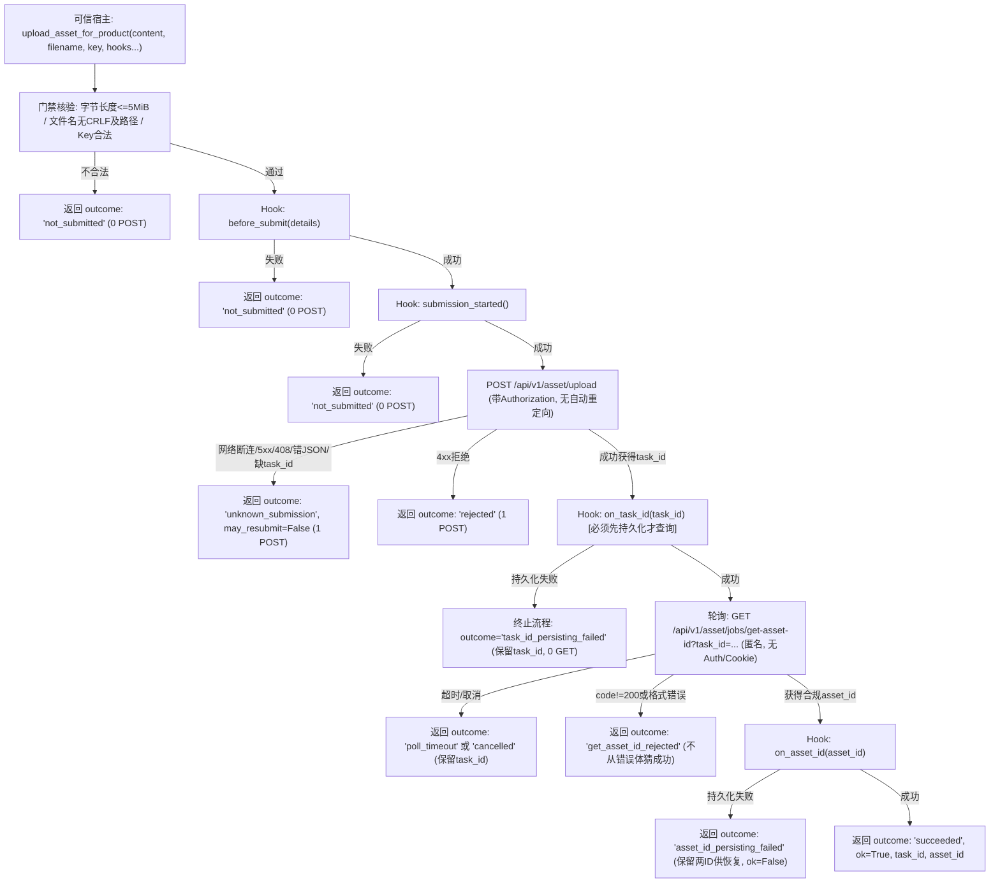

# PT 资产上传产品边界加固证据报告 (Gemini 2026-10-29)

## 1. 结论与交付概览
本包交付对现有 `shell/media/vendor/powertokens_video/pt_video.py` 资产库上传能力的复用与加固补丁。该模块提取共享的受限 Multipart 构造器与无重定向安全传输层，新增产品级确定性接口 `upload_asset_for_product`，为 Seedance 图生视频打通安全、受控的 `asset://` 素材上传凭证基础，同时保持既有 CLI `upload_asset` 命令完全向后兼容。



### 三独占新文件交付清单
1. **加固补丁**: [pt-asset-upload-product-20261029.patch](file:///Users/mmdn/Downloads/pt项目/docs/refactor/candidates/pt-asset-upload-product-20261029.patch)
2. **专项回归测试套件**: [pt-asset-upload-product-candidate-test.py](file:///Users/mmdn/Downloads/pt项目/tests/regression/pt-asset-upload-product-candidate-test.py) (27/27 PASS)
3. **证据与审计报告**: [F1-pt-asset-upload-product-gemini-20261029.md](file:///Users/mmdn/Downloads/pt项目/docs/refactor/evidence/F1-pt-asset-upload-product-gemini-20261029.md)

---

## 2. 基线哈希与补丁验证

| 文件标识 | 路径 | SHA256 哈希 | 验证状态 |
| :--- | :--- | :--- | :--- |
| **基线引擎** | `shell/media/vendor/powertokens_video/pt_video.py` | `08268f5f4e1da2782e3729498567054562d73b0c24ecab0970f861adc90f8351` | 与 `UPSTREAM.json` 中的 `engineSha256` 绝对相等 |
| **补丁文件** | `docs/refactor/candidates/pt-asset-upload-product-20261029.patch` | `ef50610080d1429b6a9bf4dfe5e576f3089802e1b055512a7531f17b4f5a4bec` | 397 行相对路径补丁 (`--- a/pt_video.py` / `+++ b/pt_video.py`) |
| **git apply 检查** | 独立临时副本 | `git apply --check pt-asset-upload-product-20261029.patch` | **退出码 0** (PASS) |
| **patch dry-run** | 独立临时副本 | `patch --dry-run -p1 -i pt-asset-upload-product-20261029.patch` | **退出码 0** (PASS) |

---

## 3. 产品级输入契约与状态流转

### 入参规范
`upload_asset_for_product(content, filename="reference.png", key=None, hooks=None, transport=None, clock=None, sleep=None, cancel_token=None, poll_timeout=120, **kwargs)`
- `content`: 必须为 `bytes` 或 `bytearray`，长度 $1 \le \text{len} \le 5\,\text{MiB}$。
- `filename`: 仅允许 `^[A-Za-z0-9_.-]{1,256}$`，严禁路径分隔符 (`/`, `\`) 及 CRLF。
- `key`: 必填字符串，不得包含换行符。
- `kwargs`: 严禁传入 `group_name`、`url`、`path` 等用户字段；意外参数一律拒绝。
- 注入参数: `transport` 支持 FakeOpener、`clock` 默认单调时钟、`sleep` 可劫持、`cancel_token` 线程安全取消。

### 返回结果结构 (可静态序列化 JSON)
```python
{
    "outcome": "succeeded | not_submitted | unknown_submission | rejected | task_id_persisting_failed | poll_timeout | cancelled | get_asset_id_rejected | get_asset_id_failed | asset_id_persisting_failed",
    "ok": bool,
    "task_id": "str 或 None",
    "asset_id": "str 或 None",
    "error_code": "str 或 None",
    "submission_may_have_started": bool,
    "may_resubmit": False,
    "byte_count": int,
    "sha256": "str",
}
```
> [!IMPORTANT]
> `may_resubmit` 在任何情况下均恒为 `False`，避免上游静默重发造成重复提交或计费冲突。

---

## 4. 安全防护与网络传输边界

1. **全局离线与传输受限**:
   - 离线门禁：测试启动即阻断底层 `socket.connect`, `socket.create_connection`, `socket.getaddrinfo`。
   - 响应体截断：真实响应体强制受限读取 $\le 128\,\text{KiB}$（`_read_bounded_asset_response`），拒绝无限 `r.read()`。
   - 严格禁止重定向：自定义 `_NoRedirectHandler` 拦截 301/302，防止凭据逃逸到第三方恶意域名。
   - 匿名轮询：GET 请求严禁附加 `Authorization` 或 `Cookie`，保持完全匿名状态。
2. **时钟单调性与超时保护**:
   - 总等待时间严格由单调时钟 `clock()` 限制 $\le 120$ 秒；单次 HTTP 超时自适应限制为 $\min(60, \text{剩余时间})$。
   - 迟到防护：在返回结果及休眠前后均校验 `deadline`，网络迟到返回的 `asset_id` 不会抹除 `poll_timeout`。
3. **格式白名单与防假冒**:
   - `task_id` 严格校验 `^[a-zA-Z0-9_.:-]{1,256}$` 并经 `urllib.parse.quote` 编码。
   - `asset_id` 严格校验 `^[A-Za-z0-9_.-]{1,256}$`。
   - 错误 Envelope 隔离：若上游返回非 200 `code`，即使 `data` 中附带 `asset_id` 亦强行拒绝，绝不推断成功。
4. **敏感信息脱敏与 PRIVATE_SENTINEL 防御**:
   - 参数错误、回调异常、网络故障等所有分支均不回显 Key、原文件名、HTTP body。
   - 已专项验证：`PRIVATE_SENTINEL` 作为 Key、文件名或回调异常内容时，绝不出现在结果或错误码中。

---

## 5. 离线回归测试验证结果

环境信息：
- **Python**: 3.13.3
- **OS / Platform**: Darwin 25.2.0 arm64 (macOS)

27 项全量专项回归测试日志：
```
test_01_multipart_fields_and_authorization (__main__.TestPtAssetUploadProduct.test_01_multipart_fields_and_authorization) ... ok
test_02_query_is_anonymous (__main__.TestPtAssetUploadProduct.test_02_query_is_anonymous) ... ok
test_03_shared_multipart_builder (__main__.TestPtAssetUploadProduct.test_03_shared_multipart_builder) ... ok
test_04_bytes_and_filename_boundaries (__main__.TestPtAssetUploadProduct.test_04_bytes_and_filename_boundaries) ... ok
test_05_hook_before_submit_order_and_zero_post (__main__.TestPtAssetUploadProduct.test_05_hook_before_submit_order_and_zero_post) ... ok
test_06_hook_submission_started_order_and_zero_post (__main__.TestPtAssetUploadProduct.test_06_hook_submission_started_order_and_zero_post) ... ok
test_07_post_network_disconnect (__main__.TestPtAssetUploadProduct.test_07_post_network_disconnect) ... ok
test_08_post_http_500_502_503_408 (__main__.TestPtAssetUploadProduct.test_08_post_http_500_502_503_408) ... ok
test_09_post_http_400_rejected (__main__.TestPtAssetUploadProduct.test_09_post_http_400_rejected) ... ok
test_10_post_malformed_json (__main__.TestPtAssetUploadProduct.test_10_post_malformed_json) ... ok
test_11_post_missing_or_invalid_task_id (__main__.TestPtAssetUploadProduct.test_11_post_missing_or_invalid_task_id) ... ok
test_12_on_task_id_failure_halts_polling (__main__.TestPtAssetUploadProduct.test_12_on_task_id_failure_halts_polling) ... ok
test_13_pending_to_asset_success (__main__.TestPtAssetUploadProduct.test_13_pending_to_asset_success) ... ok
test_14_error_envelope_with_asset_id_rejected (__main__.TestPtAssetUploadProduct.test_14_error_envelope_with_asset_id_rejected) ... ok
test_15_get_http_error_retries_until_success (__main__.TestPtAssetUploadProduct.test_15_get_http_error_retries_until_success) ... ok
test_16_get_oversized_response_rejected (__main__.TestPtAssetUploadProduct.test_16_get_oversized_response_rejected) ... ok
test_17_asset_id_format_validation (__main__.TestPtAssetUploadProduct.test_17_asset_id_format_validation) ... ok
test_18_monotonic_timeout (__main__.TestPtAssetUploadProduct.test_18_monotonic_timeout) ... ok
test_19_late_success_does_not_override_timeout (__main__.TestPtAssetUploadProduct.test_19_late_success_does_not_override_timeout) ... ok
test_20_cancellation_before_post (__main__.TestPtAssetUploadProduct.test_20_cancellation_before_post) ... ok
test_21_cancellation_during_polling (__main__.TestPtAssetUploadProduct.test_21_cancellation_during_polling) ... ok
test_22_no_redirect_handler_intercepts_redirects (__main__.TestPtAssetUploadProduct.test_22_no_redirect_handler_intercepts_redirects) ... ok
test_23_on_asset_id_failure_retains_ids_for_recovery (__main__.TestPtAssetUploadProduct.test_23_on_asset_id_failure_retains_ids_for_recovery) ... ok
test_24_private_sentinel_never_leaked (__main__.TestPtAssetUploadProduct.test_24_private_sentinel_never_leaked) ... ok
test_25_cli_upload_asset_backward_compatibility (__main__.TestPtAssetUploadProduct.test_25_cli_upload_asset_backward_compatibility) ... ok
test_26_cli_upload_asset_with_group_name (__main__.TestPtAssetUploadProduct.test_26_cli_upload_asset_with_group_name) ... ok
test_27_may_resubmit_is_always_false (__main__.TestPtAssetUploadProduct.test_27_may_resubmit_is_always_false) ... ok

----------------------------------------------------------------------
Ran 27 tests in 0.033s

OK
```

---

## 6. 宿主集成声明与上游费用免责
- **费用免责声明**: 现有 vendor 注释中的“上传免费，不扣 credits”仅作为**上游实现说明**，未经线上真实生产账单测试核实；本候选模块绝不主动填充 `cost=0`，不作为费用验收证明。
- **外部副作用边界**: 资产库上传属于独立于视频生成的外部副作用。主 Agent 在后续接线时须独立建立上传意图账本，不共用或侵占生成任务的 POST 额度。
- **未启用状态**: 补丁保存在 `docs/refactor/candidates/` 下，未直接修改 `shell/media/vendor/` 现有代码，等待主 Agent 审阅并决定上游合并时机。
