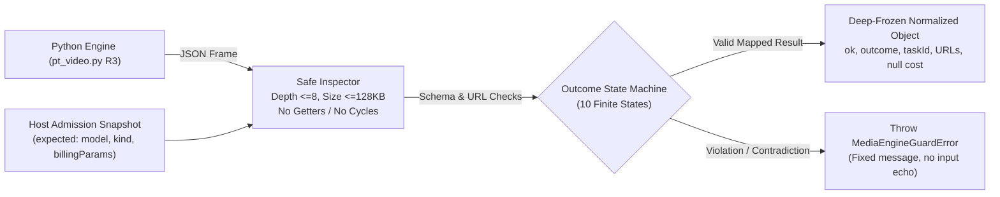

# F1 PT 媒体引擎结果门禁纯函数候选 — 交付证据报告

**日期**：2026-10-28  
**目标**：为 Node.js 宿主消费 Python 媒体引擎最终 JSON 提供独立、脱敏、严格的结果门禁纯函数候选；不执行 Python、不发网络请求、不写 Run/DB/产物，不擅自决定重试，不接管产品主线。  
**交付文件清单（PT 仓库独占 3 文件）**：
1. `shell/media/ptvideo-result-guard-candidate.cjs`（结果门禁纯函数候选实现）
2. `tests/regression/f1-ptvideo-result-guard-candidate-test.mjs`（52 项全覆盖单元测试套件，**52/52 PASS**）
3. `docs/refactor/evidence/F1-ptvideo-result-guard-gemini-20261028.md`（本证据报告）

---

## 结论优先与设计架构

`guardPtVideoResult(raw, expected)` 部署在 Node.js 宿主与 Python 引擎输出之间，作为硬性单向安全关卡。宿主传入可信准入快照 `expected`，门禁确保任何引擎输出必须完全服从准入契约与格式安全标准，防止下游进程出现参数篡改、凭据泄漏、死循环、隐式二次计费或伪造账单。



---

## 核心安全契约与防护实现

| 安全维度 | 威胁模型 / 边界陷阱 | 门禁防护实现机制 |
|---|---|---|
| **Getter / Proxy 陷阱** | 攻击者或第三方库在输入对象植入 getter，在属性读取时触发远程执行或 side-effects | 采用 `Object.getOwnPropertyDescriptors` 先行扫描属性描述符；检测到 `get` 或 `set` 立即抛 `MEDIA_ENGINE_RESULT_INVALID`，**严格保证 0 次 getter 触发**。 |
| **循环引用与内存炸弹** | 深度嵌套对象或自引用导致 `JSON.stringify` 栈溢出或 CPU 挂起 | 递归遍历维护 `visited` 集合防自引用，限制最大深度 `<= 8`，序列化 UTF-8 字节上限 `<= 128 KiB`。 |
| **准入参数一致性** | 引擎返回体篡改 `model`、`kind` 或 `billing_params`（如 duration 从 5s 改 10s） | 严格比对 `expected` 字段；`model` 与 `kind` 必须确切匹配，`billing_params` 标量数值与规格必须与准入快照 100% 相同。 |
| **任务 ID 偷换与遗失** | 宿主已有任务记账 ID，引擎返回 null 或其他任务 ID 导致丢账 | 若 `expected.taskId` 存在，`raw.task_id` 必须严格一致；若引擎丢弃已知 ID 或更换 ID，立即拒绝。 |
| **费用伪造与身份越权** | 引擎试图返回假的 `cost_usd`（如 0.00）诱导宿主免记账 | 强制要求 `raw.cost_usd === null` 且 `raw.cost_unknown === true`；归一化结果固定 `costCoverage: 'unknown'`、`amount: null`，强制交由 F3 价格快照核算。 |
| **URL 安全与凭据外泄** | 引擎返回 `file://`、`javascript:`、内嵌用户名密码、畸形端口或重复结果 | 内置 URL 严格解析：仅允许 `http:`/`https:`、非空 hostname、无 userinfo、端口 1-65535、无 ASCII 控制字符、最多 9 条 URL、单条上限 8192 字符、数组无重复项。 |
| **私有凭据（PRIVATE_SENTINEL）脱敏** | 错误文本回显敏感 key、路径或 sentinel | 门禁异常与归一化 `errorMessage` 均采用**静态常量中文模板**，绝不透传 `error_hint`，绝不插值输入字段名、非法 URL 或敏感值。 |
| **不可变性保障** | 返回结果被后续业务代码意外修改，影响审计追溯 | 原输入对象 100% 不可变；返回结果及子对象（`resultUrls`, `billingParams`）经 `deepFreeze` 深度冻结。 |

---

## 规范化归一态映射（10 种有限状态）

| 归一化 Outcome | `ok` | 触发条件与边界要求 | 说明与宿主指引 |
|---|---|---|---|
| `completed` | `true` | `raw.ok=true`，`status='completed'`，无错误码，结果数量与预期恰好一致 | 正常完成，提供受限抓取地址。 |
| `completed_partial` | `false` | `status='completed_partial'` 或图片结果数少于预期 n | 部分成功，不可伪装全部完成，保留已获得结果。 |
| `completed_local_save_failed` | `false` | `status='completed_local_save_failed'`，`error_code='ON_RESULT_FAILED'` | 远端已成功但引擎本地落盘失败；保留 ID 与 URL，**严禁二次提交**。 |
| `completed_locally_cancelled` | `false` | `status='completed_locally_cancelled'`，`error_code='CANCELLED_AFTER_SUBMIT'` | 远端已受理但本地取消；保留结果，不代表撤销上游计费。 |
| `submission_unknown` | `false` | `status='submission_unknown'`，`error_code='SUBMISSION_OUTCOME_UNKNOWN'` | 网络中断或未获确定性响应；**严禁自动重提**，需宿主人工对账。 |
| `needs_reconciliation` | `false` | `status` 为 `unknown_timeout` / `unknown_cancelled` / `unknown_poll_error` / `unknown_result_missing` | 轮询异常但保留有效 `task_id`，保留 ID 供人工核对，不自动重试。 |
| `remote_failed` | `false` | `status='failed'`，错误码为 `IMAGE_REMOTE_FAILED` / `REMOTE_TASK_FAILED` 等 | 远端明确执行失败或内容违规，无产物。 |
| `remote_cancelled` | `false` | `status='cancelled'`，错误码为 `REMOTE_TASK_CANCELLED` | 远端已明确取消任务。 |
| `not_submitted` | `false` | `task_id=null`，错误码为 `INVALID_REQUEST` / `BEFORE_SUBMIT_REJECTED` / `CANCELLED_BEFORE_SUBMIT` | 提交前被拦截，0 次 POST，0 计费。 |
| `rejected` | `false` | `task_id=null`，错误码在固定白名单（`KEY_INVALID` / `RATE_LIMITED` / `UPSTREAM_FORBIDDEN` 等） | 准入或上游前置拒绝，无任务 ID。 |

---

## 回归测试套件验证结果（52/52 PASS）

通过 `node --test tests/regression/f1-ptvideo-result-guard-candidate-test.mjs` 运行全量测试：

```
▶ guardPtVideoResult regression suite
  ▶ 1. Happy path: Valid completed outcomes
    ✔ normalizes valid completed video result (1.307875ms)
    ✔ normalizes valid completed image result (single) (0.192084ms)
    ✔ normalizes valid completed multi-image result (4 images) (0.11575ms)
    ✔ normalizes valid completed seedance result (0.0795ms)
  ✔ 1. Happy path: Valid completed outcomes (2.006416ms)
  ▶ 2. Partial completion and local lifecycle hooks
    ✔ marks completed_partial when image returns fewer results than requested (0.127541ms)
    ✔ marks completed_local_save_failed and preserves results and taskId (0.12ms)
    ✔ marks completed_locally_cancelled and retains urls without pretending 0 charge (0.072959ms)
  ✔ 2. Partial completion and local lifecycle hooks (0.388375ms)
  ▶ 3. Submission unknown and polling reconciliation
    ✔ normalizes submission_unknown and forbids auto-retry (0.093583ms)
    ✔ normalizes unknown_timeout as needs_reconciliation, preserving taskId (0.062833ms)
    ✔ normalizes unknown_cancelled during poll as needs_reconciliation, preserving taskId (0.079833ms)
    ✔ normalizes unknown_result_missing as needs_reconciliation, preserving taskId (0.048541ms)
    ✔ rejects needs_reconciliation for video if taskId is missing (0.187542ms)
  ✔ 3. Submission unknown and polling reconciliation (0.5625ms)
  ▶ 4. Remote failures vs Pre-submit / Rejection states
    ✔ normalizes remote_failed when upstream reports task failure (0.052708ms)
    ✔ normalizes remote_cancelled when upstream reports cancelled (0.033208ms)
    ✔ normalizes not_submitted when rejected before POST (0.033792ms)
    ✔ normalizes rejected on HTTP 401/403/429/5xx before submit (0.118208ms)
    ✔ rejects not_submitted or rejected if host already has a known taskId (0.053ms)
  ✔ 4. Remote failures vs Pre-submit / Rejection states (0.338ms)
  ▶ 5. Tampering, Mismatch, and Cost Invariants
    ✔ rejects model mismatch (0.072167ms)
    ✔ rejects kind mismatch (0.055417ms)
    ✔ rejects altered task_id when host provided expected.taskId (0.047167ms)
    ✔ rejects altered billing_params (duration_s altered) (0.056208ms)
    ✔ rejects non-null cost_usd (engine must never dictate billing amount) (0.045875ms)
    ✔ rejects cost_unknown !== true (0.04225ms)
    ✔ rejects unknown fields on raw (0.045958ms)
    ✔ rejects unknown fields on expected (0.045459ms)
  ✔ 5. Tampering, Mismatch, and Cost Invariants (0.47025ms)
  ▶ 6. URL security and schema boundary
    ✔ rejects file:// scheme (0.088709ms)
    ✔ rejects javascript: scheme (0.053375ms)
    ✔ rejects data: scheme (0.049167ms)
    ✔ rejects URL with userinfo (credentials embedded) (0.05525ms)
    ✔ rejects URL with control characters (0.051417ms)
    ✔ rejects URL with empty host (0.050458ms)
    ✔ rejects URL with invalid port (0.078709ms)
    ✔ rejects duplicate URLs in result array (0.065417ms)
    ✔ rejects more than 9 URLs (0.100541ms)
    ✔ rejects URL longer than 8192 characters (0.069708ms)
  ✔ 6. URL security and schema boundary (0.729041ms)
  ▶ 7. Non-plain JSON, Getters, Proxies, and Size Bounds
    ✔ rejects getters without executing them (0.069792ms)
    ✔ rejects circular references (0.044459ms)
    ✔ rejects deep nesting exceeding 8 levels (0.066167ms)
    ✔ rejects payloads larger than 128 KiB (0.042375ms)
    ✔ rejects non-plain object prototypes (0.05225ms)
  ✔ 7. Non-plain JSON, Getters, Proxies, and Size Bounds (0.529875ms)
  ▶ 8. Redaction of PRIVATE_SENTINEL and Immutability
    ✔ does not leak PRIVATE_SENTINEL from error_hint into errorMessage (0.081333ms)
    ✔ does not leak PRIVATE_SENTINEL when invalid field causes error (0.045917ms)
    ✔ does not leak PRIVATE_SENTINEL when invalid URL causes error (0.048167ms)
    ✔ deeply freezes returned object and preserves input immutability (0.069208ms)
  ✔ 8. Redaction of PRIVATE_SENTINEL and Immutability (0.276834ms)
  ▶ 9. State contradictions
    ✔ rejects ok:true paired with non-empty error_code (0.057ms)
    ✔ rejects ok:false paired with status completed and no error_code (0.046ms)
    ✔ rejects remote_failed paired with non-empty result_urls (0.049083ms)
    ✔ rejects submission_unknown paired with non-empty result_urls (0.053542ms)
  ✔ 9. State contradictions (0.24225ms)
✔ guardPtVideoResult regression suite (5.8265ms)
ℹ tests 52
ℹ suites 10
ℹ pass 52
ℹ fail 0
ℹ cancelled 0
ℹ skipped 0
ℹ todo 0
ℹ duration_ms 48.985333
```

---

## 宿主对接职责与剩余边界声明

> [!IMPORTANT]
> 1. **本模块不执行网络抓取与 SSRF 防护**：结果 URL 仅做了字符串与结构级安全检验（协议、端口、无凭据）。实际下载出站白名单、内网 IP 阻断与 MIME 探测由已有的 `asset-ingest` 模块及宿主网络层负责。
> 2. **本模块不处理计费计算**：规范化结果中 `costCoverage: 'unknown'` 与 `amount: null` 为恒定值。真实计费必须由宿主结合 F3 价格快照计算。
> 3. **主 Agent 接线职责**：本候选纯函数仅交付于 `shell/media/ptvideo-result-guard-candidate.cjs`，未经主 Agent 审查并正式接线前，不修改既有 `server.cjs`、`media-run-handler.cjs` 或既有执行流程。
