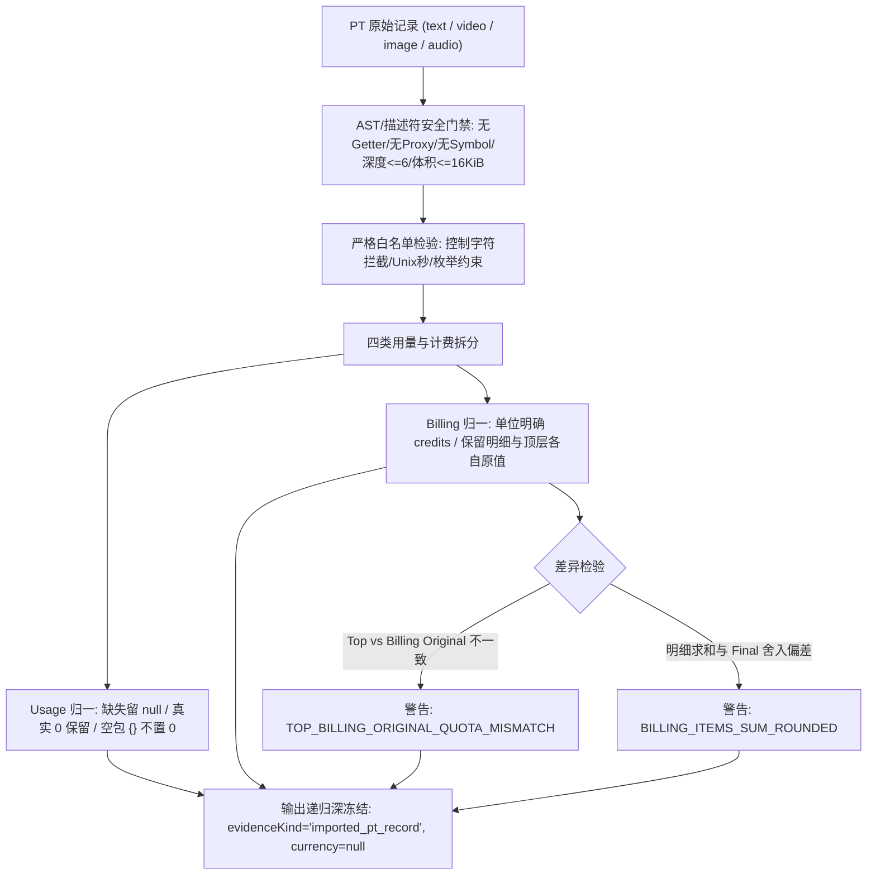

# PT 消费记录归一候选证据报告 (F3 / Gemini 2026-10-28)

## 1. 结论与交付概览
本包交付 PT 现有四类消费记录（text / video / image / audio）的数据归一化纯函数候选 `normalizePtConsumeRecord(raw)`。该函数作为未来 F3 对账与费用分析的数据清洗层，在不等待外部开放 API、不修改既有 Run 状态与数据库的前提下，提供确定性、无副作用、深冻结的规范化账单凭据快照。



### 三独占新文件交付清单
1. **归一化纯函数候选**: [pt-consume-record-candidate.cjs](file:///Users/mmdn/Downloads/pt项目/shell/usage/pt-consume-record-candidate.cjs)
2. **专项回归测试套件**: [f3-pt-consume-record-candidate-test.mjs](file:///Users/mmdn/Downloads/pt项目/tests/regression/f3-pt-consume-record-candidate-test.mjs) (30/30 PASS)
3. **证据与审计报告**: [F3-pt-consume-record-gemini-20261028.md](file:///Users/mmdn/Downloads/pt项目/docs/refactor/evidence/F3-pt-consume-record-gemini-20261028.md)

---

## 2. 字段与枚举白名单规范

| 结构层级 | 字段名 | 允许类型 / 格式 | 语义与规范化策略 |
| :--- | :--- | :--- | :--- |
| **Root** | `consume_id` / `request_id` | `string` (1..256), 无控制字符 | 必须项，原样输出为 `consumeId` / `requestId`。 |
| **Root** | `task_id` | `string` (0..512) 或 `null` | 可选项，空字符串或全空白字符严格归一化为 `null`。 |
| **Root** | `endpoint` / `provider_name` | `string` (1..256), 无控制字符 | 必须项，映射为 `endpoint` / `providerName`。 |
| **Root** | `model_id` / `model_name` | `string` (1..256), 无控制字符 | 仅代表 PT 报告模型，不推断真实物理上游；`model_name` 缺失置 `null`。 |
| **Root** | `consume_time` | 安全整数 Unix 秒 | 转换为标准 UTC ISO 8601 字符串 `consumedAt`，零时钟读取。 |
| **Root** | `request_type` | `text` \| `video` \| `image` \| `audio` | 严格四类枚举；非法类型一律拒绝。 |
| **Usage** | `input_tokens` / `output_tokens` / `total_tokens` / `characters` / `cached_tokens` / `cache_read_tokens` / `cache_creation_tokens` | 非负安全整数 或 `null` | 严格已知白名单；未知字段抛错；缺失字段保持 `null`（绝不填 0），真实 `0` 绝对保留。 |
| **Billing** | `billing_unit` | `per_tokens` \| `per_image` \| `per_characters` | 计费单位；`unit` 明确标记为 `credits`，不做货币转换（`currency: null`）。 |
| **Billing** | `items` | Array ($\le 32$ 项) | 每项包含 `name`, `quantity`, `unit_quota`, `unit_label`, `subtotal_quota`；数量支持小数，有限非负。 |
| **Billing** | `formula` | `string` ($\le 512$) 或 `null` | 保留原始计费公式字符串，**严禁 eval/执行**，不以公式反推单价。 |

---

## 3. 四类真实格式夹具对齐验证

| 类别 | 核心入参特征 | Usage 输出 | Billing 原值与差异警告 |
| :--- | :--- | :--- | :--- |
| **1. Text**<br>`seed-2-0-pro-260328` | tokens: 1642 in / 1486 out / 3128 total; 3 items (input, cache, output) | `inputTokens: 1642`<br>`outputTokens: 1486`<br>`totalTokens: 3128` | items 求和 5.015 vs final 6，保留原值并触发 `BILLING_ITEMS_SUM_ROUNDED` 警告。 |
| **2. Video**<br>`dreamina-seedance-2-0-mini-260615` | `usage: {}`, `task_id` 非空; top `original_quota: 148` vs billing `original_quota: 150` | 全部 token 指标保持 `null`（不置 0） | 两处 original_quota 分别保留为 `topOriginalQuota: 148` 与 `originalQuota: 150`；输出 `TOP_BILLING_ORIGINAL_QUOTA_MISMATCH` 警告。 |
| **3. Image**<br>`wan2.7-image-pro` | `usage: {}`, `task_id: ""`, unit `per_image`, qty 1, subtotal 71.25, final 72 | 全部 token 指标保持 `null`，`taskId: null` | 保留 `per_image` 计量；71.25 vs 72 触发 `BILLING_ITEMS_SUM_ROUNDED` 警告。 |
| **4. Audio**<br>`speech-2.8-hd` | `usage: { characters: 235 }`, unit `per_characters`, unit_size 1000, final 23 | `characters: 235`<br>其余为 `null` | items 求和 22.325 vs final 23 正常舍入，触发 `BILLING_ITEMS_SUM_ROUNDED`。 |

---

## 4. 安全防护与脱敏审计

1. **AST 与描述符级安全拦截**:
   - `types.isProxy` 优先探测：支持活跃 Proxy 与 **revoked Proxy**，拒绝进入任何 trap，避免触发访问器或产生未捕获异常。
   - `Object.getOwnPropertyDescriptors` 扫描：直接阻断 getter/setter 声明，访问器函数零执行。
   - 结构完整性：禁止 Symbol、非 plain object 原型、稀疏数组、循环与跨实体共享引用。
2. **硬边界限制**:
   - Payload 体积 $\le 16\,\text{KiB}$，深度 $\le 6$，billing items $\le 32$ 项。
   - 控制字符拦截：ASCII 0-31 及 127 字符（如 `\x00`, `\n`, `\r`）在 ID 及文本字段中直接拒绝。
3. **固定错误码与敏感信息脱敏**:
   - 错误码统一为 `PT_CONSUME_RECORD_INVALID`。
   - 错误消息采用完全静态的常量字面量，不回显任何字段名、路径或字段值，已通过 `PRIVATE_SENTINEL` 攻击测试。

---

## 5. 离线回归测试验证结果

30 项全量专项回归测试执行日志：
```
✔ 1. fixture text: full normalization of text consumption record (1.563291ms)
✔ 2. fixture video: retains usage {} and preserves top vs billing original quota discrepancy (0.128625ms)
✔ 3. fixture image: empty usage and per_image billing unit with rounding (0.099792ms)
✔ 4. fixture audio: characters usage and per_characters billing unit (0.085875ms)
✔ 5. usage metrics: missing values remain null and genuine zeros are preserved (0.088083ms)
✔ 6. task_id normalization: empty and whitespace strings normalize to null (0.487416ms)
✔ 7. time conversion: Unix seconds convert deterministically to UTC ISO 8601 (0.112ms)
✔ 8. currency and exchangeRate strictly null, credits only (0.100583ms)
✔ 9. missing required root fields throws invalid error (0.507292ms)
✔ 10. invalid request_type throws invalid error (0.125834ms)
✔ 11. invalid billing_unit throws invalid error (0.092292ms)
✔ 12. negative and non-finite numbers throw invalid error (0.146083ms)
✔ 13. unknown root fields are rejected (0.058959ms)
✔ 14. unknown usage fields are rejected (0.052083ms)
✔ 15. unknown billing fields are rejected (0.053667ms)
✔ 16. unknown billing item fields are rejected (0.065208ms)
✔ 17. formula is preserved as safe text and never evaluated (0.059292ms)
✔ 18. items count exceeding 32 is rejected (0.11425ms)
✔ 19. oversized payload exceeding 16 KiB is rejected (0.064958ms)
✔ 20. payload depth exceeding 6 is rejected (0.079417ms)
✔ 21. control characters in strings are rejected (0.096458ms)
✔ 22. getter execution protection: getters are detected and NOT executed (0.054792ms)
✔ 23. proxy trap protection: Proxy is detected and rejected without invoking trap (0.03975ms)
✔ 24. revoked proxy protection: revoked Proxy is rejected with fixed error code (0.053292ms)
✔ 25. circular reference is rejected (0.045916ms)
✔ 26. shared object reference across fields is rejected (0.050125ms)
✔ 27. symbol properties are rejected (0.030333ms)
✔ 28. explicit undefined values are rejected in pure JSON (0.039833ms)
✔ 29. PRIVATE_SENTINEL redaction: error messages never leak sentinel key or value (0.084833ms)
✔ 30. immutability and deep freeze: input untouched and output deeply frozen (0.084458ms)
ℹ tests 30
ℹ suites 0
ℹ pass 30
ℹ fail 0
ℹ cancelled 0
ℹ skipped 0
ℹ todo 0
ℹ duration_ms 43.5075
```

---

## 6. 宿主集成声明
- **非产品接入声明**: 本候选函数为**数据清洗与归一化计算单元**，未与数据库、实时 Run 执行引擎或费用对账管道进行物理接线。
- **免责与假设**: `reportedModelId` 仅反映上游 PT 记录上报的标识，不构成物理模型真实性背书，亦不可用作任务成功与否或重试许可依据。
- **对账前置**: 未来 F3 对账逻辑接线时，需在此规范化输出基础上进行幂等索引与事务写入。
