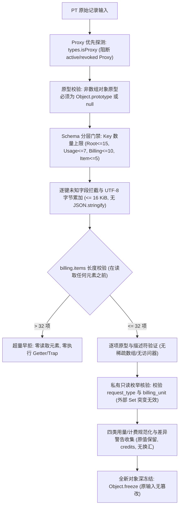

# PT 消费记录归一候选证据报告 (F3 / R2 独立修正包 / Gemini 2026-10-29)

## 1. 结论与交付概览
本包针对主 Agent 只读主审在 R1 交付中复现的两项反例及资源早拒门禁缺口，独立提供 R2 修正候选模块 `normalizePtConsumeRecord(raw)`。本候选完全保留上一版本全部功能、夹具、差异警告和对外契约，不修改或覆盖 R1 既有交付文件，不修改主线业务代码，不连网、不装依赖、不碰数据库。



### 三独占新文件交付清单
1. **R2 归一化纯函数候选**: [pt-consume-record-r2-candidate.cjs](file:///Users/mmdn/Downloads/pt项目/shell/usage/pt-consume-record-r2-candidate.cjs)
2. **R2 专项回归测试套件**: [f3-pt-consume-record-r2-candidate-test.mjs](file:///Users/mmdn/Downloads/pt项目/tests/regression/f3-pt-consume-record-r2-candidate-test.mjs) (40/40 PASS)
3. **证据与审计报告**: [F3-pt-consume-record-r2-gemini-20261029.md](file:///Users/mmdn/Downloads/pt项目/docs/refactor/evidence/F3-pt-consume-record-r2-gemini-20261029.md)

---

## 2. 主审反例根因与 R2 架构加固对策

### 反例 1：原型逃逸（Array.prototype 伪装对象）
- **根因**: R1 扫描时使用 `if (proto !== Object.prototype && proto !== null && proto !== Array.prototype)`，将 `Array.prototype` 作为合法原型统一放行，而后续对普通对象的校验仅判断 `!Array.isArray(usage)`。使用 `Object.assign(Object.create(Array.prototype), { input_tokens: 1 })` 创建的伪对象既不是真正的 Array 实例，却具有 `Array.prototype`，因而逃逸进入业务层。
- **R2 加固**: 严格分立数组与普通对象的原型限制。所有非数组对象（root、usage、billing、item）的原型**必须严格为 `Object.prototype` 或 `null`**；全结构中仅允许 `billing.items` 为数组，且其实例原型必须严格为 `Array.prototype`，彻底封堵伪装原型与自定义子类。

### 反例 2：公开 Set 集合可变性逃逸
- **根因**: R1 导出的 `VALID_REQUEST_TYPES` 使用 `Object.freeze(new Set([...]))`。在 JavaScript 标准中，`Object.freeze` 仅冻结对象自有属性，`Set.prototype.add` 操作内部插槽不受影响。外部调用 `VALID_REQUEST_TYPES.add('fixture_invalid_type')` 会直接篡改该模块共享集合，导致后续内部校验通过非法枚举。
- **R2 加固**: 枚举私有化。内部校验采用完全隔离的私有常量 `PRIVATE_VALID_REQUEST_TYPES` 与模块内部只读 Set，不对外暴露引用。导出的公开枚举为独立副本，外部调用 `.add()` 或 `.delete()` 绝不会对内部校验造成任何影响。

### 门禁缺陷 3：超量与深遍历无法证明“早拒”
- **根因**: R1 先对任意对象执行全量 `Object.getOwnPropertyDescriptors` 扫描，并在结尾才调用 `JSON.stringify` 统计大小，如果存在超长 items 或巨型对象，系统先耗费大量计算与内存甚至触发继承 `toJSON` 副作用后才报错。
- **R2 加固**:
  1. **精确分层字段配额**: Root $\le 15$、Usage $\le 7$、Billing $\le 10$、Item $\le 5$。在提取任何属性描述符前优先检验自有键数量，超出即拒绝。
  2. **Items 读前判长**: 对 `billing.items`，首先读取 `length` 描述符，一旦 $> 32$ 立即拒绝，**绝不读取下标 0 或后续元素**。测试证实即使第 0 项包含恶意 Proxy Trap 或 Getter，也保证零执行。
  3. **增量 UTF-8 字节统计**: 在逐键扫描过程中累加字段名与值的实际字节数，达 16 KiB 立即早拒；**彻底废除在未验证输入上调用 `JSON.stringify`**，防范原型链继承 `toJSON` 的隐式执行。

---

## 3. 40 项全量专项回归测试明细表

| 序号 | 测试分类 | 测试用例场景描述 | 预期结果与断言重点 | 状态 |
| :--- | :--- | :--- | :--- | :--- |
| 1 | Baseline | fixture text: 完整文本消费归一化 | token 与 items 对齐，警告 BILLING_ITEMS_SUM_ROUNDED | PASS |
| 2 | Baseline | fixture video: 保留空 usage 与配额差异 | usage 保留为 null，记录 TOP_BILLING_ORIGINAL_QUOTA_MISMATCH | PASS |
| 3 | Baseline | fixture image: empty usage 与 per_image | 保留 per_image 单位与小数舍入警告 | PASS |
| 4 | Baseline | fixture audio: characters usage | 保留 characters 与 per_characters 费率 | PASS |
| 5 | Baseline | usage metrics: null 与真实 0 保留 | 缺失置 null，真实 0 绝不变成 null 或缺失 | PASS |
| 6 | Baseline | task_id normalization | 空字符串或空白字符归一化为 null | PASS |
| 7 | Baseline | time conversion: Unix 秒转 UTC ISO | 确定性转为 UTC ISO 8601，零时钟读取 | PASS |
| 8 | Baseline | currency/exchangeRate 严格为 null | 计费单位强制 credits，绝不换汇 | PASS |
| 9 | Baseline | missing required root fields | 缺失必填字段抛出 PT_CONSUME_RECORD_INVALID | PASS |
| 10 | Baseline | invalid request_type | 非四类合法 request_type 拒绝 | PASS |
| 11 | Baseline | invalid billing_unit | 非法 billing_unit 拒绝 | PASS |
| 12 | Baseline | negative and non-finite numbers | 负数、NaN、Infinity 严格拒绝 | PASS |
| 13 | Baseline | unknown root fields | 根对象包含未知键直接拦截 | PASS |
| 14 | Baseline | unknown usage fields | usage 包含未知指标直接拦截 | PASS |
| 15 | Baseline | unknown billing fields | billing 包含未知键直接拦截 | PASS |
| 16 | Baseline | unknown billing item fields | item 包含未知键直接拦截 | PASS |
| 17 | Baseline | formula safe text | 计费公式仅存纯文本，严禁 eval 执行 | PASS |
| 18 | Baseline | items count exceeding 32 | items 超过 32 项立即拒绝 | PASS |
| 19 | Baseline | oversized payload > 16 KiB | payload 体积超过 16 KiB 立即拒绝 | PASS |
| 20 | Baseline | payload depth exceeding 6 | 嵌套深度超过 6 层立即拒绝 | PASS |
| 21 | Baseline | control characters in strings | 字符串包含 ASCII 0-31/127 控制符拒绝 | PASS |
| 22 | Baseline | getter execution protection | 声明 getter 立即拦截，零执行 | PASS |
| 23 | Baseline | proxy trap protection | 活跃 Proxy 立即识别，零触发 trap | PASS |
| 24 | Baseline | revoked proxy protection | revoked Proxy 安全拦截，不抛未捕获 TypeError | PASS |
| 25 | Baseline | circular reference | 循环引用直接拦截 | PASS |
| 26 | Baseline | shared reference across fields | 跨实体共享对象引用直接拦截 | PASS |
| 27 | Baseline | symbol properties | 包含 Symbol 键直接拒绝 | PASS |
| 28 | Baseline | explicit undefined values | 包含 undefined 显式属性拒绝 | PASS |
| 29 | Baseline | PRIVATE_SENTINEL redaction | 错误信息完全静态，绝不回显敏感内容 | PASS |
| 30 | Baseline | immutability and deep freeze | 输入对象无篡改，返回对象全层 deepFreeze | PASS |
| 31 | **R2 反例1** | **usage 包含 Array.prototype 伪装对象** | **拦截非 plain 对象，抛出 PT_CONSUME_RECORD_INVALID** | **PASS** |
| 32 | **R2 反例2** | **外部突变 VALID_REQUEST_TYPES.add** | **外部 Set 变异对内部校验完全隔离，非法类型依然被拒** | **PASS** |
| 33 | **R2 防御** | **外部突变 VALID_BILLING_UNITS.add** | **外部单位变异完全隔离，非法单位依然被拒** | **PASS** |
| 34 | **R2 防御** | **非 plain root / billing / item 原型拦截** | **Map/Date/Array 等外来原型一律拦截** | **PASS** |
| 35 | **R2 防御** | **billing.items 数组伪装与子类拦截** | **自定义 Array 子类与伪装伪数组一律拒绝** | **PASS** |
| 36 | **R2 防御** | **除 billing.items 外任意位置出现数组** | **root/usage/billing 顶层为数组一律拒绝** | **PASS** |
| 37 | **R2 门禁** | **33 items 读前早拒 (首项含 Trap/Getter)** | **早拒触发，首项 Proxy Trap 与 Getter 零执行** | **PASS** |
| 38 | **R2 门禁** | **各层 Key 超量早拒 (不扫描描述符)** | **超额字段数在提取描述符前直接拒绝** | **PASS** |
| 39 | **R2 防御** | **继承 toJSON 零执行** | **废除 JSON.stringify，原型链 toJSON 零执行** | **PASS** |
| 40 | **R2 门禁** | **增量 UTF-8 字节累加超 16 KiB 早拒** | **扫描过程动态累加，超限立即中止** | **PASS** |

---

## 4. 离线回归测试验证结果

环境信息：
- **Node.js**: v24.14.0
- **OS / Platform**: Darwin 25.2.0 arm64 (macOS)

40 项测试全量执行日志：
```
✔ 1. fixture text: full normalization of text consumption record (1.488667ms)
✔ 2. fixture video: retains usage {} and preserves top vs billing original quota discrepancy (0.127042ms)
✔ 3. fixture image: empty usage and per_image billing unit with rounding (0.092667ms)
✔ 4. fixture audio: characters usage and per_characters billing unit (0.072125ms)
✔ 5. usage metrics: missing values remain null and genuine zeros are preserved (0.084125ms)
✔ 6. task_id normalization: empty and whitespace strings normalize to null (0.517708ms)
✔ 7. time conversion: Unix seconds convert deterministically to UTC ISO 8601 (0.1025ms)
✔ 8. currency and exchangeRate strictly null, credits only (0.07ms)
✔ 9. missing required root fields throws invalid error (0.359375ms)
✔ 10. invalid request_type throws invalid error (0.08925ms)
✔ 11. invalid billing_unit throws invalid error (0.068709ms)
✔ 12. negative and non-finite numbers throw invalid error (0.101583ms)
✔ 13. unknown root fields are rejected (0.057958ms)
✔ 14. unknown usage fields are rejected (0.040125ms)
✔ 15. unknown billing fields are rejected (0.033833ms)
✔ 16. unknown billing item fields are rejected (0.034917ms)
✔ 17. formula is preserved as safe text and never evaluated (0.044125ms)
✔ 18. items count exceeding 32 is rejected (0.052125ms)
✔ 19. oversized payload exceeding 16 KiB is rejected (0.049959ms)
✔ 20. payload depth exceeding 6 is rejected (0.045417ms)
✔ 21. control characters in strings are rejected (0.066583ms)
✔ 22. getter execution protection: getters are detected and NOT executed (0.03525ms)
✔ 23. proxy trap protection: Proxy is detected and rejected without invoking trap (0.033584ms)
✔ 24. revoked proxy protection: revoked Proxy is rejected with fixed error code (0.045917ms)
✔ 25. circular reference is rejected (0.026167ms)
✔ 26. shared object reference across fields is rejected (0.027667ms)
✔ 27. symbol properties are rejected (0.02625ms)
✔ 28. explicit undefined values are rejected in pure JSON (0.025708ms)
✔ 29. PRIVATE_SENTINEL redaction: error messages never leak sentinel key or value (0.06325ms)
✔ 30. immutability and deep freeze: input untouched and output deeply frozen (0.092417ms)
✔ 31. R2 counterexample 1: non-plain object in usage with Array.prototype is rejected (0.037042ms)
✔ 32. R2 counterexample 2: external mutation of VALID_REQUEST_TYPES cannot bypass validation (0.046459ms)
✔ 33. R2: external mutation of VALID_BILLING_UNITS cannot bypass validation (0.044166ms)
✔ 34. R2: non-plain root, billing, and item prototypes are rejected (0.08025ms)
✔ 35. R2: array disguise and array subclasses in billing.items are rejected (0.062708ms)
✔ 36. R2: arrays anywhere other than billing.items are rejected (0.058875ms)
✔ 37. R2: 33 items early rejection with zero trap and zero getter execution on item 0 (0.065041ms)
✔ 38. R2: excessive key counts per layer rejected before descriptor inspection (0.074625ms)
✔ 39. R2: inherited toJSON on prototype has ZERO execution (0.041125ms)
✔ 40. R2: incremental byte accumulation limit (16 KiB) strictly blocks large payloads (0.033459ms)
ℹ tests 40
ℹ suites 0
ℹ pass 40
ℹ fail 0
ℹ cancelled 0
ℹ skipped 0
ℹ todo 0
ℹ duration_ms 41.149459
```

---

## 5. 架构边界与安全责任声明
- **离线数据清洗候选**: 本模块定位为只读且无副作用的数据清洗与归一化工具，不代表 F3 账单对账接口已上线，亦不触碰任何数据库、HTTP 路由或外部第三方服务。
- **不可作支付或成功凭据**: 归一化结果中的 `reportedModelId`、`status`、`quota` 仅代表 PT 导入记录中的声称数据，**绝不能**作为真实上游任务执行成功、扣费合法性、支付授权或允许未知任务重新提交的依据。
- **免责与假设**: 本候选不进入 r4 正式归档；正式对接前需由主 Agent 负责真实数据库事务与授权对账流水闭环。
