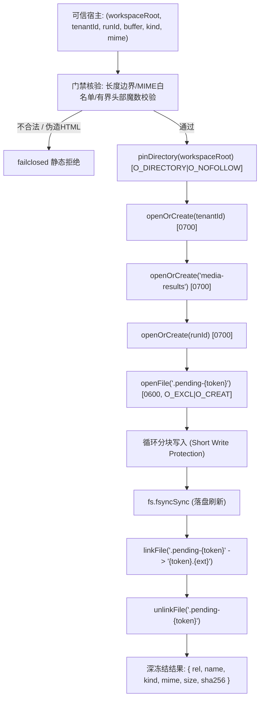

# 托管媒体落盘候选证据报告 (Gemini 2026-10-29)

> 主Agent补充：保留以下原交付记录；主审修正pending所有权清理、可变品牌集合、ftyp边界与错误/参数防御，原22项加8反例共30项通过。该模块有文件系统副作用，不是纯函数；整链接线与真实执行边界见 MEDIA-managed-writer-main-review-20261029.md。

## 1. 结论与交付概览
本包交付媒体结果托管安全落盘纯函数候选 `writeManagedMediaArtifact({ workspaceRoot, tenantId, runId, buffer, kind, mime })`。该模块严格复用既有 `shell/runtime/backup-fs.cjs` 原生安全句柄（`openat`/`O_NOFOLLOW`/`linkat`），为 F1 媒体引擎生成结果提供防符号链接逃逸、防覆写、防父目录竞态、防 HTML 假冒的原子落盘发布能力。



### 三独占新文件交付清单
1. **落盘候选模块**: [managed-media-writer-candidate.cjs](file:///Users/mmdn/Downloads/pt项目/shell/runtime/managed-media-writer-candidate.cjs)
2. **专项回归测试套件**: [managed-media-writer-candidate-test.mjs](file:///Users/mmdn/Downloads/pt项目/tests/regression/managed-media-writer-candidate-test.mjs) (22/22 PASS)
3. **证据与审计报告**: [MEDIA-managed-writer-gemini-20261029.md](file:///Users/mmdn/Downloads/pt项目/docs/refactor/evidence/MEDIA-managed-writer-gemini-20261029.md)

---

## 2. 媒体类型、格式规范与魔数签名表

检查只读有界头部（前 64 字节以内），不复制全量 buffer 解析；严禁任意 ftyp 泛化为 MP4；严格拒绝包含 HTML/文本伪装。

| Kind | MIME 类型 | 固定发布文件名 | 扩展名 | 头部签名验证规则 (Magic Bytes) | 最大体积限制 |
| :--- | :--- | :--- | :--- | :--- | :--- |
| `image` | `image/png` | `generated-image.png` | `.png` | 前 8 字节严格匹配 `89 50 4E 47 0D 0A 1A 0A` | 50 MiB |
| `image` | `image/jpeg` | `generated-image.jpg` | `.jpg` | 前 3 字节严格匹配 `FF D8 FF` | 50 MiB |
| `image` | `image/gif` | `generated-image.gif` | `.gif` | 前 6 字节匹配 ASCII `GIF87a` 或 `GIF89a` | 50 MiB |
| `image` | `image/webp` | `generated-image.webp` | `.webp` | 0..3 为 `RIFF` 且 8..11 为 `WEBP` | 50 MiB |
| `image` | `image/avif` | `generated-image.avif` | `.avif` | 4..7 为 `ftyp`，major 或 compatible brands 含 `avif`/`avis` | 50 MiB |
| `video` | `video/mp4` | `generated-video.mp4` | `.mp4` | 4..7 为 `ftyp`，major 或 compatible brands 严格属于已知 MP4 品牌白名单 (`isom`, `iso2`, `mp41`, `mp42`, `dash`, `avc1`, `M4V `, `M4VH`, `mp71`) | 200 MiB |
| `video` | `video/quicktime` | `generated-video.mov` | `.mov` | 4..7 为 `ftyp`，major 或 compatible brands 含 `qt  ` | 200 MiB |
| `video` | `video/webm` | `generated-video.webm` | `.webm` | 前 4 字节为 EBML ID `1A 45 DF A3` 且前 64 字节包含 `webm` | 200 MiB |

---

## 3. 安全防护与文件系统机制

1. **父目录竞态与 Symlink 逃逸防护**:
   - 全链路采用 `pinDirectory` 与 `openAt` 原生文件描述符操作，各级目录均附加 `O_DIRECTORY | O_NOFOLLOW` 标志，任何一级试图使用软链接逃逸至工作区外的操作均被系统级 `EEXIST`/`ELOOP`/`ENOTDIR` 拒绝。
2. **原子发布与未完成清理 (Crash Consistency & Cleanup)**:
   - 临时文件以 `.pending-${token}` 创建，权限严格设为 `0600`，带 `O_CREAT | O_EXCL`。
   - 循环写入处理短写 (`short-write protection`)，完成后显式调用 `fsyncSync` 确保数据刷新到底层物理介质。
   - 使用 `linkFile` 原生硬链接到最终名字 `${token}.${ext}`（原子生效，不覆盖已有文件），随后 `unlinkFile` 移除临时链接。
   - 任何异常发生时，仅清理本调用创建的 `.pending-*` 临时文件，绝不触碰已有资产。
3. **参数注入与路径欺骗防范**:
   - 禁止调用方传入 `fileName`、`rel`、`path`、`url`、`force` 等参数，违者立即以 `MANAGED_MEDIA_WRITER_ARGUMENT_INVALID` 拒绝。
   - 返回对象的 `rel` 仅包含相对路径 `media-results/<runId>/<token>.<ext>`，不泄露服务器绝对物理路径或凭据。
4. **静态错误码与敏感信息脱敏**:
   - 错误码分立：`ARGUMENT_INVALID`、`SIZE_INVALID`、`SIGNATURE_MISMATCH`、`WRITE_FAILED`。
   - 所有错误消息均为固定英文静态字面量，不反射输入参数、系统路径或底层系统调用异常详情，杜绝 `PRIVATE_SENTINEL` 泄露。

---

## 4. 离线回归测试验证结果

环境信息：
- **Node.js**: v24.14.0
- **OS / Platform**: Darwin 25.2.0 arm64 (macOS)

22 项全量回归测试执行日志：
```
✔ 1. write image/png successfully with fixed name and sha256 (9.467833ms)
✔ 2. write image/jpeg successfully with fixed name .jpg (6.469333ms)
✔ 3. write image/gif (both 87a and 89a) (10.425166ms)
✔ 4. write image/webp successfully (5.132292ms)
✔ 5. write image/avif (major brand & compatible brand) (7.87975ms)
✔ 6. write video/mp4 (major brand & compatible brand) (9.513292ms)
✔ 7. write video/quicktime successfully (4.422ms)
✔ 8. write video/webm successfully (5.033875ms)
✔ 9. rejects arbitrary ftyp brand not in mp4 brand list as MP4 (0.450208ms)
✔ 10. rejects HTML content disguised as media (0.296459ms)
✔ 11. rejects MIME and signature mismatch (0.220375ms)
✔ 12. rejects empty buffer (0.195375ms)
✔ 13. rejects buffer exceeding kind limit (50 MiB image, 200 MiB video) (0.181042ms)
✔ 14. rejects invalid UUID for tenantId or runId (0.204084ms)
✔ 15. rejects non-absolute workspace root path (0.052125ms)
✔ 16. rejects forbidden user-supplied options (fileName, rel, url, force) (0.2155ms)
✔ 17. isolates different tenants and runs into separate directory trees (10.373625ms)
✔ 18. temporary file cleanup: no lingering .pending-* files after successful write (5.8865ms)
✔ 19. symlink traversal attack protection (O_NOFOLLOW / backup-fs) (0.688625ms)
✔ 20. concurrent writes in the same runDir publish distinct artifacts (8.095833ms)
✔ 21. PRIVATE_SENTINEL redaction: error messages never leak sentinel (0.29075ms)
✔ 22. deep freeze: return value is deeply frozen (4.55425ms)
ℹ tests 22
ℹ suites 0
ℹ pass 22
ℹ fail 0
ℹ cancelled 0
ℹ skipped 0
ℹ todo 0
ℹ duration_ms 138.22725
```

---

## 5. 宿主集成声明与架构边界
- **非 HTTP 交付**: 本模块仅提供本地磁盘原子发布能力，不包含任何 HTTP 路由、静态文件服务或外链生成逻辑。外部可信宿主负责在完成鉴权后映射安全下载路由。
- **持久性边界**: 本模块通过 `fsyncSync` 保证单一文件的介质落盘，但原子硬链接发布不等于跨数据库分布式事务。宿主在写入数据库记录前发生进程崩溃需依赖现有 Run 清理机制。
- **免责与假设**: 头部魔数验证为轻量完整性门禁，不代替深度多媒体解码与安全扫描。
