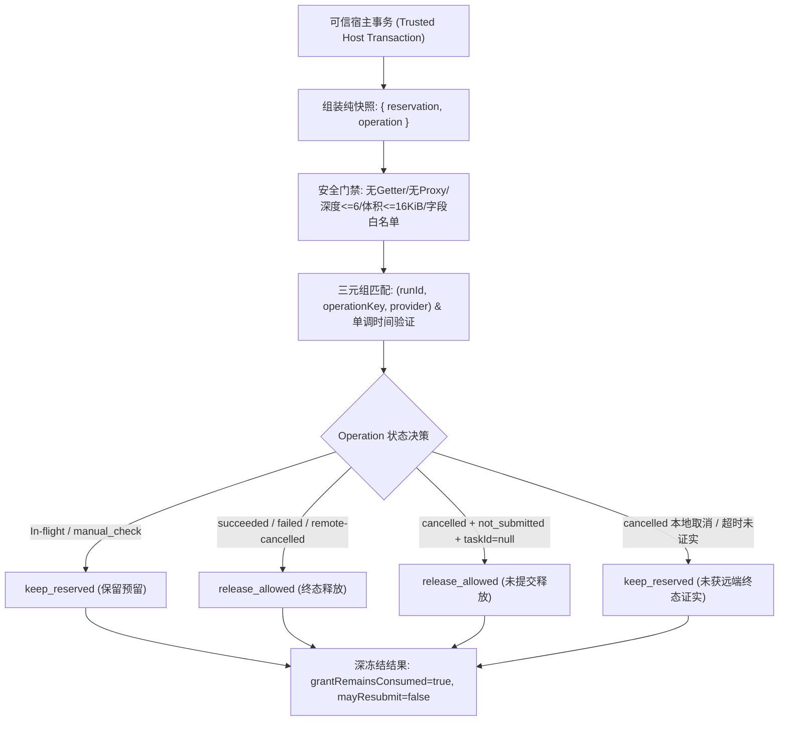

# 媒体预留核对决策纯函数候选证据报告 (Gemini 2026-10-28)

## 1. 结论与交付概览
本包为媒体占位预留（Media Reservation）提供无状态、确定性的纯函数决策候选 `decideMediaReservationReconciliation({ reservation, operation })`。该函数严格复用 `run_external_operations` 账本既有事实，裁决预留插槽当前是否允许释放或必须继续保留。函数杜绝直接暴露于工具参数，杜绝副作用与 I/O，杜绝隐式时钟猜测，杜绝授权假象，杜绝释放时的配额退还或重试重发。



### 三独占新文件交付清单
1. **决策纯函数候选**: [media-reservation-reconciliation-candidate.cjs](file:///Users/mmdn/Downloads/pt项目/shell/tasks/media-reservation-reconciliation-candidate.cjs)
2. **离线回归测试套件**: [media-reservation-reconciliation-candidate-test.mjs](file:///Users/mmdn/Downloads/pt项目/tests/regression/media-reservation-reconciliation-candidate-test.mjs) (43/43 PASS)
3. **证据与审计报告**: [MEDIA-reservation-reconciliation-gemini-20261028.md](file:///Users/mmdn/Downloads/pt项目/docs/refactor/evidence/MEDIA-reservation-reconciliation-gemini-20261028.md)

---

## 2. 状态映射与终态词表白名单

状态映射严格对齐既有适配器 `shell/tasks/provider-adapters.cjs` 与核对器 `shell/tasks/provider-reconciliation.cjs`，拒绝从 reason 文本或非结构化字符串推断终态。

| 来源分类 | 词表白名单 | 映射决策 | 理由与安全语义 |
| :--- | :--- | :--- | :--- |
| **POLLER_SUCCESS_STATUSES** | `completed`, `succeeded`, `success`, `successful`, `finished`, `done`, `ready`, `ok` | `release_allowed` | 外部任务明确执行完毕并交付产物，允许释放并发预留插槽。 |
| **POLLER_FAILURE_STATUSES** | `failed`, `error`, `expired`, `rejected`, `timeout` | `release_allowed` | 外部任务明确在远端终止失败，允许释放并发预留插槽。注：grant 永久消耗，不退款。 |
| **POLLER_CANCELLED_STATUSES** | `cancelled`, `canceled` | `release_allowed` (仅限已查询远端终态) | 远端已核实终止取消。若未向远端核实，一律降级为 `keep_reserved`。 |
| **HOST_NOT_SUBMITTED** | `outcome: 'cancelled'`, `reason: 'not_submitted'`, `taskId: null`, `queried: false`, `source: 'host'` | `release_allowed` | 明确在向远端提交前由宿主拦截取消，无需远端查证即可释放。 |
| **IN_FLIGHT_STATUSES** | `submitting`, `accepted`, `querying`, `pending_query`, `manual_check` | `keep_reserved` | 远端正在处理或处于异步查询/人工排查中，不得释放并发占位。 |
| **LOCAL_UNVERIFIED_CANCEL** | `cancelled` 且伴随非空 `taskId` 或 `queried: false` (非 not_submitted) | `keep_reserved` | 本地取消不等于远端取消；远端可能仍在计费运行，禁止释放。 |

---

## 3. 安全防护与边界约束

1. **输入纯净化门禁 (AST/Descriptor-level Inspection)**:
   - 禁止 Proxy (`util.types.isProxy`)、Getter/Setter (`Object.getOwnPropertyDescriptors`)，直接检测描述符，绝不触发访问器执行。
   - 禁止 Symbol 属性、禁止非有限数值 (`NaN`, `Infinity`)、禁止非 plain object 原型。
   - 禁止循环引用与跨实体共享引用 (`seen` Set 全局跟踪对象身份)。
   - 硬边界拦截：对象深度 $\le 6$，总序列化体积 $\le 16\,\text{KiB}$。
2. **敏感信息脱敏与固定错误码**:
   - 错误码固定为 `MEDIA_RECONCILIATION_INVALID`。
   - 错误消息全量采用静态字面量模板，不回显、不反射任何输入字段键名或字段值（测试已验证 `PRIVATE_SENTINEL` 脱敏防泄漏）。
3. **零副作用与时钟单调性**:
   - 不调用 `Date.now()` 或 `new Date()` 猜测完成，纯基于相对时间单调关系：$T_{\text{updatedAt}} \ge T_{\text{reservedAt}}$ 且 $T_{\text{observedAt}} \ge T_{\text{reservedAt}}$ 且 $T_{\text{updatedAt}} \ge T_{\text{observedAt}}$。逆序直接拒绝。
   - 输入参数对象完全不可变，输出结果完全递归深冻结 (`Object.freeze`)。
4. **硬性输出不变量**:
   - `grantRemainsConsumed: true`：无论成功或失败，旧授权额度均保持已消耗状态，纯函数无权更改扣费账本。
   - `mayResubmit: false`：释放插槽不赋予自动重试或许可，严禁重复提交。

---

## 4. 离线回归测试套件验证结果

43 项专项测试覆盖全部功能分支与安全边界：
```
✔ 1. succeeded: verified with providerStatus 'completed' allows release (0.743041ms)
✔ 2. succeeded: synchronous image with taskId null allows release (0.091375ms)
✔ 3. succeeded: queried=true with null providerStatus allows release (0.064417ms)
✔ 4. failed: verified with providerStatus 'failed' allows release (0.068083ms)
✔ 5. failed: verified with providerStatus 'error' allows release (0.401875ms)
✔ 6. failed: verified with providerStatus 'timeout' allows release (0.057375ms)
✔ 7. failed: queried=true with null providerStatus allows release (0.063666ms)
✔ 8. cancelled: confirmed not submitted allows release (0.056875ms)
✔ 9. cancelled: remote verified 'cancelled' allows release (0.057583ms)
✔ 10. cancelled: remote verified alternate spelling 'canceled' allows release (0.119292ms)
✔ 11. cancelled: local cancellation only (with taskId) must keep reserved (0.070625ms)
✔ 12. cancelled: local timeout without remote confirmation must keep reserved (0.054542ms)
✔ 13. submitting: in-flight state keeps reserved (0.090292ms)
✔ 14. accepted: in-flight state keeps reserved (0.033417ms)
✔ 15. querying: in-flight state keeps reserved (0.031792ms)
✔ 16. pending_query: in-flight state keeps reserved (0.055708ms)
✔ 17. manual_check: general manual check state keeps reserved (0.041125ms)
✔ 18. manual_check: unknown_submission without taskId keeps reserved (0.035666ms)
✔ 19. fake reason keywords in submitting does not fool engine into release (0.03325ms)
✔ 20. fake reason keywords in manual_check does not fool engine into release (0.031792ms)
✔ 21. chronology violation: updatedAt before reservedAt throws invalid error (0.271291ms)
✔ 22. chronology violation: observedAt before reservedAt throws invalid error (0.051708ms)
✔ 23. chronology violation: updatedAt before observedAt throws invalid error (0.043917ms)
✔ 24. contradiction: status succeeded but outcome failed throws invalid error (0.042709ms)
✔ 25. contradiction: status succeeded but providerStatus is failure throws invalid error (0.042542ms)
✔ 26. contradiction: status failed but outcome succeeded throws invalid error (0.041542ms)
✔ 27. contradiction: status failed but providerStatus is success throws invalid error (0.041791ms)
✔ 28. contradiction: status cancelled but outcome succeeded throws invalid error (0.045792ms)
✔ 29. identity mismatch: runId mismatch throws invalid error (0.046333ms)
✔ 30. identity mismatch: operationKey mismatch throws invalid error (0.049333ms)
✔ 31. identity mismatch: provider mismatch throws invalid error (0.045083ms)
✔ 32. security: getter accessor is detected and NOT executed (0.053792ms)
✔ 33. security: Proxy object is rejected without invoking trap (0.047417ms)
✔ 34. security: circular reference is rejected (0.05075ms)
✔ 35. security: shared object reference between reservation and operation is rejected (0.048792ms)
✔ 36. security: symbol property is rejected (0.077792ms)
✔ 37. security: non-finite numbers (NaN/Infinity) are rejected (0.134875ms)
✔ 38. security: unknown property (apiKey, prompt) is rejected (0.09225ms)
✔ 39. security: payload depth exceeding 6 is rejected (0.097417ms)
✔ 40. security: oversized payload (> 16 KiB) is rejected (0.057916ms)
✔ 41. redaction: error messages never leak PRIVATE_SENTINEL field names or values (0.084167ms)
✔ 42. immutability and deep freeze: inputs untouched and output deeply frozen (0.069042ms)
✔ 43. fixed invariants: grantRemainsConsumed: true and mayResubmit: false across all decisions (0.048291ms)
ℹ tests 43
ℹ suites 0
ℹ pass 43
ℹ fail 0
ℹ cancelled 0
ℹ skipped 0
ℹ todo 0
ℹ duration_ms 40.846958
```

---

## 5. 宿主边界声明与后续接线原则
- **非接线声明**: 本候选模块为无状态纯函数计算逻辑，**未接入** 任何数据库写入事务、未修改现有 `shell/tasks/external-operations-store.cjs` 或调度器。
- **宿主权责**: 可信宿主在读取数据库记录并完成鉴权后组装入参；在收到 `decision: 'release_allowed'` 后，须在独立的排他行锁事务中重新校验并执行物理 slot 状态转移，绝不可绕过事务直接操作。
- **不可推断性**: 若 `operation` 状态为未知或证据缺失，纯函数严格保守判定 `keep_reserved` 或抛出 `MEDIA_RECONCILIATION_INVALID`，绝不允许默认释放。
