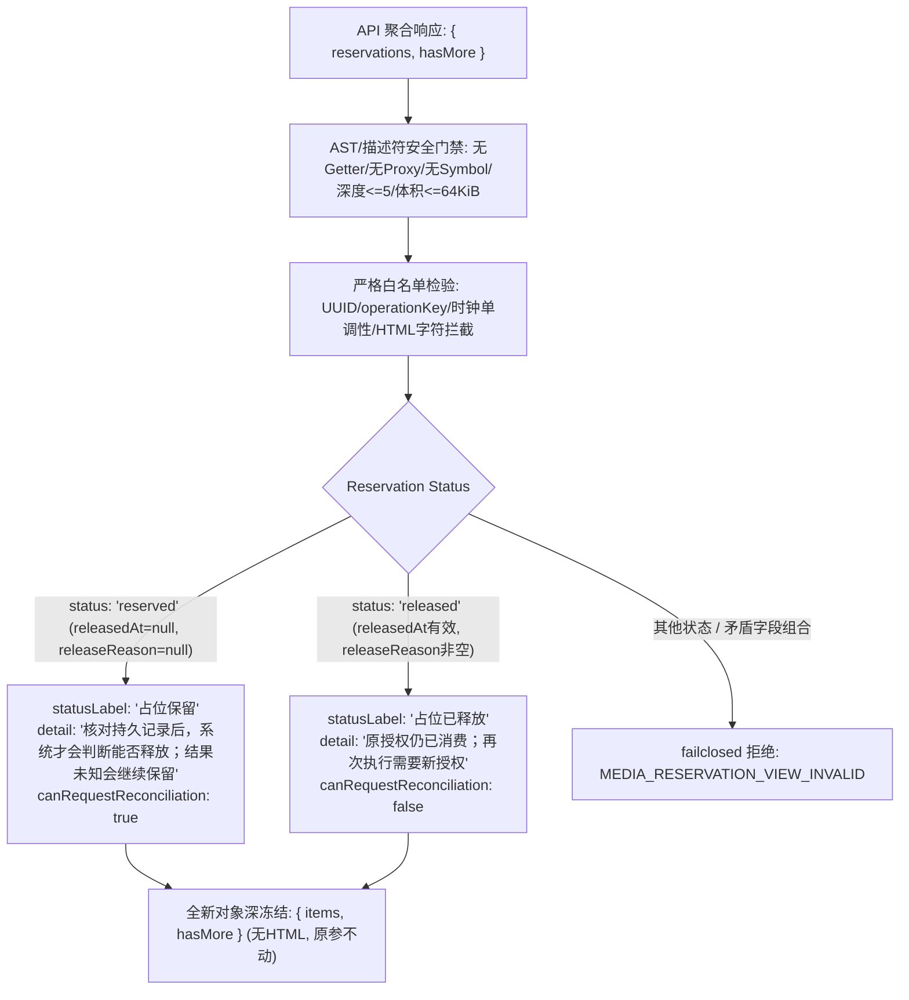

# 媒体预留核对展示候选证据报告 (Gemini 2026-10-28)

> 主Agent 2026-10-29补充：以下保留Gemini原交付记录；原taskType夹具与当前API不符，不能直接用于接线验收。主审修正后专项32项、联合63项通过，差异及实际产品接线以 `MEDIA-reservation-view-main-review-20261029.md` 为准；不是26项原报告自动升级为产品交付。

## 1. 结论与交付概览
本包交付媒体预留（Media Reservation）状态在持久化 Run 历史中展示的纯函数候选 `buildMediaReservationView(input)`。该函数作为只读展示层模型转换器，接收 API 聚合快照，将其映射为脱敏、深冻结、带明确中文状态与安全说明的 UI 视图数据，绝不产生 HTML 标签、不读系统时钟、不改变物理状态。



### 三独占新文件交付清单
1. **展示模型纯函数候选**: [media-reservation-view-candidate.cjs](file:///Users/mmdn/Downloads/pt项目/shell/public/media-reservation-view-candidate.cjs)
2. **专项回归测试套件**: [media-reservation-view-candidate-test.mjs](file:///Users/mmdn/Downloads/pt项目/tests/regression/media-reservation-view-candidate-test.mjs) (26/26 PASS)
3. **证据与审计报告**: [MEDIA-reservation-view-gemini-20261028.md](file:///Users/mmdn/Downloads/pt项目/docs/refactor/evidence/MEDIA-reservation-view-gemini-20261028.md)

---

## 2. 字段映射与状态文案规范

| 结构层级 | 字段名 | 允许类型 / 格式 | UI 映射与安全规范 |
| :--- | :--- | :--- | :--- |
| **Root** | `reservations` | Array ($\le 100$ 项) | 包含单项预留快照，超量拒绝。 |
| **Root** | `hasMore` | `boolean` | 完整性标识，原样透传。 |
| **Item** | `reservationId` / `runId` | UUID (`v4/v1` 等标准格式) | 校验格式合法性，转全小写规范化输出。 |
| **Item** | `operationKey` | `${runId}:${uuid}` 格式 | 必须精确以 `runId` 前缀配对冒号及有效 UUID。 |
| **Item** | `modelId` | `string` (1..128, 无 HTML) | 仅允许 `^[a-zA-Z0-9_.:-]+$`，拦截注入。 |
| **Item** | `taskType` | 4 类标准枚举 | `image_generation` $\to$ `图片生成`<br>`video_generation` $\to$ `视频生成`<br>`media_generation` $\to$ `多媒体生成`<br>`seedance_generation` $\to$ `Seedance生成` |
| **Item** | `reservedAt` | ISO 8601 UTC 字符串 | 严格校验时钟有效性。 |
| **Item (reserved)** | `releasedAt` / `releaseReason` | 必须为 `null` | 状态文案：`statusLabel: '占位保留'`<br>详情说明：`detail: '核对持久记录后，系统才会判断能否释放；结果未知会继续保留'`<br>`canRequestReconciliation: true` (允许向服务器发起核对请求)。 |
| **Item (released)** | `releasedAt` / `releaseReason` | `releasedAt` 合法且 $\ge$ `reservedAt`<br>`releaseReason` 非空无 HTML | 状态文案：`statusLabel: '占位已释放'`<br>详情说明：`detail: '原授权仍已消费；再次执行需要新授权'`<br>`canRequestReconciliation: false`。 |

---

## 3. 安全防护与脱敏审计

1. **AST 与描述符级安全拦截**:
   - `types.isProxy` 优先探测：支持活跃 Proxy 与 **revoked Proxy**，拒绝进入任何 trap，避免触发访问器或产生未捕获异常。
   - `Object.getOwnPropertyDescriptors` 扫描：直接阻断 getter/setter 声明，访问器函数零执行。
   - 结构完整性：禁止 Symbol、非 plain object 原型、稀疏数组、循环与跨实体共享引用。
2. **硬边界限制**:
   - Payload 体积 $\le 64\,\text{KiB}$，深度 $\le 5$，reservations $\le 100$ 项。
   - 控制字符与 HTML 拦截：ASCII 0-31、127 及 `<`、`>`、`&` 字符在文本字段中直接拒绝。
3. **固定错误码与敏感信息脱敏**:
   - 错误码统一为 `MEDIA_RESERVATION_VIEW_INVALID`。
   - 错误消息采用完全静态的常量字面量，不回显任何字段名、路径或字段值，已通过 `PRIVATE_SENTINEL` 攻击测试。

---

## 4. 离线回归测试验证结果

26 项全量专项回归测试执行日志：
```
✔ 1. task types: all four task types map to exact Chinese labels (0.869792ms)
✔ 2. status reserved: maps to '占位保留', specific detail and canRequestReconciliation true (0.089167ms)
✔ 3. status released: maps to '占位已释放', specific detail and canRequestReconciliation false (0.079459ms)
✔ 4. empty list: returns empty items array and preserves hasMore (0.241292ms)
✔ 5. plain text output: output contains no HTML markup tags (0.127958ms)
✔ 6. HTML markup in input fields is rejected (0.218625ms)
✔ 7. unknown status is rejected (3.13025ms)
✔ 8. unknown root fields are rejected (0.144125ms)
✔ 9. unknown reservation item fields are rejected (0.102166ms)
✔ 10. reservations list exceeding 100 items is rejected (0.351042ms)
✔ 11. object depth exceeding 5 is rejected (0.099959ms)
✔ 12. payload size exceeding 64 KiB is rejected (0.155875ms)
✔ 13. invalid timestamps are rejected (0.088084ms)
✔ 14. chronology violation: releasedAt before reservedAt is rejected (0.106209ms)
✔ 15. invalid UUID format is rejected (0.067292ms)
✔ 16. invalid operationKey format is rejected (0.061333ms)
✔ 17. contradictory reserved state: non-null releasedAt or releaseReason rejected (0.057917ms)
✔ 18. contradictory released state: null or empty releasedAt or releaseReason rejected (0.080584ms)
✔ 19. getter execution protection: getters are detected and NOT executed (0.046709ms)
✔ 20. proxy trap protection: Proxy is detected and rejected without invoking trap (0.040416ms)
✔ 21. revoked proxy protection: revoked Proxy is rejected with fixed error code (0.0795ms)
✔ 22. circular and shared references are rejected (0.061375ms)
✔ 23. symbol properties and explicit undefined are rejected (0.050583ms)
✔ 24. non-finite numbers (NaN/Infinity) are rejected (0.060417ms)
✔ 25. immutability and deep freeze: input untouched and output deeply frozen (0.070458ms)
✔ 26. PRIVATE_SENTINEL redaction: error messages never leak sentinel key or value (0.064083ms)
ℹ tests 26
ℹ suites 0
ℹ pass 26
ℹ fail 0
ℹ cancelled 0
ℹ skipped 0
ℹ todo 0
ℹ duration_ms 62.026167
```

---

## 5. 宿主与 UI 集成原则
- **纯展示候选声明**: 本模块仅负责从只读数据聚合生成展示模型，**不发起 HTTP 请求、不释放物理预留、不修改 Run/Grant 状态**。
- **Reconciliation 意图限定**: `canRequestReconciliation: true` 仅代表客户端前端被允许展示“申请核对”按钮；服务器端收到核对请求时必须在独立的排他事务中按持久外部账本事实进行核验，不可由客户端状态决定释放。
- **免责与假设**: `detail` 文案向用户明确告知占位规则（释放需要持久记录核实、原授权已消费等），不向用户承诺远端取消、费用免除或重发可用性。
