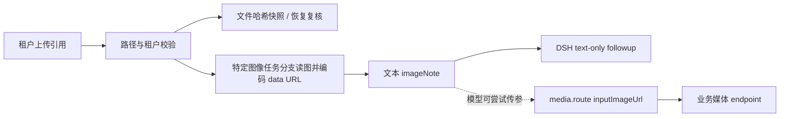

# T08 输入链路审计（2026-10-20）

**判定：附件请求的租户边界、稳定性与本地 media.route 序列化有回归证据；没有模型视觉理解证据。** 仅 auto mode 或明确的 `image2image` / `image2video` 分支会在成功读取且不超过 10 MiB 时将上传内容编码为 data URL 并拼进 `imageNote`；显式 `text2image` / `text2video`、读失败或超限时不会附入。DSH runner 对模型发出的 followup 仍只有 `{ type: "text" }`，仓库所配 PowerTokens route 声明 text-only。故只能说“特定分支可能把上传内容作为文本中的 data URL 提供给模型，再由模型决定是否把字符串作为工具参数交给 media.route”，不能声称模型看到了图像像素或理解了图像。

## 实际链路与实现边界

| 阶段 | 本地实现与证据 | 可以声称 | 不能声称 |
|---|---|---|---|
| HTTP 入参 | `shell/tasks/chat-request.cjs::normalizeChatRequest` 只接收 `/uploads/<tenant UUID>/<filename>` 引用；限制图像、文档和 media 数量/字段，并拒绝跨租户引用和 arbitrary URL/data URL。`server.cjs` 在提交 Run 前调用它。 | 请求形状和租户路径被规范化。 | 文件确实是合法图片、模型支持图片。 |
| Durable attachment | `captureDurableChatAttachments` 读取可信 uploads root 下的 regular file，检查 symlink/路径逃逸/TOCTOU，并把 SHA-256 与 size 放入 durable request；恢复时 `verifyDurableChatAttachments` 重新读取并比较。覆盖见 `tests/regression/chat-request-attachments-test.mjs`。 | 排队/恢复使用的上传字节与提交时一致；篡改、缺失、越租户和 symlink 会 fail closed。 | durable evidence 是 DSH `ImageAttachmentRef`；当前实现保存的是上传引用及完整性证据，不会转成 DSH ImageBlock。 |
| LLM 输入 | `server.cjs::uploadsToDataUrl` 按扩展名声明 MIME，单文件超过 10 MiB 返回空；只有 auto mode 或显式 image2image/image2video 分支会将 data URL 原文拼入 `imageNote`，text2image/text2video 分支不附入。该函数不解码或校验文件内容格式。`shell/persistent-runner.mjs` 的模型 followup 构造 `content: [{type:"text", text: ...}]`。`shell/dsh-settings.yaml` provider `defaultInput` 为 `[text]`。 | 对成功读取且未超限的上传文件字节，按扩展名声明 MIME 编码为 data URL；仅在适用任务分支中把它作为 prompt 文本或工具指令字符串传递。 | LLM 收到 image modality、解码了图像、根据画面回答正确。Base64 文本存在 token/请求体膨胀风险。 |
| 业务媒体工具 | `media.route` 的 tool schema 接受 `inputImageUrl`；宿主转给 `business/media/powertokens.cjs`。`tests/regression/media-route-test.mjs` 用 mock fetch 验证 HTTP body：图生图写 `image` 字段，图生视频写 `media.first_frame.url`，data URL 可序列化。 | 应用侧 mapping 和请求体结构经过本地 mock 验证。 | 实时 PT 图像/视频 endpoint 对所有 MIME、尺寸、编码、体积或 data URL 的接受能力；这也不证明 LLM 看懂输入图。 |

## 定向验证

运行命令：`node --test tests/regression/chat-request-attachments-test.mjs tests/regression/media-route-test.mjs tests/regression/media-run-lifecycle-test.mjs`（从仓库根目录执行）。**PASS：10/10 Node test subtests；其中 media.route 专项报告 80 通过、0 失败。** 所有媒体 HTTP 行为由 mock fetch 覆盖；没有调用模型、PT 或媒体服务。测试证明附件快照 fail-closed、媒体路由参数与序列化、durable external-operation lifecycle；它们不覆盖模型视觉理解，也没有覆盖实际 DSH provider request 的 image modality。

首次从 `shell/` 子目录运行时 Node 找不到仓库根的测试路径；改从仓库根重跑后全部通过。过程中看到测试创建于系统临时目录的 key 文件警告（0600），以及缺少 `PT_DASH_INTERNAL_KEY` 的既有 skip 提示；测试结束后无残留服务或付费调用。

## 最高价值的无付费调用验证

### 本地 HTTP 输入与历史重放探针

`node tests/probes/northstar-t08-upload-to-runner-jsonl.mjs` **PASS**；共14个汇总语义断言/输出项，覆盖真实HTTP上传、durable Run/worker、imageNote和生产 `assembleSystemPrompt` 格式化。结果包括：auto图片进入text data URL；text2image不携带图片字节；超10MiB不泄漏部分字节；坏格式和跨租户引用拒绝；新消息保存ref/SHA256/size；原图不变时regenerate与branch可到tenant fixture；preload模拟旧历史缺证据时两条路径均fail closed；改写原图片字节后两条路径均以 `CHAT_ATTACHMENT_CHANGED` 拒绝、fixture capture数不增且conversation messages深比较不变。owned staging在server退出后清理PASS。stage敏感过滤为best-effort路径/名称规则、不扫描内容；合成正向样例覆盖service-account、access-token、私钥、轮转日志和压缩/日期备份，负向样例确保业务 `token.js` 与迁移SQL保留；本轮实际排除了 `shell/.npmrc`（只记录相对路径、不输出内容）。shell、business/attribution、analytics依赖链接的realpath都被限制在各自checkout内 `node_modules` 根。探针使用loopback HTTP，不做socket级外连监测。`node --test tests/regression/chat-request-attachments-test.mjs` **1/1 PASS**，源码语法检查与 `git diff --check` PASS。

该探针没有调用真实模型、PowerTokens或媒体provider；tenant执行在fixture边界被替换。探针只访问loopback HTTP，没有socket级外连监测。合成PNG是上传路径字节，不用于图片解码或视觉理解。旧历史缺快照测试通过preload改写 `conversations.get` 返回值，不是实际旧数据库迁移/恢复测试；该模拟路径只断言错误与fixture未调用，未对消息深比较。改图后的regenerate/branch拒绝路径则直接深比较前后conversation messages。

**runner证据边界：** `tests/probes/northstar-t08-persistent-runner-fake-provider.mjs` 以隔离子进程和进程内 fake adapter 验证合成文本标记通过真实 runner JSONL 后仍为text block，无image modality；未调用PT adapter，也没有socket监测。`docs/refactor/T08-INPUT-CONTRACT.md`提供DSH SDK canonical ImageBlock/provider adapter背景，但本地依赖能力不等于当前PowerTokens route已接通。
