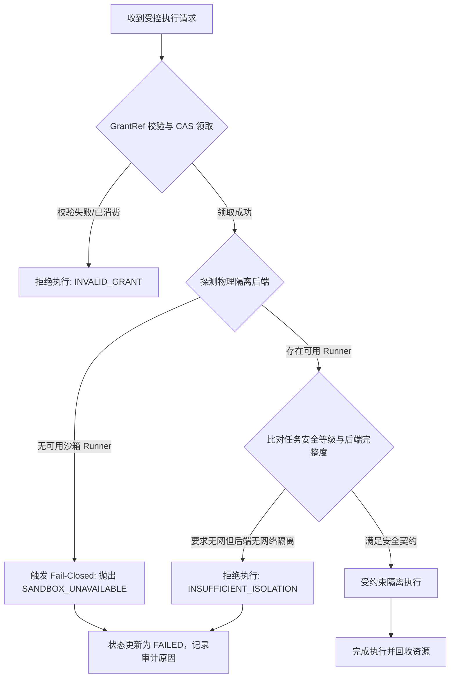

# 05/06 受控执行后端方案与威胁模型 (BACKEND-PROPOSAL)

> **版本**：1.0.0  
> **所属阶段**：M0 原生接缝与架构评审  
> **核心原则**：默认关闭 (Fail-Closed)、零裸宿主运行 (No Bare Spawn)、全维度边界防护

---

## 1. 威胁模型与隔离维度差距分析

受控执行模块 (Package 06) 面对的是模型生成或外部传入的任意代码执行请求。针对五个核心防护维度，原生实现与生产安全要求存在明显差距：

| 隔离维度 | 攻击向量 / 威胁场景 | 原生 `@deepseek-ai` 现有表现 | 06 架构层解决方案 |
|---|---|---|---|
| **只读隔离 (Read)** | 脚本通过父目录软链接、硬链接（`ln /etc/shadow link`）、绝对路径遍历读取租户私有代码与凭据 | `dsh-fs-sandbox` 明确说明：所有读取直接放行，不对读取路径设围栏。 | **宿主前置严审**：解析 `realpathSync`，验证最终真实路径在授权根内；硬链接检测（`nlink > 1` 直接拒绝）；禁用跨租户路径。 |
| **写入隔离 (Write)** | 脚本篡改宿主关键配置文件、修改其他租户文件或污染公共代码库 | `dsh-bash-sandbox` 结合 `bwrap` / `Seatbelt` 实现写入围栏（只写工作区与平台临时目录）。 | **复用原生沙箱机制**：结合原生 `SandboxBashExecutor`；在无沙箱后端时拒绝写入执行。 |
| **网络隔离 (Network)** | 恶意脚本建立反向 Shell、外发租户代码、内网探测（SSRF 攻击云元数据 169.254.169.254） | 原生 `README.zh.md` 明确声明：**网络完全不受限制**，原生沙箱只管文件写入。 | **环境能力门禁**：在 Linux 下启用 `bwrap --unshare-net`；在无网络命名空间支持的平台（macOS/裸机），若任务要求无网络则**判定后端不可用，Fail-Closed 拒绝运行**。 |
| **凭据隔离 (Credential)** | 脚本通过 `env` 或 `/proc/self/environ` 窃取宿主数据库连接串、API 密钥或 DSH 身份 Token | 原生未提供环境变量彻底净化机制，直接继承或仅简单前缀过滤。 | **强制环境净化 (Env Sanitization)**：剥离全部宿主环境变量（`process.env`）；仅注入预定义的安全子集（如 `PATH=/usr/bin:/bin`、`HOME=/tmp/sandbox`），杜绝 Secret 泄露。 |
| **进程逃逸与挂死 (Process)** | 恶意子进程创建孤儿进程、Fork Bomb 耗尽 PID、捕获 SIGTERM 拒绝退出挂死宿主 | 原生依赖基础 spawn，对多层派生进程树缺乏统一强制销毁。 | **独立进程组与树销毁**：配置 `detached: true` 创建私有进程组；超时或取消时执行 `process.kill(-pgid, 'SIGKILL')` 强制回收整棵进程树。 |

---

## 2. 操作系统真实沙箱能力矩阵 (OS Matrix)

系统在不同操作系统下的隔离能力具有客观物理差异，必须如实向调度器和用户报告真实隔离完整度 (`full` / `partial` / `unavailable`)，严禁伪造布尔值。

```
+---------------------------------------------------------------------------------------------+
|                                跨平台真实隔离能力对比                                       |
+---------------------------------------------------------------------------------------------+
| 平台 / 机制        | 文件只读隔离  | 文件写入隔离  | 网络阻断能力   | 进程树隔离   | 综合能力级别  |
+--------------------+---------------+---------------+----------------+--------------+---------------+
| Linux (bwrap)      | 强 (只读挂载) | 强 (tmpfs)    | 强 (--unshare) | 强 (PID NS)  | FULL          |
| Linux (landlock)   | 弱 (ABI差异)  | 强 (FS Rules) | 无 (不支持)    | 弱           | PARTIAL       |
| macOS (Seatbelt)   | 中 (正则规则) | 强 (deny write| 无 (原生未配)  | 中 (PGID)    | PARTIAL       |
| macOS (Docker/VM)  | 强 (容器边界) | 强 (隔离卷)   | 强 (Bridge/none| 强           | FULL          |
| 裸宿主 Node (None) | 无            | 无            | 无             | 无           | UNAVAILABLE   |
+---------------------------------------------------------------------------------------------+
```

### 2.1 当前开发/评测环境 (macOS Darwin)
- 当前原生包配置的 macOS Runner 为 Seatbelt (`sandbox-exec`)。
- **限制说明**：
  1. Seatbelt 仅能对文件写入做限制，且已被 Apple 标记为 Deprecated；
  2. 原生配置中未限制网络，无法提供内核级网络隔离。
- **处理策略**：
  - 若任务要求网络隔离或强内核级只读隔离，系统将其标识为 `PARTIAL` 或 `UNAVAILABLE`。
  - **绝不回退到 bare node 执行**；明确向调用方返回沙箱能力不足错误。

### 2.2 目标生产环境 (Linux x86_64 / aarch64)
- 优先选择 `Bubblewrap (bwrap)` 作为核心 Runner：
  ```bash
  bwrap \
    --ro-bind /usr /usr \
    --ro-bind /lib /lib \
    --ro-bind /lib64 /lib64 \
    --ro-bind /bin /bin \
    --ro-bind /sbin /sbin \
    --bind "${SANDBOX_WORKSPACE}" "${SANDBOX_WORKSPACE}" \
    --tmpfs /tmp \
    --dev /dev \
    --proc /proc \
    --unshare-all \
    --unshare-net \
    --new-session \
    --die-with-parent \
    bash -c "${SCRIPT}"
  ```
- 若无 `bwrap` 且系统支持 Landlock，则标记为 `PARTIAL`（无网络隔离）；若均不可用，标记为 `UNAVAILABLE`。

---

## 3. 闭门门禁与降级策略 (Fail-Closed Policy)

为杜绝此前审核发现的“无隔离后端时默认使用裸 Node 执行”的安全缺陷，架构层确立以下执行铁律：



### 降级与独立验收原则：
1. **只读与问答独立放行**：即使无真实沙箱后端（执行入口关闭），05 的问答/审批及 06 的只读目录/文件查询能力仍可独立运行并通过验收。
2. **拒绝静默放行**：严禁在代码中为了跑通测试而设立 `bypassSandbox = true` 或隐式裸 `child_process.exec`。缺少后端时，前端明确显示“当前环境缺乏隔离沙箱，已安全拦截”。
