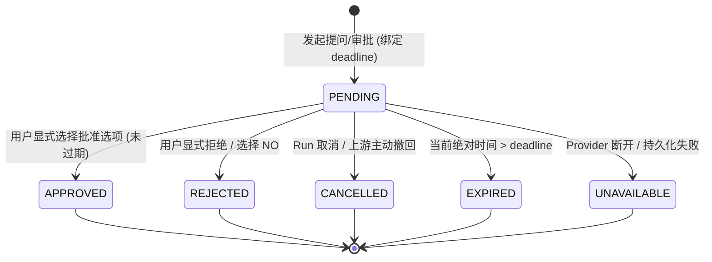
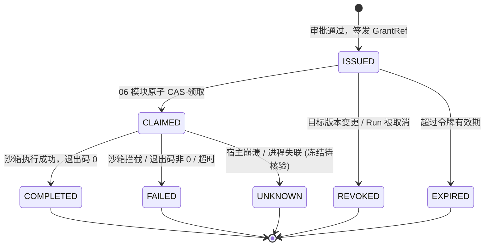

# 05/06 信任边界、数据契约与状态机模型 (TRUST-AND-STATES)

> **版本**：1.0.0  
> **所属阶段**：M0 原生接缝与架构评审  
> **设计基准**：RFC 8785 JSON 规范化、原子 CAS 单次消费、双向签名绑定

---

## 1. 信任模型与边界定义

根据冻结任务书第 3 节要求，系统严格区隔不可信源与可信源，任何授权与执行决断均只能依赖权威服务端记录。

```
+---------------------------------------------------------------------------------+
|                                 不可信数据源 (Untrusted)                        |
| - 模型生成内容: 提出的问题/文本/建议脚本/路径/JSON                                  |
| - 客户端/浏览器输入: 提交的 ID、Token、用户答复、自定义文本                         |
| - 调用方持有的返回对象: 内存中已返回给外部的数据结构（可能被就地突变）               |
| - 文件系统元数据: 符号链接 (symlink)、硬链接 (hardlink)、检查后替换 (TOCTOU)         |
| - 异步事件流: 晚到、乱序、重复发送的审批/取消事件                                   |
+---------------------------------------------------------------------------------+
                                       |
                                严格校验与归一化
                                       v
+---------------------------------------------------------------------------------+
|                                  可信数据源 (Trusted)                           |
| - 服务端认证身份: SessionContext、已鉴权的 Tenant ID、Server Actor                |
| - 活跃原生调用上下文: RunId、Native CallId、原生活跃 Agent 实例                      |
| - 服务端不可变操作快照: 规范化冻结的 RequestBinding 与 ExecutionBinding             |
| - 真实执行后端能力: 经平台探测验证的 Runner Capability、只读/受限环境               |
| - 持久化权威存储: 带有唯一索引与 CAS 事务的持久数据库记录                           |
+---------------------------------------------------------------------------------+
```

### 核心不变式 (Invariants)：
1. **身份不可伪造**：租户与运行身份由服务端鉴权层绑定，客户端传入的任何参数仅作索引查找，不具备授权效力。
2. **展示即批准**：模型或系统必须先生成不可变候选摘要并呈现给用户；批准只针对该展示摘要，禁止“盲审”或“预先批准”。
3. **显式类型决定**：批准必须是显式 `approved`；选项顺序调换、多语言标签、以及 `NO` 选项绝不可被解析为批准。自由文本仅作为回答记录，不得自动转为执行权限。
4. **单次消费原子性**：权限令牌由服务端原子 CAS 机制领取；即使网络重试或双击，也仅允许单次执行。

---

## 2. 核心数据对象契约 (Data Contracts)

### 2.1 RequestBinding (提问/审批请求绑定)
```typescript
export interface RequestBinding {
  /** 契约版本号，用于未来 schema 升级兼容 */
  schemaVersion: '2026-11-04.1';
  /** 服务端权威认证身份 */
  auth: {
    tenantId: string;
    userId: string;
    serverActor: string;
  };
  /** 原生关联上下文 */
  context: {
    runId: string;
    callId: string;
    nativeRequestId?: string;
    operationType: 'question' | 'approval_plan' | 'approval_command' | 'approval_mutation';
  };
  /** 用户展示与语义内容 */
  payload: {
    question: string;
    detail?: string;
    header?: string;
    options: Array<{
      id: string;
      label: string;
      description?: string;
      isApprovalAction?: boolean; // 明确标定该选项是否具有授权效力
    }>;
    multiSelect: boolean;
  };
  /** 执行目标绑定（针对执行审批） */
  target?: {
    cwd: string;
    targetRef: string;
    targetVersion: string;
    commandDigest?: string;
    envMode: 'stripped' | 'inherited';
    networkMode: 'deny_all' | 'isolated' | 'host';
  };
  /** 时效与版本管理 */
  metadata: {
    createdAt: number;
    deadline: number; // 绝对时间戳 (毫秒)
    revision: number; // 每次修改必须递增 revision
    digest: string;   // CanonicalDigest 计算值
  };
}
```

### 2.2 CanonicalDigest 规范化计算机制
为保证 05（提问审批）与 06（受控执行）的参数哈希绝对一致，禁止使用 `options.join('|')` 或直接哈希裸脚本。必须采用严格遵循 **RFC 8785 (JSON Canonicalization Scheme - JCS)** 的归一化算法：

1. **键名排序**：所有 JSON 对象键按 UTF-16 代码单元字典序排序。
2. **规范化类型转换**：
   - 拒绝 `undefined`、函数、Symbol、`NaN`、`Infinity` 以及循环引用结构。
   - 数值强制转为合法的十进制浮点表示。
   - 布尔值严格转换为 `true` / `false`。
3. **哈希范围**：覆盖 `schemaVersion`、`auth.tenantId`、`context.runId`、`target.cwd`、`target.targetRef`、`target.targetVersion`、`target.envMode`、`target.networkMode`、`payload.options`（按 id 排序）。
4. **算法**：采用 `SHA-256` 生成十六进制摘要。任何一方生成的摘要不一致，执行端立即抛出 `DIGEST_MISMATCH` 拦截。

### 2.3 GrantRef 与 ExecutionBinding (执行授权与绑定)
```typescript
export interface GrantRef {
  /** 不透明授权 ID，禁止包含可预测序号 */
  grantId: string;
  /** 服务端对 RequestBinding.metadata.digest + 决策时间的 HMAC 签名 */
  signature: string;
  /** 关联的请求 ID */
  requestId: string;
  /** 允许消费的最迟绝对时间戳 */
  expiresAt: number;
}

export interface ExecutionBinding {
  /** 本次执行的租户与范围 */
  tenantId: string;
  runId: string;
  grantRef: GrantRef;
  /** 实际探测并确定的后端沙箱 */
  backend: {
    backendId: 'bwrap' | 'landlock' | 'seatbelt' | 'none';
    enforcement: 'full' | 'partial' | 'unavailable';
    capabilities: {
      readIsolation: boolean;
      writeIsolation: boolean;
      networkIsolation: boolean;
    };
  };
  /** 资源上限限制 */
  limits: {
    timeoutMs: number;
    maxStdoutBytes: number;
    maxStderrBytes: number;
  };
  /** 单次消费租约与隔离围栏 Token */
  fencingToken: number;
}
```

---

## 3. 状态机模型与流转规则

系统维护两个正交但严格因果相关的状态机：**问题/审批状态机** 与 **执行令牌状态机**。

### 3.1 问题/审批生命周期 (Question & Approval State Machine)



- **不可逆转换**：一旦进入终态（`APPROVED`, `REJECTED`, `CANCELLED`, `EXPIRED`, `UNAVAILABLE`），状态被冻结，任何重试或追加事件直接忽略。
- **异参冲突**：若以相同 `id` 发起请求：
  - 若 `digest` 相同，返回现有状态（幂等）。
  - 若 `digest` 不同，抛出 `ID_CONFLICT_DIFFERENT_PARAMS` 错误。

### 3.2 执行令牌生命周期 (Grant Execution State Machine)



- **原子 CAS 消费规则**：
  在权威数据库中执行原子条件更新：
  ```sql
  UPDATE grants
  SET status = 'claimed', claimed_at = NOW(), fencing_token = fencing_token + 1
  WHERE id = $1 AND status = 'issued' AND expires_at > NOW()
  RETURNING *;
  ```
  若影响行数为 0，表示已被领取、过期或撤回，执行器立即拒绝执行，彻底杜绝并发竞争。

---

## 4. 故障注入与崩溃恢复契约 (Crash & Recovery)

1. **进程重启与非自动重放**：
   - 宿主重启后，数据库中处于 `CLAIMED` 状态的任务不得自动重新启动进程（避免重复副作用）。状态必须被置为 `UNKNOWN`，保留现场供人工审计或状态查询。
2. **原生活跃轮次断开**：
   - 重启后，因原生 `@deepseek-ai` 内存中对应的 `Promise` 和 `CallId` 已不复存在，系统严禁利用旧 Token 伪造原生上下文。任何新执行必须重新走新轮次审批。
3. **审计先行原则**：
   - 状态写入持久层与向客户端返回决定必须在同一事务中完成；若审计持久化失败，必须向用户抛出异常，绝不返回未经审计记录的成功。
