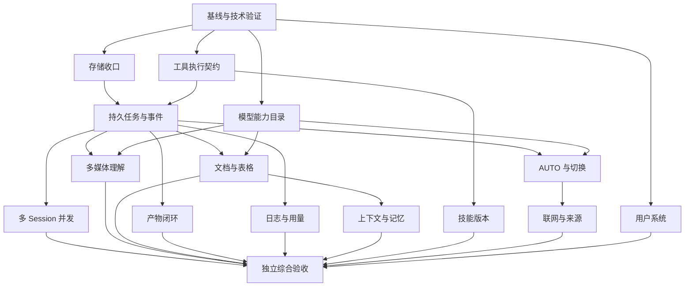

# 北极星一期 Agent 完整开发任务包 v1.0

日期：2026-10-15。代码基线：远端 main `1ceaffd2ca56703dc997ea8ccd2cffd4e84a2003`。本次已 fetch 并读取最新提交，未切换原工作区，未改产品代码。

用途：可交给 Claude 或其他实现者，按任务编号分批开发、独立验收。本文整合此前一期方案、DSH 多 session 调研、PT 模型目录讨论和 WB 借鉴审查；本轮开发范围与验收以本文为准。此前讨论稿保留为背景，不用其旧状态重复指派任务。项目进度仍只维护在《北极星总文档》中，本文不是第二份进度总表。

## 0. 交付结论与边界

**一期交付一个可供内部员工日常使用的 Agent：独立用户系统 → 默认 AUTO → 文本／图片／音视频／文档理解与生成 → 多对话并行 → 任务可追踪、可停止、可恢复 → 产物可预览下载 → 日志和用量可信。** 所有模型调用继续经 PT，复用统一 DSH 基座，不另造 Agent 内核。

| 范围 | 一期交付 |
|---|---|
| 用户系统 | 独立账号、workspace、BYOK、账号恢复、凭据与会话生命周期 |
| Agent 核心 | 同进程多 session、真实流式、工具调用、AUTO、模型切换、联网检索、上下文与记忆 |
| 输入 | 文本、图片、音频、视频、TXT／MD／CSV／PDF／DOCX／XLSX，多附件连续问答 |
| 输出 | 有依据的回答、结构化报告、图片／视频、MD／HTML／PDF／CSV／XLSX 文件及可用预览／下载 |
| 执行 | 持久任务、排队、取消、重连、外部异步任务查询、有限恢复、预算与重复失败熔断 |
| 日志与用量 | 请求／步骤／产物可追踪，成功失败均记录，实际模型、Token、媒体计量及费用来源明确 |
| 现有业务 | 保留 GA、归因、埋点审计、看板等能力与契约，不扩大广告连接业务范围 |

二期：员工可配置的定时业务流、事件触发流程、跨成员协作、邀请加入同一租户、共享工作区、外部通知／业务系统回写、复杂可视化流程编排。**每日模型目录同步属于一期平台维护；一期任务队列不因业务调度在二期而推迟。**

不包含无限制的“所有格式／所有模型／所有工具”。一期不要求专业视频剪辑、实时语音通话、复杂说话人分离、任意第三方插件市场或全部 PT 模型的专用接口适配。目标格式与代表能力必须真实可用，不能用功能菜单代替验收。

## 1. 已确定的架构与产品规则

| 决定 | 执行要求 |
|---|---|
| 共享 DSH 基座，workspace 隔离 | 统一代码和版本维护；所有数据、文件、任务与 Key 按可信身份绑定 |
| 优先同进程多 session | 在当前用户／租户运行进程内并发多个对话；不要求本期把所有用户合并到唯一 OS 进程 |
| 对话内有序，对话间并发 | 初始每用户 2 个并发执行名额，可配置；同一对话只允许一个活跃轮次 |
| AUTO 为默认 | 每个步骤可选择不同能力模型；不能把生成模型当作普通聊天模型直接调用 |
| 模型目录规则维护 | 每日同步、增量更新、来源标注；打标签不依赖 LLM；能力未知不能猜为支持 |
| 技能由 PM 管理 | 员工可使用／切换已发布技能，本期不开放自主安装或让 Agent 自行扩权 |
| 保留现有部署形态 | 前端与 shell 同源；现有 analytics 继续提供数据服务；不先换框架或拆微服务 |
| 复用现有存储 | 向前兼容、增量迁移；不删库重建，不同时维护两套会话权威实现 |
| WB 只取机制 | 不抄整套 Runner、十种权限模式、命令名 SAFE 表、固定阈值或强制 DOCX 管线 |
| 实现者与验收者分离 | 自测通过才能交独立验收；独立验收通过才能解锁依赖该能力的下游 |

进程级故障会影响该进程的多个 session，应标记中断并恢复；不能宣称 session 隔离消除了进程故障影响。将来若要求所有用户共用一个运行进程，需要另验跨用户凭据与文件权限，不把它隐含进本轮并发范围。

## 2. 最新基线：已有内容不得重复开发

| 最新已有实现 | 代码位置 | 本包处理 |
|---|---|---|
| 登录／独立 workspace／BYOK／多对话／流式／停止／分岔／归档／搜索 | shell/auth*、tenant、conversations、runtime、public | 保留能力，修接缝并验真实行为 |
| 用量与日志 A1–A5：chat_usage、失败／中断补记、分类、模型名、卡片 | shell/tool-calls.cjs、server.cjs、persistent-runner.mjs、010 迁移 | 已合并，T11 补准确性与关联，不重建 |
| PT 每日目录、24h 缓存、AUTO 初版 | shell/model-catalog.cjs、server.cjs、public/app.js | 已合并；T06／T07 做能力目录与执行闭环升级 |
| PDF／HTML／MD 左侧预览与目录扫描 | shell/runtime/artifacts.cjs、dsh-adapter.cjs、public | 已合并；T10 补归属、持久化、安全与真正的产物交付 |
| conv 目录清理，真实实现移入 shell | shell/conversations.cjs、db.cjs、storage/index.cjs | 已合并，不能再把“删除 conv”列为未开始；T01 复核迁移与打包 |
| GA／归因／埋点审计与报告抽屉 | business/attribution、analytics、report-* | 保留现有接口；只修模型可见性等接缝 |

### 2.1 本轮定向验证与待修复证据

在从上述 commit 导出的隔离目录运行以下五个测试文件，结果为 **4 文件通过、1 文件失败**：model-catalog-test 66/66；ui-artifact-preview-test 56/56；ui-model-switch-test 24/24；seam-test 19/19；artifacts-test 74/75。

失败项：`normalizeArtifact({rel: "out\\doc.md"})` 在本轮 macOS／POSIX 环境未归一化为 `out/doc.md`。这不是全项目失败，但当前不能声称此新增测试全部通过；归 T10 修复并补跨平台边界验证。

新增目录测试使用注入 fetch，UI 测试使用 DOM 桩，seam-test 未真实开库；不能据此宣称真实 PT 同步、AUTO 选模、DSH 切换或浏览器端到端通过。

| 证据编号 | 当前代码缺口／风险 | 归属 |
|---|---|---|
| R01 | 新用户 /api/models 展示 AUTO，但 handleChat 先以默认模型补空值，可能绕过 AUTO 分支 | T07 |
| R02 | model-catalog 主要保存 id/name/chat/kind；端点缺失按名称猜并默认可聊天；Wan 等名称不能准确区分全部任务 | T06 |
| R03 | 目录全量可见，但 DSH 可执行模型仍依赖静态配置；AUTO 可能选中未接通候选 | T06／T07 |
| R04 | 目录缓存整体替换，缺少已消失模型的状态保留、能力来源、验证与权限范围 | T06 |
| R05 | 热 session 创建后保持旧模型；当前记录 selectedModel 可能不同于执行模型 | T04／T07／T11 |
| R06 | runningJobs 按用户锁；runner 全局队列及 lastReport 等共享变量阻止安全并发 | T03／T04 |
| R07 | server 提供 onArtifact，但 tenant 的 runtime.run(spec) 未透传；即时产物通知链不完整 | T10 |
| R08 | artifact 在 done 帧返回，但成功消息持久化未保存该列表；缺少可靠历史产物关联 | T10 |
| R09 | 按 workspace 修改时间扫描产物在多对话并发时会混归属，不能作为正式归属判据 | T04／T10 |
| R10 | storage/migrations 仍仅 001–006，生产 db-migrations 已到 010；需统一升级入口 | T01 |
| R11 | 已有 usage 行全 NULL，SUM 的 COALESCE 仍可能显示假 0；runner 只保留最后一份 usage，累计语义待验 | T11 |
| R12 | 质量工具向模型 render 仅标题／评分，完整报告另给 UI；整轮失败可能覆盖已完成步骤状态 | T05／T11 |
| R13 | 忘记密码没有真实发信交付；已有 workspace 不自动更新同名技能内容；CI 未执行主要行为回归 | T02／T13／T15 |

上述是本次静态检查及已有定向证据，不是生产漏洞利用或真实 PT 全链路验收结论。实现前若 main 再变化，T00 必须更新差异，已修条目只验收，不重做。

## 3. 分工、接口与数据原则

### 3.1 文件归属

| 负责人角色 | 主要负责 | 修改边界 |
|---|---|---|
| 基座／运行时 | T03／T04，runtime 与 tenant，session 事件契约 | 不改 DSH node_modules；优先插件与公开 SDK |
| 模型能力 | T06／T07，model-catalog 与新增 models 模块 | 不另建平行模型目录；复用现有 API 与缓存迁移 |
| 附件／产物 | T08／T09／T10 | 共用 Attachment／Artifact 契约；不各建上传目录和权限系统 |
| 用户／存储／用量 | T01／T02／T11／T12 | 一个迁移源；保持历史数据与现有接口 |
| 工具／技能 | T05／T13／T14 | 复用 DSH 工具／技能机制与 business 公开导出 |
| UI | 各包前端与 T15 浏览器场景 | public/app.js、index.html、styles.css 指定单一集成人，避免多人同时改整文件 |
| 独立验收 | T15 及逐包验收 | 不以实现者报告替代复现；只修测试夹具／验收代码时也明确身份 |

server.cjs、tenant.cjs、persistent-runner.mjs、app.js、index.html、styles.css 是共享接缝文件；每批指定唯一集成人。其他包先交公开模块与契约，再串行接线。业务模块不自行改权限／身份全局状态；UI 不重算业务指标。

### 3.2 最小关联对象（逻辑契约，T00 固化字段）

| 对象 | 必须表达 |
|---|---|
| Conversation | 所有者、workspace、模型偏好 AUTO／手动、选定技能、历史引用 |
| Run | runId、对话、可信用户／租户、状态、预算、取消信息、上下文／策略版本 |
| RunEvent | runId＋单调 seq、事件 ID、类型、时间、关联 attempt／call／artifact；可重放去重 |
| ModelAttempt | 请求模型、解析模型、上游返回模型、能力需求、路由理由、请求 ID、状态与用量来源 |
| ToolCall | callId、参数校验、开始／结束、真实状态、错误、关联外部任务与产物 |
| Attachment | 文件 ID、可信归属、类型、大小／hash、解析状态、来源定位与索引版本 |
| Artifact | 产物 ID、run／call／来源附件、不可变版本、存储位置、预览／下载权限、留存 |
| ModelRecord | 平台模型 ID、协议、模态／任务能力、证据、上游可见性、适配与验证状态、时间 |

这些对象可以通过现有表扩列或少量增量表实现，不要求照表一对象一表。产品会话消息是展示投影；DSH session 事实与业务任务状态的所有权要清楚，禁止两套内核独立执行同一工具。业务元数据不必全部塞入模型上下文。

### 3.3 API 演进规则

保留现有对话 API／SSE 消费兼容，增量加入 runId 与事件游标。建议任务 API：创建任务、查询任务、订阅指定任务事件、取消任务、列出任务产物；既有 /api/chat 可桥接同一执行服务，不得维护第二条独立执行链。事件至少包括 queued、connecting、delta、tool.started／finished、attachment.status、artifact.ready、usage、state、done／error。

用户身份和 workspace 从服务端 session 解析；请求体内 tenantId、userId、workspace 路径不能充当授权。取消、预览、下载、日志、索引均校验真实归属。事件按序批量保存并支持 after 游标，不为每个字符单独写事务；持久化边界与可能丢失范围必须清楚。

## 4. 总任务表与依赖

以下均为增量任务。状态含义：“已有初版”不等于“验收完成”，“缺失”不等于全部从零开发。

| ID | 任务 | 基线状态 | 依赖 | 人日 |
|---|---|---|---|---:|
| T00 | 基线复核、DSH／PT 技术验证、共享契约 | 必做前置 | — | 2–3 |
| T01 | 文件／存储／迁移收口 | conv 已清，余项待验 | T00 | 2–4 |
| T02 | 用户系统与 Key 生命周期 | 部分已有 | T00 | 3–5 |
| T03 | 持久任务、事件、恢复与预算 | 缺正式闭环 | T00、T01 | 5–8 |
| T04 | 同进程多 session 并发与隔离取消 | 当前串行 | T03、T05 执行契约 | 6–10 |
| T05 | 统一工具执行、报告依据与安全边界 | 已有注册，入口分叉 | T00；完成接线依赖 T03 | 3–5 |
| T06 | PT 模型能力目录与每日增量维护 | 每日目录初版已有 | T00、T01 | 2–4 |
| T07 | AUTO 能力路由与真实模型切换 | 文本规则初版已有 | T03、T06；多模态验收依赖 T08／T09 | 4–7 |
| T08 | 图片／音频／视频理解与混合输入 | 上传／生成已有，理解不足 | T03、T05、T06 | 7–11 |
| T09 | 文档解析、检索引用、表格分析 | 仅纯文本上下文初版 | T03、T05、T06 | 7–11 |
| T10 | 多产物、预览、持久化与导出 | PDF／HTML／MD 预览已有 | T03；并发归属与 T04 联调 | 3–5 |
| T11 | 真实请求用量、费用与日志完善 | A1–A5 已有 | T03、T05、T06 | 4–6 |
| T12 | 上下文预算与可管理记忆 | 键值记忆已有 | T03；资料检索接 T09 | 3–5 |
| T13 | PM 管理的技能目录与版本发布 | 拷贝加载已有 | T00、T05 | 2–4 |
| T14 | 联网检索／网页读取／来源收口 | DSH 相关能力需验 | T05、T07 | 2–4 |
| T15 | 持续 CI、真实场景验收、性能与交付 | 语法 CI 已有 | 持续进行；最终依赖全部包 | 5–8 |
| 合计 | 模块开发与验收，不含缓冲 | — | — | **60–100** |

T05 的执行契约先交付，T03 与 T05 随后共同接线，避免循环依赖。T04 不等待全部多媒体功能完成，可先用受控异步测试工具验并发。T07 先验文本路由，再随 T08／T09 验完整 AUTO。



## 5. 可分派任务规格

### T00｜锁定基线与验证关键假设（2–3 人日）

**目标**：让后续实现依据真实版本、PT 响应和 SDK 行为；不让新合并内容被重复重建。

交付：最新 main 差异表、DSH 锁定包／依赖版本、PT 目录脱敏字段样本、模型能力来源矩阵、usage 语义、共享对象与事件契约、文件负责人及测试环境说明。

工作：复核本包 R01–R13；用当前锁定 DSH 做同进程双 session 技术验证；核实取消／dispose／文件 cwd／模型切换；获取真实 /v1/models 完整响应及分页范围；核实音频理解／ASR、视频理解、价格与实际账单接口。没有外部资料时先实现可测契约，但保留真实验证缺口。

验收：① 固定完整 hash 与依赖版本；② 两 session 的运行区间实际重叠且事件可归属；③ 取消／模型切换验证与“尚未证明”分别列出；④ PT 证据不含 Key、敏感回调或用户资料；⑤ 无法取得的能力列为依赖，不能默认为支持。

### T01｜唯一实现与迁移／打包收口（2–4 人日）

**目标**：确认新合并的 conv 清理真实生效，修存储入口差异；不是再次执行目录删除。

范围：shell/conversations.cjs、memory.cjs、db.cjs、db-pg.cjs、storage/*、db-migrations/*、seam 测试、打包与相关说明。

工作：确认生产、测试和脚本不运行引用 conv；统一生产与 Storage Contract 的迁移来源；现有迁移文件名／记录不重编号；PG 显式配置时，加载／连接失败明确报错，不静默回落另一种数据库。按后续任务需要拆模块，不做无关全仓重构。

验收：① 现有库升级后用户／对话／归档／搜索／记忆／Key 保留；② PGlite 重启与迁移幂等真实验证；③ PG 路径使用真实临时 PG 验证；④ 干净安装与打包不依赖 conv；⑤ 历史注释不是运行引用，不以 grep 文本计数代替行为。

### T02｜用户系统与 BYOK 生命周期（3–5 人日）

**目标**：员工能登录、恢复账号、更新 Key，并始终只使用自己的数据与额度。

范围：auth*、keys*、key-routes、tenant／runtime 凭据接缝、相关设置 UI。

工作：完成真实邮件重置交付，或先交受控管理员恢复流程并明确 UI；令牌消费与密码修改原子化、一次性、过期失效；重置后处理旧 session；常见弱密码校验与限流；Key 换绑／撤销时对下一轮和运行中任务采用明确策略。禁止在共享进程中按任务改全局环境变量切换不同用户 Key。

验收：① 注册→登录→绑 Key→真实对话通过；② 热进程换 Key 后下一次请求使用新 Key，撤销后新任务失败；③ 重置令牌并发重复使用仅一次成功，过期不可用；④ A 不能读取 B 的文件／任务／日志／记忆；⑤ 生产 cookie／CSRF／反代配置在目标环境验证，开发回传重置 token 不能用于生产。

### T03｜持久任务、事件重连、恢复与预算（5–8 人日）

**目标**：执行生命周期独立于浏览器和单次 HTTP 请求。

建议状态：queued、running、waiting_external、awaiting_confirmation、cancelling；终态 completed／failed／cancelled／interrupted。外部状态未知另记 needs_reconciliation，不伪装成功或自动重提。awaiting_confirmation 只用于需要真实决定的参数／费用／外部动作，常规已授权操作不反复问。

工作：创建持久 run、稳定客户端提交幂等键、单调事件序号；先记外部提交意图再提交，保存供应商 taskId；刷新／断线可订阅原任务；重启对可查询任务恢复查询，对不可恢复推理明确中断。预算涵盖时长、模型请求次数、重复工具调用、重试次数及有依据的费用额度。保持原 /api/chat 兼容，统一底层执行入口。

验收：① 重复提交同幂等键返回同一任务，不能新扣两次费；② 刷新后能看到原任务状态并去重收到后续事件；③ 工具成功后服务重启仍保留记录；④ 模拟“上游已接受、本地未拿到结果”不盲目重试付费任务；⑤ 超预算有限停止并说明原因；⑥ 只读查询与外部副作用采用不同恢复策略；⑦ 用户切页不取消任务，明确点停止才取消。

### T04｜同进程多 Session 并发（6–10 人日）

**目标**：同一用户的视频任务不阻塞另一个对话，保持同一套 DSH 基座与 workspace。

范围：server 运行中任务索引、runtime/dsh-adapter、persistent-runner、tenant、任务 UI 与事件协议。

工作：用户全局锁改对话锁＋用户／全局信号量；runner 改按 session 排队；currentTenantId、lastReport、lastMediaRouteResult、lastMediaRouteModel 等改可信 session／run 局部状态；完整持有 SDK 生命周期 handle；取消等待真实收敛，不能把“已发取消”当“已停止”。超时不常规杀共享进程；失控进程的最终重启必须标记受影响任务，并按 T03 恢复。禁止 process.chdir 随任务切换；CPU 密集解析用受限 worker，不阻塞整个事件循环。

验收：① 同进程 A／B 两真实任务有运行重叠；② 同对话同时第二次提交明确排队或 busy，不能覆盖历史；③ 停止 A 后 B 正常结束；④ 相同工具名／近同时结果／不同报告均正确归属；⑤ 同文件写入受控、不同任务目录互不覆盖；⑥ 连续创建关闭 session 后资源释放，无持续增长；⑦ 共享进程崩溃时状态真实、恢复不重提未知付费任务。

### T05｜工具执行统一、报告依据与安全边界（3–5 人日）

**目标**：对话调用和 API 调用执行同一份工具定义、参数校验、权限和日志契约。

范围：tools/registry、autoload、runtime 工具桥、business 公开契约、报告 render、文件／命令执行限制。不改 business 内部计算口径来掩盖基座接缝。

工作：统一工具别名／ID；完整校验输入 Schema；可信授权上下文不让模型填 tenant；所需凭据、风险和预算统一执行；报告向模型返回必要 stats／问题／建议／来源，UI 保留完整结构；一轮支持多份报告。文件真实路径、符号链接、命令执行和网络出口有可证明约束；上游模型名、文件名、错误信息用安全 DOM 输出。平台权限不能由 Skill frontmatter 或文档正文修改。

验收：① 非授权用户从对话与 HTTP 两入口均被拒；② 非法参数不触达 executor；③ 模型能解释报告中一个真实具体问题，不能只复述评分；④ 多报告都持久化；⑤ 目录穿越／符号链接／恶意网页与附件无法扩权；⑥ 普通允许操作不增加无意义审批；⑦ 不把 Python／curl 等命令名视为充分安全证明。

### T06｜PT 模型能力目录与每日同步升级（2–4 人日）

**目标**：在现有 model-catalog.cjs 上实现“新增可发现、已有保留、消失标不可用、能力有来源”。

数据：inputModalities、outputModalities、tasks、protocol／endpoint、工具调用／流式／结构化输出、上下文／文件／时长限制；每项证据来源与时间；availability、adapterStatus、verificationStatus 分开。保留本地人工覆盖、启用策略、历史路由版本。未知采用 unknown，不默认 true。

同步：每天一次全局目录维护，支持管理员刷新；新增／变更增量解析；已有无变化只更新 lastSeen；完整且成功的同范围快照中消失才标不可见，保留 tombstone；重新出现恢复；401／限流／网络错／异常分页不下架全部模型。缓存、超时、去重同步、失败退避、调度唯一性明确。平台目录与各 Key 可见范围分开；可复用现有本地缓存或增量存储，不另建平行目录。

标签：优先 PT 结构化元数据，其次官方定义和受控覆盖，不调用 LLM 给整表打标签，不以模型名或 endpoint 家族推断全部模态。新的未知专用协议只“已发现”，不能直接宣称可运行。

验收：① 新增／修改／消失／恢复／权限范围变化各有测试；② 失败快照保留旧目录；③ 同步不产生模型生成调用；④ 新能力有来源，unknown 不成为支持；⑤ 真实 PT 快照与本地规范化结果可核对；⑥ 目录中可选与 runtime 真正可执行一致，或明确显示未适配。

### T07｜默认 AUTO、按能力路由与模型切换（4–7 人日）

**目标**：从文本关键词初版升级为输入／附件／任务所需能力驱动的选择。

工作：修新用户实际请求绕过 AUTO；模型偏好绑定对话，用户偏好只作新对话默认；按步骤规划理解／查询／生成；先过滤能力、权限、适配、可用性和预算，再按质量／延迟／成本策略选；没有数据时用经过验收的默认候选，不凭 max／pro 名称承诺性能。显式手动模型不静默换成其他模型；若需回退遵守产品策略并记录。已提交异步任务先查询原 taskId。

模型切换：下一轮真实生效，进行中的轮次不变；优先用 SDK 的已验证能力；不支持时安全重建 session 并重放持久上下文，不重做历史工具。动态目录须接到 DSH 可执行路由，不仅更新下拉列表。

验收：① 全新用户未选择模型时真实进入 AUTO；② 看图、编辑图、生成视频、长文档、工具查询路由到满足要求的执行能力；③ 热对话 X→Y 下一轮请求证据确认为 Y，历史保留；④ 新目录模型可执行，否则不可作为 AUTO 候选；⑤ 回退不跨能力／预算；⑥ requested／resolved／上游返回模型分别记录，未暴露的内部路由填未知；⑦ 简单问题不会每次多一轮昂贵分类，路由耗时可测。

### T08｜图片、音频、视频理解与混合输入（7–11 人日）

**目标**：上传后真正理解内容，连续追问可引用具体文件或时间位置；保留现有媒体生成。

共用 Attachment 服务，输入内容类型与文件魔数校验；图片多图分析／OCR／图表；音频经 PT 原生理解或 ASR 得到时间戳内容；视频原生理解或抽帧＋音轨联合分析。使用受控文件引用／签名地址／供应商文件 API，不能把用户目录公开给外部。处理进度、失败、超限与保留策略可见。

建议验收档位（T00 实测后固化配置，不是承诺无限规模）：图片单个≤20MB、每轮≤4 张；音频≤50MB／30 分钟；视频≤100MB／10 分钟。视频采用采样时记录帧时间与覆盖范围，不能宣称逐帧分析。配额要与现有默认 100MB 总上传空间协调，不出现单任务允许但总配额天然不足的配置。

验收：① 使用带已知文字／图表／音频事实／视频事件的真实素材，回答与事实相符；② 图片理解不调用生图冒充；③ 录音定位时间戳；④ 视频结论能定位片段并说明采样缺口；⑤ 同轮多附件引用不串；⑥ 同一个对话后续可继续问附件；⑦ Key 无权限／转录失败不伪装空内容；⑧ 至少一个 PT 真实图像理解、音频理解、视频理解链路通过。PT 某类无可用端点时该类标外部阻塞，不能将一期全能力标完成。

### T09｜文档问答、检索引用与确定性表格分析（7–11 人日）

**目标**：员工能读普通办公资料，跨文件对比，数字有计算依据。

输入：TXT／MD／CSV／PDF（含扫描件）／DOCX／XLSX。解析保留文件版本、PDF 页码、Word 标题／段落、sheet／行列；小文件直接分析，大文件按租户／选定资料范围检索；支持跨文档比较与后续追问。先复用现有 PG／PGlite 能力，不强制建设独立向量服务。

表格计算用受控确定性工具，处理单位、日期、空值、重复、合计与公式来源，不把缺失值当 0。设置解压后大小／页数／单元格／执行时长限制，宏与内嵌脚本不执行。建议档位：纯文本单个≤5MB；PDF／DOCX≤20MB、PDF≤200 页；CSV／XLSX≤20MB、最多 10 万单元格；超限明确降级／分批，不能静默截断。

验收：① 每种格式至少一份真实资料端到端；② 扫描 PDF OCR 有来源与无法识别提示；③ 关键结论可点击回原页／sheet／行列；④ 多文件事实不混源；⑤ 给定含空值／重复／多单位的标准表，计算结果精确一致；⑥ 删除资料后检索与上下文不再引用失效内容；⑦ 解析错误不伪装无数据；⑧ 长文档说明实际覆盖与引用范围。

### T10｜多产物、历史预览、版本与生成导出（3–5 人日）

**目标**：把新合并的左侧预览接成可靠产物管理；不重做已有面板。

首先修 R07／R08 透传与持久化、反斜杠归一化失败。产物按 run／call 显式注册、可信任务输出目录或可靠映射归属；workspace mtime 扫描只作发现兜底，不能并发时给 A 归入 B 文件。统一图片／视频／报告与文件索引，保留不可变版本；重命名同路径不覆盖历史结果。

一期输出 MD／HTML／PDF／CSV／XLSX；复用模板、确定性导出与渲染验证，不为每份短文跑多专家 Agent。既有 PDF／HTML／MD 预览保留；图片／视频继续气泡展示并进入统一产物列表。格式转换失败仍交付已完成的可用正文，明确失败类型，不宣称目标格式已生成。

验收：① Agent 真实写文件→运行时事件→tenant→server→前端面板闭环；② 刷新／重启／重开对话仍能预览下载；③ A／B 并发同时写文件，产物归属与版本正确；④ 一轮多报告／多图均保留；⑤ HTML iframe 禁脚本、危险链接受控，下载与预览均防越权／符号链接／路径穿越；⑥ 导出文件可由独立读取器／渲染器打开，表格计算与页布局验证；⑦ 外部媒体 URL 过期有留存或明确失效状态；⑧ artifacts-test 跨平台路径测试通过。

### T11｜日志、Token、媒体计量与费用准确性（4–6 人日）

**目标**：在 A1–A5 基础上收口正确性，不重新开发整个用量系统。

工作：工具真实开始／结束写事件；保留各步骤真实状态，整轮失败不覆盖成功步骤；模型请求逐次关联 request／attempt／run；确认 DSH usage 字段与增量／累计语义后去重聚合，不能仅取最后一次回复。已知零、未知、部分已知分别返回覆盖信息，不用 COUNT(*) 判断量是否已知。失败／取消／重试／心跳均入账并标来源，心跳不混入用户任务统计。

实际执行模型从运行时请求证据返回；媒体模型、provider、taskId 独立于主对话模型。Token／图片张数／视频秒／音频时长／OCR 页等按单位记录，价格版本与币种明确。费用估算和 PT 实际扣费分开；接口缺失显示未接入实际账单，不填 0。不跨用户求和。

验收：① 单轮至少两次 LLM 请求＋一次重试，按已确认语义精确聚合；② 全 NULL／部分 NULL／真实零／无调用四种状态分别正确；③ 工具成功、后续模型失败仍显示工具成功；④ 热切换后实际模型与日志一致；⑤ 用户停止、超时、崩溃记录可查；⑥ 媒体消费不冒充 Token；⑦ 过滤／分页／导出／时区边界／脱敏验证；⑧ 实际账单不可用时明确交付边界，不声称精确费用。

### T12｜上下文预算、记忆与个人资料范围（3–5 人日）

**目标**：长对话可继续工作，跨对话保留经过确认的稳定偏好，资料与权限不混淆。

工作：保留原始历史与摘要来源，按模型上下文预算选择最近消息、工具证据和相关附件片段；压缩不丢当前目标、约束、待办、关键来源与失败状态；按需读取记忆，不每轮注入全部资料。记忆增加来源／范围／更新时间／失效标识，可看、改、删；用户明确要求记住时确认保存结果，自动推断不能伪装用户确认事实。初期规则检索优先，不每条消息额外调用记忆选择模型。

验收：① 超出上下文预算的长对话可继续，保留关键约束；② 新对话召回稳定用户偏好；③ 删除／更正后新请求与已有热会话不再采用旧记忆，相关索引／派生摘要按策略失效；④ A 用户记忆不进入 B；⑤ 上传内容或网页不能通过“写记忆”获得系统权限；⑥ 上下文使用量、压缩与未覆盖范围可解释。

### T13｜技能目录、按需加载与 PM 发布（2–4 人日）

**目标**：PM 接入技能后，用户看到的可用状态、版本和真实执行一致。

工作：复用 DSH SKILL 发现／加载，不另造兼容层内核；维护技能 ID、版本、来源、能力需求、依赖、启停、授权与运行验证状态；修已有 workspace 只首拷贝、不更新的问题。受控只读共享技能或版本化同步均可，但任务开始绑定版本，进行中不热替换脚本。先注入精简目录，使用时加载正文；员工能明确选择已发布技能，也可让 Agent 合理选择。

验收：① 发布 v2 后已有用户的新任务使用 v2，v1 运行任务不被中途修改；② 禁用后新任务不可调用，历史记录保留版本；③ Skill 声称的能力能定位 executor 和测试；④ 员工／模型修改 frontmatter 不能获得发布、删除或扩权资格；⑤ 加载失败与依赖缺失明确展示；⑥ 多技能场景不重复注册／无限增长上下文。

### T14｜联网检索与网页读取收口（2–4 人日）

**目标**：员工可查询外部信息，答案有可检查来源；复用现有 DSH 插件，不凭 settings 条目声称生效。

工作：确认生产 run-persistent profile 实际挂载搜索／读取能力；查询与链接读取分别验；记录 URL、访问时间与关键引用，不虚构已读页面；对登录墙、失败、过期内容明确标记。URL 与重定向解析防内部敏感地址访问；网页正文是外部资料，不能改权限或决定工具凭据。

验收：① 从生产对话入口真实搜索并读取页面，回答含可点来源；② 页面不可达／需登录不伪造内容；③ 查询失败不返回示例结果冒充；④ 内网／云元数据／恶意重定向受控；⑤ 外部网页指令不触发未授权文件或网络动作；⑥ 搜索／抓取耗时与费用来源可观察。

### T15｜持续 CI、独立综合验收与交付（5–8 人日）

**目标**：每个能力既可单独证明，也能从员工真实入口组合使用。

工作：把关键行为回归加入 CI，不只语法与迁移文件非空；真实临时 DB、HTTP、受控上游、浏览器与付费模型分层；修测试依赖绝对安装路径／生产缓存／固定 sleep 的问题。测试只能写隔离目录，不能删除开发者真实 model-catalog 缓存。付费验收设预算并与普通 CI 分开，失败／无凭据不得显示通过。

验收：① 第 7 节矩阵全部有证据；② 干净安装、旧数据升级、重启、回滚预案可复现；③ 首字／排队／解析／外部生成／渲染分别测时，至少报告 P50／P95 或足够样本的原始分布；④ 两对话并发无串扰，至少两用户隔离实测；⑤ 目标桌面浏览器和基础移动操作可用；⑥ 每批提供完整 commit hash、测试命令／结果、未覆盖范围及阻塞项；⑦ 最终由独立验收者给“可交付／不可交付”，不以实现者自测或 mock 替代真实验收。

## 6. WB 借鉴规则：采纳什么、避免什么

| 采纳机制 | 北极星适配方式 | 不照搬的部分 |
|---|---|---|
| 每 run 独立上下文 | runtime 外围任务对象，状态按 session／run 归属 | 重写 DSH Runner |
| 追加事件与恢复游标 | 持久任务事件、语义批量保存、幂等重放 | 游标保证外部副作用恰好一次 |
| provider 元数据侧车 | 请求／工具／产物／用量独立关联 | 为展示过程而保存全部隐藏推理 |
| 角色模型与 fallback | 能力约束候选与已验证适配器 | vision／视频失败无条件回主文本模型 |
| 精简记忆入口＋按需资料 | 数据库与索引继续作为可控来源 | 强制换为全文件事实源、记忆永不可删 |
| 技能发现、按需正文、版本 | PM 发布、版本绑定与可信权限 | Agent 自行添加技能／修改权限 |
| 内容→排版→导出 | 按用户目标格式选择阶段、验证与降级 | 所有任务最终必须 DOCX、多专家串行 |
| 权限与隔离独立 | 参数／身份／路径／执行限制各自成立 | 复制命令名 SAFE 列表或仅靠 AI 裁决 |
| 预算与失败熔断 | 可配置、按真实任务调优 | 复制 500 轮／固定 60–120 秒分类器等待 |

WB 的 Auto 权限分类器不是北极星 AUTO 模型路由。本期不为日常工具调用默认增加两轮安全 LLM 请求，不以此损害响应体验。

## 7. 一期总验收矩阵（全部覆盖才可宣称完整一期）

| ID | 员工场景 | 通过标准 | 主要包 |
|---|---|---|---|
| AC01 | 新员工首次使用 | 注册／恢复、绑 Key、默认 AUTO、首次真实问答闭环 | T02／T07 |
| AC02 | 同时两个对话 | A 视频生成期间 B 可执行真实问答／文件任务，运行区间重叠 | T03／T04 |
| AC03 | 定向停止 | 停止 A，B 不受影响；上游仍运行时明确说明 | T03／T04 |
| AC04 | 刷新／断网／重启 | 原任务可查、事件不重复、结果不丢、不自动重提未知付费任务 | T03 |
| AC05 | 热会话切换模型 | 下一轮请求真走新模型，历史和附件保留，日志一致 | T07／T11 |
| AC06 | 模型目录生命周期 | 新增可发现、消失标不可用、恢复可识别；失败同步不全下架 | T06 |
| AC07 | AUTO 混合任务 | 看产品图→生成海报→生成视频，各步骤能力正确，多个产物都在 | T07／T08／T10 |
| AC08 | 图片理解 | 正确读图／图表，无法辨识区域明确说明且引用图片 | T08 |
| AC09 | 录音／视频问答 | 转录／视觉内容真实，时间戳可回查，采样边界说明 | T08 |
| AC10 | 办公文档与表格 | 每个约定格式可读，跨文件引用正确，计算标准答案一致 | T09 |
| AC11 | 文件产物交付 | MD／HTML／PDF／CSV／XLSX 可生成／验证／预览或下载，重开仍在 | T10 |
| AC12 | 多份报告 | 所有报告保存，Agent 能解释真实问题与建议依据 | T05／T10 |
| AC13 | 失败与费用 | 已成功步骤不变失败；多请求去重计量；未知不为零；估算不冒充扣费 | T11 |
| AC14 | 长对话与个人记忆 | 保留关键约束；新对话召回已确认偏好；删改生效且不跨用户 | T12 |
| AC15 | 技能与联网 | PM 新版对新任务生效；联网结果有真实来源；失败不伪装 | T13／T14 |
| AC16 | 越权与注入 | A 不能读 B，附件／网页／技能无法提升权限，恶意路径／链接受控 | T02／T05／T10／T14 |
| AC17 | 部署与升级 | 无 conv 依赖、干净安装可跑、旧数据保留、目标 DB 分支实测 | T01／T15 |
| AC18 | 响应体验 | 排队、连接、解析、生成各阶段可见；测时可复现，不给所有模型承诺同一时延 | T03／T15 |

性能不把“首字 2 秒”等上游不受控指标写成无条件承诺。T00 先确定测试机、网络、模型、数据量与预算，T15 在同条件比较基线与改造后结果；排队时长和首字时间分开统计。系统自身不能为简单请求串联不必要的选模、安全分类、记忆选择调用。

## 8. 分批交付与工作量

| 批次 | 任务组合 | 必须看见的增量成果 |
|---|---|---|
| 批 0 | T00，T01；T02／T05／T06 的契约可并行 | 最新差异、关键依赖验证、唯一存储入口；修已知测试失败 |
| 批 1 | T03、T04、T05 的执行接线、T10 持久化、T11 事件关联 | 两对话不互相卡住、任务可查、失败有记录、产物不丢 |
| 批 2 | T06、T07、T08、T09、T10 输出格式 | 默认 AUTO、真正看图／听音／理解视频、文档引用、可用文件交付 |
| 批 3 | T02／T11／T12／T13／T14 收口，T15 最终验收 | 账号／Key／记忆／技能／费用／联网与运行稳定性闭环 |

T15 的测试与独立验收贯穿各批，不拖到最后才运行。不同任务包可以开发独立模块，但共享接缝文件按集成人串行修改。不得以并行开发绕过依赖包的验收。

总量 **60–100 有效工程人日**，包含模块设计／实现／自测与单列的综合验收；加入约 20% 不确定性，排期预算约 **75–120 人日**。相较旧讨论范围，上限变化来自同进程多 session 的完整取消／生命周期治理与技能发布收口，同时已扣除新合并目录／预览／conv 的从零开发工作。

按熟悉项目的工程师配合 AI 开发估算，不是模型生成代码耗时；两名工程师配独立验收支持，考虑依赖约 9–15 工作周。先完成 T00 后重估，不能简单人数相除。新供应商接入、未验证 SDK 不兼容、复杂隔离重构不保证全部被缓冲覆盖。范围变化必须明确加减任务，不能静默压缩验收。

## 9. 外部依赖与完成判定

| 依赖 | 不具备时可继续做什么 | 不得声称什么 |
|---|---|---|
| PT 测试 Key、权限与额度 | 契约、受控上游、UI 与本地 DB 集成 | 真实 PT／真实并发／真实多模态已通过 |
| PT 完整模型目录／能力元数据 | 规范化器与来源矩阵、未知状态 | 模型能力自动全量识别准确 |
| ASR／音频与视频理解端点 | 附件管线与明确缺失提示 | 上传成功即能理解，或一期全模态已完成 |
| 单价／账单数据 | 真实计量、估算／账单缺失状态 | 精确实际费用或媒体 Token 可替代费用 |
| 邮件／管理员恢复机制 | 令牌、安全流程与 UI | 忘记密码已交付可用 |
| 目标部署环境与真实 PG | PGlite 与测试适配 | 生产 HTTPS／PG／容量已验收 |

无需在所有包开始前取得全部依赖；先做不依赖它的工作。缺少某项外部验收时应列具体阻塞、责任方、已完成工作和复验入口。**“代码完成但待真实验收”不是“全部完成”，也不能让无关包停工。**

## 10. 实施、测试、提交与验收交接规范

每包开始：确认当前分支／hash／干净或已有用户改动，查本地 AGENTS 与既有契约；核对 upstream 新增实现；列本包具体修改文件、公开接口与迁移，复用能用的能力。不要覆盖用户／其他实现者改动。

每包交付必须包含下表；实现者与验收者分别填写，不用新增另一份项目进度总文档。

| 字段 | 必填内容 |
|---|---|
| 范围 | T 编号、目标、对应 R／AC，明确未做部分 |
| 代码 | 分支、完整 commit hash、文件清单、接口／迁移变更 |
| 验证 | 命令、环境、数据范围、实际 PASS／FAIL、mock／本地集成／真实模型／浏览器分别标注 |
| 证据 | 非敏感请求／任务 ID、时间区间、页面或日志证据、数字对账与错误样本 |
| 边界 | 外部阻塞、已知非阻塞缺陷、性能限制、回滚方式 |
| 结论 | 已实现／待验收／验收不通过／验收通过；不可由自测直接跳到独立验收通过 |

提交／推送／合并／部署分别报告；不能互相代替。默认不因本文自动授权合并 main 或生产部署；实施按用户后续安排执行。用户已明确授权的操作不重复索要许可。

可复用的定向命令示例（从实施基线的隔离导出目录运行，测试缓存与 DB 均不得指向真实用户环境）：当前 model-catalog-test 把缓存路径固定在导出目录的 runtime 下并会清理它，必须在隔离导出目录执行，或先完成可注入测试路径整改；仅设置一个未被读取的环境变量不算隔离。

```bash
node --test tests/regression/runtime-contract-test.mjs tests/regression/ui-conversation-isolation-test.mjs
node --test tests/regression/model-catalog-test.mjs tests/regression/ui-model-switch-test.mjs
node --test tests/regression/artifacts-test.mjs tests/regression/ui-artifact-preview-test.mjs
node --test tests/regression/ui-usage-token-summary-test.mjs
node tests/regression/seam-test.mjs
node tests/regression/seam-smoke.mjs
```

上述不是全部验收命令，也不意味着当前全部通过；新增行为需要有意义的新测试。真实 DSH／PT／PG／浏览器需对应实际验收入口，不能以 mock 或字符串检查代替。完成聚焦验证后，不无理由深度重测整个无关业务。

## 11. 二期保留任务包

| ID | 内容 | 依赖／估算 |
|---|---|---|
| P2-01 | 固定模板定时业务流：时区、暂停、错过触发、有限重试、通知与执行历史 | 复用一期 run/event/artifact/usage；约 10–16 人日 |
| P2-02 | 可视化流程编排、条件节点与流程版本 | P2-01 后另加约 12–20 人日 |
| P2-03 | 邀请加入同一租户、共享工作区、跨成员权限 | 单独产品设计与估算，不能用现有角色表代替协作闭环 |

二期不能把持久调度绑定浏览器打开状态或某个短命对话；重复触发、外部动作幂等、租约、DST 与密钥失效均需专项验收。WB 的 Cron 可作参考，不照搬固定三天到期／500ms 轮询等产品阈值。

## 12. 可直接复制给 Claude 的启动说明

> 请先阅读本任务包，按 T00 开始核实 main 最新状态；不要整包直接同时改代码。保留共享 DSH 基座，优先当前用户进程内多 session，不另写 Runner，不把全部用户合并单进程作为隐藏范围。
>
> 以 `1ceaffd2ca56703dc997ea8ccd2cffd4e84a2003` 为本包已检查基线；A1–A5 日志、模型目录／AUTO 初版、PDF／HTML／MD 预览和 conv 清理已合并，先复核和补缺，不重复开发。处理 R01–R13，尤其产物测试路径失败、新用户真实 AUTO、目录与 DSH 执行能力脱节、onArtifact 透传和产物历史持久化。
>
> 先交共享契约、文件归属和技术验证结果，再按批次实施；工具／任务层确定后做并发。所有用户文件与日志按可信身份隔离，能力未知不能猜支持，付费生成状态未知不能自动重提。每包提供独立验收证据和诚实完成状态；更新项目唯一总文档的时间线、成果线、进度线并做自洽检查。

## 13. 依据与状态说明

- 最新代码：[main 基线 1ceaffd2](https://github.com/tjj1234/pt-test/commit/1ceaffd2ca56703dc997ea8ccd2cffd4e84a2003)。本轮确认 62f5b46 之后的 B2／B3／B4 合并，未覆盖或切换用户工作区。
- 项目总文档：`北极星总文档-v1.9.md`（历史正文与增量需按本次已验证代码对齐）。
- 方案背景：`docs/一期Agent能力方案与架构审查-2026-10-15.md`、`docs/DSH多Session并发与PT模型目录自动维护-讨论稿.md`。
- WB 审查：`docs/WB分析文档对北极星一期的借鉴审查-2026-10-15.md`；原参考包 `wb copy/`。其声明不等于原产品行为已独立验证。
- 锁定版本 SDK 调研：`@deepseek-ai/dsh-agent`／`dsh-agent-loop`／`dsh-llm-pi-ai`／`dsh-fs-local` 的 `0.1.1-rc.2` 官方包；此前已读源码，本轮未重复执行真实并发。
- PT 能力来源：[官方模型目录](https://powertokens.ai/models)、[官方文档索引](https://docs.powertokens.ai/llms.txt)；实际鉴权元数据与可调用端点由 T00 获取并固化。

**任务包完成不代表功能完成。当前可交付的是实施规格与验收边界；一期产品完成必须以 AC01–AC18 的真实证据为准。**
