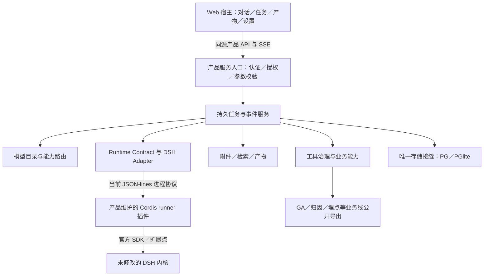
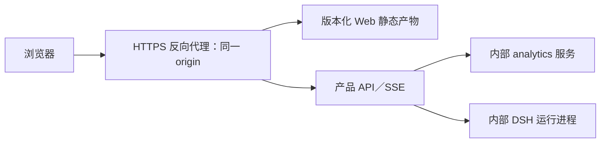

# 北极星架构设计与接口契约 v1.0

> 2026-10-16 开工授权补注：本地 v1.11 及 Codex 进度均为工作过程记录，不是正式总文档；正式总文档由用户在整体验收后发布。本文原有“取代／作废”描述不对正式任务包 D、旧架构审查修订版生效。已授权在专用集成分支从 T00 开工，期间不合 main、不部署；此前“仅文档、未授权开发”是编写时的历史状态。当前过程记录见 `docs/refactor/WORKLOG.md`（从仓库根目录定位）。

日期：2026-10-16。代码观察基线：`origin/main = a2adbee64c326653dbf5bfed3f918dd09f96589d`。本文为一期生产级重构的目标规格，不代表下述能力已实现或已通过验收；项目状态只在《北极星总文档-v1.11.md》维护。实施任务见《北极星一期生产级重构完整任务包-v2.0.md》，操作门禁见《北极星部署升级与维护说明-v1.0.md》。实施开始前仍须重新锁定 main，核对本文观察基线后的变化。

## 1. 架构结论与产品边界

北极星一期只建设 Web Agent。复用 DSH Agent 内核，通过受控 SDK、官方扩展插件和产品 Runtime Adapter 接入，不修改 DSH 包内部源码，不修改 node_modules，不复制 Agent 循环、工具执行内核或另一套 SessionStore。生产级的判断依据是可靠任务、用户隔离、能力可用、产物可交付与可维护性，不能用拆微服务代替验收。

一期采用 Web 宿主／产品服务／DSH 内核三层职责；原有 GA、归因、埋点审计等业务线作为产品服务调用的独立能力模块继续保留。这与历史“DSH 基座／业务壳／业务线”的业务资产划分是不同视角：前者描述运行职责，后者描述复用边界，不再混称同一套三层。

| 层 | 唯一职责 | 禁止承担 |
|---|---|---|
| Web 宿主 | 对话、附件、任务状态、技能选择、产物、设置与用量展示 | 拼接任意 workspace 路径、授权工具、推断账单、直接调用 DSH |
| 产品服务 | 身份与权限、可信上下文、会话记录、任务生命周期、目录与路由、Skill 发布、附件产物、日志计量 | 自建第二套 Agent 推理循环；信任前端传入租户或技能自授权 |
| DSH 内核 | 现有 Agent 循环、Session 生命周期、原生工具与 Skill 加载、流式、原生取消和上下文机制 | 产品账号、租户计费、跨用户权限、产品任务与文件归属 |
| Runtime Adapter（服务与内核接缝） | 进程与 Session 映射、公开 API 调用、事件翻译、取消收敛、兼容性 | 固化业务计费、页面逻辑、隐式补丁 DSH |

不强制照搬 WorkBuddy 的 ACP over HTTP。当前代码使用每租户常驻进程、stdin/stdout JSON-lines 与正式 Cordis 插件；应先收口契约，再决定是否值得增加内部 HTTP 传输。未来换传输只替换适配实现，仍须版本与行为测试，不以“有 Adapter”保证升级只改一个文件。

## 2. 当前观察与目标分离

当前基线存在 `shell/runtime/contract.cjs`、`dsh-adapter.cjs`、`mock-adapter.cjs`；Runtime 方法为 `run/abort/closeSession/close`，事件为 `delta/step/done/error/aborted`。DSH 顶层依赖为本地 vendor 的 `deepseek-ai-dsh-0.1.1-rc.2.tgz`。这些是观察事实；本文新增 runId、持久事件、协议协商、完整多 Session 并发等均属目标，不能因为已有接缝便标记完成。

| 领域 | 重构要求 |
|---|---|
| 已有能力 | 先验现有实现，复用登录、目录、预览、用量和业务模块；不重复建设 |
| 公开 SDK | 必须记录所用 SDK 方法、类型、包版本与行为证据；官方包中可读源码不自动等于稳定公开接口 |
| 不支持能力 | 在 T00 记录缺口与可行适配；不能私改 DSH 内部或以私有符号接入代替评审 |
| 插件配置 | 仓库保存实际 profile、bundle、patch 快照；不能只依赖开发机全局目录 |
| 旧文档 | 旧串行、密码体系、待清理 conv 等描述须按最新代码校正，不把历史状态当新任务 |

## 3. 前后端边界与部署

前后端代码和发布产物应有独立边界、独立验证入口与可独立构建／打包能力；这不要求换 React，也不要求引入没有必要的打包器。保留原生 HTML/JS 时，前端构建可为静态资源校验、清单与版本产物生成。产品服务不得通过 require 前端脚本获取业务逻辑，UI 通过版本化 API 获取数据。

一期默认同源部署：反向代理提供静态资源、产品 API 与 SSE，后端和 DSH 运行端口仅内部可达。独立构建、独立进程和独立公网源是三件不同的事；前后端独立部署仍可保持同源，不必为此更换 Cookie 鉴权。只有确有跨源需求才新增明确 CORS 与凭据策略，禁止宽泛通配。

SSE 必须关闭代理缓冲、设置适当超时、提供心跳与可恢复游标；浏览器断线不能等同取消任务。Cookie 的 Secure、HttpOnly、SameSite、路径与 CSRF／Origin 检查在目标部署环境实测，不把同源视为唯一安全措施。

## 4. 契约版本与兼容规则

本文字段是逻辑契约，T00 固化为 schema、测试和 ADR 后才能依赖，不要求一对象一张新表。现有 API 保持兼容，新增 API 前核对最新路由；下列路径为目标，不声称已存在。

| 契约 | 规则 |
|---|---|
| 产品 HTTP API | 新增资源使用 `/api/v1/`；现有 `/api/chat` 等桥接同一服务，不复制执行链；既有客户端迁移前保留旧响应 |
| Runtime Contract | 记录 contractVersion、支持能力与事件类型；不支持必需能力启动时明确失败，不静默忽略 |
| 进程协议 | 握手包含 protocolVersion、DSH 包版本、runner 版本与能力声明；请求与响应完整关联 run/session |
| Schema 演进 | 增加可选字段允许兼容；删除、改义、必填变化需升级主版本和兼容迁移 |
| 错误 | 稳定 code、可理解 message、可重试属性、requestId；内部堆栈与凭据不回传 |
| 时间与金额 | UTC 时间戳；UI 按用户时区展示；金额带币种和精度，不能无来源跨币种求和 |
| 幂等与分页 | 有费用／外部动作使用稳定幂等键；列表有稳定排序与游标；重复消息不得二次执行 |

## 5. 可信关联对象与权威来源

| 对象 | 最小信息与责任 |
|---|---|
| IdentityContext | 服务端 session 得到 userId、tenantId、role、授权版本；不可由请求体覆盖 |
| Conversation | 所有者、workspaceId、标题、模型偏好、技能偏好、分支与消息引用 |
| Run | runId、conversationId、可信身份、状态、版本、预算、上下文快照、取消与错误 |
| RunEvent | eventId、runId、单调 seq、类型、时间、callId／attemptId／artifactId、脱敏 payload |
| ModelAttempt | 请求／解析／上游实际模型、能力、端点类型、重试关系、状态、计量来源 |
| ToolCall | callId、工具 ID 与版本、分类、参数摘要、授权结果、状态、外部 taskId、结果索引 |
| Attachment | attachmentId、可信归属、hash、真实类型、大小、解析与索引版本、来源位置 |
| Artifact | artifactId、runId／callId、不可变版本、hash、归属、存储对象、预览／下载状态 |
| SkillRelease | skillId、版本、发布者、来源、内容 hash、依赖、所需能力、启停与验证状态 |

产品数据库是身份、会话记录、Run、工具结果索引、计量及产物归属的权威；DSH Session 持有当前执行轨迹。UI 消息是展示投影，不是另一套可独立执行工具的内核。原始 DSH 日志用于恢复／诊断时记录保留策略，不允许两份历史独立编辑并同时声称权威。

## 6. 任务、Runtime 与事件

Run 状态为 `queued/running/waiting_external/awaiting_confirmation/cancelling`，终态为 `completed/failed/cancelled/interrupted`；外部结果未知另标 `needs_reconciliation`。状态转换由服务端带版本更新；终态不可被迟到事件改回运行。重新生成／失败后重试创建新 run，保留历史关联。

| Runtime 操作 | 目标语义 |
|---|---|
| `run(spec)` | 可信 session／run 关联，固定策略、技能版本、workspace、模型偏好；接收事件并最终收敛 |
| `abort(runId)` | 取消指定运行；收到请求进入 cancelling，实际确认后才 cancelled；旧 sessionKey 接口仅兼容映射 |
| `closeSession(sessionKey)` | 清理指定会话执行轨迹，确保分岔／重新生成只重放有效历史；不得停止其他会话 |
| `close()` | 有序关闭，未完成任务明确中断，回收资源；禁止静默悬挂 waiter |

事件统一信封：`{version,eventId,runId,conversationId,seq,type,occurredAt,callId?,attemptId?,artifactId?,payload}`。内部可含可信租户上下文，外发事件最小化；Key、完整敏感参数、隐藏推理不进入通用事件流。类型覆盖 `queued/connecting/delta/tool.started/tool.finished/attachment.status/artifact.ready/usage/state/done/error`。批量持久化文本 delta，工具边界、外部提交与终态可靠落盘；记录故障时可能丢失的最大尾部范围。

目标 API 包括 `POST /api/v1/runs`、`GET /api/v1/runs/:id`、`GET /api/v1/runs/:id/events?after=`、`POST /api/v1/runs/:id/cancel`、`GET /api/v1/runs/:id/artifacts`。订阅只重放获授权的原事件，eventId 去重，游标过期返回可理解重同步状态。持久化、授权与创建顺序必须防止“任务开始了但用户拿不到任务 ID”。

恢复不保证外部动作恰好一次：先记录提交意图，再发送带幂等键的请求，保存供应商 taskId；可查询的任务恢复查询。无幂等／查询且上游结果未知时停止自动重提，展示需核查。浏览器刷新不重新提交；幂等键复用不能绑定另一份请求参数。

## 7. 并发与文件隔离

优先当前租户 DSH 常驻进程内多 Session，对话内串行、对话间有界并发，初始每用户 2 个名额并可配置；不把所有用户合并到一个 OS 进程。T00 必须证明两个真实 Session 运行区间重叠、事件归属、取消、模型切换和凭据隔离。若失败，提交事实、备选方案、成本与影响，交产品负责人决定；实现者不能自行改为 worker 池或修改 DSH 核心。

每个 run 独立上下文、工具结果、报告列表、模型元数据与工作输出目录；禁止 `process.chdir()` 随任务切换，禁止并发任务轮流改全局环境变量注入 Key。输入资料只读引用，产物显式注册；共享 workspace 不意味着并发写同路径安全，冲突需检测、排队或保存为新版本。mtime 扫描只用于发现兜底，不能作为正式归属依据。

取消只作用于指定 run；超时先原生取消，不能常规杀共享进程。最终失控需回收进程时，列出受影响任务并按恢复政策处理。CPU 密集转换放受限 worker，限制内存、时间、并发和临时空间，不能阻塞主 API 事件循环。

## 8. 模型目录、AUTO 与用量

目录区分“上游发现、协议已适配、真实验证、AUTO 可用”，能力按文本／图像／音频／视频输入和对话／生成／转录／嵌入等任务分别记录；未知不是支持。每日规则同步不调用 LLM，保留能力来源、时间、上游消失状态与最近成功快照；同步失败不能全量下架。

AUTO 先满足能力、用户可用性、协议适配和预算，再按成本／速度策略排序；回退只到兼容候选。用户手选生成模型不能直接走文本聊天端点；不支持时立即说明。模型切换对下一轮真实生效，不中途改当前 run；必要时在 Adapter 内重建 Session 并重放有效历史，记录行为与代价。

每次上游请求保存 requestedModel、resolvedModel、reportedModel（可未知）、provider、endpointType、requestId、attemptId、状态。不能把前端选中值当实际执行模型。计量记录值、单位、来源、覆盖状态及是否累计；确认 DSH usage 语义后去重聚合。已知零／未知／部分已知／无调用分开，费用估算与 PT 实扣分开；图片张数、视频秒、音频时长不能冒充 Token。心跳单独标记，不混入用户任务。

## 9. 工具、权限与 Skill

工具注册统一 ID、版本、分类（Skill／MCP／Workflow／内置）、inputSchema、风险与所需权限；服务端身份授权和参数校验在真正执行入口成立。提示词中的“允许”不是授权，工具隐藏也不能代替执行层校验。权限与隔离分别验证：工作区路径、符号链接、网络目标、进程身份、子进程环境、CPU／时间预算各有约束；不引入命令名 SAFE 表作为自动放行边界。

工具结果提供结构化数据／报告 ID 与模型可读依据，UI 抽屉和模型不能分别拿不同的事实。一轮多工具、多报告均以 callId 保存，后续失败不能覆盖已成功步骤。外部写入／费用／不可逆操作按已授权任务范围决定确认，不给常规已授权工作区操作制造重复确认。

一期 PM 添加、发布、更新、禁用和维护 Skill，员工仅选择或使用已发布技能。PM 权限来自可信管理身份，不能由技能 frontmatter、邮箱域名猜测或客户端参数取得；新账号不自动获得全局发布权。每个 run 绑定技能内容 hash 与版本，正在运行的任务不热替换；发布后已有 workspace 的新任务获取新版本。禁用阻止新调用，历史保留，恶意技能不能自行增加 allowed-tools、hook 或读取其他租户资料。

## 10. 附件、解析、产物与 UI

上传支持 `.txt/.md/.csv/.xls/.xlsx/.pdf/.doc/.docx/.ppt/.pptx/.zip`；图片、音频、视频沿既有能力收口。扩展名、魔数／真实类型、大小、文件数与配额同时校验。Office 旧格式走受控转换，不执行宏／脚本／外部链接。PDF 包括文本提取与扫描 OCR；表格保留 sheet／行列，演示文稿保留幻灯片页码，文档保留可用章节／段落／页定位，并如实标记转换定位偏差。

ZIP 先列目录后受控解压：路径穿越、绝对路径、符号链接、压缩炸弹、解压后大小、文件数、嵌套层数都受限；加密、损坏或不支持内容明确状态，不直接执行文件。限制值在 T00 按资源测试固化，超过限制先说明分批／降级，不静默截断。

解析结果是 `{attachmentId,parserVersion,status,coverage,sourceLocator,text/table/imageRefs,warnings}`；检索引用包含源文件、页／sheet／行列／幻灯片／ZIP 内路径。文件删除覆盖原件、派生文本、索引与后续上下文失效；已生成结果保留引用失效说明，不能让删除后热 Session 继续召回原文。

产物按 run／call 显式注册，文件名相同也保存不可变版本，支持预览、下载与历史重开。HTML 预览隔离脚本与危险链接，文件读取防路径穿越与跨租户；上游媒体 URL 有过期与留存策略。目标输出 MD／HTML／PDF／CSV／XLSX，转换失败仍保留可用正文，不声称目标格式完成。

UI 对齐仓库根目录《用量与日志.png》的数据内容与必要交互；样式不要求像素复刻。需保留今日工具调用、今日／本月 Token、按模型分布、本月费用／额度或明确未知，以及时间、用户、工具类型、输入／结果摘要、耗时、实际模型、状态与任务关联。日志与用量的不同统计口径必须标明。重构中缺少必要字段、失败提示、进度、取消、空态或与确认原型不符应纳入任务验收；涉及权限、费用或核心流程新语义先形成产品决定。

## 11. 存储、身份与迁移

Google OAuth 2.0／OIDC 是一期唯一登录入口，不保留密码注册／找回密码开发任务。以校验过的 issuer＋subject 绑定外部身份，邮箱用于展示及受控识别，验证 email_verified；不只凭同名邮箱自动合并身份。校验 state、nonce／PKCE（按实际流程）、redirect URI 与 token；首次成功登录幂等建个人租户，1 员工＝1 账号＝1 workspace。成员邀请、共享 workspace 和跨成员协作是二期。

BYOK 只使用该用户自己的 PT Key，不放共享管理员 Key。加密密钥方案按目标系统配置，Windows DPAPI 不假定跨平台可用；换绑／撤销对新任务与在途任务的策略需固定。子进程使用最小环境变量与适当身份隔离，日志不保留凭据。

Storage Contract 只保留一套迁移来源，保留历史迁移记录，不重编号、不删库重建；PG 显式配置失败不可偷偷回退 PGlite。新表／列仅在满足任务所需时增量迁移，升级前备份，关键索引与租户过滤由真实 DB 验证。产品授权覆盖任务、文件、预览下载、日志、索引和记忆，不能只验证对话列表隔离。

## 12. 验证、协作与维护交接

开发使用 3 个子 Agent＋主 Agent：运行时／任务、模型／工具／Skill／文件、用户／存储／权限／日志三个职责组；主 Agent 管理契约、共享接缝、冲突与集成。文件级单一负责人：`server.cjs/tenant.cjs/persistent-runner.mjs/public/app.js` 等每批只能由指定者修改，其余组交模块和接线请求。任务包细化每批文件归属，架构文档不能被当作所有文件可同时编辑的授权。

独立验收轮换：一个组验收另一组时，须无该改动的实现参与、使用独立上下文并自行复现；主 Agent 编写的集成由未参与该集成的验收者审查。若三个组都参与同一接缝，单独启用全新验收实例，不由参与者互签。自测、mock、真实 DSH／PT、DB、浏览器与生产证据分别标注。开发组负责修复，验收者复核，不以报告转述判通过。

DSH 升级锁定精确版本与完整 lockfile／vendor hash；在隔离分支执行协议／契约、真实多轮、并发取消、工具 Skill、模型切换、附件产物与计量的受影响回归，再预发布验证、独立验收、保留旧版本回滚。配置和插件快照同步更新。不能承诺一次冒烟全绿就直接替换生产，也不承诺 Adapter 消除全部上游变更影响。

每次交付记录完整 hash、契约版本、配置版本、迁移、命令、结果、证据边界及回滚。后续按“Codex 整体实现→Claude 整体验收→预发布／部署验证→全新 Claude Code 完整测试→通过后交付”执行；存在不能通过的关键项时明确不可交付，不把文档齐全当作产品已生产可用。

## 13. 全局外部依赖治理（T17）

覆盖全部运行入口中的模型 ID、provider、端点／协议版本、region、媒体结果域名、门户地址及超时／限额来源，建立来源、负责人、验证时间、影响范围、失效策略与复验入口矩阵。协议常量、部署配置、平台目录和用户凭据分类治理，不把所有常量机械搬入环境变量；前端／模型不能任意指定服务端目的地址。媒体 CSP 放行与受控下载同时验 SSRF，不能因上游可返回 URL 就自动信任。保活心跳不默认开启或假定是延迟根治方案，须有实测、BYOK 授权、预算与独立计量。

## 14. T00 必须固化的决定

| 决定 | 产出与失败处理 |
|---|---|
| DSH 多 Session 与取消／模型生命周期 | 真实重叠、定向取消、共享进程故障行为；失败提交 ADR，不私改内核／架构 |
| SDK 与协议支持范围 | 官方可用入口、版本与样本；缺失能力列出阻塞与可替代设计 |
| 资源与保留限制 | 文件／ZIP／OCR／音视频限额、任务预算、事件与产物留存；按测试固化 |
| 模型元数据与账单来源 | 真实脱敏响应、usage 增量／累计、价格币种与实扣可用性；未知明确标注 |
| PM 管理身份与生产部署 | Google 身份授权方式、密钥托管、PG／PGlite目标、构建产物与回滚入口 |

依据：旧任务包 v1.0、WB 借鉴审查、用户提供总文档 v1.10 与本轮明确决策；WB 分析是设计参考，不是原产品真实行为已独立验证的证据。本文只新增文档，未执行付费测试、未修改产品代码。
