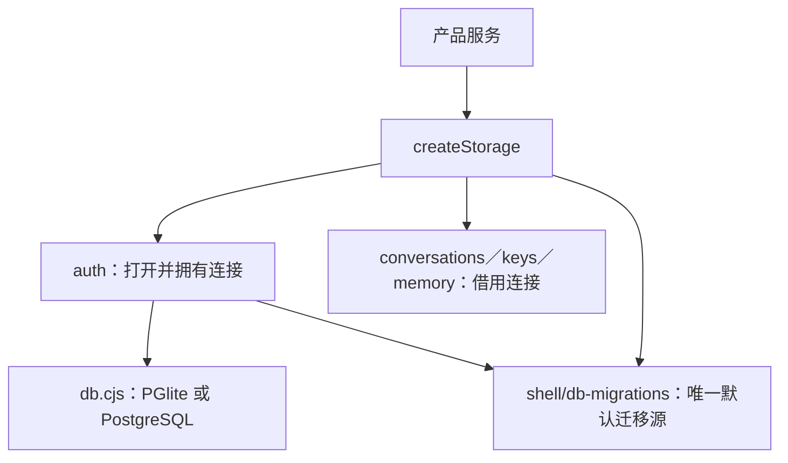

# Storage 接缝：迁移来源与连接所有权

`createStorage()` 复用现有 auth／conversations／keys／memory 仓储，把统一 StorageAdapter 暴露给产品服务；不创建第二份 SQL、会话权威或数据库执行器。2026-10-16 起，默认迁移目录与 `auth.cjs` 的默认值一致，为 **`shell/db-migrations/`**。旧 `shell/storage/migrations/001–006` 保留作历史兼容与升级测试夹具，不能再添加新迁移，也不是生产默认来源。



| 文件／接口 | 责任 |
|---|---|
| `contract.cjs` | Adapter／Repository 形状与事务语义声明 |
| `index.cjs` | 返回 `{adapter,repositories,db,ownsDb,migrate,close}`，不另开数据库 |
| `../db-migrations/` | 按文件名排序的完整 SQL 链；不重命名、不重编号既有迁移 |
| `migrations/` | 旧 001–006 快照，仅历史兼容与测试使用 |
| `migrate()` | 对当前连接重跑默认或显式指定目录，由既有 `dbmod.migrate` 管理已应用记录 |
| `close()`／`adapter.close()` | 同一 Promise、一次委托 `auth.close()`，并发／重复关闭不重复关闭连接 |

## 使用与升级

```js
const { createStorage } = require('./storage/index.cjs');
const storage = await createStorage({ dataDir, masterKeyFile });
try {
  const { auth, conversations, keys, memory } = storage.repositories;
  // 调用既有仓储；升级由初始化自动执行，必要时可幂等重跑。
  await storage.migrate();
} finally {
  await storage.close();
}
```

`migrationsDir` 显式覆盖继续保留，适用于隔离旧版本测试；部署脚本应省略它或指向完整权威目录，不要继续固定旧 storage/migrations。原 001–006 已应用记录按原文件名识别，升级只执行缺失迁移，补上角色、工具调用、授权账户及用量等表／字段，保留用户、Session、对话、归档、记忆与加密 Key。

`ownsDb:false` 表示 Storage 借用 auth 打开的同一连接，而不是调用方可以不关闭；调用方仍需在生命周期结束调用 Storage close。关闭统一从 Storage 入口执行，业务方不要绕过调用 `db.close()` 或 `auth.close()`，以免破坏一次关闭约束。close Promise 拒绝时不会隐式反复关闭，调用方应记录并处理错误。`db` 字段暂保留给既有接线，新增服务优先使用 Adapter／Repository。

## 已验证的边界

`node --test tests/regression/storage-upgrade-test.mjs` 使用临时目录和真实 PGlite：从旧 001–006 建库、写入真实加密测试 Key、用户、Session、归档对话与记忆，关闭后用默认源升级全部迁移，验证原记录、Key 解密、登录态、完整 schema、幂等重跑、再次重启与事务 commit／rollback；同时验证连接对象复用及并发关闭只调用 auth 一次。测试遇到显式 `PT_PG_*` 配置直接失败，不接触外部 PG；依赖缺失失败，不跳过或换成 mock。

本次 PGlite 通过不代表 PostgreSQL、生产 Google 登录、密钥托管或备份恢复通过。测试只使用合成 Key，不请求 PT；非 Windows 现有 Key 存储采用 raw-0600 文件方案，其生产托管与恢复仍需 T18 验收。实际命令、版本与结果见 `docs/refactor/evidence/T01-storage.md`。

## 尚未解决的技术债

- auth 仍拥有数据库连接；Storage 并未改为独立连接管理器。仓储初始化失败后的统一回收、进程关闭时序需后续生命周期治理。
- 仓储方法内部仍使用闭包中的 db，未统一接收外部 transaction handle；`repoUsesTx` 声明不等于所有跨仓储操作已原子化。
- `shell/conversations.cjs` 已是实际权威实现，旧 README 所谓“权威仍在 conv、构建时覆盖”已过期；不能据旧描述恢复或重建分叉。
- 真实 PG 路径需独立测试，不因两种数据库共享入口而推断兼容。迁移执行器的事务／失败语义由 `db.cjs` 管理，本模块不复制实现。
