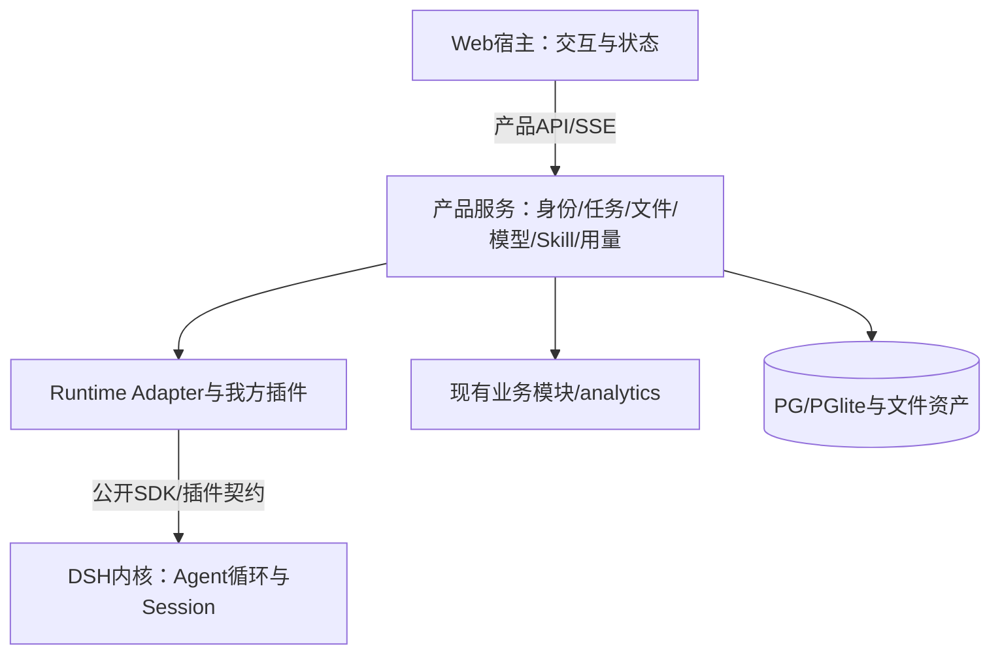

# 北极星项目 · 唯一总文档 v1.11

> 2026-10-16 开工授权补注：本地 v1.11 及 Codex 进度均为工作过程记录，不是正式总文档；正式总文档由用户在整体验收后发布。本文原有“取代／作废”描述不对正式任务包 D、旧架构审查修订版生效。已授权在专用集成分支从 T00 开工，期间不合 main、不部署；此前“仅文档、未授权开发”是编写时的历史状态。当前过程记录见 `docs/refactor/WORKLOG.md`（从仓库根目录定位）。

更新：2026-10-16。**当前阶段：重构前文档已编写，待 PM 审阅；产品重构尚未开始。** 本文件取代用户在本轮提供的总文档 v1.10 及本地 v1.9 的现状／进度口径，旧版只作历史证据。本文是唯一进度来源；任务包、架构和维护说明是详细规格及操作引用，不维护另一份进度。

## 阅读与事实边界

本文四层：时间线解释原因；成果线定位有效资产；进度线给完成判定；全量信息保存范围、架构、权限、接口、维护与治理。每次实质变化同时更新前三层及受影响模块。旧增量篇名 v1.10/v1.11/v1.12 是历史事件编号，不代表本文件发布日期或发布版本；本次统一以标题版本为准。文档版本不等于产品版本。

| 证据 | 本版处理 |
|---|---|
| 用户提供总文档 v1.10 | 作为最新产品决策与历史记录来源；本地未发现该同名文件，不声称已原样存档 |
| 远端 main | 本轮已 fetch，`a2adbee64c326653dbf5bfed3f918dd09f96589d`；最新合并 PR#4，2026-10-16 10:03:10 +08:00 |
| 本地 HEAD | `a49584eed6ca9a4a9f611f164285cf041b4f7d8a`，未切换／覆盖，不能当最新源码 |
| 本轮验证层级 | 静态核查远端代码、文档和原型；未运行产品测试、真实 Google/PT/DSH 或浏览器验收 |
| 历史测试数字 | 只证明当时版本与环境，不升级为本轮或生产验收 |

# 第一层 · 时间线

## 1.1 历史演进与依据

早期数据／归因／看板先完成设计和单元验收，随后发现“运行成功但结论错误、权限未收口、入口未接线”等问题，因此确立独立验收和真实入口验证。产品选择自建业务壳，以 DSH 为 Agent 基座；多租户与 BYOK 随后成为产品边界。以下 #1–#53 保留本地历史记录，其中路径、状态、测试数字均为当时快照，不是当前待执行命令或完成结论。

## 1.2 详细时间线

| # | 时间 | 事件 | **为什么这样变** | 影响的功能 | 影响的文件 |
|---|---|---|---|---|---|
| 1 | 09-09 | 设计阶段完成，界定本期范围 | 要先把"做什么/不做什么"钉死，否则实现期无限蔓延 | 全局 | `北极星范围-本期-v1.2.md` |
| 2 | 09-10 | 数据接入层 1.1~1.5 全部完成 | 里程碑：**这是后面积累数据的地基** | 事件接入、查询、审计 | `backend/src/collect/*`、`backend/src/events/query.ts`、`backend/db/001_init.sql` |
| 3 | 09-10 | **单元 2.1 验收抓到高危：只读代码留写工具后门** | 声称"只读"，但代码里留有能改广告的路径 | 广告数据接入 | `backend/src/ads/ryze-client.ts` |
| 4 | 09-10 | 单元 2.2 时区缺陷 | 只用 `opts.timezone`，缺失时**静默回退 UTC** → 广告数据与用户行为差 9 小时，对不上 | 广告落库、归因 | `backend/src/ads/ingest.ts` |
| 5 | 09-10 | 单元 2.3 缺归因索引 + 折算漏标 | 性能与数据口径问题 | JOIN 归因 | `backend/src/ads/attribution.ts` |
| 6 | 09-11 | **单元 4.1 第 1 次验收不通过（高危：纸面合规）** | ★ **验收者去查了 DSH 源码，发现 `@deepseek-ai/dsh-mcp-client` 的 `syncTools` 会无条件注册 server 全部工具，且配置 schema 里没有 allowlist 字段**。→ 原方案"DSH 直连 Ryze + 配置声明白名单"**根本不成立**，AI 实际有权改广告预算 | AI 层工具权限 | 方案重做：引入**后端只读代理** `backend/src/ads/mcp-proxy.ts` |
| 7 | 09-11 | 单元 4.1 第 2 次验收不通过 | 废弃的直连配置 `mcp-ryze-config.json` **仍占着规范文件名**，误载即复现旧洞 | AI 层安全 | `北极星实现/ai/mcp-ryze-config.json` |
| 8 | 09-11 | 单元 4.1 第 3 次验收通过（**有条件：5 条部署门禁**） | — | — | 见原历史版第三层 |
| 9 | 09-11 | 单元 2.4 历经 **5 次**验收/返工才通过 | 每次不通过都拦下一个真问题 | Funnel API | `backend/src/ads/funnel.ts` |
| 10 | 09-11 | 单元 3.1 抓到：**修好了 bug 但 `index.html` 没接线** | 修正版文件写好了，却没人把它接上 → 4 个 Tab 的三态提示**看不见** | 看板界面 | `frontend/index.html`、`frontend/app.fixed.js` |
| 11 | 09-11 | 单元 3.2 抓到：**排序方向反（null 浮顶）** | 默认按 ROI 降序时，"无法归因"的行**浮到表格最顶部** → 运营误以为它排行靠前。**数字没假，结论是错的** | 素材 Tab | `frontend/tabs/creatives.fixed.js`、`FIX-3.2-排序与空值.md` |
| 12 | 09-11 | 单元 3.3/3.4 抓到 **3 处空值当 0** | 「算不出来」被显示成「0」 | 用户/产品/健康 Tab | `FIX-空值口径专项.md` |
| 13 | 09-11 | **单元 3.4 抓到：审计功能根本没接出 HTTP 路由** ← 跨单元视野 | 单元验收天然看不见"单元之间的缝" | 健康 Tab 恒 404 | `backend/src/audit/route.ts` |
| 14 | 09-11 | **3.2 复验者抓到：我的文档「虚假保证」** | 文档声称"门禁会拦"，实际门禁**没拦**（纸面合规，这次是我犯的） | 门禁机制 | `scripts/preflight-*.mjs` |
| 15 | 09-11 | **顶层 agent 对照发现：后端无统一入口，3 个 API 无法同源访问** | 系统**装不起来** | 部署 | `backend/src/server.ts`（新增统一入口） |
| 16 | 09-11 | 前后端 API 路径一致性检查 | 自查补做（门禁未覆盖的维度） | 全局 | — |
| 17 | 09-11 | 前端 XSS 安全审查 + 后端 SQL 注入审查 | 自查补做（门禁未覆盖的维度），两个维度均通过 | 全局 | — |
| 18 | 09-11 | 交付版打包完成（8095） | 让 PM 能亲手点 | 全部 | `北极星实现/交付版/` |
| 19 | 09-11 | 交付版独立验收 + v1.45 返工 | 交付版层面又发现缺陷 6/7 | 交付版 | `北极星交付版-v1.45-独立验收问题与返工记录.md` |
| 20 | **09-14** | **产品形态拍板：形态 B** = `dsh --profile headless` + **自建业务壳**（不是直接发 DSH 的 Web UI） | 要卖给客户的是"北极星产品"，不是"一个 AI 工具" | 部署形态 | `DSH基座-部署与隔离决策-形态B.md` |
| 21 | 09-14 | **隔离决策**：产品 DSH 绝不与开发者的 DSH 共用 home | 否则**会话、配置、技能互相污染**。且 DSH 硬规则**拒绝 `--host 0.0.0.0`**（原话"会把远程代码执行暴露到网络上"）—— 有意为之，不许绕 | 部署形态 | 同上 |
| 22 | 09-14 | **技能 2「埋点质量」实现**（`tracking-quality`） | 审计系统只看 SS-GTM 侧 3 个事件，**PT 业务侧是另一套 6 事件**，「埋没埋齐」只有这个技能会查 | AI 层技能 | `.dsh/skills/tracking-quality/` |
| 23 | 09-14 | **技能 2 独立验收抓到高危：鉴权失败被伪装成"没数据"** | token 写错时后端返回 401，技能却输出「暂无可审计数据」+ **退出码 0** → **用户以为"系统里没数据"，真相是"凭证错了"** | 技能 2 | `adapter/main.py`（`BackendAuthFailed`） |
| 24 | 09-14 | 技能 2 返工 6 条 + 独立复验 **6/6 通过** | 复验方还做了**破坏性测试**（故意改坏代码，确认测试真的会失败） | 技能 2 | `test/smoke.py`（84 断言） |
| 25 | 09-14 | **4.1 MCP 接线：发现代理是"孤儿模块"** | `mcp-proxy.ts` 写完了，但**全项目没有任何文件 import 它**，也从没启动过 | AI 层工具链路 | `backend/src/ads/mcp-proxy.ts` |
| 26 | 09-14 | **破译 DSH 真实装配机制** | 设计文档假设配置写在 `settings.yaml` 的 `mcp:` 段 —— **是错的**。真实机制是 **`cordis.patch.yml` 分层叠加**（base → surface → profile 自己的 patch → `--patch` 覆盖层） | 部署形态 | `$DSH_HOME/profiles/*/cordis.patch.yml` |
| 27 | 09-14 | **4.1 接线完成 + 独立验收通过（三条红线独立复现）** | 用**替身上游**验机制（真 Ryze 本机不存在） | AI 层工具链路 | `ai/cordis.patch.ryze.yml`、`backend/standin-upstream.cjs` |
| 28 | 09-14 | 验收方证伪 **"报警器是活的"** | 「永远不响的报警器和没有报警器一样」→ 必须先证明检测机制会触发 | 验收方法 | 见本版保留铁律 #9 |
| 29 | 09-14 | **发现 X 平台缺陷**：前端有 X、后端不认 | PM 指出**他们还在投 X**，所以我原本"去掉筛选项"的建议是错的 → **后端实现缺口**，该补不该删 | 全数据链路 | 见单元 X |
| 30 | 09-14 | **发现部署门禁阻断发布（6 项）** | 门禁脚本 09-10 就写好了，**没人跑过** | 部署 | `scripts/preflight-deploy-v2.mjs` |
| 31 | 09-14 | **进度文档收口** | 进度散在两套文档里且主文档过期（v1.44 停更于 09-11，且 原历史版 §2 与 原历史版 §4 **自相矛盾**） | 项目管理 | `北极星总文档-v1.0.md` |
| 32 | 09-14 | **发现总文档自身有 3 处错误**（PM 抓到 1 处） | ★ **PM 拿着文档对照实物，发现自我引用写错** → 顺带自查又找出 2 处（已过期清单漏登记、范围写法会被误读） | 项目管理 | 见本版保留铁律 #14 |
| 33 | **09-14** | **单元 X 独立验收通过** | 验收方**构造了"只改白名单"的反例版本**，实测证实第 4 处改动确属必要 | 全数据链路 | `单元X独立验收报告-a7f3kq.md` |
| 34 | 09-14 | **业务壳建成（形态 B）** | 产品对外的"门"：登录 + 对话 + 看板导航，用户不碰 DSH | 产品入口 | `北极星产品/app/server.cjs`、`start.cjs` |
| 35 | 09-14 | **看板代理打通** | 业务壳原来 `/api/analytics/*` 全 404，补代理后看板出真数（4830 访问） | 归因看板 | `北极星产品/app/server.cjs` |
| 36 | 09-14 | **技能 6 策略建议验收通过** | 真实查询给出 $13,590.03 / 0.34× / 18.3🔴，诚实声明"未补数未编造" | 技能 6 | `.dsh/skills/ad-strategy/` |
| 37 | 09-15 | **★ PM 发现多租户缺失** | 产品 `.credentials.yaml` 与开发者**逐字节相同** → 任何人登录都花开发者的 PT key；单账号、会话存内存 | 全局 | `北极星产品/运行时/dsh-home/.credentials.yaml` |
| 38 | 09-15 | **多租户方案定案** | BYOK（用户自带 key）+ AES-256-GCM 加密落盘 + 产品级；主密钥 DPAPI | 全局 | `北极星产品/架构-多租户与BYOK.md` |
| 39 | 09-15 | **问题与缺口总清单** | 把现存问题 + 缺口盘成一份清单供 PM 审阅 | 项目管理 | `北极星-问题与缺口总清单-v1.0.md` |
| 40 | 09-15 | **归因面板 4 模块新需求** | PM 指出总览页缺：调用渠道 / 全局模型明细 / 国家漏斗对比 / 国家下钻 | 归因看板 | 参考 `base/merged-prototype/attribution/index.html` |
| 41 | 09-15 | **他方 AI 方案评审** | 借鉴"两层映射 + 数据层 RLS 已实现"，纠正"把读数据 token 当模型 key"、"workspace 不用做" | 多租户设计 | 已并入本方案 |
| 42 | 09-15 | **门禁 v3 被发现会漏检** | 修 [7] 引入假阴性：`const u="a//b"` 同行写法漏检真缺陷；[7] 查的是没被加载的文件 | 部署门禁 | `scripts/preflight-deploy-v3.mjs` |
| 43 | 09-15 | **门禁四轮迭代至 v7 通过** | v4→v5→v6→v7 每轮独立证伪，最终通过（剩余为文档化边界）；验收拦住「自家代理被误判直连」等生产级 bug | 部署门禁 | `scripts/preflight-deploy-v7.mjs` |
| 44 | 09-15 | **X 源码化验收通过** | 6 处补丁落源码（含第 4 处泛化逐字节保住 google/meta），逐行 diff + tsc + transpile 三重验证 | X 平台 | `backend/src-x` / `db-x` / `lib-x` |
| 45 | 09-15 | **归因 4 模块通过** | 调用渠道/模型明细接真实 `by_source`/`by_model`（55+54=109 自洽）；广告侧无数据空处理；零编造 | 归因面板 | `归因4模块/overview-modules.js` |
| 46 | 09-15 | **多租户 U1~U5 全部收口** | 身份库(修提权)+key加密(DPAPI)+租户隔离(修假stub)+前端(修口径)+收口(修死代码)，五单元独立验收全过 | 多租户 | `北极星产品/app/server-v2.cjs` |
| 47 | 09-15 | **PM 指出「demo 级」偏差，做生产缺口自查** | 缺注册页/设置入口/needKey提示/会话持久化/看板隔离等 18 项，入本文档 原历史版 §3.3b | 产品 | 原历史版 §3.3b 生产发布缺口清单 |
| 48 | 09-15 | **P0 基础用户页面补齐** | 注册(tab+确认密码+自动登录跳设置) + 「我的Key」入口(红点/提示条) + needKey友好提示；独立验收通过(29/29+端到端) | 前端 | `北极星产品/P0页面-落地说明.md` |
| 49 | 09-15 | **P1 服务端硬化（#5/#8/#9）** | 会话落库重启不丢 + 登录暴力破解防护 + API限流(login/register/chat)；独立验收通过(43/43+独立17项) | 后端 | `北极星产品/P1硬化-落地说明.md` |

### 1.2 续 · P1 收尾批次（v1.8 新增 · 编号接 #49）

> ★ **铁律 #1：实现者 ≠ 验收者**，每条都标注双方 agent；独立验收通过才算 done。
> 验收不通过的，如实记录「不通过 → 修复 → 复核通过」。

| # | 时间 | 事件 | 实现者 agent | 验收者 agent | 结论 |
|---|---|---|---|---|---|
| 50 | 09-16 | **P1 #7 key 有效性校验**：保存 PT key 从「直接加密落库、不验真伪」改为「先验证、通过才落库、不过给中文提示」。实现 = 本地格式校验（fail-fast）+ 对 PowerTokens 做一次最小代价 live 鉴权探测（`GET /v1/models` + Bearer；**真 key→200 / 假 key→500 已实测**，非 2xx fail-closed 拒绝落库）。 | 实现 agent（实现单元） | 独立验收 agent（≠ 实现者） | ❌ 不通过 → 修复 → ✅ 复核通过 |
| 51 | 09-16 | **P1 #10/#11/#13 运维-部署观测**：`logging.cjs` 结构化 JSON 日志（三层零泄露防线）+ `server-v4.cjs`（日志接线 + `/healthz` 探活）+ `Dockerfile` + PM2(`ecosystem.config.js`) + `nginx.conf.example`(TLS 模板) + 部署说明四套。真实自测 **31/31**。 | 实现 agent（实现单元） | 独立验收 agent（≠ 实现者） | ✅ 通过（31/31，零泄露实锤；**抓出 1 项 P1 反代 IP 塌缩，并入收尾**） |
| 52 | 09-16 | **P1 #12/#14 数据安全**：`backup.cjs`/`restore.cjs` 冷备份/还原（rename 探测拒热拷贝 + 还原后 SELECT 1 校验）+ `key-migrate.cjs`/`key-import.cjs` master key 迁移（PBKDF2-SHA256 600k 次 → AES-256-GCM，目标机 DPAPI 重落盘）。真实自测 **26/26**（真实 PGlite + DPAPI）。 | 实现 agent（实现单元） | 独立验收 agent（≠ 实现者） | ✅ 通过（26/26；**2 项 P2 非阻塞**） |
| 53 | 09-16 | **P1-1 + #6 看板隔离**：`ratelimit-v2.cjs` 加 `TRUST_PROXY` 开关 + 信任边界（修反代 IP 塌缩）+ `auth-routes-v4.cjs` + `server-v6.cjs` + `start-x-v2.cjs` A 方案租户头注入（默认关）。 | 实现 agent（实现单元） | 独立验收 agent（≠ 实现者） | ❌ 不通过 → 修复 → ✅ 复核通过（14/14，演示租户数据不断、随机租户零泄漏） |

**#50 与 #53 的「不通过 → 修复 → 复核通过」明细（如实记录）**：

| # | 首验抓到的问题 | 修复 | 复核结论 |
|---|---|---|---|
| 50 | ① P0：`key-routes-v3.cjs` 只在自测里用 require shim 接上，**真实入口未接线** ② P1：live 探活默认开有风险（真实 key 对 `/v1/models` 是否稳定 2xx 未实测确认） | 接线进 `server-v5.cjs`（真实入口替换 require）；live 探活保留可单点替换钩子 + `PT_KEY_LIVE_VERIFY=0` 退化开关 | ✅ 复核通过（真 key→200/假 key→500 已实测；fail-closed 保留） |
| 53 | **P1 跨租户泄漏**：未知租户走 funnel 时，`resolveWorkspaceId` 回落演示工作区 → 泄漏演示租户的 `ads_synced_through`（"碰巧不泄露"而非"结构性隔离"） | `start-x-v4.cjs` + `lib\deps-x-v4.cjs`（`createWorkspaceResolver` **去 fallback、未知租户返回 null**）+ `.dist-x-v4\ads\funnel.js`（`queryFreshness` 对 workspaceId=null 短路）；启动新增 3.5 步幂等兜底写演示租户映射 | ✅ 复核通过（14/14：演示租户 groups=7/roi=7/ads_synced_through 有值、数据不断；随机租户全空且 `ads_synced_through===null`） |

## 1.3 ★ 关键转折点（几个"为什么"值得深挖）

### 转折点 1：为什么引入"后端只读代理"？

**起因**：4.1 第 1 次验收不通过。验收者去读了 DSH 源码，发现：

> `@deepseek-ai/dsh-mcp-client` 的 `syncTools` **无条件注册 server 全部工具**，配置 schema 里**没有 allowlist 字段**。

**推演**：若 DSH 直连 Ryze，Ryze 那边 **150+ 个工具（含大量写工具）会全部出现在 AI 手里**。
设计文档里那句「白名单」在原生插件下**只是纸面声明**，没有任何执行力。

**决策**：DSH **不直连 Ryze**，改连**我方自己写的只读代理**（`backend/src/ads/mcp-proxy.ts`），
**白名单在执行层收口** —— `tools/list` 只回白名单、`tools/call` 白名单外绝不转发。

**验证方式（这是重点）**：不是"看代码写了没有"，而是
- 硬调写工具名 → 必须得 **`Error: unknown tool`**（注册表里根本没它 = "结构上不存在"，而不是"存在但被拒"）
- 上游替身**收到的写工具次数 = 0**
- 且**先证明报警器是活的**，才能说"它一次都没响"

### 转折点 2：为什么产品形态选"形态 B"？

**备选**：A = 直接发 DSH 的 Web UI；B = **自建业务壳**（DSH 调用层早期为 `dsh --profile headless` 一次性 spawn；**2026-09-17 起迁移为「常驻 agent（SDK 模式）」**，见 原历史版 §4.8）。

**选 B 的原因**：要卖的是"**北极星产品**"，不是"一个通用 AI 工具"。
DSH 的 Web UI 暴露的是 DSH 自己的形态，不是北极星的业务形态。

> ★ **2026-09-17 演进**：业务壳定位不变，DSH 调用层从「每次 spawn 一次性 headless」迁移为「**常驻 agent（SDK 模式）**」——每租户一个常驻 DSH 进程，冷启动从 ~6s 降到 ~300ms。详见原历史版 §4.8 与 v1.10 增量。

**连带的硬约束**：DSH 默认把**所有用户数据放在同一个根目录**下 → 产品 DSH 必须**独立 home**，否则与开发者实例互相污染。

### 转折点 3：为什么"技能 2 的鉴权问题"是最值得记的一个？

**现象**：token 写错时，技能输出「暂无可审计数据，请先完成 Workflow2 最小审计」，**退出码 0**。
**真相**：后端实际返回 `HTTP 401 {"code":"UNAUTHORIZED"}`。

**为什么它值钱**：
- **我自己的冒烟测试 60 条全绿，没抓到它** —— 因为我**只测了底层函数，没测用户真正走的那条路**
- **用户会以为"系统里没数据"**，而真相是"你的凭证错了" —— **一个错误的结论，比一个报错更危险**
- 抓它的方法："**断言必须从用户真正走的入口驱动**"

### 转折点 4：为什么 X 平台要"补"而不是"删"？

**我一开始的判断（错的）**：数据库 `CHECK (platform IN ('meta','google'))` 让 X 永远查不出来 → 建议把「X-Ads」从筛选栏去掉。

**PM 的反驳**：**我们还在投 X。**

**正确的推理**：前后端不一致时，**不许默认"多出来的那部分"是错的**。
实测 X 占 **~15.5%** 流量（693 访问 / 175 注册 / 12 充值 / **$1,188**），
而且 X 的种子数据是**故意设计的归因边界用例**：
- `pt-brand`/`img_brand_awareness`/JP → **有花费无充值**
- `pt-launch-us`/`orphan_creative_zz`/SG → **无广告实体 → 未命中**

**结论**：后端不支持 X = **这两个归因边界场景根本跑不起来**。要**补后端**，不是删筛选项。

### 转折点 5：为什么"独立验收"机制值得保留？（战果统计）

**11 个真问题里，没有一条是「代码跑不起来」** —— 全部是「**能跑，但会出事**」：

- 跑得起来，但**算出来的结论是错的**（排序 null 浮顶、空值当 0、时区差 9 小时）
- 跑得起来，但**该看不见的东西看不见**（Tab 没接线、审计没路由、无统一入口）
- 跑得起来，但**该拦住的没拦住**（只读后门、纸面合规、虚假保证）

> **推论**：如果只做"能不能跑"的验收（跑一下、不报错、就通过），
> **这 11 个问题一个都抓不到**，而它们每一个都会在线上变成真实的错误决策或安全事件。

**发现问题靠什么**：

| 手段 | 抓到数量 | 说明 |
|---|---|---|
| 单元独立验收（20 次） | 8 | 主力机制 |
| 验收者的「跨单元视野」 | 1 | 3.4 验收者顺手看了后端路由 |
| 验收者对**交付文档**的核查 | 1 | 3.2 复验者去读了门禁源码 |
| 顶层 agent 前后端对照 / 补做检查 | 1 | 无统一入口 |
| **PM 拿文档对照实物** | 1 | 总文档自我引用写错（v1.1 修正） |

**三点启示**：① 单元验收是主力，但**看不见单元之间的缝**；② **"不信声明、只看实物"** 才能抓到纸面合规；③ **"集成检查"必须独立成一环**。

### 转折点 6：为什么验收方要"自己造一个反例版本"？

**单元 X 的验收方做了一件很对的事**：实现者声称"任务书漏了第 4 处改动"（`attribution.ts`）。
验收方**没有直接信，也没有直接否**，而是**自己构造了一个"只改前 3 处"的版本**（`.dist-x3`）跑了一遍：

> 实测 `platform=x` → **HTTP 200，但分组 = 0**

**结论**：实现者的说法成立 —— 只改 3 处会得到"**看起来成功、其实没数据**"的假成功。

**这就是"试图证伪"的正确姿势**：不接受论断，也不无理由怀疑，而是**构造反例去试**。

---

## 1.4 后续历史与本版更新（承接用户提供 v1.10）

| 编号／时间 | 变化与原因 | 本版事实边界 |
|---|---|---|
| 历史增量，09-17 | 一次性 headless spawn 改为每租户常驻 DSH SDK 插件；避免每轮约6秒冷启动，保留 session 与流式；面板只读分享落地 | 历史报告记录6338ms→306ms、分享7/7；当前不重复宣称已测 |
| 历史增量，09-20 | 真实 PT 多轮／停止／恢复与 PG 实测；修 question 注入、冷启动 sessionId、分岔残留上下文 | 保留历史证据；PG记录为当时临时数据库，不等于生产PG验收 |
| 历史增量，09-21 | 安全修复、Storage/Runtime 接缝、mock与真实适配器，降低单体耦合 | 历史20/20、19/19、14/14、26/26等是分层验证，不是当前全链路验收 |
| #53b，10-16 | 用户v1.10补录DSH升级检查与Adapter机制 | 历史缺口迁移；“升级永远只改一个文件”不成立，本版改为影响分析与完整门禁 |
| #54，10-15 | Google单一登录拍板，删除密码产品路径 | 产品决定成立；远端仍是密码实现，Google待T02 |
| #55–56，10-15 | C包审查及加固合并，以减少流程／安全／报告缺口 | C1–C4已有部分实现；C5仍暂缓，不能按整包全完成 |
| #57–59，10-15 | 媒体失败排查；历史真Key验证指向余额不足；补显式参数与最低像素护栏 | 历史真机结果不代表所有模型／路径永久可用；DSH与autoload参数接线仍需复验 |
| #60，10-15 | 密码流程失败态、恢复等修复 | 已合入旧体系；不改变Google目标，也不继续投入密码新功能 |
| #61，10-16 | 三分支合并与定向核对 | 用户v1.10把媒体合并后main写成1c1b462有误；本轮确认媒体最终合并为a2adbee |
| #62，10-16 | 重申BYOK，禁止生产共享管理员Key | 测试Key不进入仓库／日志；本版不复述尾号或账户余额 |
| #63，10-15 | 一期整体方案与协作方式升级 | Codex整体实现、Claude独立整体验收、部署验证、全新Claude Code完整测试后交付 |
| #64，10-15 | D1多session／D2目录维护进入一期 | 并发优先同用户现有进程多session；先T00验证，失败提交ADR，不擅改为每对话进程池 |
| #65，10-15 | 外部依赖写死值盘点尚未全覆盖 | 本版纳入T17，不再只解决模型名 |
| #66，10-16 | 对齐生产级Web Agent重构范围 | PM发布Skill，三层职责、DSH无侵入、完整用户权限日志、文件与UI均为一期 |
| #67，10-16 | 新增XLS/XLSX/PDF/DOC/DOCX/PPT/PPTX/ZIP与日志原型要求 | 上传、解析、引用、失败与安全均验；已查看根目录原型图 |
| #68，10-16 | 获取今晨main并核查 | C5未完成、Google未实现、conv已清理、迁移双源、报告数组仍共享等订正进入当前状态 |
| #69，10-16 | 编写本版及三份配套文档 | 只交付文档，未开发产品；主Agent+3子Agent整理基线、架构与维护，主Agent集成并自洽检查 |

# 第二层 · 成果线

## 2.1 当前文档入口

| 文件 | 作用／有效性 | 日期 |
|---|---|---|
| [北极星总文档-v1.11.md](北极星总文档-v1.11.md) | 唯一当前事实与进度来源；本文件 | 2026-10-16 |
| [一期生产级重构完整任务包-v2.0](docs/北极星一期生产级重构完整任务包-v2.0.md) | T00–T18、AC01–AC24、批次、分工、迁移和交接规范；待PM审阅 | 2026-10-16 |
| [架构设计与接口契约-v1.0](docs/北极星架构设计与接口契约-v1.0.md) | 三层、DSH边界、数据与事件、身份、模型、文件及版本契约 | 2026-10-16 |
| [部署升级与维护说明-v1.0](docs/北极星部署升级与维护说明-v1.0.md) | 当前可核命令与目标运维门禁、恢复与回滚 | 2026-10-16 |
| [最新基线核查](docs/北极星重构基线核查-2026-10-16.md) | 远端静态证据与历史文档订正，不是第二份进度表 | 2026-10-16 |
| [用量与日志原型](用量与日志.png) | 字段与关系参考，示意数字不作为业务数据 | 本轮已查看 |
| [WB借鉴审查](docs/WB分析文档对北极星一期的借鉴审查-2026-10-15.md) | 借鉴机制及不可照搬边界；非原产品实机验收 | 2026-10-15 |
| [DSH配置快照](docs/dsh-profile-snapshot/README.md) | 已有web profile历史快照；不能冒充生产run-persistent配置 | 以文件记录为准 |

## 2.2 代码与测试入口（最新远端，非本地工作树状态）

| 路径／模块 | 当前作用 | 边界 |
|---|---|---|
| `shell/public/`、`shell/server.cjs` | Web与同源API/SSE | 共享大文件待职责拆分 |
| `shell/auth*`、`keys*`、`tenant.cjs` | 密码身份、凭据、workspace与运行组装 | Google待替换，BYOK生命周期待验 |
| `shell/runtime/contract.cjs`、`dsh-adapter.cjs`、`mock-adapter.cjs` | Runtime公开边界及真实／mock实现 | 扩展返回值尚未完全进入契约 |
| `shell/persistent-runner.mjs` | 我方Cordis插件驱动DSH SDK | 不等于DSH内核；仍有串行队列与共享结果 |
| `shell/conversations.cjs`、`memory.cjs`、`db-pg.cjs` | conv收口后的真实实现 | 不再改conv旧路径 |
| `shell/db-migrations/` | 真实server显式使用，001–010范围 | 存在历史两个002命名，不重编号 |
| `shell/storage/` | 存储契约与适配 | 默认迁移源仍001–006，待统一 |
| `shell/tools/`、`shell/permissions/` | 工具目录、权限与日志接线 | C5校验未完成，内核入口一致性待验 |
| `shell/model-catalog.cjs` | 模型目录与AUTO初版 | 能力来源、权限、真正可执行尚待升级 |
| `business/`、`analytics/` | 现有业务与数据服务 | 公开接口保留，不扩大广告连接范围 |
| `.github/workflows/ci.yml`、`scripts/run-regression.mjs` | Node20/22回归接线 | 本轮未执行，不声称CI全绿或已设强制保护 |
| `tests/regression/`、`shell/runtime/dsh-live-*.mjs` | 聚焦回归、真实DSH契约与冒烟入口 | 真实测试需隔离环境、自己的Key和预算 |

## 2.3 过期与历史来源

本地[总文档v1.9](北极星总文档-v1.9.md)、用户消息中的v1.10、旧总进度／实现任务进度系列全部退出当前事实来源；本地[任务包v1.0](docs/北极星一期Agent完整开发任务包-v1.0.md)由v2.0取代。[一期架构讨论](docs/一期Agent能力方案与架构审查-2026-10-15.md)与[多Session讨论稿](docs/DSH多Session并发与PT模型目录自动维护-讨论稿.md)只作背景，C/D等旧包重复范围归入v2.0。历史表中Windows路径、旧脚本、旧版本文件名不保证当前仓库存在，不作为执行入口。用户提供而仓库无同名文件的Google/C/D任务书与修订稿只标为用户提供的历史来源，不伪造本地链接；不删除用户资产。

# 第三层 · 进度线

## 3.1 当前结论

**重构文档已编写，待PM审阅；产品重构未开始；尚不能宣称生产级一期交付。** 历史已实现能力需复用，最新静态发现不等于独立验收通过。各包状态只在本节更新，详细规格见任务包。

| ID | 范围 | 当前状态／后续 |
|---|---|---|
| T00 | 最新基线、DSH/PT关键验证、契约与预算 | 已完成文档阶段静态核查；真实验证未开始 |
| T01 | 存储／迁移／打包 | conv已收口；迁移双源、PG与安装待复验 |
| T02 | Google与BYOK | Google未实现；保留旧资产，密码入口待替换 |
| T03 | 持久run／事件／恢复／预算 | 缺正式闭环 |
| T04 | 同进程多session并发与取消 | 未完成；先技术验证，不只改锁 |
| T05 | 工具校验、报告与执行边界 | C3/C4部分已有；C5与统一入口待做 |
| T06 | 能力目录每日增量 | 初版已有，来源／未知／权限等待升级 |
| T07 | AUTO与热会话切换 | 初版已有；新用户与真实执行一致性待验 |
| T08 | 图片／音视频理解与媒体 | 生成修复已合并；理解、多输入与参数路径待验 |
| T09 | 全部办公格式与ZIP | 当前文档入口仅TXT/MD/CSV；扩展待做 |
| T10 | 产物持久化／预览／导出 | 预览已有；归属、版本、历史、并发待收口 |
| T11 | 日志与真实用量 | A1–A5已有；累计语义、unknown、原型字段待补 |
| T12 | 上下文与记忆 | 基础已有；压缩、来源、删除失效待补 |
| T13 | PM发布Skill | 基础加载已有；版本、更新、依赖与授权待补 |
| T14 | 搜索／网页／来源 | 现有能力待核生产profile与真实入口 |
| T15 | CI／浏览器／独立验收 | CI回归已接；全量场景与跨平台待验 |
| T16 | 三层与前后端／DSH边界 | 本轮写规格，未重构代码 |
| T17 | 外部依赖值全局治理 | 本轮明确纳入，待盘点整改 |
| T18 | 部署／恢复／升级／维护 | 本轮写说明，当前缺失操作需实施与验证 |

## 3.2 已有成果的诚实边界

数据／看板历史单元、X补齐、只读代理、多租户、对话历史、流式、停止、分岔、分享等已有历史实现与测试记录；本轮不撤销历史结果，也不认定最新发布已经验收。C1已接回归；C2环境收窄与可选POSIX uid/gid不是跨平台完整沙箱；C4数组不是run局部隔离。媒体PR#4已合并而main为a2adbee；测试额度不足的历史排查不证明所有媒体错误都源于余额。历史路径和脚本在当前仓库缺失时，T18重建真实可执行说明。

旧文档“并发／目录AUTO／预览／日志／conv均属二期”的说法失效：这些能力已纳入一期或已有初版。旧“密码重置／强度待补”由Google单一登录取代；邀请成员、共享workspace、定时业务流、外部通知与复杂编排仍为二期。

## 3.2b 历史遗留风险登记（尚未在最新环境复验）

| 遗留 | 当前处理与归属 |
|---|---|
| restore 校验失败 exit 0、缺备份目录参数 | 旧脚本当前未找到；T18新入口必须失败非零且支持明确源目录，真实恢复验证 |
| 日志脱敏只匹配精确字段、演示启动横幅输出secret | T05/T11/T18检查变体／嵌套／异常及启动输出，不能仅靠黑名单 |
| healthz访问日志噪声、自测弱断言、旧落地前置不符 | T15/T18验证触发与降噪，替换过期入口，不继承弱通过结论 |
| 反代IP信任、未知租户回落演示数据 | T02/T05/T18真实部署负向测试，确认伪造头拒绝与RLS；没有租户数据明确空态 |
| 正式域名／证书、PT门户确切地址与业务数据接入 | T17/T18核实来源与负责人；模板不等于真实上线，演示与私有数据分开 |
| X回归映射脚本误判、ROI层未完整验证 | T15只在受影响业务范围补验证，真Ryze仍二期外部依赖，不冒充已接通 |
| 历史Markdown／延迟／分享／图片等局部待测 | T10/T15以最新版本真实入口核对，不按历史缺陷列表盲目返工 |

## 3.3 依赖与交付判定

真实Google客户端／回调、测试用户Key和能力权限、PT音视频理解端点、价格／账单、目标部署与PG配置均须对应实物证据；秘密不进文档。无法取得时可继续不依赖部分，但该验收标阻塞。并发路径受T00验证门禁约束；账号迁移按保留ID与资产原则执行，任何破坏性清理另行决定。主Agent+最多3子Agent，分工见任务包，非实际开发已启动。

完成要求：AC01–AC24证据齐全，独立验收者给可交付结论，Claude整体验收与全新Claude Code最终测试完成，部署／恢复／回滚可复现；提交、推送、合并、预发布、生产交付分别记录。当前仅有文档，不满足上述产品条件。

# 第四层 · 全量信息模块

## 4.1 产品与范围

北极星是基于DSH的Web Agent产品，保留PowerTokens归因／GA／埋点等业务能力，以完整Agent体验供内部员工使用。仅Web宿主，每员工独立账号、租户、workspace与BYOK。模型调用经PT，不静默改用其他供应商。PM添加发布Skill，员工选择和使用已发布技能，不开放自助安装或扩权。目标功能覆盖对话／工具／联网／记忆／多模态／文档／产物／并发／任务可靠性／用户权限／日志用量。

文件输入：TXT、MD、CSV、XLS、XLSX、PDF、DOC、DOCX、PPT、PPTX、ZIP；其中PDF含扫描OCR，旧Office需受控转换，ZIP需目录与受控解析。输入、解析、理解、引用四层分别验，不只放开上传。输出一期MD/HTML/PDF/CSV/XLSX及图片视频；不自动扩张成任意格式或专业剪辑工具。

## 4.2 架构与DSH原则

三层是职责边界，不强制三个服务。当前跨进程JSON-lines不是ACP over HTTP；不为复制WorkBuddy改造内核。只通过受支持SDK/CLI/插件机制及Adapter，不改DSH源码、vendor、node_modules；我方插件可维护。旧“业务壳/基座/业务线”是产品资产分类，与本版运行三层不同；业务线仍挂产品服务，不成为第二个内核。

前后端职责与产物分离，一期允许同源部署。当前原生JS/HTML无需引入编译器，独立构建指独立准备／检查产物。独立部署也能经反代同源，不必然换cookie或引入CORS。DSH升级先锁候选包、审影响、契约、真实冒烟、受影响回归、预发布与回滚，全通过再替换；不自动漂移，不保证只改一个适配文件。

并发优先现有每租户进程内多session；同对话有序、不同对话限额并行；默认目标每用户2个名额，可配置。先实测事件归属、取消、生命周期、cwd与凭据，失败列ADR并重新对齐，不擅自换架构。共享进程崩溃影响多个session须真实标中断。

## 4.3 数据、身份与执行契约

稳定关联链为用户／租户→conversation→run→attempt／tool call→attachment／artifact→usage。服务端session决定身份，模型与请求体不能授权tenant。DSH持有热会话轨迹，数据库持有产品持久事实；UI消息为展示投影，不另执行一遍工具。Runtime当前接口run/abort/closeSession/close，事件delta/step/done/error/aborted，目标兼容扩展runId、单调seq、工具／附件／产物／usage事件和重连游标。业务任务状态和DSH session状态职责分开。

持久任务不随切页取消；停止必须等待真实收敛；未知付费外部任务先核查，不能自动重提。幂等键不能保证供应商端恰好一次。产物显式按run/call注册，mtime扫描仅兜底。旧迁移不重编号、统一迁移源；PG显式配置失败不能静默换库。

Google以验证iss+sub建稳定身份，邮箱不是静默合并依据；旧资产不无授权删除。BYOK服务端加密保管，不向浏览器或DSH共享环境暴露无关秘密；换Key与撤销绑定明确生命周期。文件／命令／网络的真实约束不等于仅设cwd，外部资料和Skill不能改平台权限。

## 4.4 用量日志与UI

根目录原型含今日工具调用、今日／本月Token、本月费用与额度、模型分布、时间／用户／工具／类型／输入／结果／耗时／Token／状态。按字段与关系验收，不强制复制视觉；示意数字不灌入。补实际模型及run/call/request定位。用户只看自己授权范围，图中多成员示例不引入二期协作。

未知不为零，估算不为实际扣费；Token与媒体单位分开；心跳独立计量；不能将未知工具一律标Skill。视频阶段／等待／耗时、上传解析／失败／取消、产物历史、错误态与基础移动交互均在一期。必要UI整改纳入对应任务，不借整改扩大未确认权限或计费语义。

## 4.5 历史业务契约与缺陷

保留历史教训：funnel是顶层groups而非data.groups；from/to是毫秒；limit静默钳制、事件名词表不一致、空值当零、时区与ROI来源差异需按目标模块实测，不凭旧表断言当前仍坏。只读代理应在执行层限制写工具，不能只写配置声明。真Ryze暂缓，既有仿真／演示数据必须标识；SS-GTM原始质量与去重pt_events不能混用以推断上游重复率。既有GA等业务契约保留，不把本轮扩张为全部广告连接交付。

旧静态包曾有artifacts反斜杠路径失败（74/75）及缓存隔离风险，属于历史待复验；本轮未重跑。所有当前缺口和责任统一在T00–T18，不让历史“已完成”和新“待验”相互覆盖。

## 4.6 ★ 铁律（14 条，每条都是踩坑换来的）

| # | 铁律 | 来源 |
|---|---|---|
| 1 | **实现者 ≠ 验收者**，每单元独立验收，通过才解锁下游 | 项目治理 |
| 2 | **"验文本" ≠ "验行为"** | 曾发现"前端断言只检查字符串存在" |
| 3 | **一个永远不会失败的检查，比没有检查更糟** | 多个空转检查；X 验收又遇到"会误报失败的检查" |
| 4 | **断言必须从"用户真正走的入口"驱动** | 技能2 鉴权高危问题的根因 |
| 5 | **SKILL.md 里每句"我能做 X"，都要能指到实现代码 + 验证断言** | 多次过度声称 |
| 6 | **滚动时间窗系统里，对账前必须先固定 `from`/`to`** | 差点误报的"跨组件不一致" |
| 7 | **鉴权失败 ≠ 没有数据** | 技能2 高危问题 |
| 8 | **证据不足时不许给分/给结论** | 60% 权重未知仍亮绿灯 |
| 9 | ★ **任何「某件事没有发生」的结论，必须先证明检测机制是活的** | 4.1 报警器验证 |
| 10 | ★ **实现者的"自我辩解"必须交给独立方裁定，哪怕它是诚实的自曝** | 4.1「等价替代」裁定；X 的"第 4 处改动"也是这么裁定的 |
| 11 | ★ **验收不只查"对不对"，还要查"会不会被读错"** | 4.1 数字口径问题 |
| 12 | ★ **发现前后端/组件间不一致时，不许默认"多出来的那部分"是错的 —— 先问需求** | X 平台筛选项（AI 差点误删） |
| 13 | ★ **报告"某处失败"之前，先确认这个判断的适用范围（哪个目录、哪个版本）** | 门禁 [5][7] 误读 |
| 14 | ★ **总文档每次发布前必须做「自洽性自查」**：① 自我引用是否指向本文件 ② 提到的每个文件名是否真实存在 ③ 被取代的文档是否都进了"已过期"清单 ④ 状态描述是否与进度线一致 | **PM 抓到总文档自我引用写错（v1.1 修正）** |

> **第 12、13 条是 AI 在同一天犯的两次同类错误** —— 都是**没先确认"判断的适用范围"就下结论**。
> **第 14 条来自 PM** —— **"唯一事实来源"的另一面是"唯一的错误来源"，所以更要自查。**

## 4.7 维护与交付入口

详见维护说明。当前依赖实际为本地vendor DSH tgz、版本0.1.1-rc.2；只vendor顶层不代表传递依赖全离线。配置快照需补生产run-persistent，与开发web分开。DPAPI不是Linux通用方案；主密钥、资产与DB恢复需一起设计。不能因历史说明写过backup/restore或部署门禁，就认定当前路径存在或命令可运行。

默认不因为历史延迟分析开启付费心跳；须实测原因、配置授权与预算。媒体域名/CSP、受控下载、过期链接有统一策略；费用数据缺失明确标未接入。日志不能保存Key、cookie、OAuth code或完整私有附件。部署、旧数据迁移、备份恢复、版本回滚均需目标环境实跑。

## 4.8 本版文档自洽检查与后续

自我引用指向v1.11；当前三份实施文档相互引用；进度仅本文件；旧文档退出现状来源；历史表保留并明确环境时效；原型已查看。当前源码事实均以最新远端静态证据为边界；没有产品测试与发布结论。下一步为PM审阅四份核心文档，之后另行授权实施；执行前再fetch并重核差异。完整工程估算待T00，旧60–100人日不覆盖所有新增范围，不作为AI日历承诺。

## 版本记录

| 版本／来源 | 处理 |
|---|---|
| v1.0–v1.9及历史增量 | 保留原文件作历史，不继续维护其现状表 |
| 用户提供v1.10（2026-10-16） | 收入Google、C/D、媒体、BYOK、升级与协作决定；错误现状按远端订正 |
| 本版v1.11（2026-10-16） | 重构前文档收口；T00–T18、AC01–24；三层／DSH门禁／格式／UI／分工／运维统一；仅文档完成待审 |
